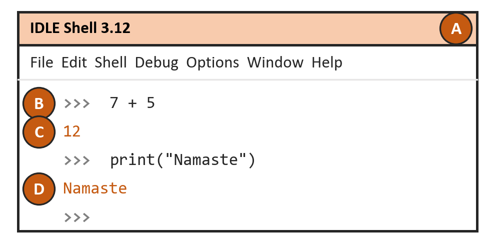
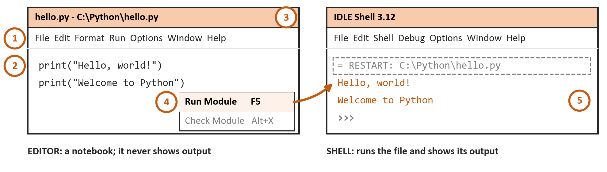

# Your first program in IDLE

*Get started. IDLE comes with Python: the exam uses it. First the shell, then a saved program (section 6.3 of the book).*

## 1. The shell: one line at a time {#shell}

{ width="420" }

| Part | What it is |
|:-:|---|
| **A** | the shell window |
| **B** | the prompt `>>>`: Python is waiting |
| **C** | the answer to `7 + 5`, at once |
| **D** | the output of `print("Namaste")` |

- ✅ **Do:** type `7 + 5` and press Enter; then `print("Namaste")`.
- ⚠️ **Watch out:** work in the shell is **not saved**.

## 2. A saved program: five steps {#script}

{ width="640" }

1. **File → New File**: the editor opens.
2. Type the program.
3. **File → Save** (Ctrl+S), name it `hello.py`.
4. **Run → Run Module** (F5): the file goes to the shell.
5. Read the output in the **shell**: first IDLE's `= RESTART` line, then your output.

```python
print("Hello, world!")
print("Welcome to Python")
```

*Output:*

```text
Hello, world!
Welcome to Python
```

- ✅ **Do:** save in one folder, for example `Documents\Python`, with names like `marks_total.py`.
- ❌ **Don't:** type `>>>` or line numbers into the editor: a script holds only the statements.
- 👀 **Why does the output appear in the other window?** The editor only holds the text; F5 hands the file to the shell, which runs it.

Problems? [When things go wrong](when-things-go-wrong.md).
