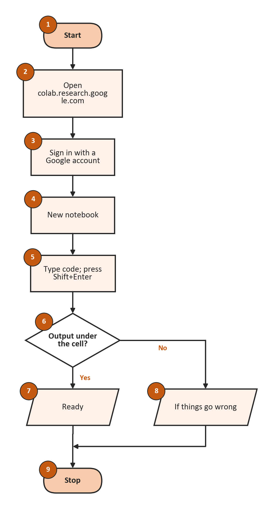
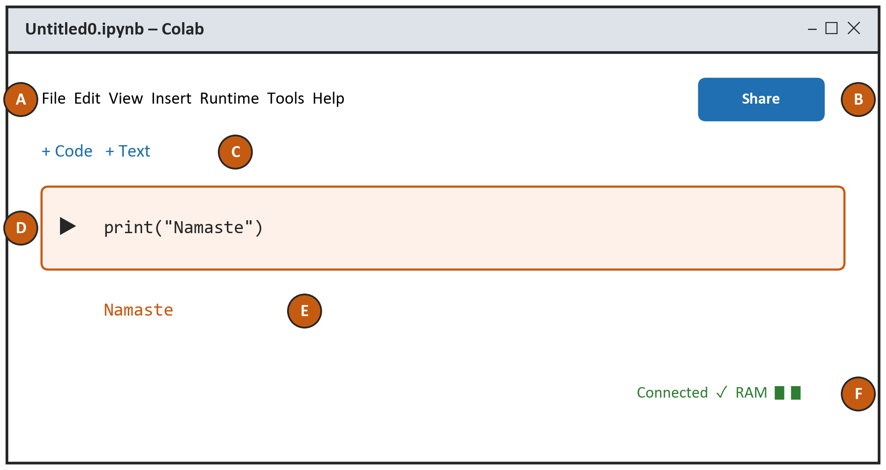

# Google Colab, step by step

*Get started. Python in your browser, on Google's computers: nothing to install. Good on a Chromebook, a phone, or a computer where you may not install programs.*

!!! abstract "The whole flow"

    { width="360" }

    The numbers in the circles are the flowchart's box numbers (Start is box 1). Each step below says its box:

    1. **Box 2** → [Step 1: Open Colab and sign in](#co-start)
    2. **Box 5** → [Step 2: Run your first cell](#co-run)
    3. [Step 3: Save, share, and open the book's notebooks](#co-save)

    **Something went wrong?** [Go to "If things go wrong"](#if-things-go-wrong)

**Before you start.** An internet connection · a Google account · a browser.

## Step 1 (box 2): Open Colab and sign in {#co-start}

Open **colab.research.google.com** in Chrome, Edge or Firefox (on a laptop, a Chromebook or even a phone). Sign in with a Google account. Press **New notebook**.

- ✅ **Do:** use a Google account you can sign in to again: your notebooks are kept in its Drive.
- ❌ **Don't:** type passwords, phone numbers or other private data into a notebook you share.
- 👀 **You should now see:** a page with one empty code cell.

*Problem at this step?* [It asks me to sign in, or a school account is blocked](#p-co-signin)

## Step 2 (box 5): Run your first cell {#co-run}

{ width="640" }

*A simplified drawing; your screen may look a little different.*

| Part | What it is |
|:-:|---|
| **A** | the menus: **Runtime → Run all** runs every cell |
| **B** | **Share**, like a Google Doc: send a link to your teacher |
| **C** | add a **code** cell or a **text** cell |
| **D** | the ▶ button runs the cell (or Shift + Enter) |
| **E** | the output, under the cell |
| **F** | connected to Google's computer |

Type `print("Namaste")` and press ▶ (or **Shift + Enter**). The first run takes a few seconds: Colab connects to one of Google's computers.

- ⚠️ **Watch out:** the last line of a cell shows its value even without print, unlike a script ("the Colab trap").
- 👀 **You should now see:** `Namaste` under the cell.

*Problem at this step?* ["Runtime disconnected"](#p-co-disconnected)

*Problem at this step?* [NameError for a name you made](#p-co-nameerror)

## Step 3: Save, share, and open the book's notebooks {#co-save}

- **Save:** Colab saves to your Google Drive (folder *Colab Notebooks*) by itself; **File → Save** saves now.
- **Open this book's notebooks:** each chapter's notebook page has an **Open in Colab** link; it opens the notebook from GitHub. Then **File → Save a copy in Drive** to keep your own copy.
- **Download:** **File → Download → Download .py** gives the code as a Python script for IDLE.

- ✅ **Do:** save a copy before you change a book notebook.
- 👀 **You should now see:** your notebook in Google Drive → *Colab Notebooks*.

## If things go wrong {#if-things-go-wrong}

### It asks me to sign in, or a school account is blocked {#p-co-signin}

- **What you see:** Colab will not open a notebook without signing in, or your school account has Colab switched off.
- **Why:** Colab saves notebooks in your Google Drive, so it needs a Google account; schools can switch it off.
- **Fix:** Sign in with a personal Google account (with a parent's permission), or ask your teacher.

### "Runtime disconnected" {#p-co-disconnected}

- **What you see:** A message says the runtime disconnected; your names and values are gone.
- **Why:** An idle notebook is stopped after a while to free Google's computers.
- **Fix:** Press **Connect**, then **Runtime → Run all** to run every cell again from the top.

### NameError for a name you made {#p-co-nameerror}

- **What you see:** A cell says a name is not defined, though you made it in another cell.
- **Why:** The cell that makes the name was not run (or was run before a disconnect).
- **Fix:** Run the cells in order from the top (**Runtime → Run all**).

## Not needed in Class XI {#later}

- **GPU and TPU** (Runtime → Change runtime type): for training AI models, later.
- **Installing extra libraries** (`!pip install …`): not needed for this book.
