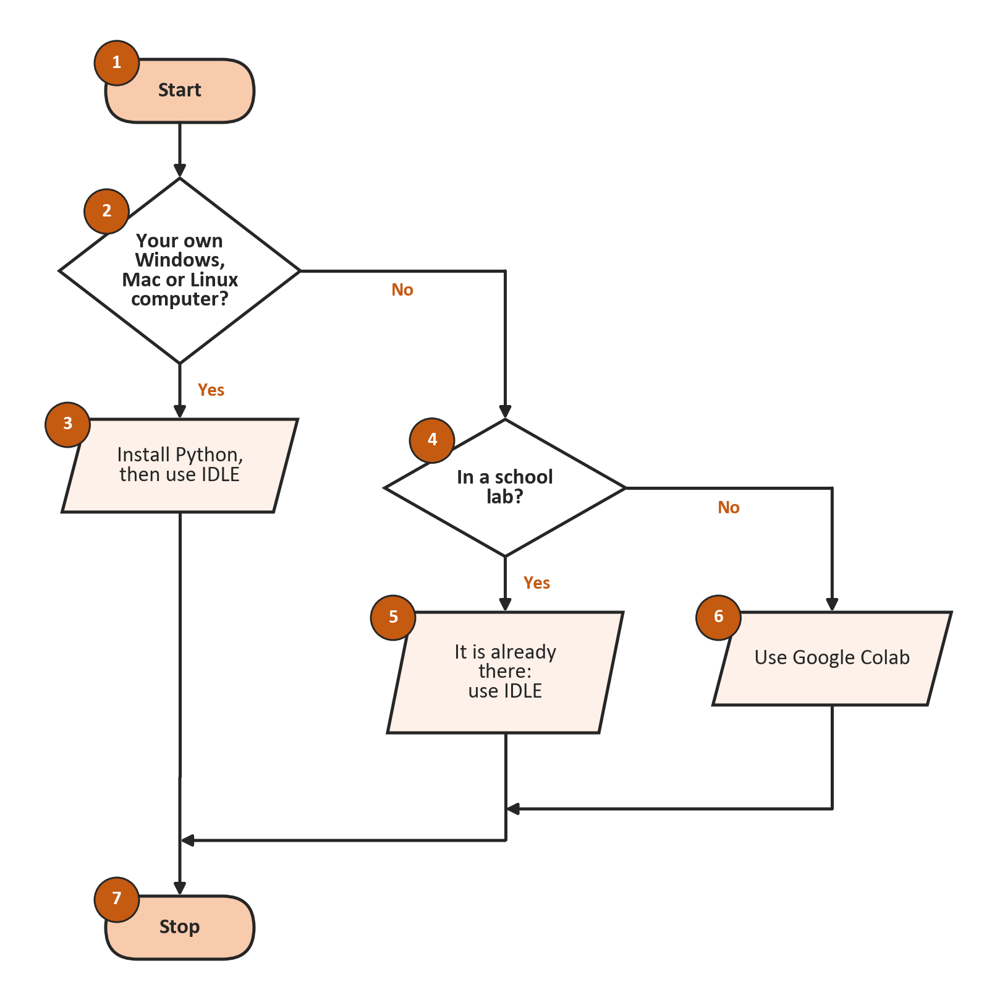

# Start here: set up Python

*Get started. Before Chapter 6 you need a place to write and run Python. Answer one question, then follow the page it points to.*

{ width="420" }

| Your situation | Do this | Then |
|---|---|---|
| Your own **Windows** laptop or desktop | [Install Python](install-python.md) (10 minutes) | [Your first program in IDLE](first-program-in-idle.md) |
| A **Mac** or **Linux** computer | [Install Python: Mac and Linux](install-python.md#mac-linux) | [Your first program in IDLE](first-program-in-idle.md) |
| A **school lab** | nothing: Python and IDLE are already there | [Your first program in IDLE](first-program-in-idle.md) |
| A **phone**, a **Chromebook**, or a computer where you may not install | [Google Colab](google-colab.md): nothing to install | the book's Colab notebooks |

**Later, if you want more:** [VS Code](vs-code.md) for bigger projects · [Jupyter Notebook](jupyter.md) for notebooks without the internet · [Where does my code run?](where-does-my-code-run.md) · [When things go wrong](when-things-go-wrong.md).

## Which tool, for what? {#tools}

| Tool | Kind | Install? | Best for | In the exam? |
|---|---|:-:|---|:-:|
| IDLE | desktop IDE | comes with Python | learning; the exam | **yes** |
| Thonny | desktop IDE | yes | beginners: shows each value as it changes | rarely |
| VS Code | desktop IDE | yes | bigger projects | rarely |
| Jupyter Notebook | browser, local server | yes | notebooks without the internet | no |
| Google Colab | browser, cloud | no | practice anywhere | no |

## Thonny, in short {#thonny}

Thonny is a free Python editor made for beginners at the University of Tartu (Estonia). It installs with its own Python. Its special feature is the **Variables** pane (View → Variables): when a program runs step by step (the bug button), it shows every name and its value, as on this site's "names and objects" page. Many schools abroad use it; in India most labs and the practical exam use **IDLE**. To try it: **thonny.org** → download for Windows → install → type a program in the top pane → press the green **Run** button.
