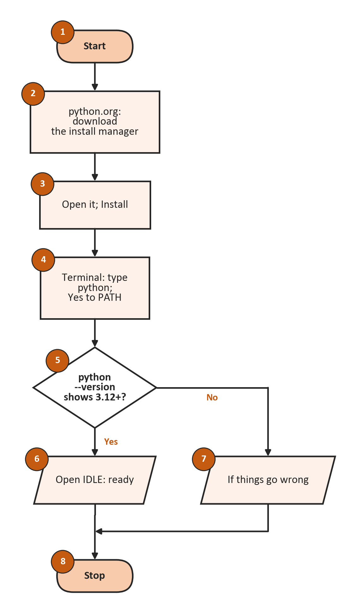
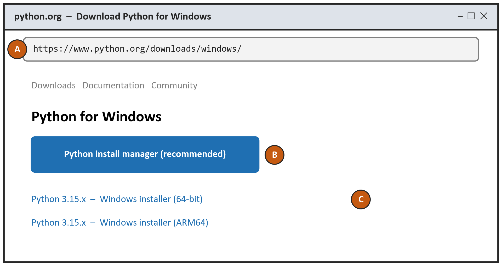
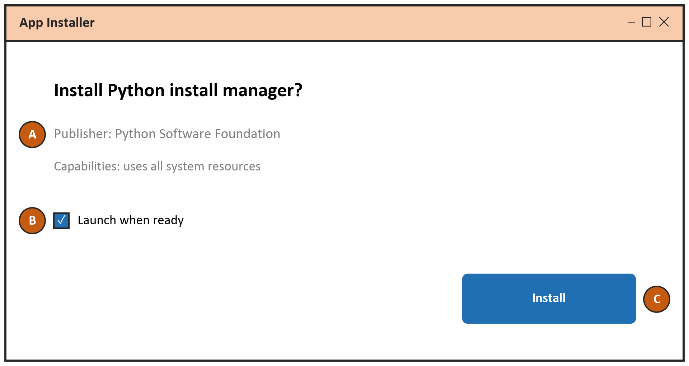
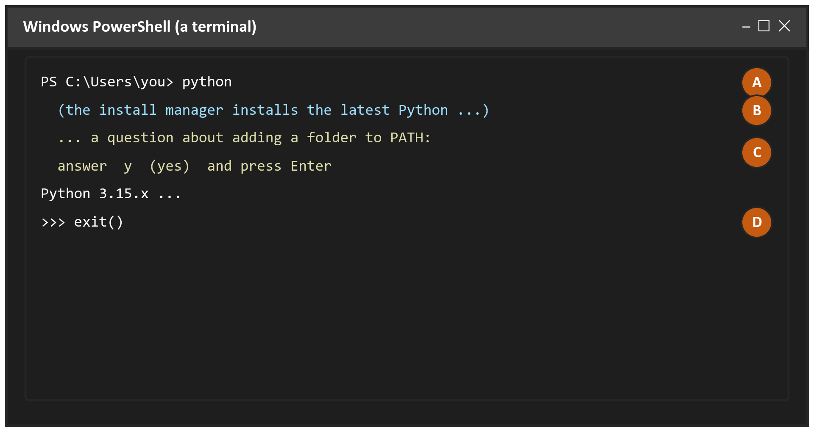
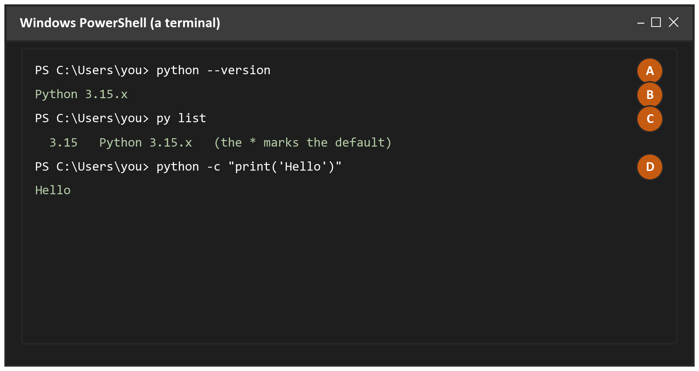
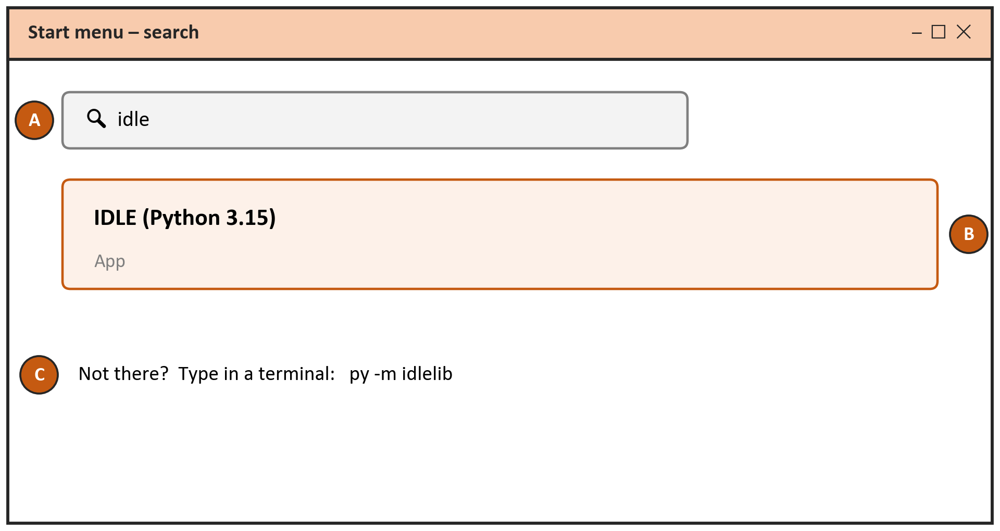
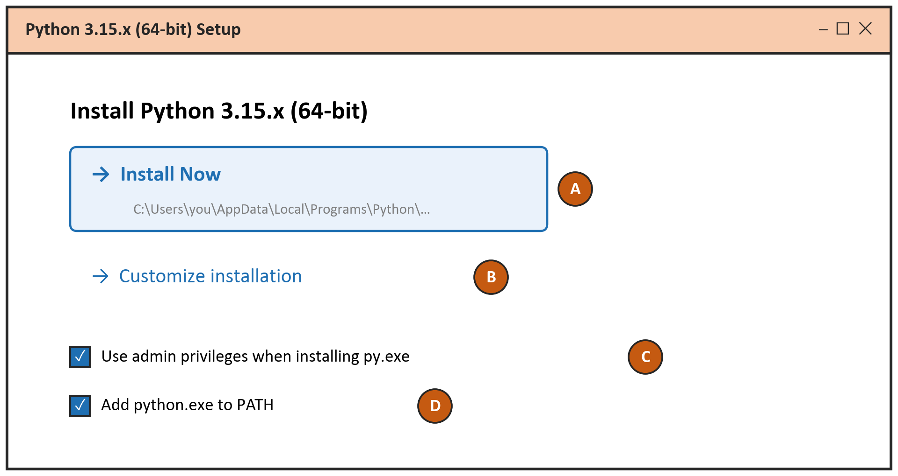

# Install Python on Windows, step by step

*Get started. Ten minutes, an internet connection and about 100 MB of space. Follow the steps in order; each step says what you should see when it is done.*

!!! abstract "The whole flow"

    { width="360" }

    The numbers in the circles are the flowchart's box numbers (Start is box 1). Each step below says its box:

    1. **Box 2** → [Step 1: Download the Python install manager](#step-download)
    2. **Box 3** → [Step 2: Install it](#step-install)
    3. **Box 4** → [Step 3: Type python once: it fetches Python](#step-first-run)
    4. **Box 5** → [Step 4: Check that it worked](#step-check)
    5. **Box 6** → [Step 5: Open IDLE](#step-idle)

    **Something went wrong?** [Go to "If things go wrong"](#if-things-go-wrong)

**Before you start.** Windows 10 or 11 · an internet connection · about 10 minutes · permission to install programs on this computer. On a Mac or Linux? See [Mac and Linux](#mac-linux). Already have Python? [Check it in one minute](#already).

## Step 1 (box 2): Download the Python install manager {#step-download}

{ width="640" }

*A simplified drawing; your screen may look a little different.*

| Part | What it is |
|:-:|---|
| **A** | the address bar: it must say **python.org** |
| **B** | the **Python install manager** button: the way the makers recommend since Python 3.14 |
| **C** | the older full installers (see "Another way" below) |

- ✅ **Do:** type the address yourself: **python.org**, then **Downloads → Windows**.
- ❌ **Don't:** download Python from any other site or from an advertisement.
- ⚠️ **Watch out:** the same install manager is also in the **Microsoft Store** ("Python Install Manager"); either is fine.
- 👀 **You should now see:** a file in your **Downloads** folder.

*Problem at this step?* [The download does not start, or is blocked](#p-no-download)

## Step 2 (box 3): Install it {#step-install}

{ width="640" }

*A simplified drawing; your screen may look a little different.*

| Part | What it is |
|:-:|---|
| **A** | the publisher: **Python Software Foundation**, the makers of Python |
| **B** | start it when ready |
| **C** | the **Install** button |

- ✅ **Do:** double-click the downloaded file, check the publisher (A), then press **Install** (C).
- ❌ **Don't:** install a file whose publisher is not the Python Software Foundation.
- ⚠️ **Watch out:** a school computer may ask for an administrator password.
- 👀 **You should now see:** the installer finishes in a minute.

*Problem at this step?* ["You need administrator permission"](#p-admin)

## Step 3 (box 4): Type python once: it fetches Python {#step-first-run}

{ width="640" }

*A simplified drawing; your screen may look a little different.*

| Part | What it is |
|:-:|---|
| **A** | you type `python` and press Enter |
| **B** | the install manager downloads and installs the newest Python by itself |
| **C** | the **PATH question**: answer **y** (yes) |
| **D** | the `>>>` prompt: Python is running; type `exit()` to leave |

**Open a terminal:** press the Windows key, type **PowerShell** (or **Terminal**), press Enter.

**What "PATH" means:** PATH is the list of folders where Windows looks for a command. Yes adds Python's folder to the list, so `python` works in every terminal.

- ✅ **Do:** answer **yes** to the PATH question.
- ❌ **Don't:** close the window while it is downloading.
- ⚠️ **Watch out:** the exact words of the question may differ from the drawing.
- 👀 **You should now see:** `>>>`, Python's prompt.

*Problem at this step?* [Typing python opens the Microsoft Store](#p-store-opens)

*Problem at this step?* ["python is not recognized …"](#p-not-recognized)

## Step 4 (box 5): Check that it worked {#step-check}

{ width="640" }

*A simplified drawing; your screen may look a little different.*

| Part | What it is |
|:-:|---|
| **A** | `python --version` asks Python for its version |
| **B** | the answer: **3.12 or later** is what this book needs |
| **C** | `py list` lists every Python on the computer |
| **D** | a first one-line program, run from the terminal |

On the computer that checked this page, `python --version` printed `Python 3.12.7` and the one-line program printed `Hello`.

- ✅ **Do:** open a **new** terminal first (a terminal reads PATH only when it opens).
- 👀 **You should now see:** a version number, and `Hello`.

*Problem at this step?* ["python is not recognized …"](#p-not-recognized)

*Problem at this step?* [An old version answers](#p-old-version)

## Step 5 (box 6): Open IDLE {#step-idle}

{ width="640" }

*A simplified drawing; your screen may look a little different.*

| Part | What it is |
|:-:|---|
| **A** | search for **idle** |
| **B** | IDLE: Python's own simple editor, used in the practical exam |
| **C** | another way to open it |

- ✅ **Do:** pin IDLE to the taskbar (right-click → Pin) so you find it quickly.
- 👀 **You should now see:** the IDLE shell with `>>>`. Next: [Your first program in IDLE](first-program-in-idle.md).

*Problem at this step?* [IDLE is not in the Start menu](#p-no-idle)

## Another way: the classic installer {#classic-installer}

The older full installer (a `.exe` file) is still offered for **Python 3.15 and earlier**; it stops with Python 3.16. If your school uses it:

{ width="640" }

| Part | What it is |
|:-:|---|
| **A** | **Install Now**: the usual choice |
| **B** | Customize: not needed |
| **C** | py.exe, Python's launcher (keep it ticked) |
| **D** | **Add python.exe to PATH**: **tick it** before pressing Install Now |

- ❌ **Don't** forget box **D**: without it, `python` is "not recognized" in a terminal.
- 👀 At the end, **Setup was successful**. Then check it as in [Step 4](#step-check).

## Mac and Linux (short) {#mac-linux}

- **macOS:** download the macOS installer from **python.org → Downloads → macOS**, open the `.pkg` file and follow it. IDLE is in **Applications → Python 3.x**. In the Terminal, type `python3` (not `python`).
- **Linux** (Ubuntu and others): Python 3 is usually already there; check with `python3 --version`. For IDLE: `sudo apt install idle3`.

## Already have Python? {#already}

Open a terminal and type `python --version`. If it shows **3.12 or later**, you are ready: go to [Step 5](#step-idle).

## If things go wrong {#if-things-go-wrong}

### "python is not recognized …" {#p-not-recognized}

- **What you see:** `'python' is not recognized as an internal or external command, operable program or batch file.`
- **Why:** Windows does not know where Python is: it is not installed, or its folder is not on PATH (you said No, or closed the window too early).
- **Fix:** Close the terminal and open a **new** one (PATH is read only when a terminal opens). Still the same? Type `py` instead of `python`. Still the same? Run the install manager again and say **Yes** to the PATH question.

### Typing python opens the Microsoft Store {#p-store-opens}

- **What you see:** The Microsoft Store opens a Python page instead of Python starting.
- **Why:** Windows has a shortcut ("app execution alias") that points to the Store when it cannot find Python.
- **Fix:** Install Python (steps 1–4). If it still happens: Start → type **Manage app execution aliases** → check that the entries for **Python** of the install manager are **On**.

### An old version answers {#p-old-version}

- **What you see:** `python --version` shows an old Python, for example 3.8.
- **Why:** Two Pythons are installed; Windows finds the old one first.
- **Fix:** Type `py list` to see all of them. Uninstall the old one (Settings → Apps), or run your programs with `py` (the newest).

### The download does not start, or is blocked {#p-no-download}

- **What you see:** Nothing downloads, or the browser warns about the file.
- **Why:** A school network or an antivirus may block installers.
- **Fix:** Ask your teacher or parent. Download **only** from python.org; never from another site ("free Python setup" files can carry malware).

### IDLE is not in the Start menu {#p-no-idle}

- **What you see:** Searching for "idle" finds nothing.
- **Why:** The shortcut was not made, or the search has not caught up yet.
- **Fix:** Type `py -m idlelib` in a terminal: it opens IDLE.

### "You need administrator permission" {#p-admin}

- **What you see:** Windows asks for an administrator password.
- **Why:** On a school or family computer, you may not be allowed to install programs.
- **Fix:** Ask the computer's owner. Or use **Google Colab**: nothing to install ([Google Colab](google-colab.md)).

