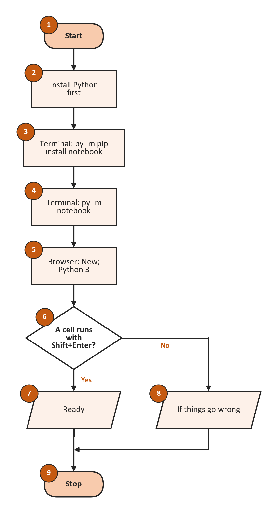
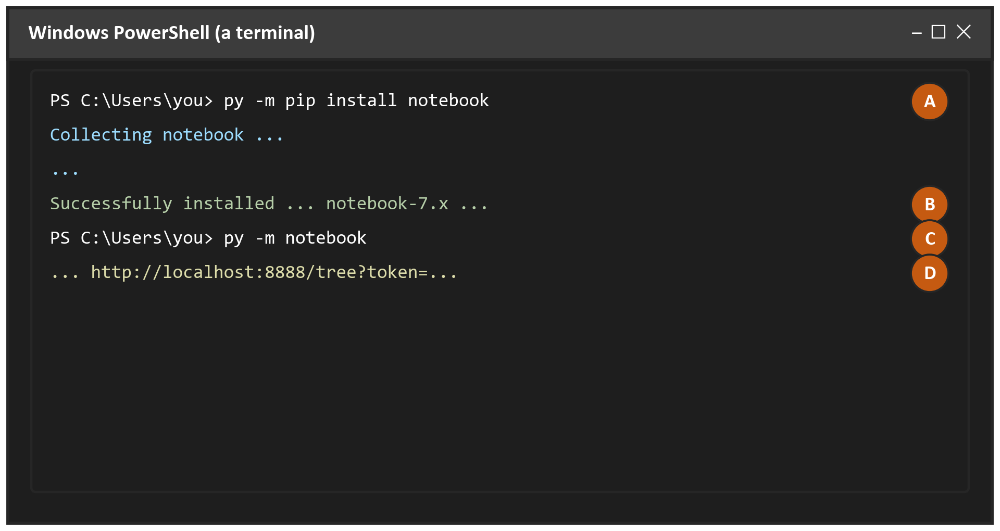
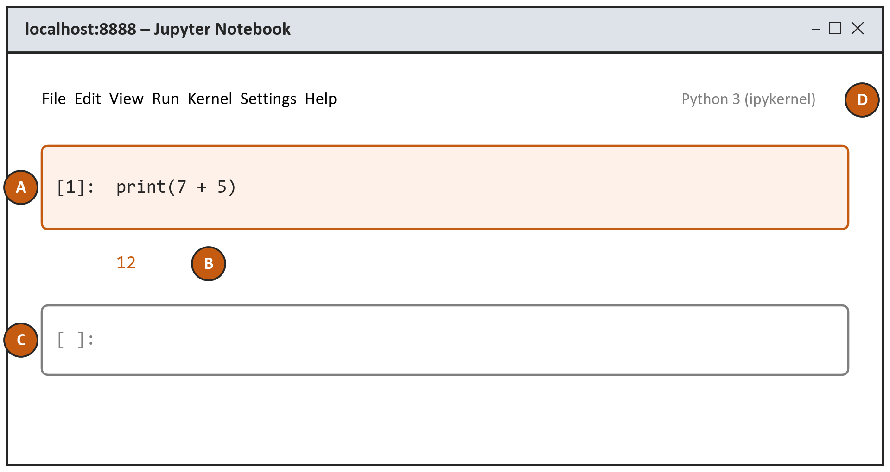

# Jupyter Notebook, step by step

*Get started. Notebooks on your own computer, without the internet: cells of code and text, each run on its own.*

!!! abstract "The whole flow"

    { width="360" }

    The numbers in the circles are the flowchart's box numbers (Start is box 1). Each step below says its box:

    1. **Box 3** → [Step 1: Install Jupyter and start it](#ju-install)
    2. **Box 5** → [Step 2: Make a notebook and run a cell](#ju-notebook)

    **Something went wrong?** [Go to "If things go wrong"](#if-things-go-wrong)

**Before you start.** Python installed ([Install Python](install-python.md)) · an internet connection for the install only · about 5 minutes.

## Step 1 (box 3): Install Jupyter and start it {#ju-install}

{ width="640" }

*A simplified drawing; your screen may look a little different.*

| Part | What it is |
|:-:|---|
| **A** | install Jupyter Notebook with Python's own installer, **pip** |
| **B** | success |
| **C** | start the Jupyter server |
| **D** | its address: **localhost** means *this computer*, **8888** the "door" (port) it listens at |

Open a terminal and type the two commands. (pip is Python's installer for extra packages; on the computer that checked this page it answered `pip 26.2`.)

- ✅ **Do:** keep this terminal open while you work: it **is** the server.
- ❌ **Don't:** close it: the notebook stops working.
- 👀 **You should now see:** your browser opens the Jupyter page.

*Problem at this step?* ["pip is not recognized" or "No module named notebook"](#p-ju-pip)

*Problem at this step?* [The browser does not open](#p-ju-browser)

## Step 2 (box 5): Make a notebook and run a cell {#ju-notebook}

{ width="640" }

*A simplified drawing; your screen may look a little different.*

| Part | What it is |
|:-:|---|
| **A** | a **code cell**: type Python here |
| **B** | its output, just below |
| **C** | the next, empty cell |
| **D** | the **kernel**: the Python that runs your cells |

In the Jupyter page: **New → Notebook**, choose **Python 3 (ipykernel)**. Type `print(7 + 5)` in the first cell and press **Shift + Enter**.

- ✅ **Do:** save with **File → Save** (Ctrl+S): the notebook is a `.ipynb` file on your computer.
- ⚠️ **Watch out:** the last line of a cell shows its value even without print, unlike a script ("the Colab trap", section 6.3).
- 👀 **You should now see:** `12` under the cell.

*Problem at this step?* ["Connection failed" or the notebook stops working](#p-ju-closed)

## If things go wrong {#if-things-go-wrong}

### "pip is not recognized" or "No module named notebook" {#p-ju-pip}

- **What you see:** The install command fails, or `py -m notebook` says there is no such module.
- **Why:** Python is missing, or the install did not finish.
- **Fix:** Check Python first ([Install Python](install-python.md#step-check)). Always write `py -m pip …`, not `pip …`: it installs into the Python that `py` runs.

### The browser does not open {#p-ju-browser}

- **What you see:** The terminal shows addresses, but no browser opens.
- **Why:** Windows did not start the browser for you.
- **Fix:** Copy the address that starts with `http://localhost:8888/` from the terminal into your browser.

### "Connection failed" or the notebook stops working {#p-ju-closed}

- **What you see:** The page says it cannot connect, or cells do not run any more.
- **Why:** The terminal window was closed: it was running the Jupyter server.
- **Fix:** Start it again with `py -m notebook`, and keep that window open (minimised) while you work.

## How Jupyter works: client and server {#how}

Jupyter has two parts on your own computer. The **server** (started in the terminal) runs Python. The **client** is your browser: it only shows the cells and sends them to the server. The address `http://localhost:8888` means: this computer (**localhost**), door number **8888** (the **port**). Nothing goes on the internet. See [Where does my code run?](where-does-my-code-run.md).

## Anaconda: you may hear of it {#anaconda}

Anaconda is a large download that brings Python, Jupyter and hundreds of packages together. **For Class XI we do not recommend it**: it is very large, school labs do not use it, and it installs a **second** Python beside the first, so you may not know which one is running.

## Not needed in Class XI {#later}

- **Virtual environments**, **JupyterLab** (a bigger form of Jupyter): later.
