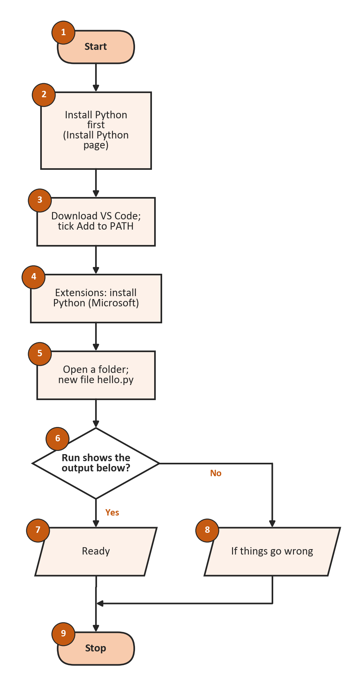
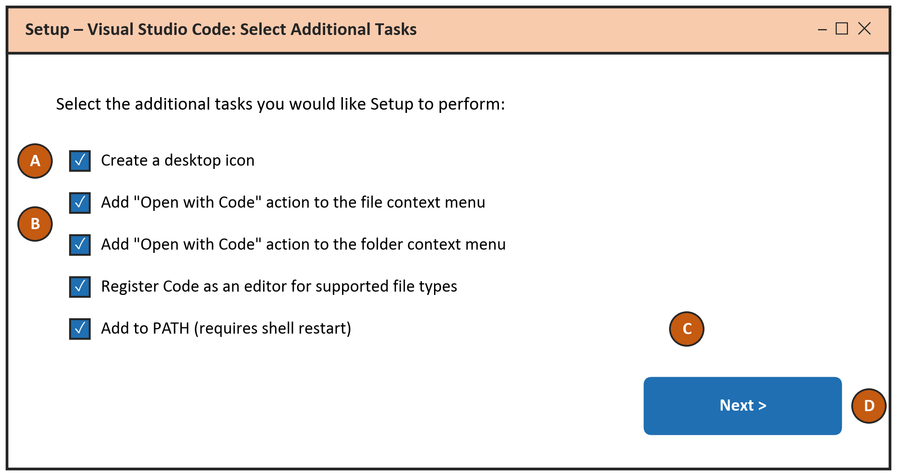
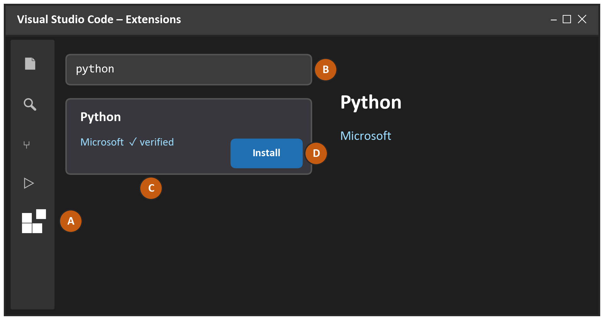
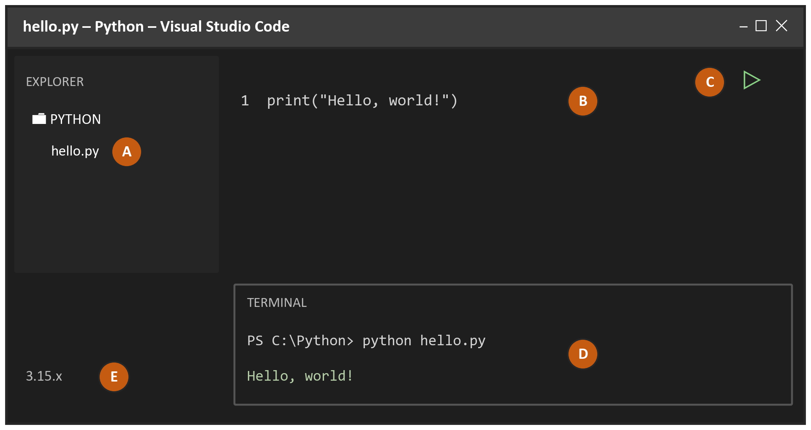

# VS Code, step by step

*Get started. VS Code is a free editor used for bigger projects. Install Python first; VS Code uses it.*

!!! abstract "The whole flow"

    { width="360" }

    The numbers in the circles are the flowchart's box numbers (Start is box 1). Each step below says its box:

    1. **Box 3** → [Step 1: Download and install VS Code](#vs-install)
    2. **Box 4** → [Step 2: Install the Python extension](#vs-extension)
    3. **Box 5** → [Step 3: Open a folder and make a file](#vs-folder)
    4. **Box 6** → [Step 4: Choose Python and run](#vs-run)

    **Something went wrong?** [Go to "If things go wrong"](#if-things-go-wrong)

**Before you start.** Python installed ([Install Python](install-python.md)) · about 400 MB of space · about 10 minutes.

## Step 1 (box 3): Download and install VS Code {#vs-install}

{ width="640" }

*A simplified drawing; your screen may look a little different.*

| Part | What it is |
|:-:|---|
| **A** | a desktop icon (useful) |
| **B** | "Open with Code" on files and folders: lets you right-click a folder and open it |
| **C** | **Add to PATH**: lets you type `code` in a terminal; keep it **ticked** |
| **D** | go on |

Download from VS Code's own site (**code.visualstudio.com**) and run the installer. Accept the licence, keep the suggested folder, and on the **Select Additional Tasks** screen tick the boxes as in the drawing.

- ✅ **Do:** tick **Add to PATH** (C).
- ❌ **Don't:** download VS Code from any other site.
- ⚠️ **Watch out:** VS Code does not include Python: install Python first.
- 👀 **You should now see:** VS Code opens with a Welcome page.

*Problem at this step?* ["code" is not recognized in a terminal](#p-vs-path)

## Step 2 (box 4): Install the Python extension {#vs-extension}

{ width="640" }

*A simplified drawing; your screen may look a little different.*

| Part | What it is |
|:-:|---|
| **A** | the **Extensions** icon in the Activity Bar (or Ctrl+Shift+X) |
| **B** | type **python** in the search box |
| **C** | the extension named **Python** by **Microsoft** (verified) |
| **D** | its **Install** button |

- ✅ **Do:** install **Python** by **Microsoft**; it also brings Pylance (better hints) on its own.
- ❌ **Don't:** install many extensions you do not understand.
- 👀 **You should now see:** the Install button turns into a settings gear.

*Problem at this step?* [Many extensions with "Python" in the name](#p-vs-wrong-ext)

## Step 3 (box 5): Open a folder and make a file {#vs-folder}

1. Make a folder, for example `Documents\Python`.
2. In VS Code: **File → Open Folder** → choose it. Answer **Yes, I trust the authors** (it is your own folder).
3. **New File** (the page-with-plus icon in the Explorer) → name it `hello.py`.
4. Type `print("Hello, world!")` and save (**Ctrl+S**).

- ✅ **Do:** keep all your programs of one chapter in one folder.
- ❌ **Don't:** open your whole Documents or C: drive as a folder: VS Code becomes slow.
- 👀 **You should now see:** `hello.py` in the **Explorer** on the left.

## Step 4 (box 6): Choose Python and run {#vs-run}

{ width="640" }

*A simplified drawing; your screen may look a little different.*

| Part | What it is |
|:-:|---|
| **A** | the **Explorer**: your folder and files |
| **B** | the **editor**: your program |
| **C** | the **Run Python File** button ▷ |
| **D** | the **terminal**: the output appears here |
| **E** | the Python in use: click it to change |

The first time, choose the Python to use: **Ctrl+Shift+P** → type `Python: Select Interpreter` → pick the Python you installed. Then press ▷ (C).

- ✅ **Do:** check part **E**: it should show 3.12 or later.
- 👀 **You should now see:** `Hello, world!` in the terminal (D).

*Problem at this step?* ["Python is not installed" or no interpreter to choose](#p-vs-no-python)

*Problem at this step?* [Run does nothing, or there is no Run button](#p-vs-run-nothing)

## If things go wrong {#if-things-go-wrong}

### "Python is not installed" or no interpreter to choose {#p-vs-no-python}

- **What you see:** VS Code says Python is not installed, or the list of interpreters is empty.
- **Why:** VS Code does not contain Python; it uses the Python you installed.
- **Fix:** Install Python first ([Install Python](install-python.md)); then restart VS Code and choose it: Ctrl+Shift+P → `Python: Select Interpreter`.

### Run does nothing, or there is no Run button {#p-vs-run-nothing}

- **What you see:** Pressing ▷ does nothing, or the button is missing.
- **Why:** The Python extension is not installed, or the file is not saved as `.py`.
- **Fix:** Install the **Python** extension by **Microsoft** (step 2); save the file with a `.py` name.

### "code" is not recognized in a terminal {#p-vs-path}

- **What you see:** Typing `code .` in a terminal does not open VS Code.
- **Why:** The **Add to PATH** box was not ticked during setup (part C of step 1).
- **Fix:** Run the VS Code installer again and tick **Add to PATH**; then open a new terminal.

### Many extensions with "Python" in the name {#p-vs-wrong-ext}

- **What you see:** The search shows many extensions.
- **Why:** Anyone can publish an extension.
- **Fix:** Choose the one named **Python**, published by **Microsoft**, with the verified tick. Install only what you need.

## Notebooks inside VS Code (optional) {#notebooks}

VS Code can also open notebooks (`.ipynb`), like Jupyter and Colab: install the **Jupyter** extension (Microsoft), then open a `.ipynb` file or press Ctrl+Shift+P → `Create: New Jupyter Notebook`. Choose your Python as the "kernel" when asked. You do not need this for Class XI.

## Why learn VS Code? {#why}

VS Code is free, and it is built from open-source code. For several years it has been the editor most used by programmers in the large yearly developer surveys. Because its code is open, other editors are built on it, such as Cursor and Google's Antigravity, so what you learn here carries over.

## Not needed in Class XI {#later}

- **Virtual environments** (a separate set of packages for each project): you will meet them in larger projects.
- **Pylance settings, Code Runner and other extensions**: the Python extension is enough.
- **Git inside VS Code**: for saving versions of a project, later.
