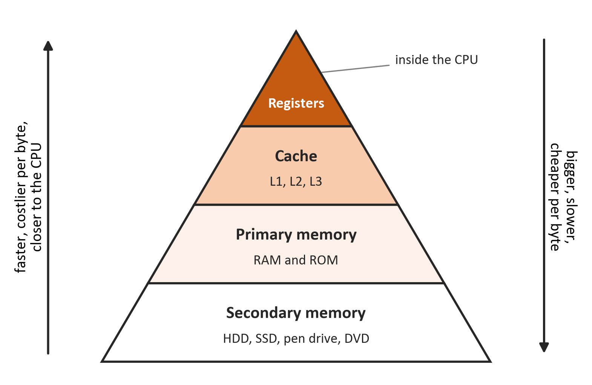

# The memory hierarchy in depth

**Beyond syllabus** · not in the CBSE syllabus · Chapter 1, section 1.6

## Rough sizes and speeds

The numbers below are typical of a laptop today and only show the pattern: each level down is bigger and slower.

| Level | Typical size | Time to reach it (roughly) | In the kitchen |
|---|---|---|---|
| Registers | A few hundred bytes | Less than 1 nanosecond | Plate in the hand |
| L1 cache | 32–64 KB per core | About 1 nanosecond | Masala dabba |
| L2 cache | About 1 MB per core | A few nanoseconds | Spice rack beside the stove |
| L3 cache | 8–32 MB, shared | 10–20 nanoseconds | The shelf above the counter |
| RAM | 8–32 GB | 50–100 nanoseconds | The kitchen shelf |
| SSD | 256 GB–2 TB | Tens of microseconds | The store room next door |
| HDD | 1–4 TB | Several milliseconds | The godown down the road |

(1 nanosecond = one billionth of a second; 1 microsecond = 1000 nanoseconds; 1 millisecond = 1000 microseconds.)

## Why does the hierarchy work?

Programs use the **same** data and instructions again and again within a short time (a loop runs the same lines many
times), and data **near** what was just used is likely to be needed next. So a small, fast memory that keeps copies of
recent and nearby data is hit most of the time. This is called **locality**.

## Cache hit and cache miss

- **Cache hit**: the CPU finds what it needs in the cache: fast.
- **Cache miss**: it is not there; it must be fetched from RAM (and copied into the cache for next time): slow.
