# See it: the device gallery

*Chapter 1 · See it. Every device of section 1.3, drawn large in full colour. For understanding; not needed for the exam answer.*

For each device ask the one question of section 1.3: **which way does the data flow?**

## Keyboard

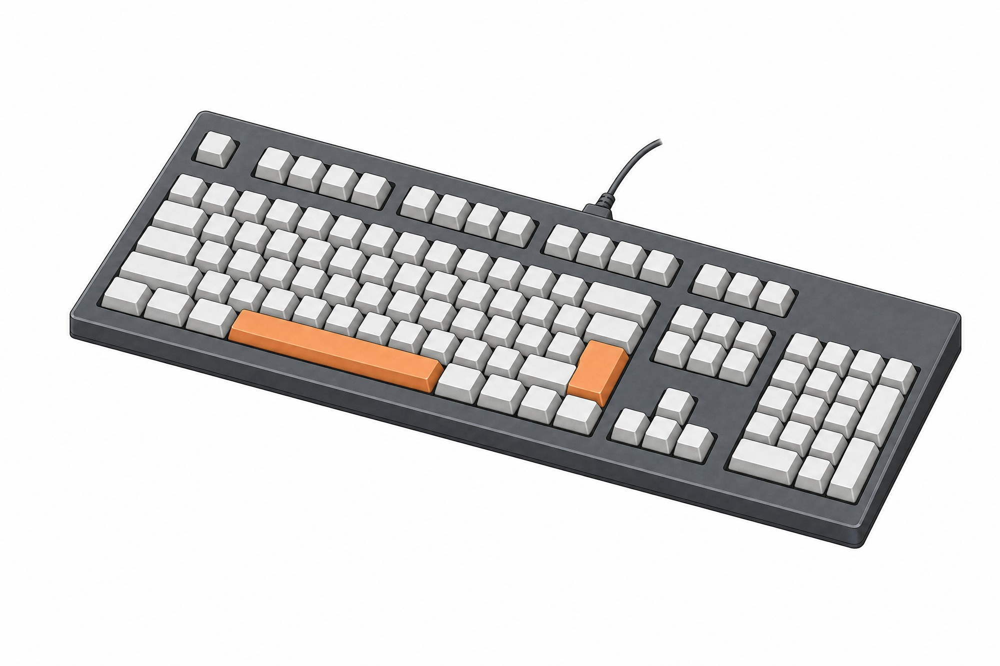

- **Type:** input
- **What it changes:** Key presses → data
- **Where you meet it:** Typing a school project

## Mouse, touchpad, joystick

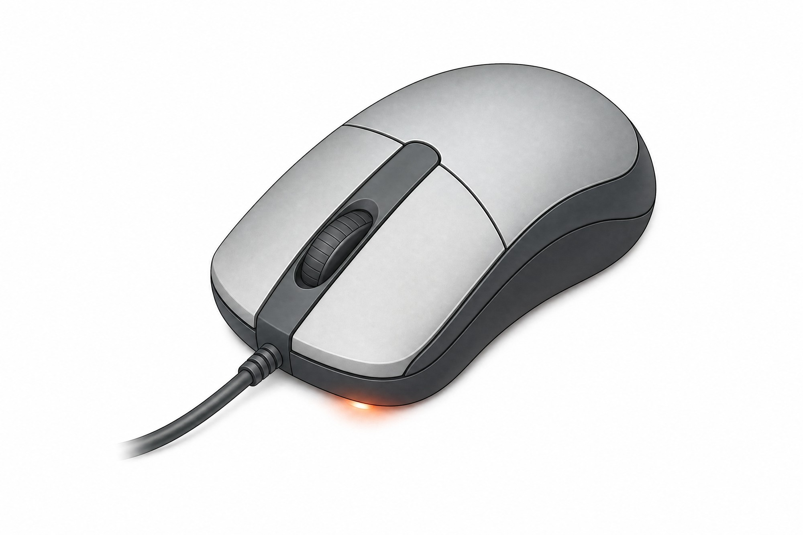

- **Type:** input
- **What it changes:** Movement and clicks → data
- **Where you meet it:** Pointing, games

## Scanner

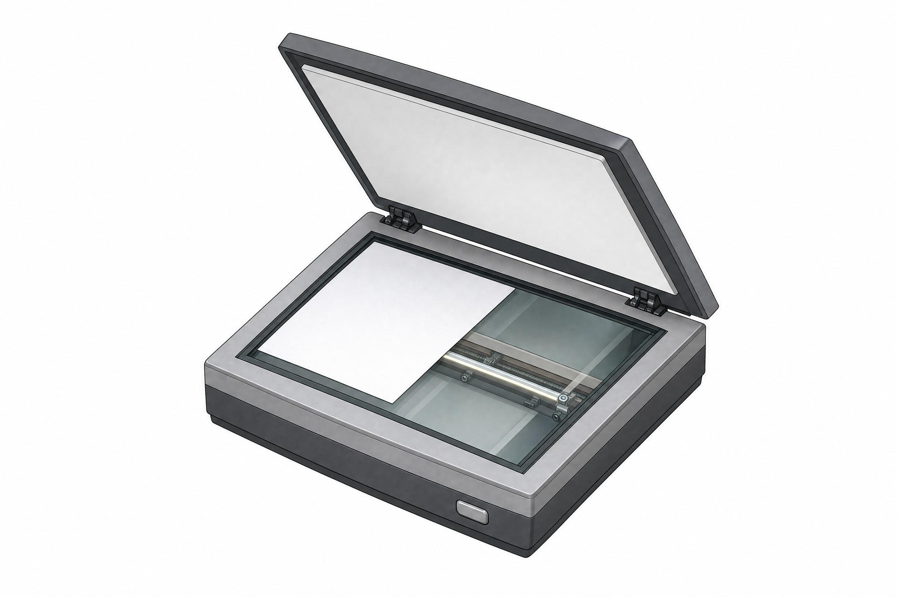

- **Type:** input
- **What it changes:** A page → a picture
- **Where you meet it:** Scanning a certificate

## Barcode reader, QR code scanner

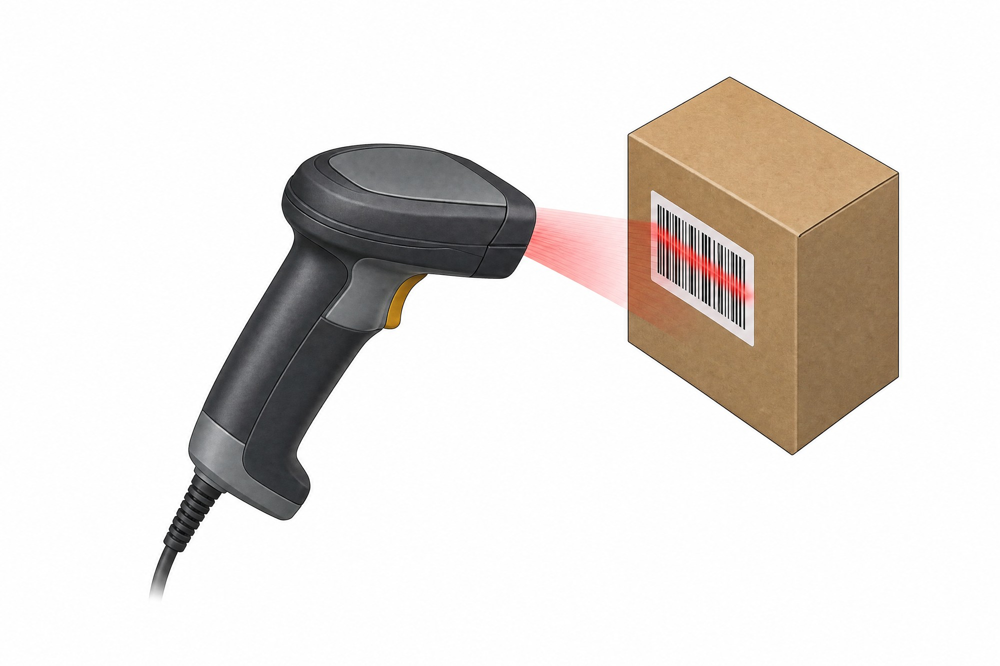

- **Type:** input
- **What it changes:** Bars or squares → a code
- **Where you meet it:** Shop billing counter; paying by UPI

## Webcam, digital camera

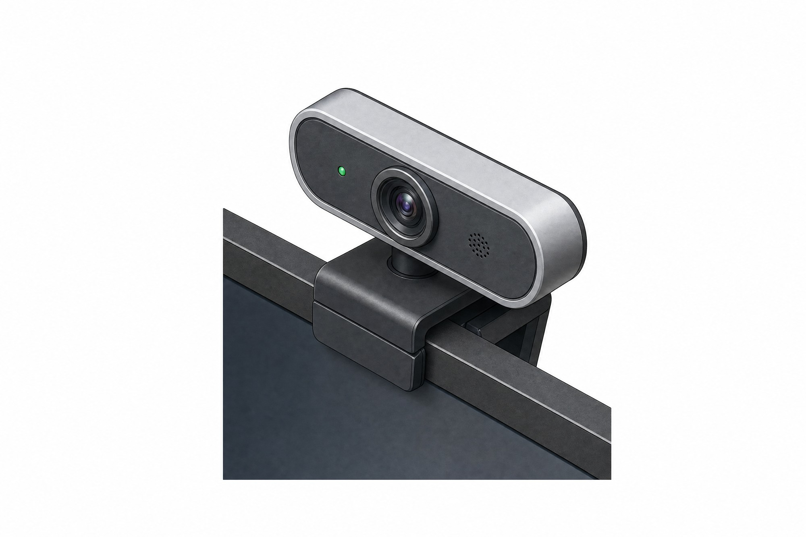

- **Type:** input
- **What it changes:** Light → pictures
- **Where you meet it:** Online classes

## Microphone

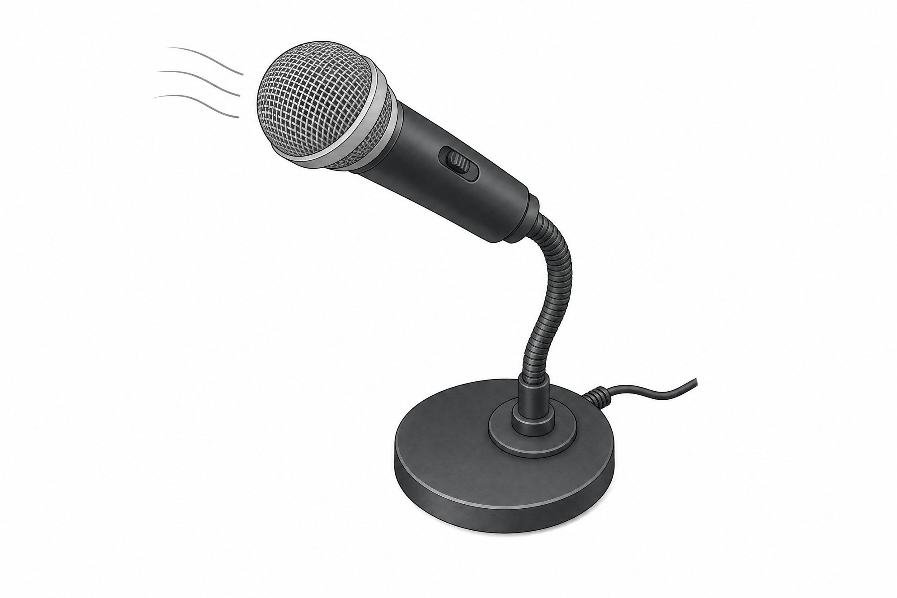

- **Type:** input
- **What it changes:** Sound → data
- **Where you meet it:** Voice search

## Monitor

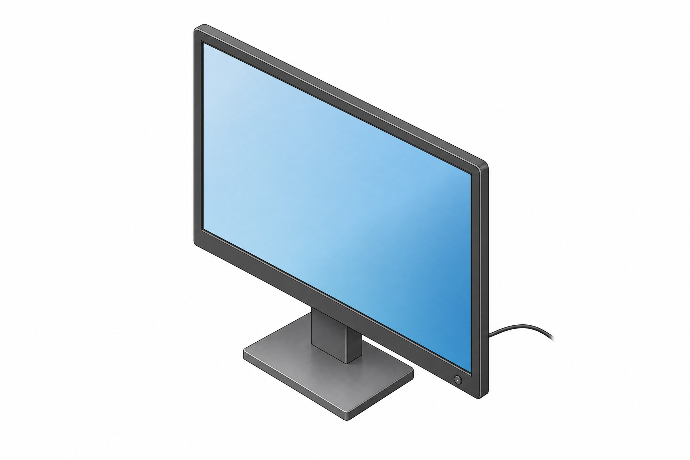

- **Type:** output
- **What it changes:** Data → light (text, pictures)
- **Where you meet it:** Every desktop computer

## Printer (impact, non-impact)

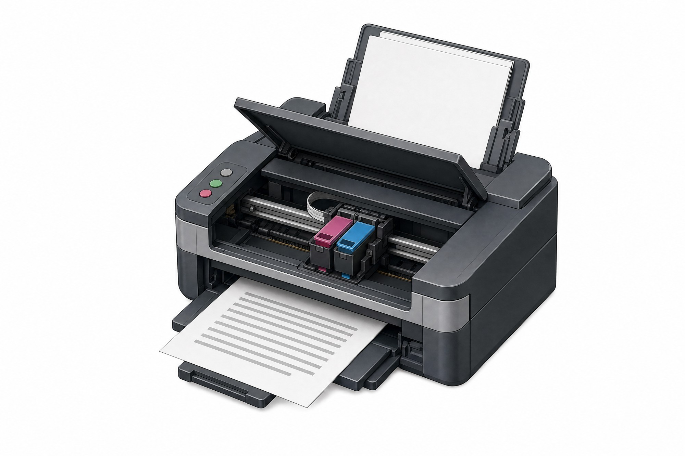

- **Type:** output
- **What it changes:** Data → ink on paper
- **Where you meet it:** Bank passbook; home printer

## Speaker, headphones

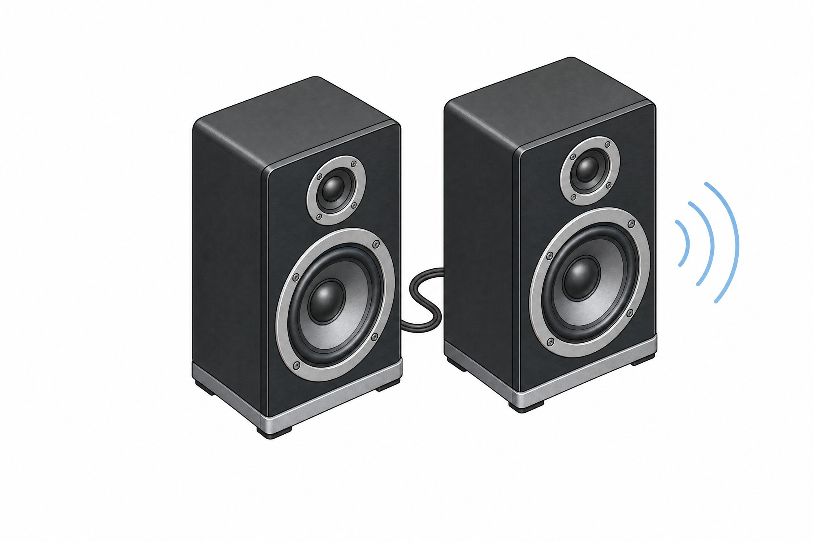

- **Type:** output
- **What it changes:** Data → sound
- **Where you meet it:** Music, announcements

## Projector

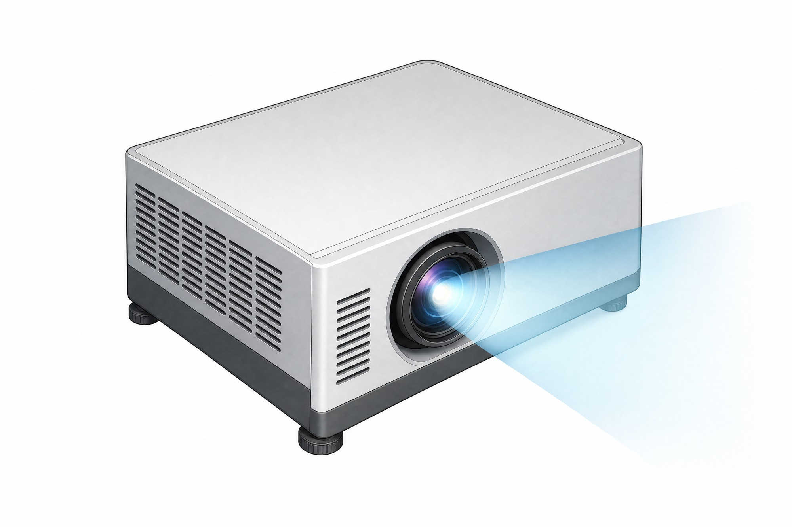

- **Type:** output
- **What it changes:** Data → light on a wall
- **Where you meet it:** Smart classroom

## Plotter

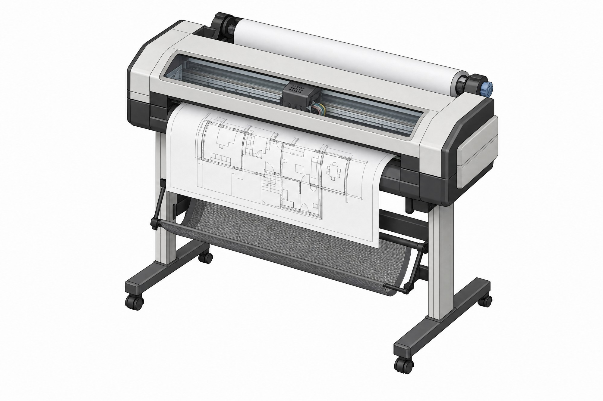

- **Type:** output
- **What it changes:** Data → large line drawings
- **Where you meet it:** Building plans

## Touchscreen

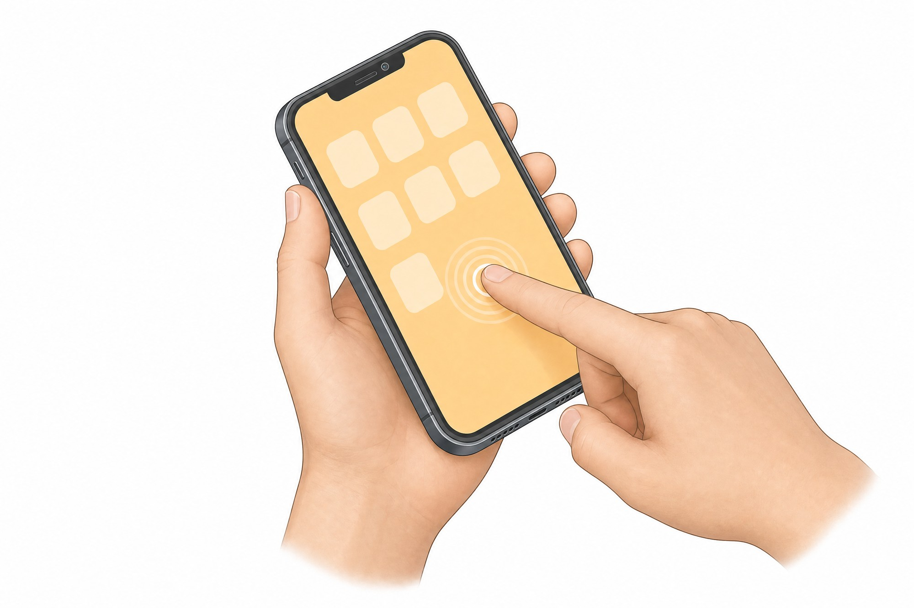

- **Type:** both
- **What it changes:** Touch in; pictures out
- **Where you meet it:** Phone, ATM

## More devices (no picture yet)

| Device | Type | What it changes | Where you meet it |
|---|:-:|---|---|
| Light pen | Input | Pointing at the screen → a position | Designers drawing on a screen |
| OMR (Optical Mark Reader) | Input | Pencil marks in bubbles → answers | Checking MCQ answer sheets in entrance exams |
| MICR (Magnetic Ink Character Reader) | Input | Numbers printed in magnetic ink → data | The numbers along the bottom of a bank cheque |
| OCR (Optical Character Recognition) | Input | Printed text in a picture → text you can edit | Copying the text of a photographed page |
| Smart card reader | Input | The chip on a card → data | Metro card gate; debit card at a shop |
| Biometric reader | Input | Fingerprint, face or eye → data | Aadhaar check; school attendance |
| Braille keyboard | Input | Braille keys → letters | Used by people who cannot see |
| 3D printer | Output | Data → a solid object, built layer by layer | Models, spare parts |
| Braille display | Output | Text → small pins that rise, read by touch | Used by people who cannot see |
| Headset with microphone | Both | Voice in; sound out | Online classes, calls |
