# The device gallery

**See it** · for understanding, not needed for the exam answer · Chapter 1, section 1.3

Every device below is drawn large, with its parts labelled. Under each drawing: what it does, and how it works in
two or three lines. The rule from the book still holds: **which way does the data flow?** Into the computer = input;
out of it = output.

## Input devices

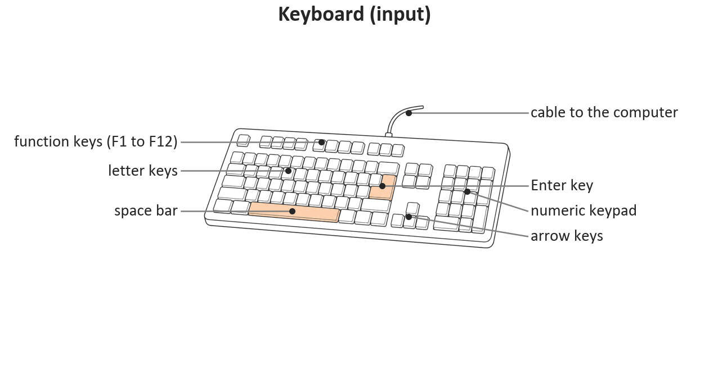

**Keyboard.** Each key closes a tiny switch underneath it. A small chip in the keyboard notices which switch closed
and sends that key's code to the computer. The function keys (F1–F12) do special jobs set by each program; the
numeric keypad makes typing numbers quick.

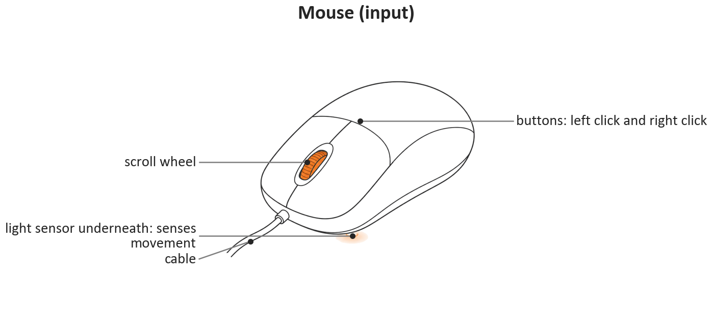

**Mouse.** A small light and a tiny camera underneath take hundreds of pictures of the desk every second; by comparing
them, the mouse works out which way and how far it moved, and the pointer on the screen moves the same way. The
buttons send clicks; the wheel scrolls.

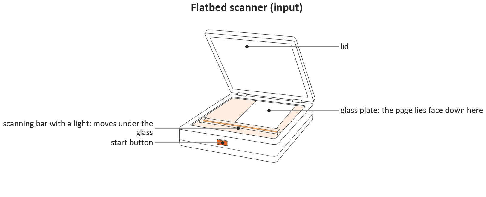

**Scanner.** The page lies face down on the glass. A bar with a bright light moves slowly under it, and light sensors
on the bar measure how much light each tiny dot of the page reflects. Row by row, the page becomes a picture made of
dots.

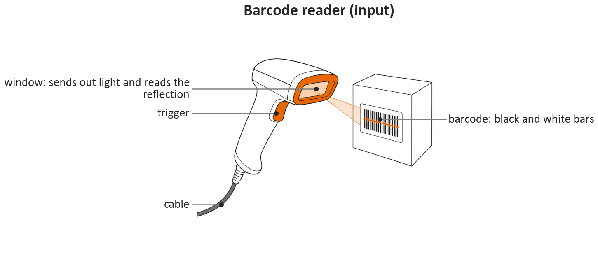

**Barcode reader.** It shines light on the bars: black bars reflect little light, white gaps reflect a lot. The
pattern of thick and thin bars is a number (the product's code), which the shop's computer looks up to find the name
and price.

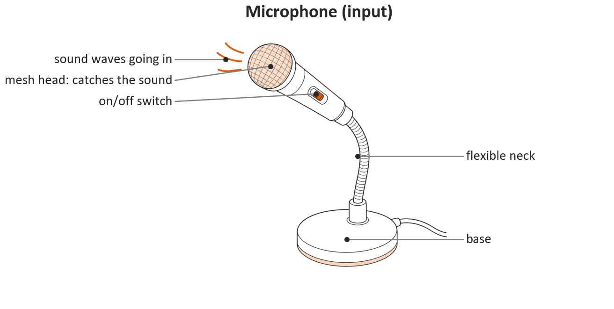

**Microphone.** Sound is air shaking. A thin sheet inside the microphone shakes with it and turns the shaking into a
changing electric signal, which the computer turns into numbers (data).

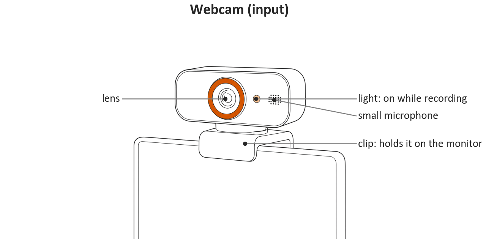

**Webcam.** The lens focuses light onto a small sensor made of millions of light-sensitive dots; each dot measures
how much light falls on it, and together they make a picture, many times a second (video). Most webcams also have a
small microphone.

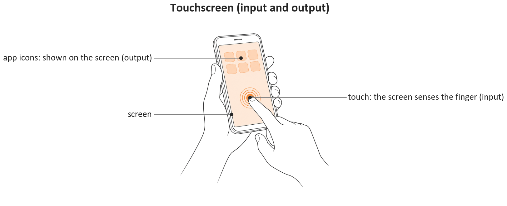

**Touchscreen (input and output).** A see-through touch layer senses exactly where the finger touches (input); the
display underneath shows the pictures (output). Two jobs, one glass.

## Output devices

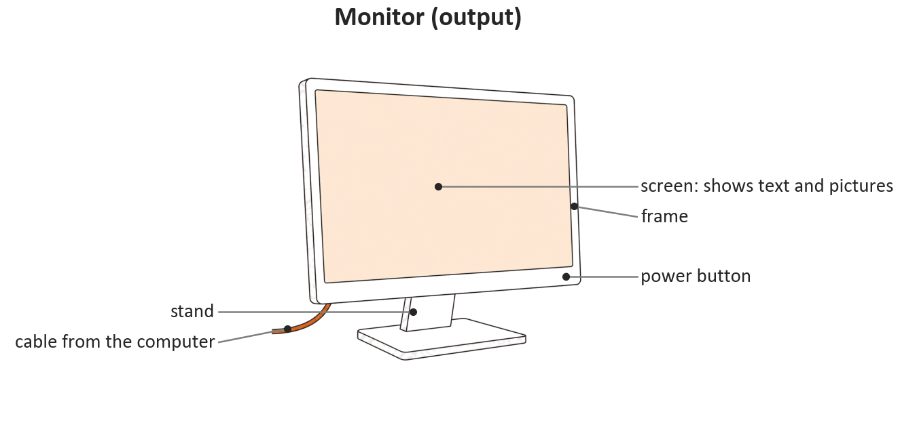

**Monitor.** The screen is made of millions of tiny dots called **pixels**. Each pixel can glow in any colour; together
they make the text and pictures. The more pixels, the sharper the picture (the **resolution**, e.g. 1920 × 1080).

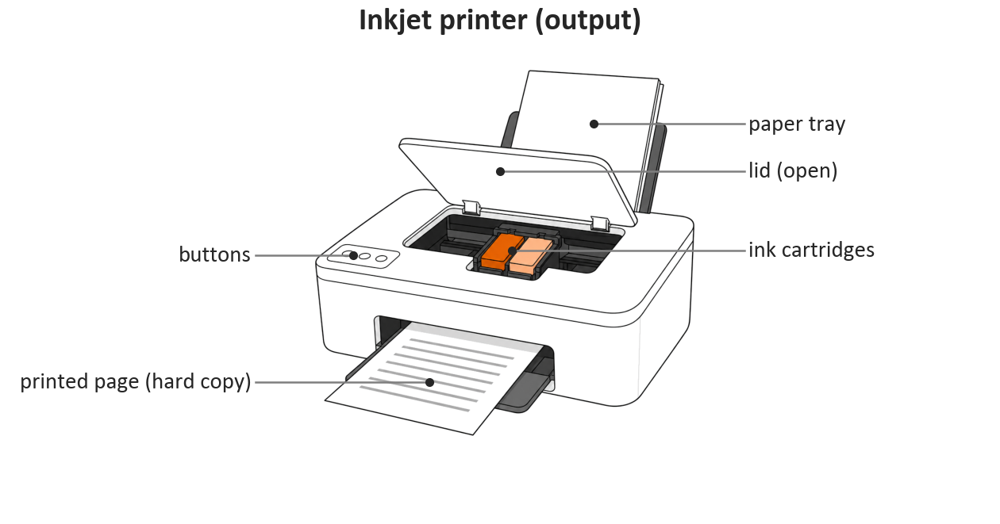

**Printer.** An inkjet printer sprays tiny drops of ink from the cartridges onto the paper as the print head moves
across it. A laser printer instead uses a laser and a fine powder (toner) melted onto the paper. The printed page is
**hard copy**.

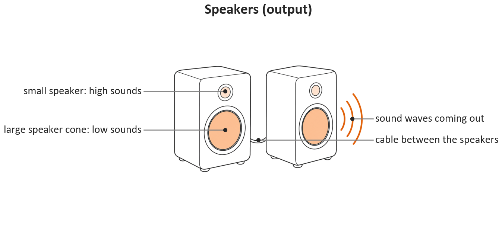

**Speakers.** The opposite of a microphone: an electric signal makes the cone shake, and the shaking cone pushes the
air: that is sound. Big cones make the low sounds, small ones the high sounds.

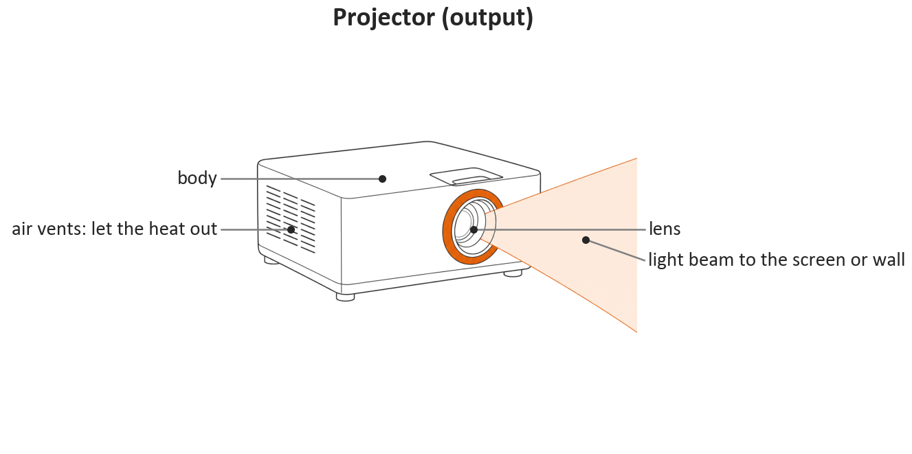

**Projector.** A very bright lamp shines through (or off) a small picture-making chip; the lens makes the picture large
on a wall or screen. Used in classrooms and halls.

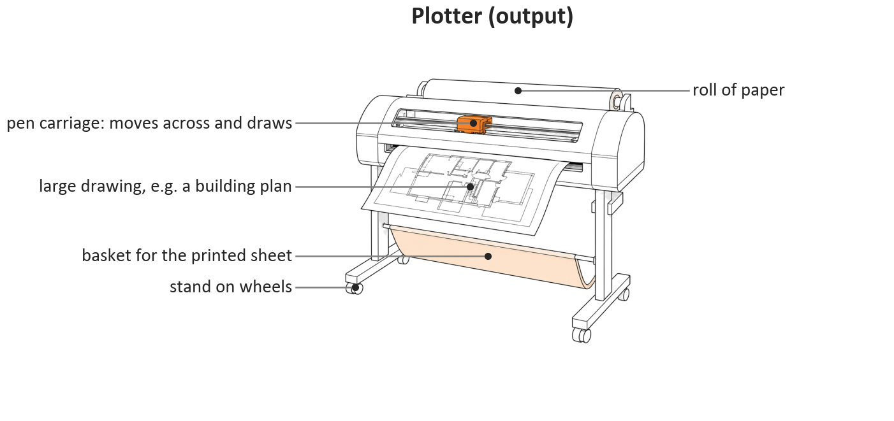

**Plotter.** It draws very large drawings, such as building plans and maps, on wide rolls of paper, with pens or
ink jets that move across the paper.

---

*Drawings: clean line drawings made for this book; labels added by program.*
