# See it: inside the computer

*Chapter 1 · See it. The real parts, drawn large: first labelled (as in the book), then in full colour.*

## Inside a desktop computer (side panel removed)

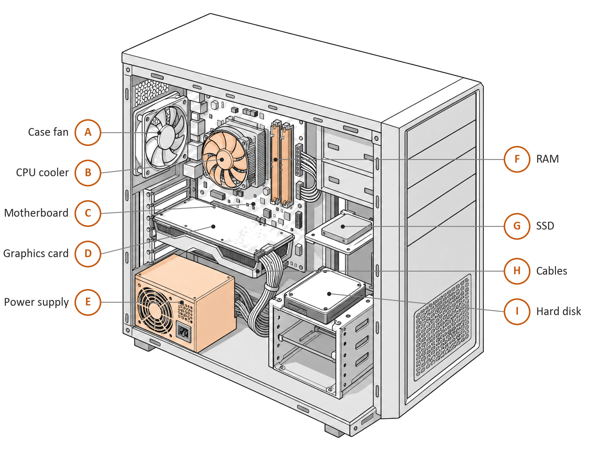

- **A** Case fan: pulls cool air through the cabinet.
- **B** CPU cooler: a fan on a metal heat sink; the CPU is under it.
- **C** Motherboard: the main circuit board; every part connects to it.
- **D** Graphics card in an expansion slot: makes the picture for the monitor.
- **E** Power supply unit: turns mains electricity into the low voltages the parts need.
- **F** RAM modules: primary memory.
- **G** SSD: secondary memory, flash chips.
- **H** Cables: carry power and data between the parts.
- **I** Hard disk (HDD) in the drive cage: secondary memory, magnetic.

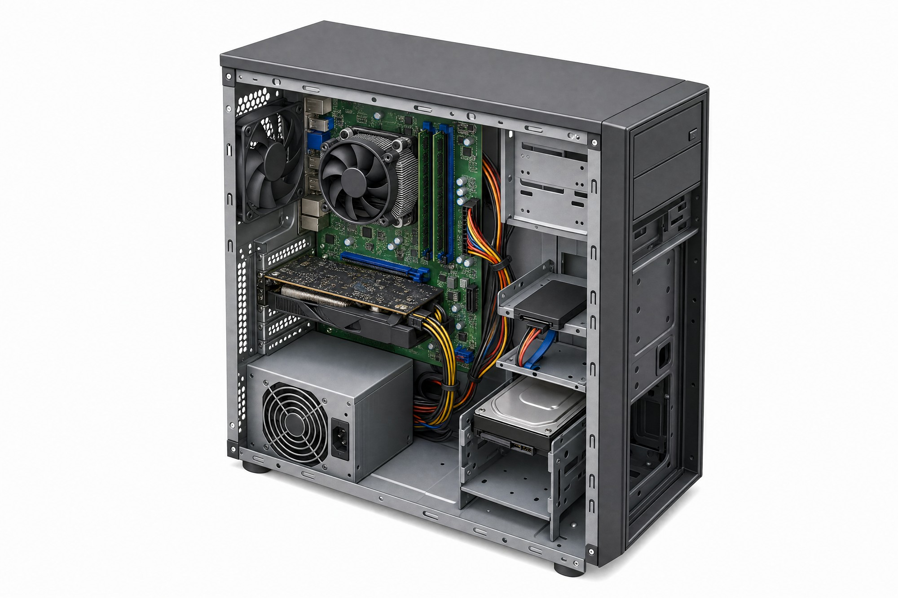

## A motherboard

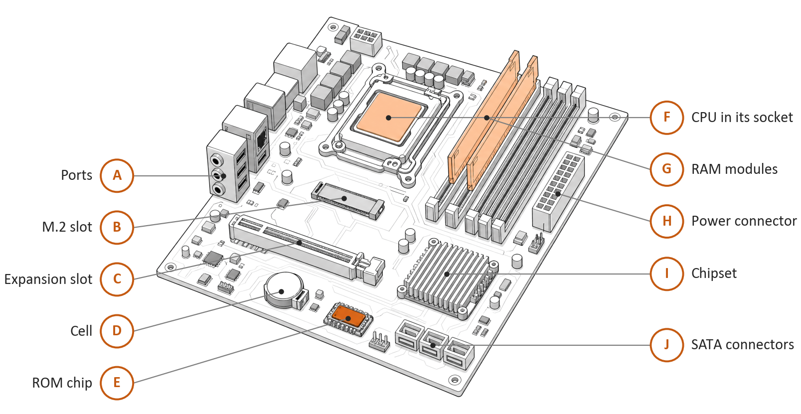

- **A** Ports (USB, network, sound): input and output devices plug in here.
- **B** M.2 slot: an SSD plugs in here.
- **C** Expansion slot: add a card (graphics, network).
- **D** Cell (battery): keeps the clock and the settings when the computer is off.
- **E** ROM chip (BIOS or UEFI): the start-up instructions.
- **F** CPU socket, with the CPU in it.
- **G** RAM modules (sticks) in their slots.
- **H** Main power connector: power from the power supply comes in here.
- **I** Chipset under its heat sink: traffic control between the parts.
- **J** SATA connectors: cables to the hard disk and SSD.

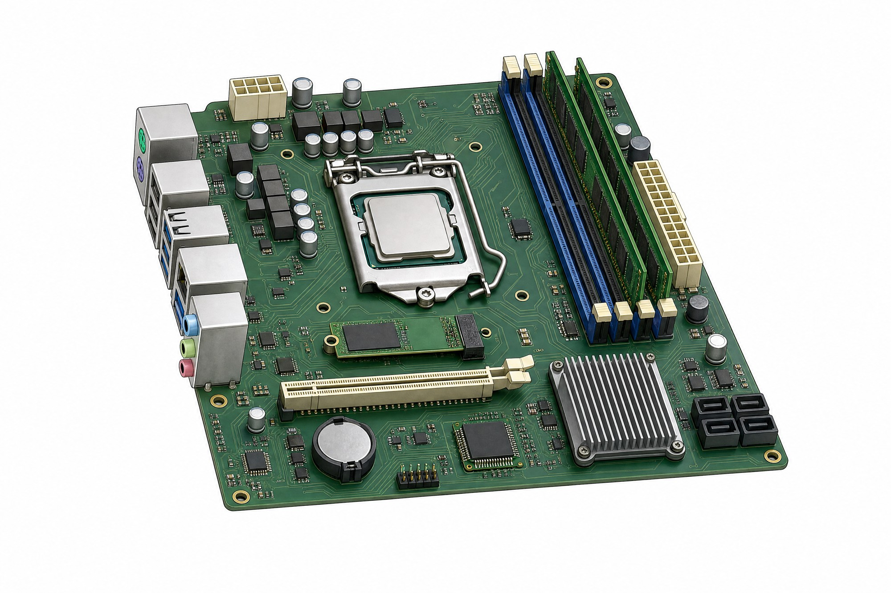

## The CPU chip (processor): top and underside

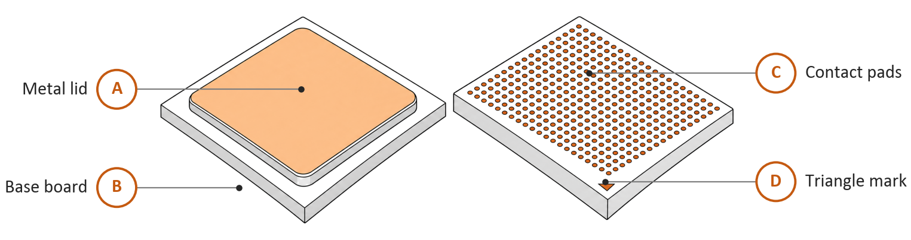

- **A** Metal lid (heat spreader): carries heat to the cooler; the chip itself is under it.
- **B** Base board: carries the signals from the chip to the pads.
- **C** Contact pads: hundreds of tiny points that touch the socket.
- **D** Triangle mark: shows which way round the chip fits.

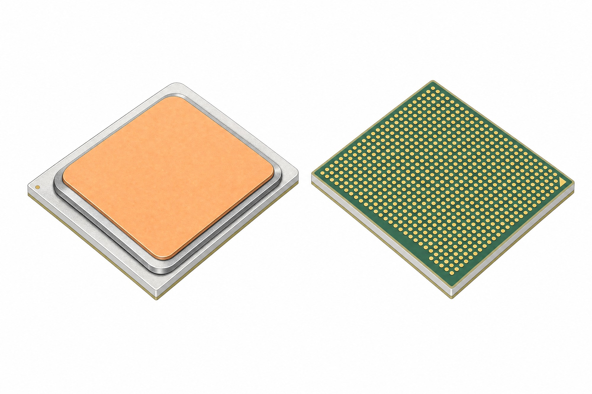

## A RAM module (stick)

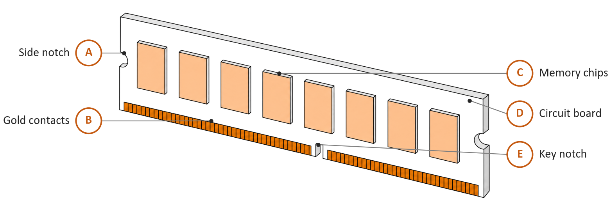

- **A** Side notches: the slot's clips lock in here and hold the stick.
- **B** Gold contacts (pins): connect to the slot on the motherboard.
- **C** Memory chips: store the data (only while the power is on).
- **D** Circuit board: holds the chips and the wiring between them.
- **E** Notch in the contacts: the stick fits only one way.

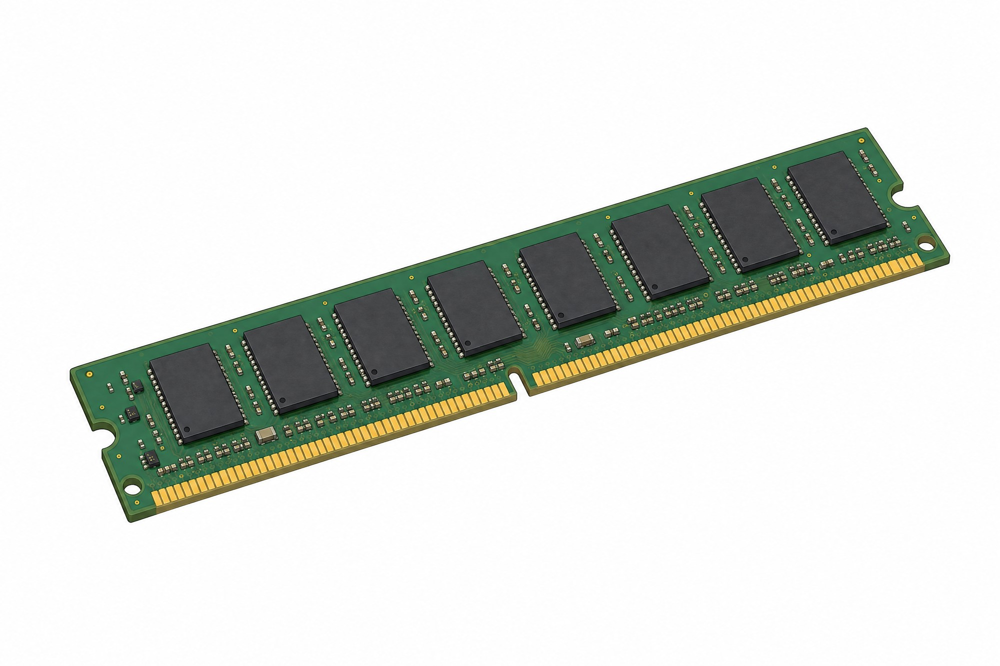

## A hard disk drive (HDD), cover removed

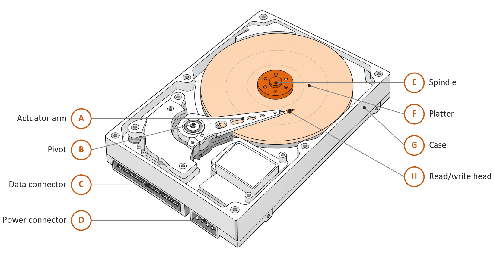

- **A** Actuator arm: moves the head across the platter.
- **B** Pivot: the arm swings about it.
- **C** Data connector: the cable to the motherboard.
- **D** Power connector.
- **E** Spindle: spins the platter thousands of times a minute.
- **F** Platter: a disk with a magnetic coating that holds the data.
- **G** Metal case: sealed against dust.
- **H** Read/write head: reads and writes the magnetic spots.

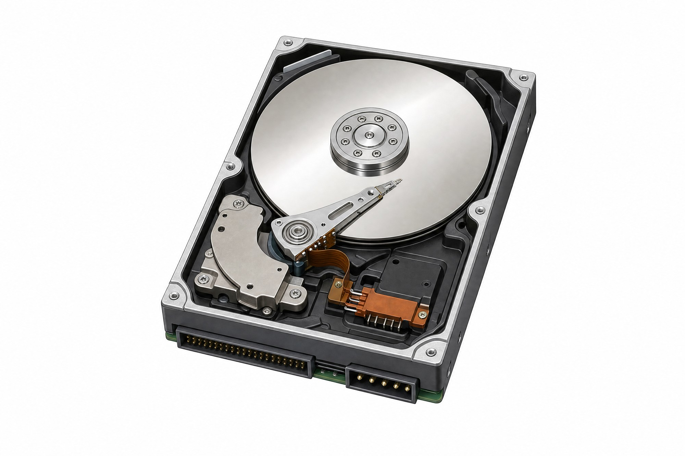

## A solid state drive (SSD), cover removed

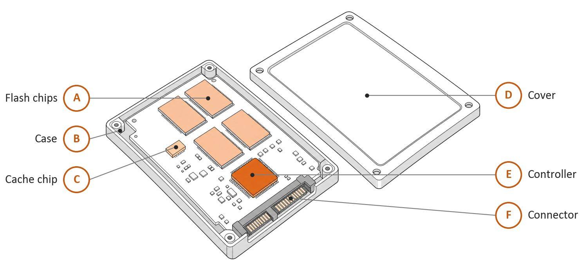

- **A** Flash memory chips: store the data, even with the power off.
- **B** Case.
- **C** Cache chip: a little fast memory.
- **D** Cover (taken off).
- **E** Controller: manages the flash chips.
- **F** Connector: data and power. Nothing moves inside an SSD.

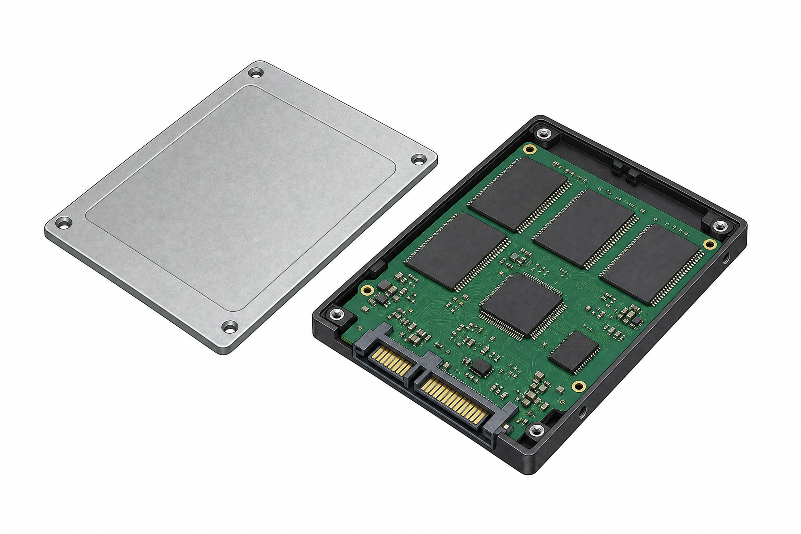

## A ROM chip (an EPROM)

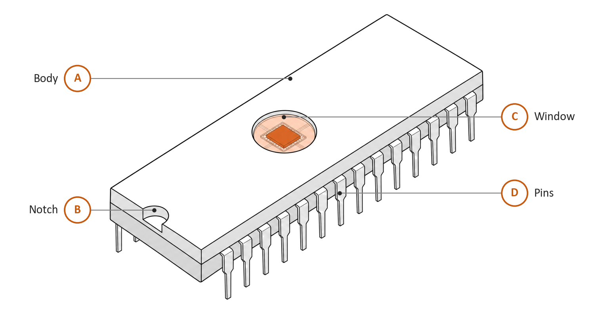

- **A** Plastic or ceramic body.
- **B** Notch: shows which end is pin 1.
- **C** Quartz window (EPROM only): ultraviolet light through it erases the chip.
- **D** Pins (legs): carry signals in and out.

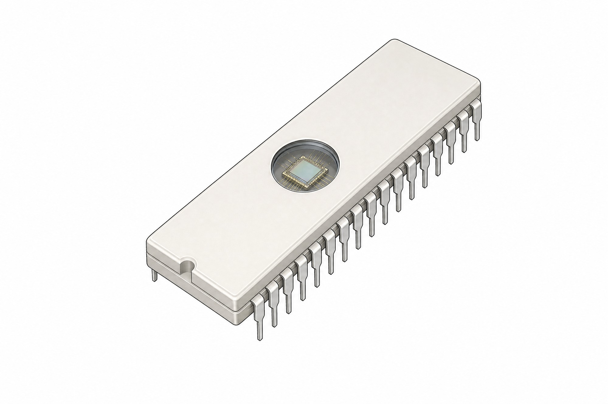

## HDD and SSD compared

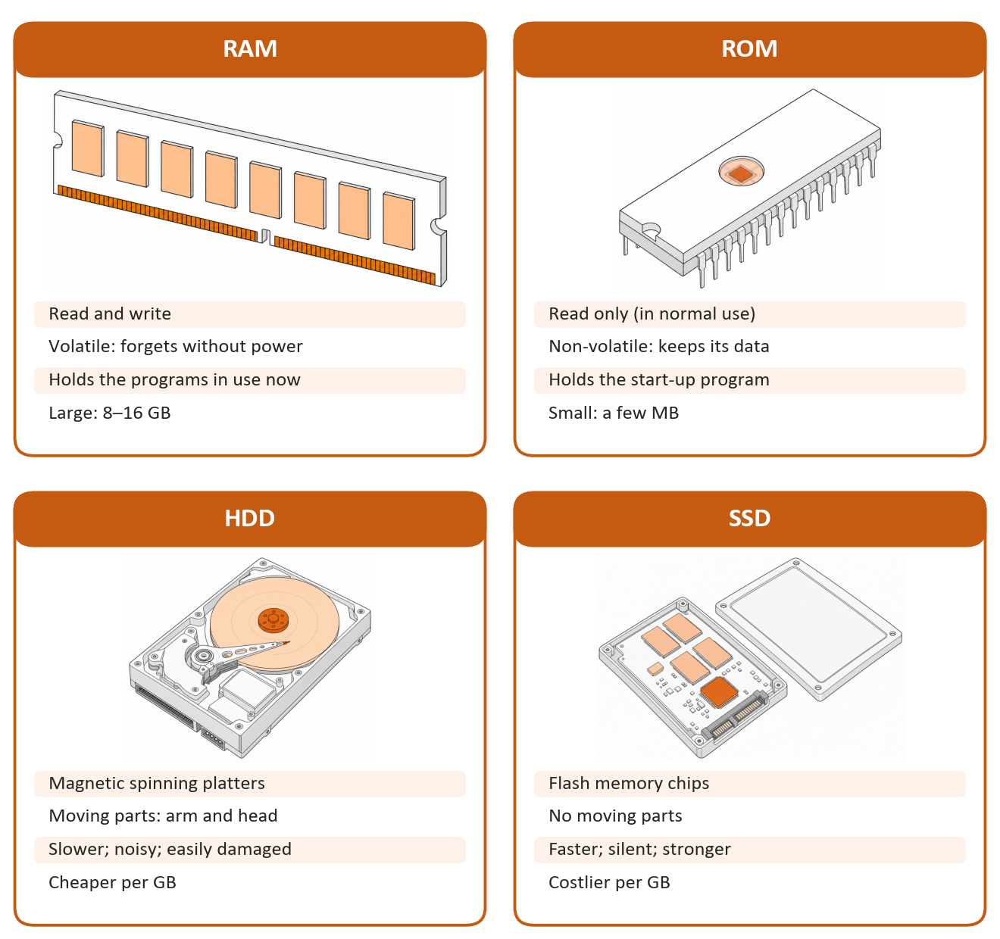

