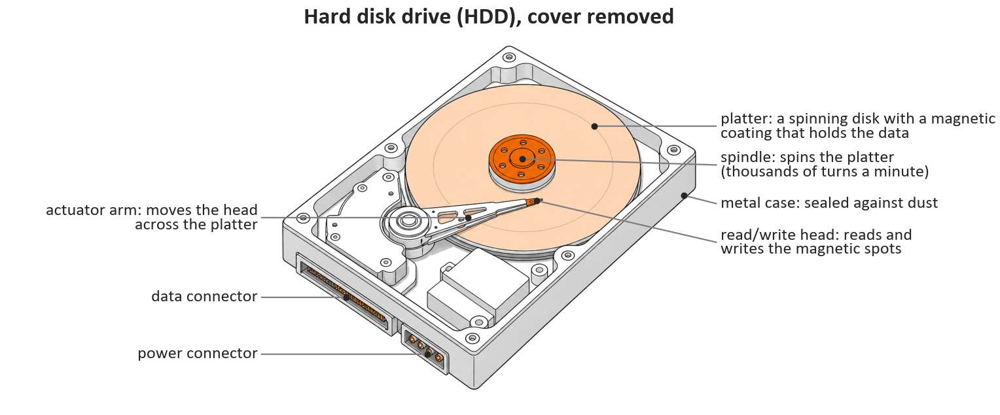
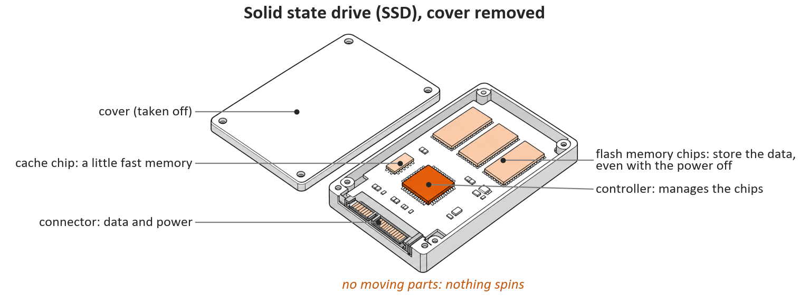
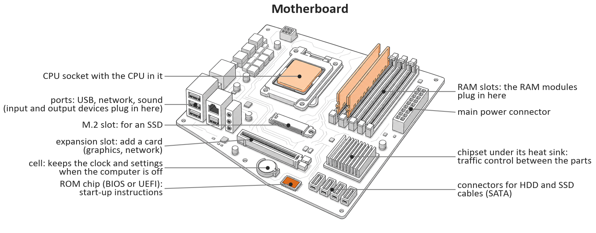
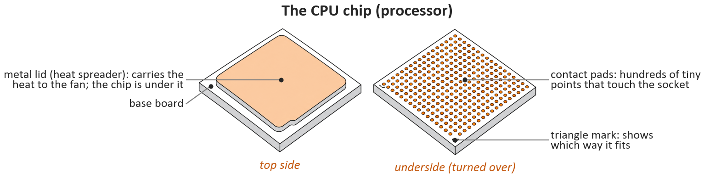
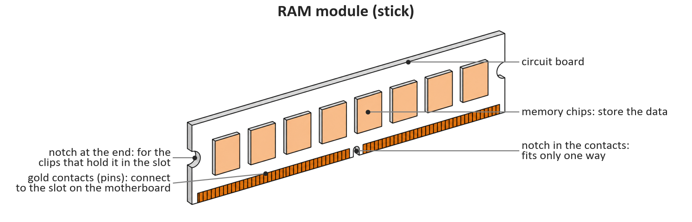

# Inside the computer: motherboard, CPU, RAM, hard disk, SSD and ROM

**See it** · for understanding, not needed for the exam answer · Chapter 1, section 1.6

## The hard disk drive (HDD), cover removed

- The **platter** is a disk coated with a magnetic material. Data is stored as millions of tiny magnetic spots, each
  pointing one way (1) or the other (0).
- The **spindle** spins the platter very fast, typically 5400 or 7200 turns a minute.
- The **read/write head** floats a hair's breadth above the spinning platter; it reads the spots or changes them.
- The **actuator arm** swings the head across the platter to the right track, like the arm of an old record player.

**Why is a hard disk slower than RAM?** Before it can read anything, the arm must swing to the right track and wait for
the right part of the platter to spin round under the head. RAM has no moving parts: any location is reached at once.

## The solid state drive (SSD), cover removed

An SSD has nothing that moves: the data is kept as electric charges in **flash memory chips**, and a **controller** chip decides where each piece of data goes. A small **cache** chip holds data on its way in and out.

## HDD and SSD compared

| Basis of difference | HDD | SSD |
|---|---|---|
| Stores data as | Magnetic spots on platters | Electric charges in flash chips |
| Moving parts | Yes (platter, arm) | None |
| Speed | Slower | Much faster: a computer with an SSD starts in seconds |
| If dropped | Can break (the head can hit the platter) | Much stronger |
| Noise and power | Makes some noise; uses more power | Silent; uses less power |
| Cost per GB | Lower | Higher |

A pen drive and a memory card use the same **flash** memory as an SSD.

## The motherboard

The **motherboard** is the main circuit board: every part of the computer plugs into it, and the thin copper lines
printed on it carry data between the parts. The CPU sits in its socket, the RAM modules in their slots, the ROM chip
holds the start-up program, and the ports on the edge connect the input and output devices.

## A ROM or EPROM chip

The real chip is a tiny square of silicon inside the plastic body; the pins carry signals in and out. An **EPROM** has
a little quartz window: shining ultraviolet light through it for a few minutes erases the chip so that it can be
written again.

## The CPU chip and a RAM module

The CPU chip fits into the socket of the motherboard only one way (the triangle mark); the RAM module fits into its slot only one way (the notch in the gold contacts).

---

*Drawings made for this book.*
