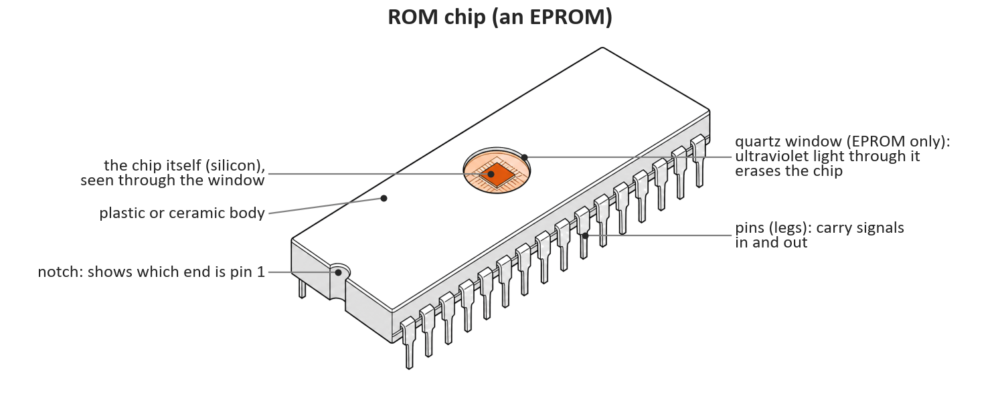

# EPROM, flash and the other types of RAM and ROM

**Sometimes asked** · asked in a few school papers · Chapter 1, section 1.6

The printed chapter tells you that RAM forgets when the power goes and ROM does not. This page answers the next
questions: **how** does each kind of memory keep a bit, **how** is a "read-only" memory ever changed, and why is the
memory in your pen drive called **flash**?

## Types of RAM

| Basis of difference | SRAM (static RAM) | DRAM (dynamic RAM) |
|---|---|---|
| How it keeps a bit | A tiny circuit of about six switches (transistors) that holds itself on or off | A tiny charge in a capacitor (a very small store of electricity), which slowly leaks |
| Needs refreshing? | No: it stays as it is while there is power | Yes: every bit is read and written back many times a second |
| Speed | Faster | Slower |
| Cost and size | Costlier; fewer bits per chip | Cheaper; many more bits per chip |
| Used for | Cache memory | Main memory (the RAM modules) |
| In the kitchen | The masala dabba: small, always ready | The big shelf: holds a lot, but someone keeps tidying it |

*Hook:* **S**RAM **S**tays (static); **D**RAM **D**rains (its charge leaks, so it is refreshed).

**Both are volatile.** "Static" does not mean that SRAM keeps its data without power: switch off, and SRAM forgets too.
*Common mistake:* "SRAM is non-volatile." *Why it is wrong:* static means "needs no refreshing", not "keeps data without power".

**The RAM in your laptop** is sold as **DDR4** or **DDR5** modules: these are kinds of DRAM (DDR = double data rate:
data is sent twice in every tick of the clock).

## Types of ROM: from "never" to "any time"

The story of ROM is the story of making a read-only memory a little easier to change at each step.

| Type | Full form | How it is written | How it is erased | Can be rewritten? |
|---|---|---|---|---|
| **ROM** (mask ROM) | Read Only Memory | At the factory, when the chip is made | Cannot be erased | Never |
| **PROM** | Programmable ROM | Once, by the user, with a device called a PROM programmer that burns tiny fuses | Cannot be erased (a burnt fuse cannot be mended) | Never: written once only |
| **EPROM** | Erasable Programmable ROM | With a programmer | **Ultraviolet light** through a quartz window on top of the chip, for 15–20 minutes; the whole chip is erased | Yes, but the chip is taken out of the machine |
| **EEPROM** | Electrically Erasable PROM | Electrically, inside the machine | **Electrically**, a byte at a time | Yes, inside the machine |
| **Flash** | (a kind of EEPROM) | Electrically, inside the machine | Electrically, a whole **block** at a time, which is fast | Yes, many thousands of times |

*Hook:* **P** = **P**ut in once; **E** = **E**rase with light; **EE** = **E**rase **E**lectrically.

### The EPROM chip: a window on the top

An EPROM chip has a small round **quartz window** in its top, through which you can see the silicon. Quartz is used
because ordinary glass stops ultraviolet light. To erase the chip, it is taken out of its socket and put in an
**EPROM eraser**, a box with an ultraviolet lamp. After erasing, every bit is 1 again, and the chip can be written
afresh. Once written, the window is covered with a sticker, because sunlight also has a little ultraviolet in it and
would slowly erase the chip.

### Flash memory: why "flash"?

Flash memory is a kind of EEPROM that erases a whole **block** of memory in one go, "in a flash", instead of one byte at
a time. That is what makes it fast enough for storing files. It was invented in the 1980s at Toshiba in Japan.

Where you meet flash memory:

- **pen drives** and **memory cards** (in phones and cameras);
- **SSDs** (solid-state drives) in laptops;
- the storage of every **smartphone**;
- the **start-up chip** (BIOS or UEFI) on today's motherboards, which can therefore be updated by a program.

**Flash wears out.** Each block can be erased only a limited number of times (thousands to about a hundred thousand,
depending on the kind). An SSD spreads its writing evenly over all its blocks, so that no block wears out early; this is
called **wear levelling**. For everyday use, an SSD lasts many years.

**Is flash primary or secondary memory?** It depends on its job. The start-up chip on the motherboard holds firmware that
the CPU reads directly at booting: in that job it plays the part of ROM. A pen drive or SSD holds files for later, which
the CPU does not read directly: secondary memory.

## How the types fit together

| Memory | Volatile? | Primary or secondary | Typical use |
|---|---|---|---|
| SRAM | Yes | Primary (cache) | Cache inside the CPU |
| DRAM | Yes | Primary | Main memory (RAM modules) |
| Mask ROM, PROM | No | Primary | Fixed programs in simple machines (toys, old games) |
| EPROM | No | Primary | Firmware that was changed now and then (older machines) |
| EEPROM | No | Primary | Small settings that must survive power cuts (for example in a TV remote or a car key) |
| Flash | No | Primary (start-up chip) or secondary (SSD, pen drive) | BIOS/UEFI; files |

## Questions with answers

**Q1.** Expand: PROM, EPROM, EEPROM.

**Answer.** Programmable Read Only Memory; Erasable Programmable Read Only Memory; Electrically Erasable Programmable Read Only Memory.

**Q2.** Write two differences between SRAM and DRAM.

**Answer.** SRAM does not need refreshing, DRAM does; SRAM is faster and costlier and is used for cache, DRAM is cheaper and is used for main memory.

**Q3.** How is an EPROM erased? Why is its window covered after it is written?

**Answer.** By shining ultraviolet light through the quartz window for about 15–20 minutes. The window is covered because sunlight contains some ultraviolet light, which could slowly erase it.

**Q4.** How does EEPROM differ from EPROM?

**Answer.** EEPROM is erased electrically, a byte at a time, without taking the chip out; EPROM is erased with ultraviolet light, the whole chip at once, after removing it.

**Q5.** Which type of ROM can be written only once?

**Answer.** PROM. *Why:* writing burns tiny fuses, which cannot be mended.

**Q6.** Why is flash memory called "flash"?

**Answer.** Because it erases a whole block at once, in a flash, instead of one byte at a time.

**Q7.** True or false: SRAM keeps its data when the power is switched off.

**Answer.** False. *Why:* SRAM is volatile; "static" only means it does not need refreshing.

**Q8.** Name the memory used in (a) cache (b) RAM modules (c) a pen drive (d) the BIOS chip of a new computer.

**Answer.** (a) SRAM (b) DRAM (c) flash (d) flash (a kind of EEPROM).

**Q9.** What is wear levelling?

**Answer.** Spreading writes evenly over all the blocks of an SSD, so that no block is erased much more often than the others and wears out early.

**Q10.** Arrange in the order in which they became easier to change: EEPROM, mask ROM, EPROM, PROM.

**Answer.** Mask ROM (never) → PROM (once) → EPROM (with UV light, chip removed) → EEPROM (electrically, in the machine).
