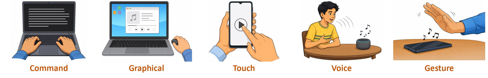

# Beyond syllabus: From typed commands to voice and gestures

*Chapter 2 · Beyond syllabus. The printed chapter shows the five kinds of user interface. Here they are in the order they came, and why each one came.*

{ width="720" }

| When | Interface | You … | Early examples | Why it came |
|---|---|---|---|---|
| 1970s–80s | Command line (CUI) | type exact commands | MS-DOS, UNIX | computers had little memory; text was all they could show |
| 1984–95 | Graphical (GUI) | click icons and menus with a mouse | Apple Macintosh, Windows 95 | anyone could use a computer without learning commands |
| 2007 onwards | Touch | tap, swipe, pinch | iPhone, Android | phones had no room for a keyboard and mouse |
| 2011 onwards | Voice | speak | Siri, Google Assistant, Alexa | hands-free use; help for people who cannot see or type |
| 2010s onwards | Gesture | move a hand, tilt or shake | motion-sensing game consoles, VR headsets, "flip to silence" | natural movement; games and VR |

*Older ways never disappear:* programmers still use the command line every day, because one typed command can do what
many clicks do (see "Ten safe commands to try").
