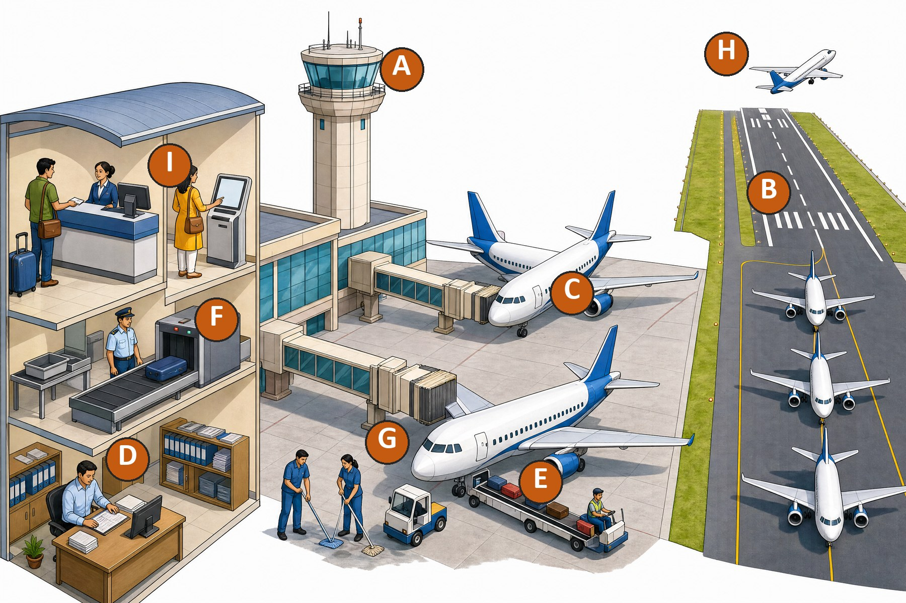

# Explained: The airport, part by part

*Chapter 2 · Explained. The printed chapter uses an airport to picture the operating system. Here is the whole mapping, part by part, with where it stops working.*

{ width="720" }

## The mapping

| | At the airport | In the computer | What is the same | Where it stops working |
|:-:|---|---|---|---|
| A | Control tower and airport management | Operating system | Nothing moves without them; they decide who uses what, and when | The tower never takes a holiday; a computer without an OS cannot do anything at all |
| B | One runway, planes in turn | The CPU, shared by turns (process management) | One plane at a time; the others wait in a queue | A plane holds the runway for minutes; a program holds the CPU for thousandths of a second |
| C | Gates and parking bays | Memory (RAM) | Given to a plane on arrival, freed after take-off | A gate fits one plane; RAM is divided among many programs at once (space sharing) |
| D | Records office | Files | Flight plans and passenger lists stored, found, protected | — |
| E | Aerobridges, baggage belts and their drivers | Devices and their device drivers | Each machine has an operator who knows only that machine | A driver is software, not a person |
| F | Security check | Security; an antivirus | Every bag scanned; only ticket holders allowed in | — |
| G | Cleaning and maintenance crew | Utilities | Keep the airport fit for work | Utilities run when needed or on a schedule |
| H | The airlines and their flights | Application software | What the passengers came for | — |
| I | Check-in counter and kiosk | User interface | Where passengers tell the airport what they want | An airport has one or two ways in; a phone has five kinds of interface |

## Several runways: several CPU cores

A big airport has two or three runways, so two or three planes can take off at the same moment. A phone with an
8-core processor is like an airport with 8 runways: 8 programs can really run at the same instant, and each core still
shares its time among many programs.

## Humanware: the passengers

Some books say a computer system has four parts: **hardware**, the **operating system**, **application programs** and
**humanware**, the people who use it. At the airport, the humanware is the passengers and the staff: without them, the
planes have nowhere to go.
