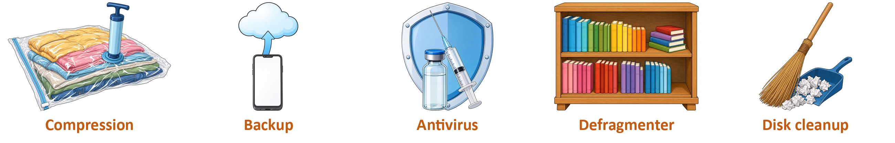

# Explained: Utilities on your phone

*Chapter 2 · Explained. The printed chapter names five utilities. Here is where to find each one on a phone or laptop, what it really does, and the cyber links in full.*

{ width="720" }

*Menus differ from one phone maker to another; look for the words in **bold**.*

| Utility | What it does | On an Android phone | On a Windows laptop |
|---|---|---|---|
| Compression | stores a file or folder in less space; "unzips" it back | the **Files** app opens and extracts zip files | right-click a folder → **Compress to ZIP file** |
| Backup | keeps a safe copy elsewhere | Settings → Google → **Backup**; WhatsApp → Settings → Chats → **Chat backup** | Settings → **Windows Backup**, or copy to a pen drive |
| Antivirus | finds and removes malware | Play Store → your profile → **Play Protect** | **Windows Security** → Virus & threat protection |
| Defragmenter | gathers the scattered pieces of files on a hard disk | not needed: phones use flash memory | **Defragment and Optimize Drives** (on an SSD it only "trims") |
| Disk cleanup | deletes files nobody needs | Settings → **Storage**, or the Files app → **Clean** | **Disk Cleanup**, or Settings → Storage → Temporary files |

## Why a defragmenter does not help a phone or an SSD

A hard disk has a spinning plate and a moving arm, like a gramophone record. If a file is broken into pieces all over
the plate, the arm must jump about to read it, which is slow; gathering the pieces makes reading fast again. A phone and
an SSD have no moving parts: every piece is reached equally fast, so gathering them saves nothing (and needless writing
wears flash memory out a little).

## Cyber links, in full (Chapter 18)

- **What an antivirus catches.** The three kinds of **malware** in the syllabus: a **virus** (copies itself into other
  files), a **trojan** (looks like a useful program but does harm in secret) and **adware** (forces unwanted ads on you).
  Like the airport's security check, it checks everything that comes in.
- **Backup against ransomware.** Ransomware locks your files and demands money to unlock them. With a recent backup
  kept somewhere else, you lose nothing: wipe the device, restore the backup, and pay nobody.
- **The fake cleaner.** "Your phone is 87% full of junk: clean now!" pop-ups and unknown "cleaner" or "booster" apps are a
  common disguise for adware and trojans. The utilities above come with the phone; you do not need another one.
