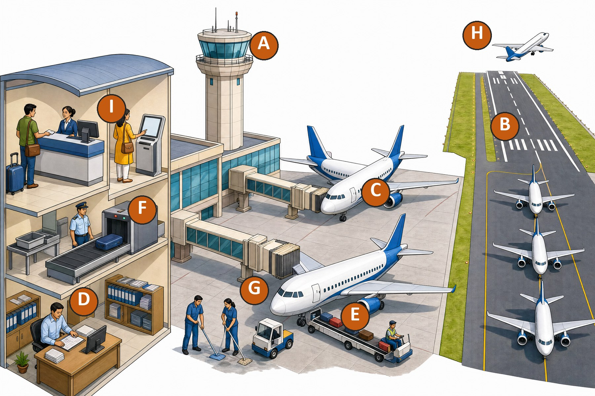
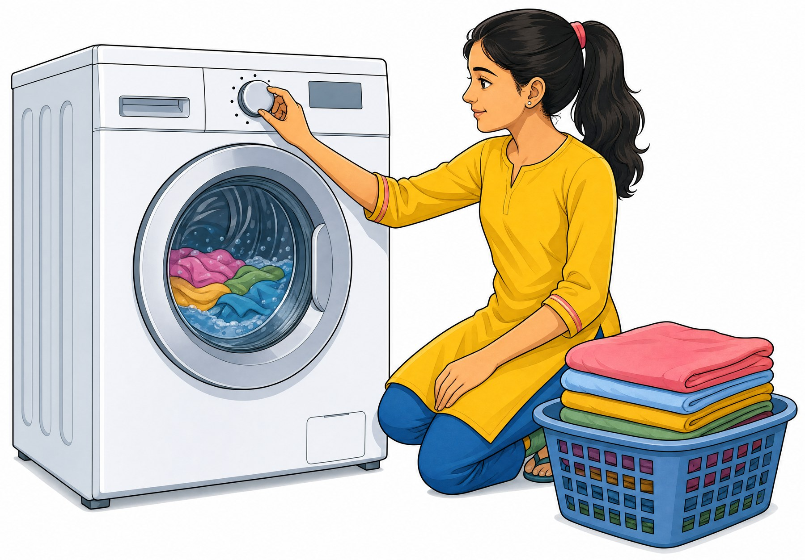
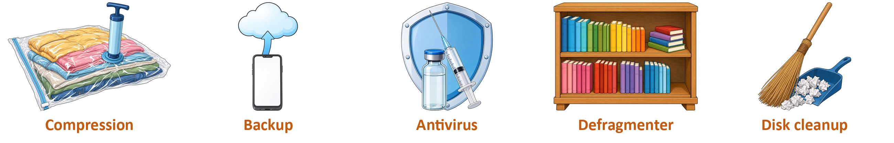
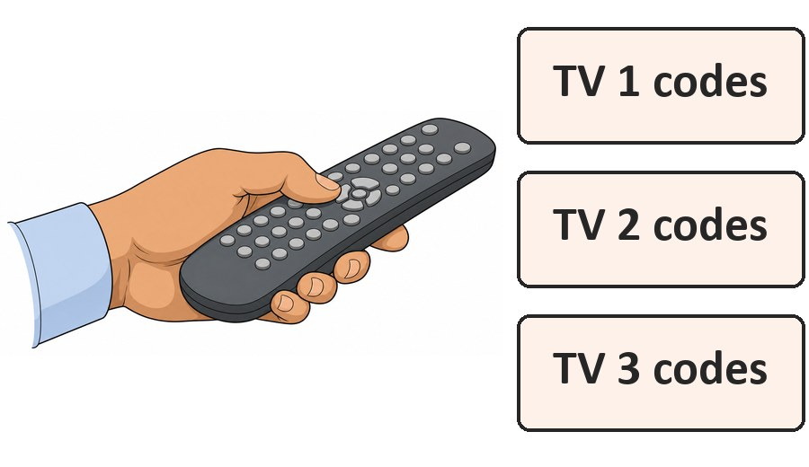
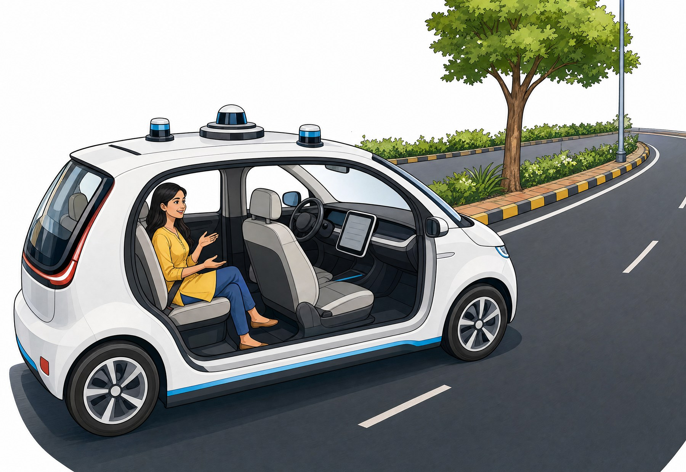
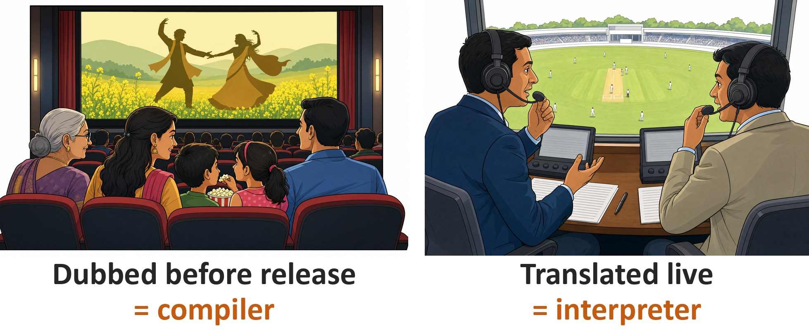
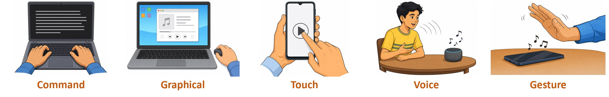

# Chapter 2: Software and Operating Systems

The online pages of Chapter 2 of *Computer Science with Python, CBSE Class XI*. The label under each QR code in the
printed book says what you will find: **Explained**, **Step by step**, **See it** (interactive), **Helps you
understand**, **Sometimes asked**, **Beyond syllabus**, **Challenge**, **Practice** and **Revise**.

| Page | Label | Section of the book |
|---|---|---|
| [Why books group software differently](sometimes-asked-grouping-software.md) | Sometimes asked | 2.1 |
| [The airport, part by part](explained-airport-part-by-part.md) | Explained | 2.2 |
| [Utilities on your phone](explained-utilities-on-your-phone.md) | Explained | 2.2 |
| [Installing a printer: the device driver at work](step-by-step-installing-a-printer.md) | Step by step | 2.2 |
| [Kinds of application software](helps-kinds-of-application-software.md) | Helps you understand | 2.3 |
| [Compiler vs interpreter, step by step](see-it-compiler-interpreter.md) | See it | 2.4 |
| [The robot that knows six commands](challenge-robot-six-commands.md) | Challenge | 2.4 |
| [From source code to a running program](sometimes-asked-source-to-running-program.md) | Sometimes asked | 2.4 |
| [Software libraries](sometimes-asked-software-libraries.md) | Sometimes asked | 2.4 |
| [How Python really runs](beyond-how-python-runs.md) | Beyond syllabus | 2.4 |
| [The OS at work on your phone](explained-os-at-work.md) | Explained | 2.5 |
| [What happens when you tap an app](step-by-step-tap-an-app.md) | Step by step | 2.5 |
| [Types of operating system](beyond-types-of-os.md) | Beyond syllabus | 2.5 |
| [How to report a cyber crime](explained-report-a-cyber-crime.md) | Explained | 2.5 |
| [From typed commands to voice and gestures](beyond-ui-timeline.md) | Beyond syllabus | 2.6 |
| [Ten safe commands to try](challenge-safe-commands.md) | Challenge | 2.6 |
| [Questions with answers, by type](questions/index.md) | Practice | the whole chapter |
| [Flashcards](flashcards.md) and [glossary](glossary.md) | Revise | the whole chapter |
| [Concept map](concept-map.md) | Revise | the whole chapter |

## Full-colour pictures

Large full-colour versions of the pictures of the printed chapter.

**The whole chapter at one airport** (end of the chapter): find each letter, then say what it is in a computer.

**Same machine, different programs** (section 2.1).

**Five utilities** (section 2.2): compression, backup, antivirus, defragmenter, disk cleanup.

**The universal remote** (section 2.2): it needs each TV's codes, as the OS needs each device's driver.

**Three ways to tell a car where to go** (section 2.4).

**Dubbed before release, translated live** (section 2.4): the compiler and the interpreter.

**Play your favourite song, five ways** (section 2.6).

