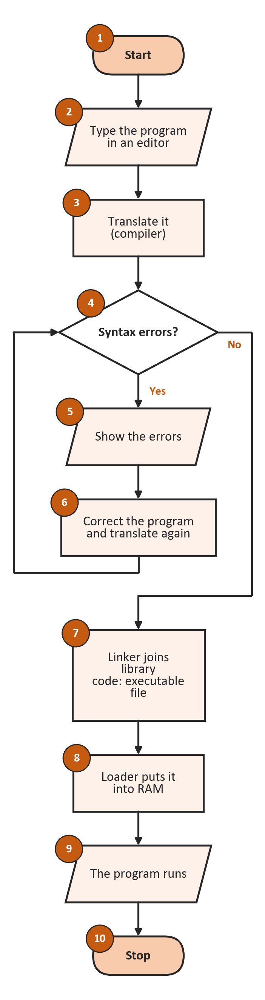

# Sometimes asked: From source code to a running program

*Chapter 2 · Sometimes asked. The syllabus names the translators. Some papers and books also ask about the editor, the linker and the loader: the steps a program goes through before it runs.*

## The steps

1. Start.
2. Type the program in an editor.
3. Translate it (compiler).
4. Syntax errors? Yes: go to 5. No: go to 7.
5. Show the errors.
6. Correct the program and translate again; go to 4.
7. Linker joins library code: executable file.
8. Loader puts it into RAM.
9. The program runs.
10. Stop.

## The flowchart

{ width="258" }

## The tools on the way

| Tool | What it does | Like … |
|---|---|---|
| **Editor** | lets you type and save the source code | a notebook |
| **Translator** (compiler) | turns source code into object code; lists syntax errors | the dubbing studio |
| **Linker** | joins your object code with ready-made **library** code into one executable file | binding the chapters of a book with the printed glossary |
| **Loader** | a part of the OS: copies the executable file from storage into RAM and starts it | the usher who takes you to your seat |
| **IDE** | the editor, translator and error messages in one window (IDLE for Python) | a whole studio in one room |

**Errors on the way.** A **syntax error** (grammar) is caught by the translator, before anything runs. A **logical
error** (a wrong formula) is not caught by any tool: the program runs and gives a wrong answer, and only testing finds
it (Chapters 5 and 8).

**And Python?** Python has no separate linker step for your program: its interpreter reads the file, makes bytecode and
runs it, and the `import` statement brings library code in while the program runs (see "How Python really runs").
