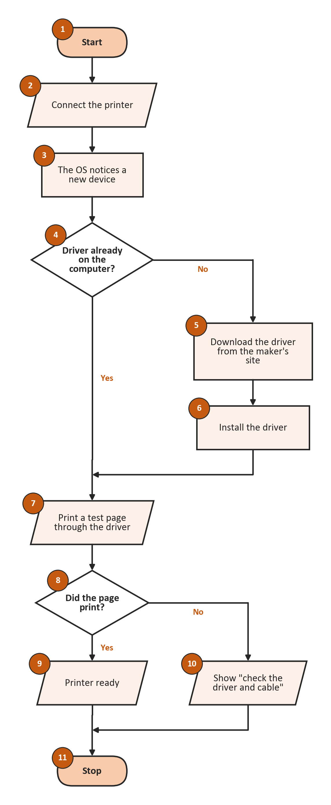

# Step by step: Installing a printer: the device driver at work

*Chapter 2 · Step by step. The printed chapter explains drivers with a universal TV remote. Here is the real procedure, as numbered steps and as a flowchart with the same numbers.*

## The steps

1. Start.
2. Connect the printer.
3. The OS notices a new device.
4. Driver already on the computer? Yes: go to 7. No: go to 5.
5. Download the driver from the maker's site.
6. Install the driver.
7. Print a test page through the driver.
8. Did the page print? Yes: go to 9. No: go to 10.
9. Printer ready; go to 11.
10. Show "check the driver and cable".
11. Stop.

## The flowchart

{ width="439" }

## What each step means

- **Steps 2–3.** The OS knows "a printer was connected", but not this model's own signals. Windows and Android carry
  drivers for many common printers; if this one is new or rare, the OS cannot print yet.
- **Steps 4–6.** If the driver is missing, the **only** safe place to get it is the maker's own website (or the OS's own update). A pop-up or a
  link in a message saying "update your driver now" is a common way for a **trojan** to get in (Chapter 18).
- **Steps 7–10.** The test page proves that the OS, the driver and the printer understand each other.

*Where the universal remote fits:* steps 5–6 are like giving the remote the code set for your TV's brand.
