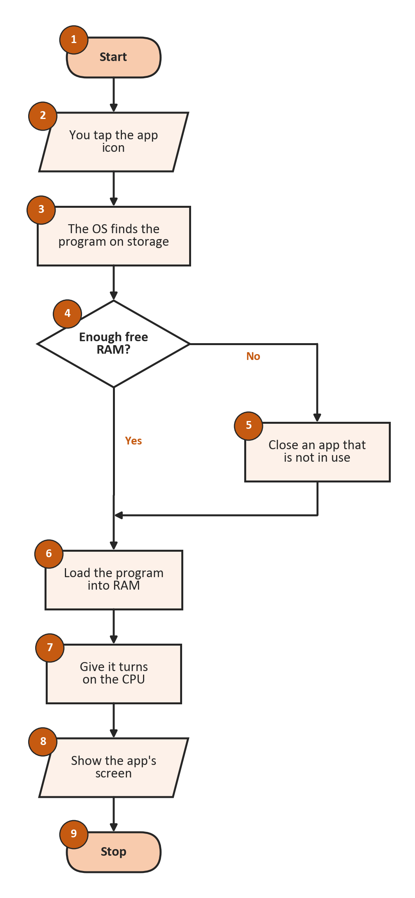

# Step by step: What happens when you tap an app

*Chapter 2 · Step by step. The printed chapter says that one tap uses four functions of the OS. Here are the steps, and a flowchart with the same numbers.*

## The steps

1. Start.
2. You tap the app icon.
3. The OS finds the program on storage.
4. Enough free RAM? Yes: go to 6. No: go to 5.
5. Close an app that is not in use.
6. Load the program into RAM.
7. Give it turns on the CPU.
8. Show the app's screen.
9. Stop.

## The flowchart

{ width="390" }

## Which function does each step use?

| Step | Function of the OS |
|---|---|
| 2 (your tap) | user interface |
| 3 (find the program) | file management |
| 4–6 (free RAM, load it) | memory management |
| 7 (turns on the CPU) | process management |
| 8 (show the screen) | device management (the display) and the user interface |

*Why does an app open faster the second time?* It may still be in RAM from last time, so steps 4–6 are skipped.
