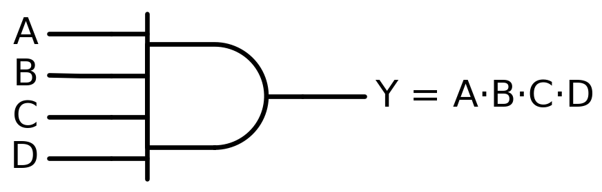
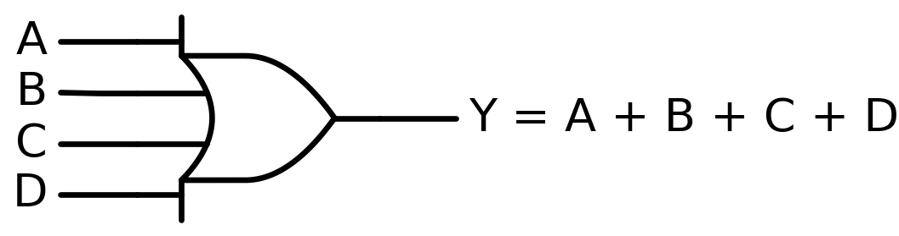
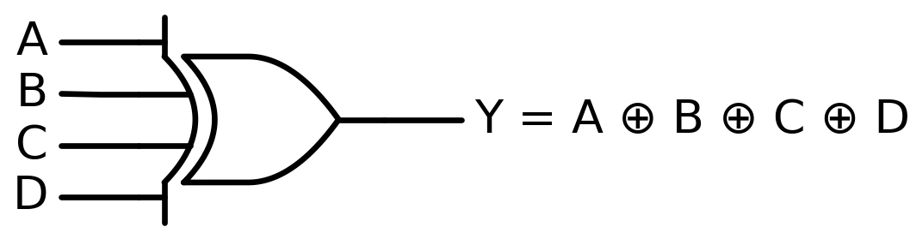
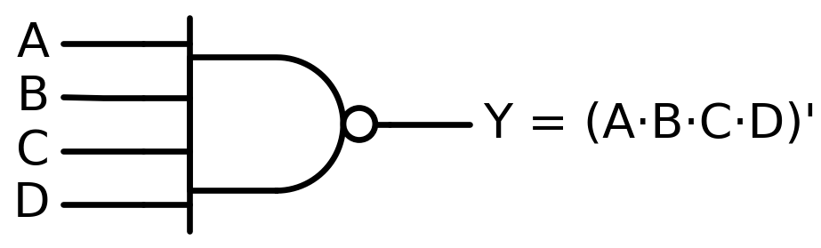
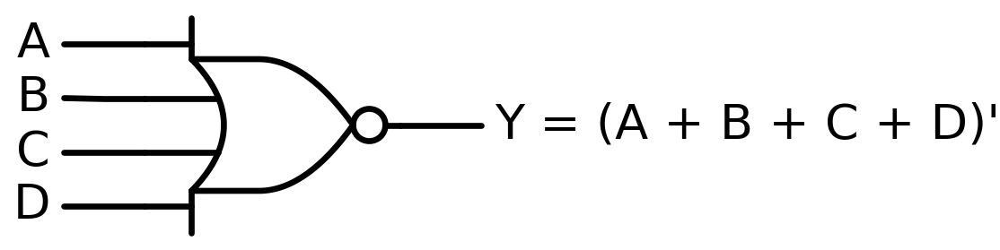
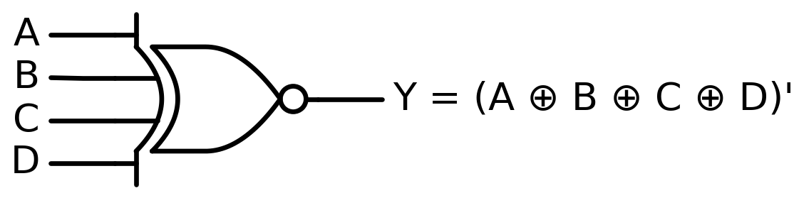

# Beyond syllabus: gates with four inputs

*Chapter 3 · Beyond syllabus. The printed book (section 3.5) shows gates with three inputs; this page goes one step further. Every table and answer here was computed by a program (`tools/four_input_page.py`) and checked row by row.*

## 1. The same rules, more inputs

A gate can have any number of inputs. Its rule stays the same; only the table grows. With four inputs A, B, C and D there are 2 × 2 × 2 × 2 = **2⁴ = 16** rows.

| Gate | Expression | Gives 1 when … | Rows with 1 (of 16) |
|---|:-:|---|:-:|
| AND | A·B·C·D | **all four** inputs are 1 | 1 |
| OR | A + B + C + D | **at least one** input is 1 | 15 |
| NAND | (A·B·C·D)' | **not all** inputs are 1 | 15 |
| NOR | (A + B + C + D)' | **all four** inputs are 0 | 1 |
| XOR | A ⊕ B ⊕ C ⊕ D | an **odd** number of inputs are 1 | 8 |
| XNOR | (A ⊕ B ⊕ C ⊕ D)' | an **even** number of inputs are 1 (0, 2 or 4) | 8 |

*The trap:* a 4-input XOR is **not** "1 when the inputs differ". With 1, 1, 1, 1 all inputs are the same, but the count of 1s is 4 (even), so XOR gives 0. Always count the 1s.

## 2. The symbols

The shape does not change: the gate simply has four input lines.

| | | |
|:-:|:-:|:-:|
| { width="300" } | { width="300" } | { width="300" } |
| { width="300" } | { width="300" } | { width="300" } |

## 3. The full truth table

Each row gives the four inputs A, B, C, D in order (0 1 0 1 means A = 0, B = 1, C = 0, D = 1). The column "1s" counts the inputs that are 1: it makes the XOR and XNOR columns easy to check.

| A B C D | 1s | AND | OR | NAND | NOR | XOR | XNOR |
|:-:|:-:|:-:|:-:|:-:|:-:|:-:|:-:|
| 0 0 0 0 | 0 | 0 | 0 | 1 | 1 | 0 | 1 |
| 0 0 0 1 | 1 | 0 | 1 | 1 | 0 | 1 | 0 |
| 0 0 1 0 | 1 | 0 | 1 | 1 | 0 | 1 | 0 |
| 0 0 1 1 | 2 | 0 | 1 | 1 | 0 | 0 | 1 |
| 0 1 0 0 | 1 | 0 | 1 | 1 | 0 | 1 | 0 |
| 0 1 0 1 | 2 | 0 | 1 | 1 | 0 | 0 | 1 |
| 0 1 1 0 | 2 | 0 | 1 | 1 | 0 | 0 | 1 |
| 0 1 1 1 | 3 | 0 | 1 | 1 | 0 | 1 | 0 |
| 1 0 0 0 | 1 | 0 | 1 | 1 | 0 | 1 | 0 |
| 1 0 0 1 | 2 | 0 | 1 | 1 | 0 | 0 | 1 |
| 1 0 1 0 | 2 | 0 | 1 | 1 | 0 | 0 | 1 |
| 1 0 1 1 | 3 | 0 | 1 | 1 | 0 | 1 | 0 |
| 1 1 0 0 | 2 | 0 | 1 | 1 | 0 | 0 | 1 |
| 1 1 0 1 | 3 | 0 | 1 | 1 | 0 | 1 | 0 |
| 1 1 1 0 | 3 | 0 | 1 | 1 | 0 | 1 | 0 |
| 1 1 1 1 | 4 | 1 | 1 | 0 | 0 | 0 | 1 |

*Reading the table:* AND has one 1 (the last row); OR has one 0 (the first row); NAND and NOR are those two turned round; XOR and XNOR follow the "1s" column: odd gives XOR = 1, even gives XNOR = 1.

## 4. Building a 4-input gate from 2-input gates

- **AND, OR, XOR:** join the inputs in pairs, then join the two results: Y = (A·B)·(C·D), Y = (A + B) + (C + D), Y = (A ⊕ B) ⊕ (C ⊕ D). Three 2-input gates in each case.
- **NAND, NOR, XNOR:** build the AND, OR or XOR first, then put **one NOT at the very end**: Y = ((A·B)·(C·D))'.
- *Trap:* three 2-input NAND gates joined in pairs do **not** make a 4-input NAND. ((A·B)'·(C·D)')' works out to A·B + C·D (De Morgan), a different expression.

## 5. Practice

**Q1.** A 4-input AND gate gets A = 1, B = 1, C = 0, D = 1. What is its output?

**Answer.** **0**: one input is 0, and AND needs all four to be 1.

**Q2.** A 4-input OR gate gets 0, 0, 1, 0. What is its output?

**Answer.** **1**: one input is 1 is enough for OR.

**Q3.** A 4-input NAND gate gets 1, 1, 1, 1. What is its output?

**Answer.** **0**: the only row where NAND gives 0.

**Q4.** A 4-input NOR gate gets 0, 0, 0, 1. What is its output?

**Answer.** **0**: NOR gives 1 only when all four inputs are 0.

**Q5.** A 4-input XOR gate gets 1, 1, 1, 0. What is its output?

**Answer.** **1**: three 1s, an odd number.

**Q6.** A 4-input XOR gate gets 1, 1, 1, 1. What is its output?

**Answer.** **0**: four 1s, an even number. *Trap:* not 1 because "all are 1".

**Q7.** A 4-input XNOR gate gets 1, 0, 0, 1. What is its output?

**Answer.** **1**: two 1s, an even number.

**Q8.** A 4-input XNOR gate gets 0, 0, 0, 0. What is its output?

**Answer.** **1**: no 1s at all, and 0 counts as even.

**Q9.** How many rows has the truth table of a 4-input gate? In how many of them does a 4-input XOR give 1?

**Answer.** 2⁴ = **16** rows; XOR gives 1 in **8** of them (exactly half: the rows with 1 or 3 ones).

**Q10.** How many 2-input AND gates make one 4-input AND gate? Write the expression.

**Answer.** **3**: (A·B) and (C·D), then an AND of the two results: Y = (A·B)·(C·D).
