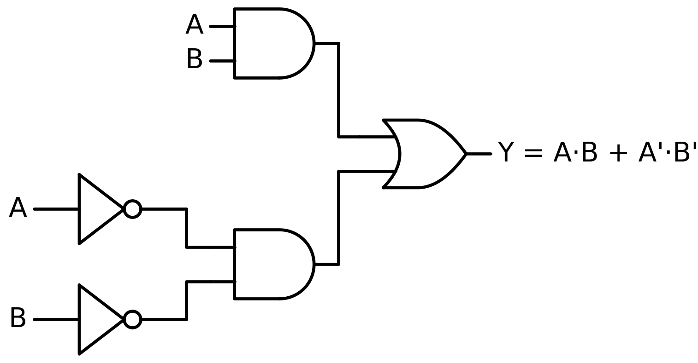

# Beyond syllabus: XNOR, the "same answer" detector

*Chapter 3 · Beyond syllabus. The printed book has the essentials of XNOR (section 3.4); this page goes further.*

*Every table and answer on this page was computed by a program (`tools/boolean_pages.py`) and checked row by row.*

## 1. What it does

An **XNOR** gate gives **1 when its inputs are the same**, and 0 when they differ. It is XOR followed by NOT.

| A | B | Y = (A ⊕ B)' |
|:-:|:-:|:-:|
| 0 | 0 | 1 |
| 0 | 1 | 0 |
| 1 | 0 | 0 |
| 1 | 1 | 1 |

- Expression: **Y = (A ⊕ B)' = A·B + A'·B'**: "both 1, or both 0".
- Symbol: the XOR symbol with a bubble at the output.

## 2. XNOR built from AND, OR and NOT

Two AND gates catch "both 1" (A·B) and "both 0" (A'·B'); the OR gate says yes if either happened.

## 3. More than two inputs: the even detector

With three or more inputs, XNOR (XOR followed by NOT) gives 1 when an **even** number of inputs are 1.

| A | B | C | Number of 1s | XNOR of all three |
|:-:|:-:|:-:|:-:|:-:|
| 0 | 0 | 0 | 0 | 1 |
| 0 | 0 | 1 | 1 | 0 |
| 0 | 1 | 0 | 1 | 0 |
| 0 | 1 | 1 | 2 | 1 |
| 1 | 0 | 0 | 1 | 0 |
| 1 | 0 | 1 | 2 | 1 |
| 1 | 1 | 0 | 2 | 1 |
| 1 | 1 | 1 | 3 | 0 |

## 4. Where it is used: are two numbers equal?

To check whether two 2-bit numbers A1A0 and B1B0 are equal, compare them bit by bit with XNOR, then AND the answers: equal only if every bit matches. This is how a computer's ALU tests "is A equal to B?" (the comparison of Chapter 1).

| A1 | A0 | B1 | B0 | Equal? E = (A1 ⊕ B1) · (A0 ⊕ B0) |
|:-:|:-:|:-:|:-:|:-:|
| 0 | 0 | 0 | 0 | 1 |
| 0 | 0 | 0 | 1 | 0 |
| 0 | 0 | 1 | 0 | 0 |
| 0 | 0 | 1 | 1 | 0 |
| 0 | 1 | 0 | 0 | 0 |
| 0 | 1 | 0 | 1 | 1 |
| 0 | 1 | 1 | 0 | 0 |
| 0 | 1 | 1 | 1 | 0 |
| 1 | 0 | 0 | 0 | 0 |
| 1 | 0 | 0 | 1 | 0 |
| 1 | 0 | 1 | 0 | 1 |
| 1 | 0 | 1 | 1 | 0 |
| 1 | 1 | 0 | 0 | 0 |
| 1 | 1 | 0 | 1 | 0 |
| 1 | 1 | 1 | 0 | 0 |
| 1 | 1 | 1 | 1 | 1 |

## 5. Practice

1. What is the XNOR of 1 and 0? *Answer:* 0 (they differ).
2. Write XNOR using only AND, OR and NOT. *Answer:* A·B + A'·B'.
3. Is XNOR the same as NOR? *Answer:* No. For A = 1, B = 1: XNOR gives 1, NOR gives 0.
4. A 4-input XNOR gets 1, 1, 0, 1. Output? *Answer:* 0: three 1s is odd.
5. Prove (A ⊕ B)' = A ⊕ B'. *Answer:* both are 1 exactly when A and B are the same (check the four rows).
