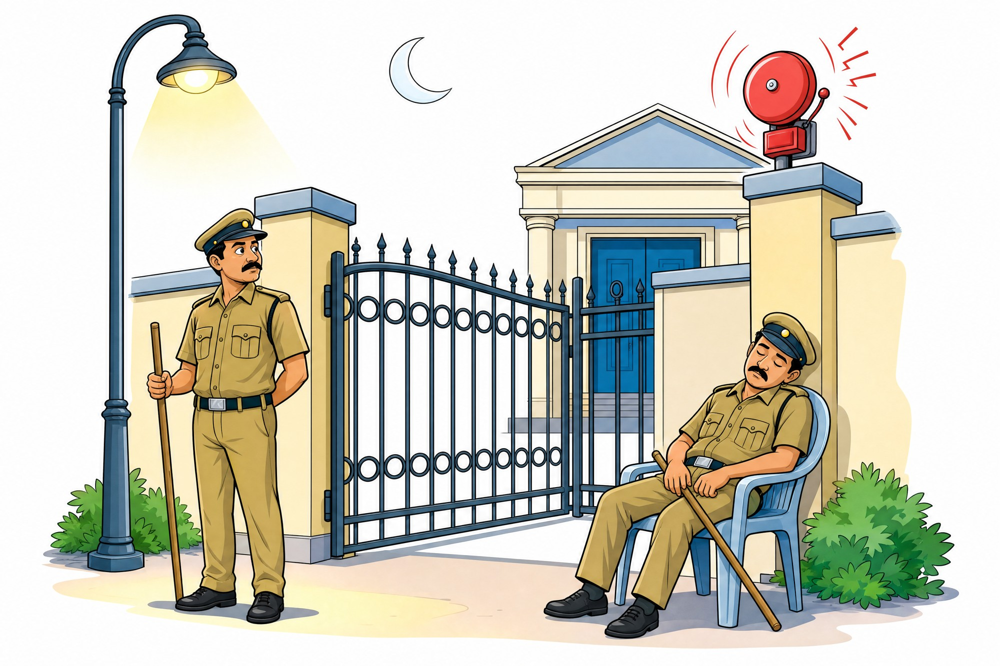
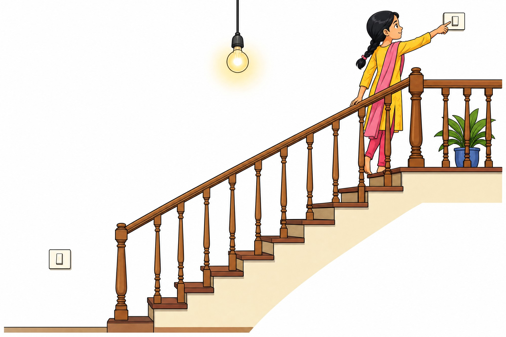

# Chapter 3: Boolean Logic and Logic Circuits

The online pages of this chapter of *Computer Science with Python, CBSE Class XI*. Each page is marked with what it is for.

| Page | What it is for |
|---|---|
| [Challenge: all 16 gates of two inputs](challenge-16-functions.md) | Challenge |
| [Challenge: two bits for three results](challenge-two-bits-three-results.md) | Challenge |
| [Questions with answers](questions/index.md) | Practice |
| [Glossary](glossary.md) | Words of the chapter |
| [Flashcards](flashcards.md) | Revision |

## Full-colour pictures

Large full-colour versions of the pictures in the printed chapter.

