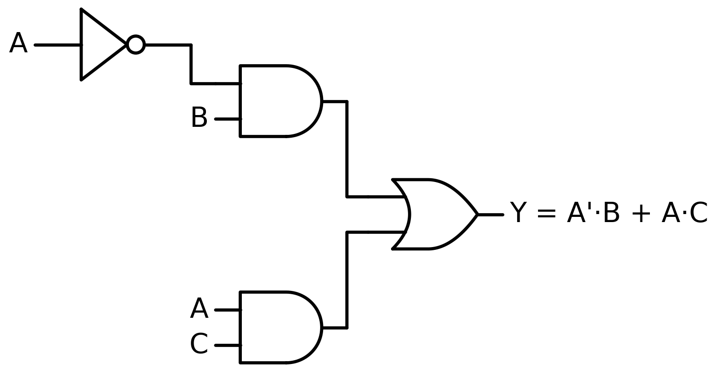
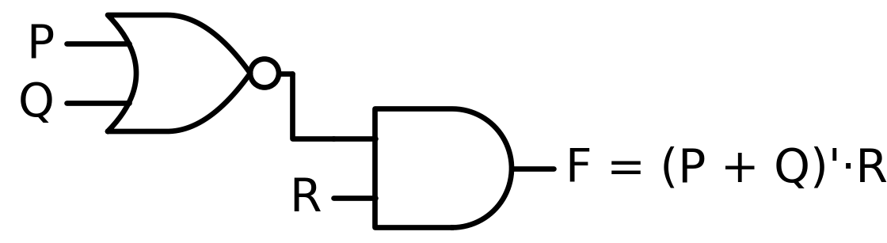

# Chapter 3: Boolean Logic and Logic Circuits: Short-answer questions (25)

*Chapter 3 · Questions (online). The questions of the printed chapter and many more, each followed by its answer and the reason. Try each one first. The difficulty (E easy, M medium, H hard) and the section of the book are given in brackets. Every Boolean answer on this page was checked by a program (`tools/ch03_typed_questions.py`).*

## 1 mark

**Q1.** Which gate has only one input? *(E · 3.2)* *[1 mark]*

**Answer.** The NOT gate (inverter). *Why:* "the opposite" is the opposite of one value; every other gate combines two or more inputs.

**Q2.** A door alarm must ring when either the front door or the back door is open (open = 1). Which gate is needed? *(M · 3.2)* *[1 mark]*

**Answer.** The OR gate. *Why:* one open door is enough. *Exam tip:* the word "either" usually points to OR.

**Q3.** A circuit must give 1 only when its two inputs are different. Which gate? *(E · 3.4)* *[1 mark]*

**Answer.** The XOR gate, the "difference detector".

**Q4.** How many rows does the truth table of an expression with 4 variables have? *(E · 3.1)* *[1 mark]*

**Answer.** 2⁴ = 16 rows. *Trap:* not 4 × 2 = 8.

**Q5.** Which law does A + (B + C) = (A + B) + C show? *(E · 3.7)* *[1 mark]*

**Answer.** The associative law. *Why:* only the grouping changes. If the order changed (A + B = B + A), it would be the commutative law.

**Q6.** State the principle of duality. *(E · 3.7)* *[1 mark]*

**Answer.** If a Boolean law is true, the law made by swapping + with · and 0 with 1 (keeping every letter and prime) is also true.

**Q7.** A 3-input XOR gate gets A = 1, B = 0, C = 1. What is its output? Explain. *(M · 3.5)* *[1 mark]*

**Answer.** 0. *Why:* two inputs are 1, an even number. (1 ⊕ 0 = 1, then 1 ⊕ 1 = 0.)

## 2 marks

**Q8.** What is a logic gate? Name the three basic gates. *(E · 3.1)* *[2 marks]*

**Answer.** A logic gate is a tiny circuit that turns one or more inputs (each 0 or 1) into one output by a fixed rule. The basic gates are NOT, AND and OR.

**Q9.** Why are NAND and NOR called universal gates? Show how NAND makes a NOT gate. *(M · 3.3)* *[2 marks]*

**Answer.** Because any other gate (NOT, AND, OR, and so any circuit) can be built using only NAND gates, or only NOR gates. NOT from NAND: join both inputs and feed A into them: Y = (A · A)' = A'. *Why it works:* A · A = A (idempotent law). *Exam tip:* draw a NAND with its two inputs joined.

**Q10.** Write the truth table of a 2-input NAND gate and give its expression. *(E · 3.3)* *[2 marks]*

**Answer.** Y = (A·B)'.

| A | B | Y = (A·B)' |
|:-:|:-:|:-:|
| 0 | 0 | 1 |
| 0 | 1 | 1 |
| 1 | 0 | 1 |
| 1 | 1 | 0 |

*Why:* the AND column turned round: 0 only in the last row.

**Q11.** Complete and name each law: (i) A + A = ___ (ii) A · A' = ___ (iii) (A')' = ___ (iv) A + A·B = ___ *(E · 3.7)* *[2 marks]*

**Answer.** (i) A, idempotent (ii) 0, complement (iii) A, involution (iv) A, absorption. *Exam tip:* half a mark for the value, half for the name.

**Q12.** Find the complement of F = A·B' + C·D using De Morgan's laws. *(M · 3.6)* *[2 marks]*

**Answer.** F' = (A·B' + C·D)' = (A·B')'·(C·D)' = **(A' + B)·(C' + D')**. *Why:* De Morgan on the +, then on each ·; (B')' = B. *Exam tip:* keep the brackets in the last line.

**Q13.** Find the complement of F = (A + B)·(C + D'). *(M · 3.6)* *[2 marks]*

**Answer.** F' = ((A + B)·(C + D'))' = (A + B)' + (C + D')' = **A'·B' + C'·D**. *Why:* the · between the brackets becomes +, and each bracket is opened with the first law.

**Q14.** Write the dual of: (i) A + A·B = A (ii) (A + B)·(A + C) = A + B·C. *(E · 3.7)* *[2 marks]*

**Answer.** (i) A·(A + B) = A (ii) A·B + A·C = A·(B + C). *Why:* swap + and ·; letters and primes stay.

**Q15.** Define tautology and fallacy, with one example of each. *(E · 3.7)* *[2 marks]*

**Answer.** A tautology is 1 for every combination of inputs, e.g. A + A'. A fallacy is 0 for every combination, e.g. A·A'. *Exam tip:* "every combination" is the key phrase.

**Q16.** Prove algebraically that A + A'·B = A + B. *(M · 3.7)* *[2 marks]*

**Answer.** A + A'·B = (A + A')·(A + B) (distributive) = 1·(A + B) (complement) = A + B (identity). *Exam tip:* name the law at every step.

**Q17.** Make the truth table of Y = A'·B + A·B' and say which single gate it is. *(M · 3.5)* *[2 marks]*

**Answer.** Outputs for A, B = 00, 01, 10, 11: **0, 1, 1, 0**. It is the **XOR** gate: Y is 1 exactly when A and B differ.

**Q18.** Show how to make an AND gate using only NOR gates. *(M · 3.3)* *[2 marks]*

**Answer.** Feed A into a NOR with both inputs joined (gives A'), and B the same way (gives B'); feed A' and B' into a third NOR: (A' + B')' = A·B (De Morgan). Three NOR gates in all.

**Q19.** Write the XNOR truth table for two inputs, and its expression. *(E · 3.4)* *[2 marks]*

**Answer.** Outputs for 00, 01, 10, 11: **1, 0, 0, 1**. Y = (A ⊕ B)' = A·B + A'·B'. *Why:* 1 when the inputs are the same.

**Q20.** How many NAND gates are needed to make an OR gate? Show the circuit in words. *(M · 3.3)* *[2 marks]*

**Answer.** Three: two NANDs with joined inputs make A' and B'; a third NAND gives (A'·B')' = A + B.

**Q21.** Draw the Venn diagrams of A + B and A·B, and say which one shows an OR gate. *(E · 3.2)* *[2 marks]*

**Answer.** A + B: both circles fully shaded; A·B: only the overlap shaded (section 3.2). The first, A + B, is OR.

**Q22.** Why are there 2ⁿ rows in the truth table of n inputs? *(M · 3.1)* *[2 marks]*

**Answer.** Each input can be 0 or 1. The first input gives 2 rows; every new input can be 0 or 1 in each of those rows, so it doubles them: 2 × 2 × … × 2 (n times) = 2ⁿ.

## Drawing circuits (2 and 3 marks)

**Q23.** Draw the logic circuit for Y = A'·B + A·C. *(M · 3.8)* *[2 marks]*

**Answer.** A NOT gate for A'; an AND gate for A'·B; an AND gate for A·C; an OR gate joining the two AND outputs.

{ width="420" }

*How to answer:* inputs on the left, output on the right, label every line.

**Q24.** Draw the logic circuit for F = (P + Q)' · R. *(M · 3.8)* *[2 marks]*

**Answer.** P and Q go into a NOR gate (or an OR gate followed by NOT), giving (P + Q)'; that output and R go into an AND gate.

{ width="420" }

*Exam tip:* label the output of every gate, not only F.

**Q25.** Explain the order of operations in a Boolean expression, with an example. *(E · 3.8)* *[2 marks]*

**Answer.** Brackets first, then NOT, then AND, then OR (B-N-A-O). Example: in A + B·C', first C', then B·C', then the OR with A.
