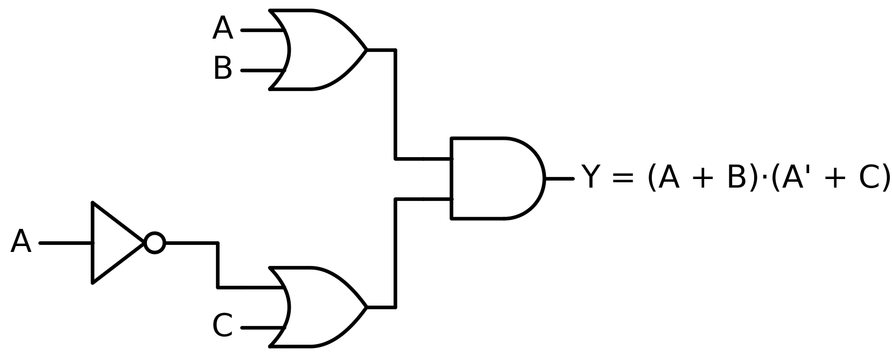
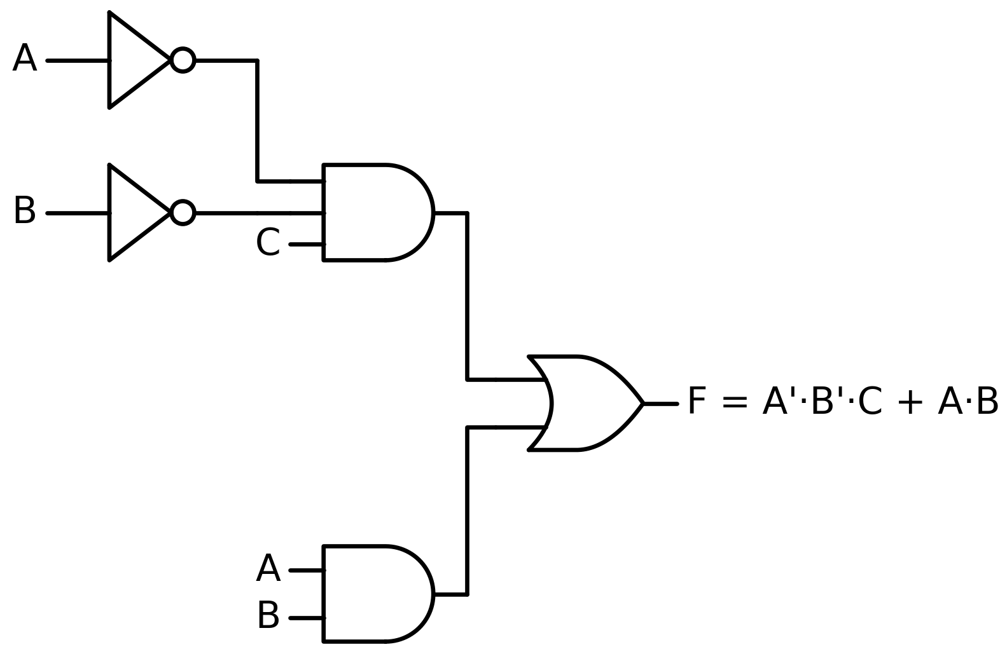

# Chapter 3: Boolean Logic and Logic Circuits: Long-answer questions (10)

*Chapter 3 · Questions (online). The questions of the printed chapter and many more, each followed by its answer and the reason. Try each one first. The difficulty (E easy, M medium, H hard) and the section of the book are given in brackets. Every Boolean answer on this page was checked by a program (`tools/ch03_typed_questions.py`).*

**Q1.** Draw the symbols of the AND, OR and NOT gates and write the truth table of each. *(E · 3.2)* *[3 marks]*

**Answer.** Symbols: AND is a D shape (flat back, round front); OR is a shield (curved back, pointed front); NOT is a triangle with a bubble at its tip (figures of section 3.2).

| A | NOT: A' |
|:-:|:-:|
| 0 | 1 |
| 1 | 0 |

| A | B | AND: A·B | OR: A + B |
|:-:|:-:|:-:|:-:|
| 0 | 0 | 0 | 0 |
| 0 | 1 | 0 | 1 |
| 1 | 0 | 0 | 1 |
| 1 | 1 | 1 | 1 |

*Exam tip:* NOT has one input, so it gets its own two-row table.

**Q2.** Explain the XOR gate with its symbol, expression and truth table for two inputs. *(M · 3.4)* *[3 marks]*

**Answer.** The XOR (exclusive OR) gate gives 1 when its two inputs are **different** and 0 when they are the same. Expression: Y = A ⊕ B = A'·B + A·B'. Symbol: the OR shape with an extra curved line at the input side.

| A | B | Y = A ⊕ B |
|:-:|:-:|:-:|
| 0 | 0 | 0 |
| 0 | 1 | 1 |
| 1 | 0 | 1 |
| 1 | 1 | 0 |

*Why "exclusive":* it excludes the row where both inputs are 1, which ordinary OR includes.

**Q3.** State De Morgan's first law and prove it using a truth table. *(M · 3.6)* *[3 marks]*

**Answer.** First law: **(A + B)' = A' · B'**.

| A | B | A + B | (A + B)' | A' | B' | A'·B' |
|:-:|:-:|:-:|:-:|:-:|:-:|:-:|
| 0 | 0 | 0 | 1 | 1 | 1 | 1 |
| 0 | 1 | 1 | 0 | 1 | 0 | 0 |
| 1 | 0 | 1 | 0 | 0 | 1 | 0 |
| 1 | 1 | 1 | 0 | 0 | 0 | 0 |

The columns (A + B)' and A'·B' are identical in all rows; hence proved. *How to answer:* formula + table + one closing line. Never only the name.

**Q4.** State De Morgan's second law and prove it with a truth table. *(M · 3.6)* *[3 marks]*

**Answer.** Second law: **(A · B)' = A' + B'**.

| A | B | A·B | (A·B)' | A' | B' | A' + B' |
|:-:|:-:|:-:|:-:|:-:|:-:|:-:|
| 0 | 0 | 0 | 1 | 1 | 1 | 1 |
| 0 | 1 | 0 | 1 | 1 | 0 | 1 |
| 1 | 0 | 0 | 1 | 0 | 1 | 1 |
| 1 | 1 | 1 | 0 | 0 | 0 | 0 |

The columns (A·B)' and A' + B' are identical in all four rows; hence proved. *Exam tip:* some examiners number the laws the other way, so the formula protects your marks.

**Q5.** Make the truth table of Y = (A + B)' · C. *(M · 3.5)* *[3 marks]*

**Answer.** Three inputs, so 2³ = 8 rows. Steps, inside out: A + B, then (A + B)', then Y.

| A | B | C | A + B | (A + B)' | Y = (A + B)'·C |
|:-:|:-:|:-:|:-:|:-:|:-:|
| 0 | 0 | 0 | 0 | 1 | 0 |
| 0 | 0 | 1 | 0 | 1 | 1 |
| 0 | 1 | 0 | 1 | 0 | 0 |
| 0 | 1 | 1 | 1 | 0 | 0 |
| 1 | 0 | 0 | 1 | 0 | 0 |
| 1 | 0 | 1 | 1 | 0 | 0 |
| 1 | 1 | 0 | 1 | 0 | 0 |
| 1 | 1 | 1 | 1 | 0 | 0 |

*Why only one 1:* Y needs A = 0, B = 0 **and** C = 1. *Exam tip:* a column for each step earns the method marks.

**Q6.** Name the law X + Y·Z = (X + Y)·(X + Z) and verify it with a truth table. *(M · 3.7)* *[3 marks]*

**Answer.** The distributive law (second form: OR over AND).

| X | Y | Z | Y·Z | X + Y·Z | X + Y | X + Z | (X + Y)·(X + Z) |
|:-:|:-:|:-:|:-:|:-:|:-:|:-:|:-:|
| 0 | 0 | 0 | 0 | 0 | 0 | 0 | 0 |
| 0 | 0 | 1 | 0 | 0 | 0 | 1 | 0 |
| 0 | 1 | 0 | 0 | 0 | 1 | 0 | 0 |
| 0 | 1 | 1 | 1 | 1 | 1 | 1 | 1 |
| 1 | 0 | 0 | 0 | 1 | 1 | 1 | 1 |
| 1 | 0 | 1 | 0 | 1 | 1 | 1 | 1 |
| 1 | 1 | 0 | 0 | 1 | 1 | 1 | 1 |
| 1 | 1 | 1 | 1 | 1 | 1 | 1 | 1 |

The columns X + Y·Z and (X + Y)·(X + Z) are identical in all eight rows; hence verified. *Why it surprises:* ordinary arithmetic has no such rule (1 + 2 × 3 = 7, but (1 + 2) × (1 + 3) = 12).

**Q7.** Simplify: (i) A·B + A·B' (ii) A·(A + B) (iii) (A + B)'·A. *(M · 3.7)* *[3 marks]*

**Answer.** (i) A·(B + B') = A·1 = **A**. (ii) **A** (absorption). (iii) A'·B'·A = (A·A')·B' = 0·B' = **0**. *Why (iii):* A and A' cannot both be 1.

**Q8.** Draw the circuit for Y = (A + B)·(A' + C). *(M · 3.8)* *[3 marks]*

**Answer.** One NOT gate for A'; one OR gate for A + B; one OR gate for A' + C; one AND gate joining the two OR outputs.

{ width="420" }

*Exam tip:* in a product of sums the OR gates come first and the AND is last.

**Q9.** Draw the logic circuit for F = A'·B'·C + A·B. *(M · 3.8)* *[3 marks]*

**Answer.** NOT gates for A' and B'; a 3-input AND for A'·B'·C; a 2-input AND for A·B; an OR gate joining the two AND outputs.

{ width="420" }

*Exam tip:* a 3-input AND is allowed; or use two 2-input ANDs one after the other.

**Q10.** Verify using a truth table that A·B + A'·C + B·C = A·B + A'·C (consensus). Then complement X·Y + X'·Z and check your answer for X = 1, Y = 1, Z = 0. *(H · 3.6–3.7)* *[4 marks]*

**Answer.**

| A | B | C | A·B + A'·C + B·C | A·B + A'·C |
|:-:|:-:|:-:|:-:|:-:|
| 0 | 0 | 0 | 0 | 0 |
| 0 | 0 | 1 | 1 | 1 |
| 0 | 1 | 0 | 0 | 0 |
| 0 | 1 | 1 | 1 | 1 |
| 1 | 0 | 0 | 0 | 0 |
| 1 | 0 | 1 | 0 | 0 |
| 1 | 1 | 0 | 1 | 1 |
| 1 | 1 | 1 | 1 | 1 |

The two columns are equal in all eight rows. *Why the B·C term adds nothing:* when B·C = 1, either A = 1 (then A·B = 1) or A = 0 (then A'·C = 1).

Complement: (X·Y + X'·Z)' = (X·Y)'·(X'·Z)' = **(X' + Y')·(X + Z')**. Check: original 1·1 + 0·0 = 1; complement (0 + 0)·(1 + 1) = 0. Opposite, as it must be.
