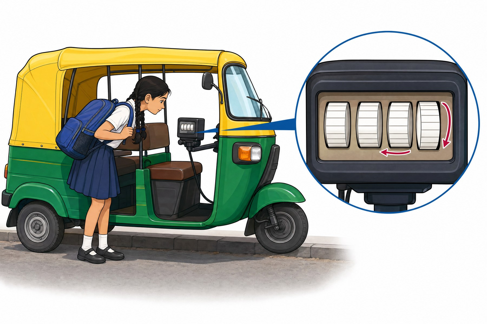
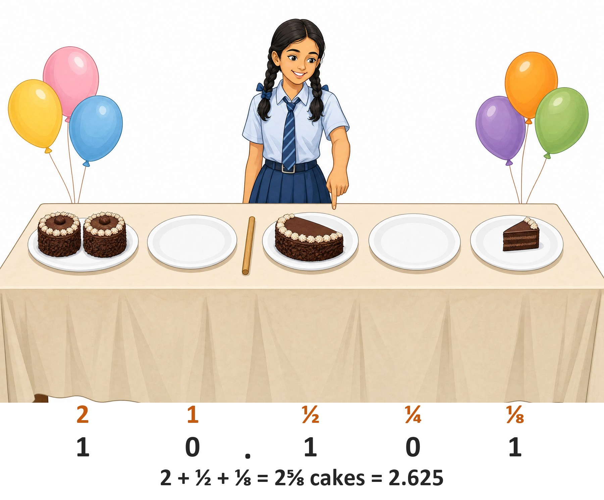
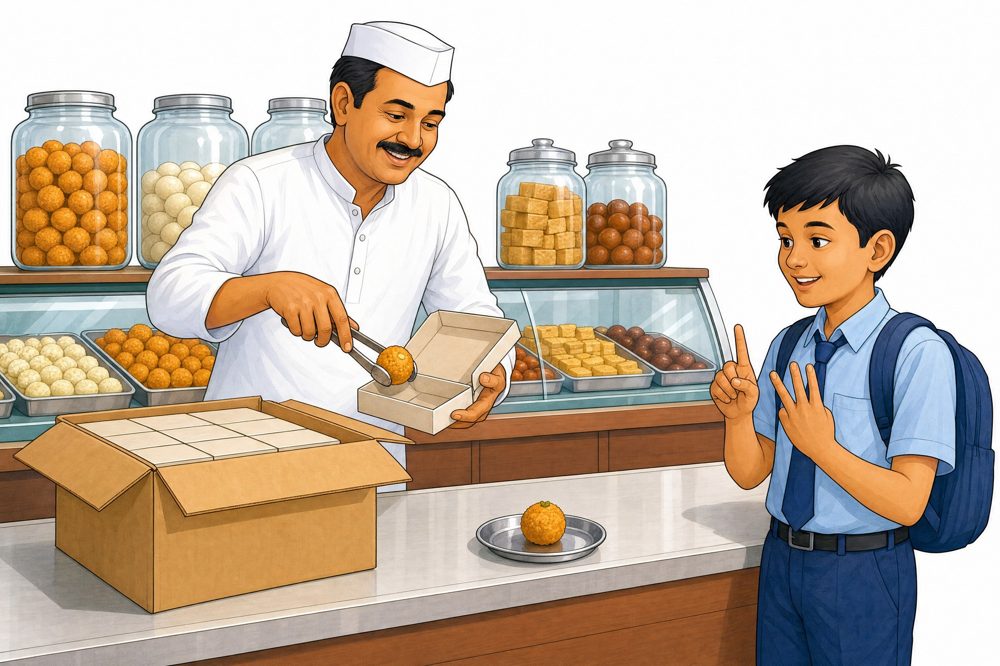
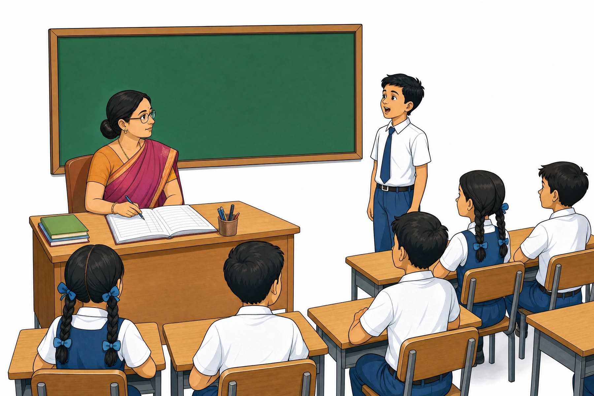
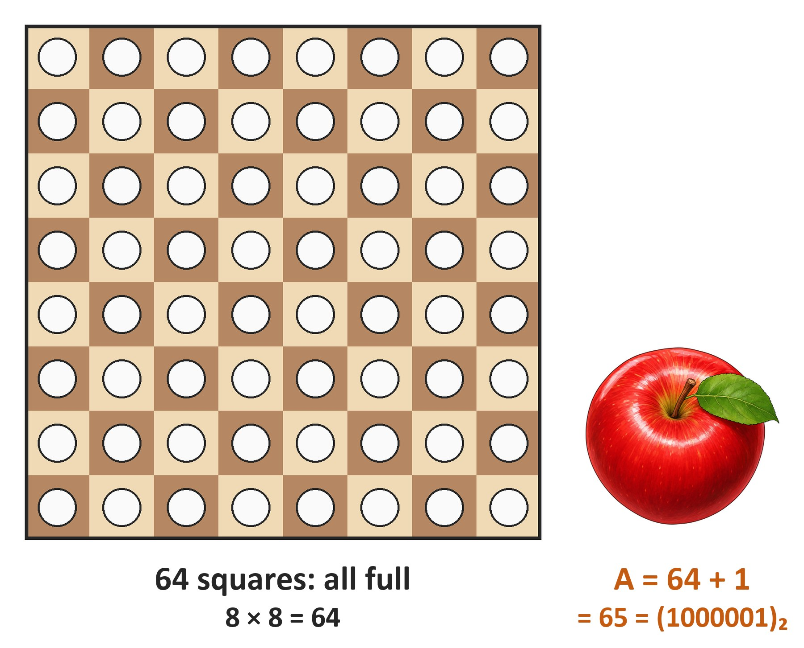
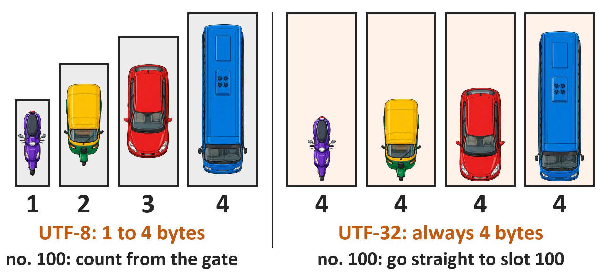

# Chapter 4: Number Systems and Encoding Schemes

The online pages of this chapter of *Computer Science with Python, CBSE Class XI*. Each page is marked with what it is for:

- **Helps you understand**: more explanation of what the printed book teaches (the **See it** pages are interactive: type or click, and the page answers);
- **Sometimes asked**: not in the syllabus wording, but set now and then in school papers;
- **Beyond syllabus**: for the curious student and the teacher;
- **Challenge**: puzzles.

| Page | What it is for |
|---|---|
| [See it: the step-by-step converter](see-it-converter.md) | Helps you understand: type a number, see every step |
| [See it: cake trays and the meter](see-it-trays-and-meter.md) | Helps you understand: click and watch |
| [See it: from a letter to bytes](see-it-letters-to-bytes.md) | Helps you understand: type any text, see its bytes |
| [Why the methods work](helps-why-methods-work.md) | Helps you understand |
| [The full ASCII table, explained](helps-full-ascii-table.md) | Helps you understand |
| [How many bits does a number need?](helps-how-many-bits.md) | Helps you understand |
| [Binary arithmetic](sometimes-asked-binary-arithmetic.md) | Sometimes asked |
| [1's and 2's complement](sometimes-asked-complements.md) | Sometimes asked |
| [Double dabble: a second way from binary to decimal](sometimes-asked-double-dabble.md) | Sometimes asked |
| [Extended ASCII and garbled text](sometimes-asked-extended-ascii-garbled-text.md) | Sometimes asked |
| [Typing Hindi and other Indian languages](sometimes-asked-typing-indian-languages.md) | Sometimes asked |
| [UTF-16, the third way](sometimes-asked-utf16.md) | Sometimes asked |
| [Unicode code points of Indian scripts](sometimes-asked-unicode-indian-scripts.md) | Sometimes asked |
| [How UTF-8 packs the bits](beyond-utf8-bits.md) | Beyond syllabus |
| [Other codes: BCD, Excess-3, Gray code, EBCDIC and parity](beyond-other-codes.md) | Beyond syllabus |
| [Signed numbers: how a computer stores −5](beyond-signed-numbers.md) | Beyond syllabus |
| [Where you meet octal and hex](beyond-where-octal-and-hex.md) | Beyond syllabus |
| [Number systems in history, and in India](beyond-history-and-india.md) | Beyond syllabus |
| [Why 0.1 + 0.2 is not 0.3 in Python](beyond-floating-point.md) | Beyond syllabus |
| [Characters that join: why नमस्ते is 6 code points](beyond-joining-characters.md) | Beyond syllabus |
| [Puzzles with bases](challenge-puzzles-with-bases.md) | Challenge |
| [The binary mind-reading cards](challenge-mind-reading-cards.md) | Challenge |
| [Number systems in Python (opens in Google Colab)](https://colab.research.google.com/github/ag999git/002-cbse-cs-class-11/blob/main/notebooks/ch04-number-systems.ipynb) | Try it yourself |
| [Questions with answers](questions/index.md) | Practice |
| [Glossary](glossary.md) | Words of the chapter |
| [Flashcards](flashcards.md) | Revision |

## Full-colour pictures

Large full-colour versions of the pictures of the printed chapter.

**The auto-rickshaw meter** (section 4.2): when a wheel passes its top digit, it rolls over and pushes the next wheel.

**The cake trays** (sections 4.2 and 4.4): two cakes, an empty 1-cake place, then ½ and ⅛ of a cake: (10.101)₂ = 2⅝ = 2.625.

**Packing laddoos** (section 4.3): one crate of boxes, no single boxes, one loose laddoo: 65 = (101)₈.

**The class register** (section 4.5): one fixed number for each student, the same for every teacher: an encoding scheme.

**The full chessboard** (section 4.5): all 64 squares are taken, so A comes next, as 65.

**The parking lot** (section 4.5): slots cut to size (UTF-8, 1 to 4 bytes) and all slots bus-size (UTF-32, always 4 bytes).

