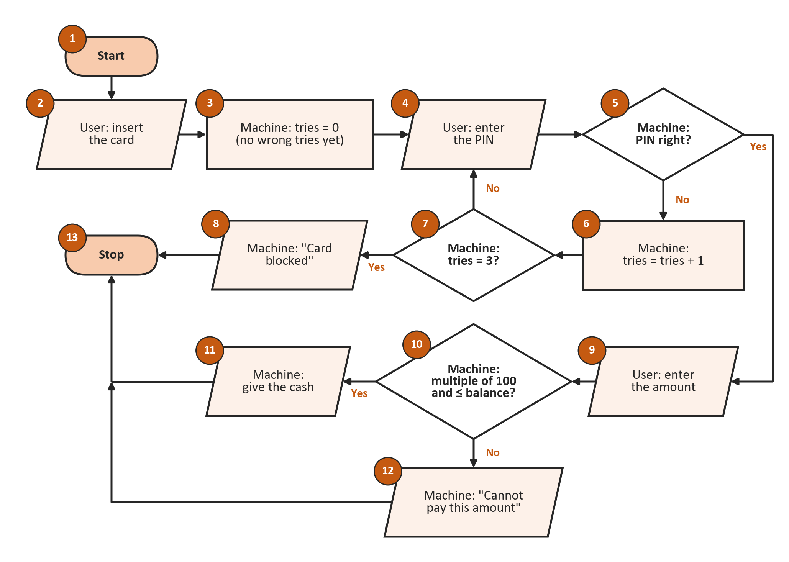
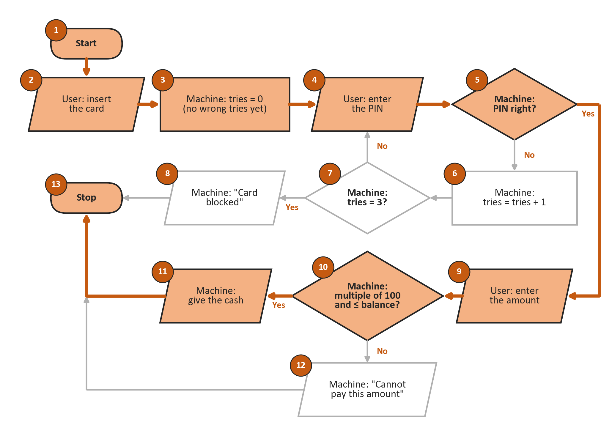
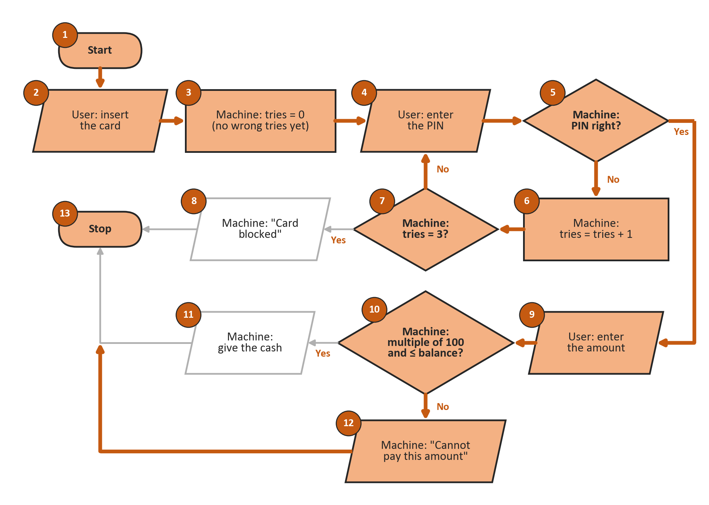
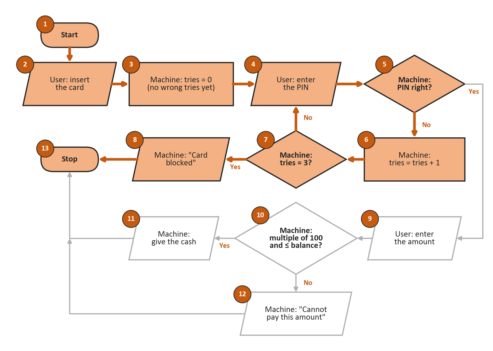
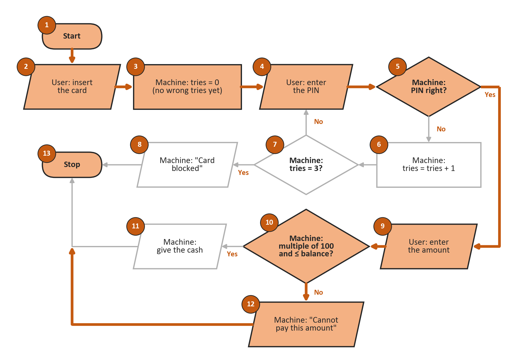

# Explained: The ATM algorithm, run by run

*Chapter 5 · Explained. The printed book (section 5.3) gives the 13 steps of taking cash from an ATM, and section 5.5 its flowchart. This page runs the algorithm four times, with different PINs and amounts, and colours the path each run takes through the flowchart.*

*Every number on this page was computed by a program (`tools/ch05_pages2.py`) and checked.*

## 1. The 13 steps, who does each, and which building block it is

| Step | Who | What happens | Building block |
|:-:|---|---|---|
| 1 | User | Start: the user comes to the machine. | sequence |
| 2 | User → Machine | The user inserts the card; the machine reads it and finds the balance. | sequence |
| 3 | Machine | Set the number of wrong tries to 0. | sequence |
| 4 | User | Enter the PIN. | repetition (steps 4–7) |
| 5 | Machine | Is the PIN right? Yes: go to 9. No: go to 6. | selection |
| 6 | Machine | Add 1 to the wrong tries. | repetition |
| 7 | Machine | Are the wrong tries now 3? Yes: go to 8. No: back to 4. | selection, ends the loop |
| 8 | Machine | Show "Card blocked" and keep the card; go to 13. | sequence |
| 9 | User | Enter the amount. | sequence |
| 10 | Machine | Is the amount a multiple of ₹100 and not more than the balance? | selection |
| 11 | Machine | Give the cash; go to 13. | sequence |
| 12 | Machine | Show "Cannot pay this amount". | sequence |
| 13 | — | Stop. | — |

The machine knows the right PIN of the card (in these runs it is **4321**) and the balance of the account (₹5,000).

## 2. The flowchart

{ width="720" }

## 3. Run 1: the right PIN at once, ₹2,800

*Inputs:* balance ₹5,000; PIN typed: 4321; amount ₹2,800.

{ width="720" }

*The path:* boxes 1 → 2 → 3 → 4 → 5 → 9 → 10 → 11 → 13. The shortest path that pays: the PIN loop is never entered, because box 5 says Yes at the first try.

| Step | Pseudocode | What happens |
|:-:|---|---|
| 1 | `START` | begin |
| 2 | `INPUT card` | balance = 5000 |
| 3 | `SET tries = 0` | tries = 0 |
| 4 | `INPUT pin` | pin = 4321 |
| 5 | `WHILE pin is wrong` | Machine: PIN right? Yes |
| 9 | `INPUT amount` | amount = 2800 |
| 10 | `IF amount is a multiple of 100 AND amount <= balance THEN` | Machine: multiple of 100 and ≤ 5000? Yes |
| 11 | `PRINT the cash` | prints Cash 2800 |
| 13 | `STOP` | end |

**The machine shows:** Cash 2800.

## 4. Run 2: one wrong PIN, then the right one; ₹2,850

*Inputs:* balance ₹5,000; PINs typed: 1111, 4321; amount ₹2,850.

{ width="720" }

*The path:* boxes 1 → 2 → 3 → 4 → 5 → 6 → 7 → 4 → 5 → 9 → 10 → 12 → 13. The loop 4 → 5 → 6 → 7 → 4 runs once. Then 2,850 is not a multiple of 100 (2,850 ÷ 100 leaves 50), so box 10 says No and the machine refuses.

| Step | Pseudocode | What happens |
|:-:|---|---|
| 1 | `START` | begin |
| 2 | `INPUT card` | balance = 5000 |
| 3 | `SET tries = 0` | tries = 0 |
| 4 | `INPUT pin` | pin = 1111 |
| 5 | `WHILE pin is wrong` | Machine: PIN right? No |
| 6 | `INCREMENT tries` | tries = 1 |
| 7 | `IF tries = 3 THEN` | Machine: 1 = 3? No |
| 4 | `INPUT pin` | pin = 4321 |
| 5 | `WHILE pin is wrong` | Machine: PIN right? Yes |
| 9 | `INPUT amount` | amount = 2850 |
| 10 | `IF amount is a multiple of 100 AND amount <= balance THEN` | Machine: multiple of 100 and ≤ 5000? No |
| 12 | `PRINT "Cannot pay this amount"` | prints Cannot pay this amount |
| 13 | `STOP` | end |

**The machine shows:** Cannot pay this amount.

## 5. Run 3: three wrong PINs

*Inputs:* balance ₹5,000; PINs typed: 1111, 2222, 3333.

{ width="720" }

*The path:* boxes 1 → 2 → 3 → 4 → 5 → 6 → 7 → 4 → 5 → 6 → 7 → 4 → 5 → 6 → 7 → 8 → 13. The loop runs three times; at the third wrong PIN, tries = 3, box 7 says Yes and the card is blocked. The amount is never asked.

| Step | Pseudocode | What happens |
|:-:|---|---|
| 1 | `START` | begin |
| 2 | `INPUT card` | balance = 5000 |
| 3 | `SET tries = 0` | tries = 0 |
| 4 | `INPUT pin` | pin = 1111 |
| 5 | `WHILE pin is wrong` | Machine: PIN right? No |
| 6 | `INCREMENT tries` | tries = 1 |
| 7 | `IF tries = 3 THEN` | Machine: 1 = 3? No |
| 4 | `INPUT pin` | pin = 2222 |
| 5 | `WHILE pin is wrong` | Machine: PIN right? No |
| 6 | `INCREMENT tries` | tries = 2 |
| 7 | `IF tries = 3 THEN` | Machine: 2 = 3? No |
| 4 | `INPUT pin` | pin = 3333 |
| 5 | `WHILE pin is wrong` | Machine: PIN right? No |
| 6 | `INCREMENT tries` | tries = 3 |
| 7 | `IF tries = 3 THEN` | Machine: 3 = 3? Yes |
| 8 | `PRINT "Card blocked" and STOP` | prints Card blocked |
| 13 | `STOP` | end |

**The machine shows:** Card blocked.

## 6. Run 4: the right PIN, but more than the balance: ₹6,000

*Inputs:* balance ₹5,000; PIN typed: 4321; amount ₹6,000.

{ width="720" }

*The path:* boxes 1 → 2 → 3 → 4 → 5 → 9 → 10 → 12 → 13. 6,000 IS a multiple of 100, but it is more than 5,000: one half of the AND is No, so the whole question is No.

| Step | Pseudocode | What happens |
|:-:|---|---|
| 1 | `START` | begin |
| 2 | `INPUT card` | balance = 5000 |
| 3 | `SET tries = 0` | tries = 0 |
| 4 | `INPUT pin` | pin = 4321 |
| 5 | `WHILE pin is wrong` | Machine: PIN right? Yes |
| 9 | `INPUT amount` | amount = 6000 |
| 10 | `IF amount is a multiple of 100 AND amount <= balance THEN` | Machine: multiple of 100 and ≤ 5000? No |
| 12 | `PRINT "Cannot pay this amount"` | prints Cannot pay this amount |
| 13 | `STOP` | end |

**The machine shows:** Cannot pay this amount.

## 7. Why the algorithm always stops

There are only two ways round the loop, and both end:

- a right PIN leaves the loop at box 5 (Yes), and then the machine pays or refuses: either way it reaches Stop;
- every wrong PIN adds 1 to *tries*, so after at most **three** wrong PINs box 7 says Yes and the card is blocked.

So the loop runs **at most 3 times**, whatever the user types. This is **finiteness**, one of the five
characteristics of an algorithm. Without box 6 (tries = tries + 1), *tries* would stay 0, box 7 would always say No,
and a thief could go on trying PINs for ever.

## 8. The notes for ₹2,800

The machine holds ₹500, ₹200 and ₹100 notes. Taking the **largest note first**, again and again, gives the fewest
notes: 2,800 ÷ 500 = **5** notes, leaving 300; 300 ÷ 200 = **1** note, leaving 100; 100 ÷ 100 = **1** note.
So ₹2,800 = 5 × ₹500 + 1 × ₹200 + 1 × ₹100: **7 notes**. This "largest first" rule is itself a small
algorithm (it is called a *greedy* algorithm).

## 9. Try it yourself

**The PINs 2222 and then 4321 are typed, and the amount ₹500. Which boxes run, in order, and what does the machine do?**

??? success "Answer"
    Boxes 1 → 2 → 3 → 4 → 5 → 6 → 7 → 4 → 5 → 9 → 10 → 11 → 13. The machine shows **Cash 500**.

**The right PIN is typed and the amount is ₹5,000, exactly the balance. What happens, and which sign in box 10 decides it?**

??? success "Answer"
    Boxes 1 → 2 → 3 → 4 → 5 → 9 → 10 → 11 → 13. The machine shows **Cash 5000**. "Not more than the balance" means ≤: 5,000 ≤ 5,000 is Yes.

