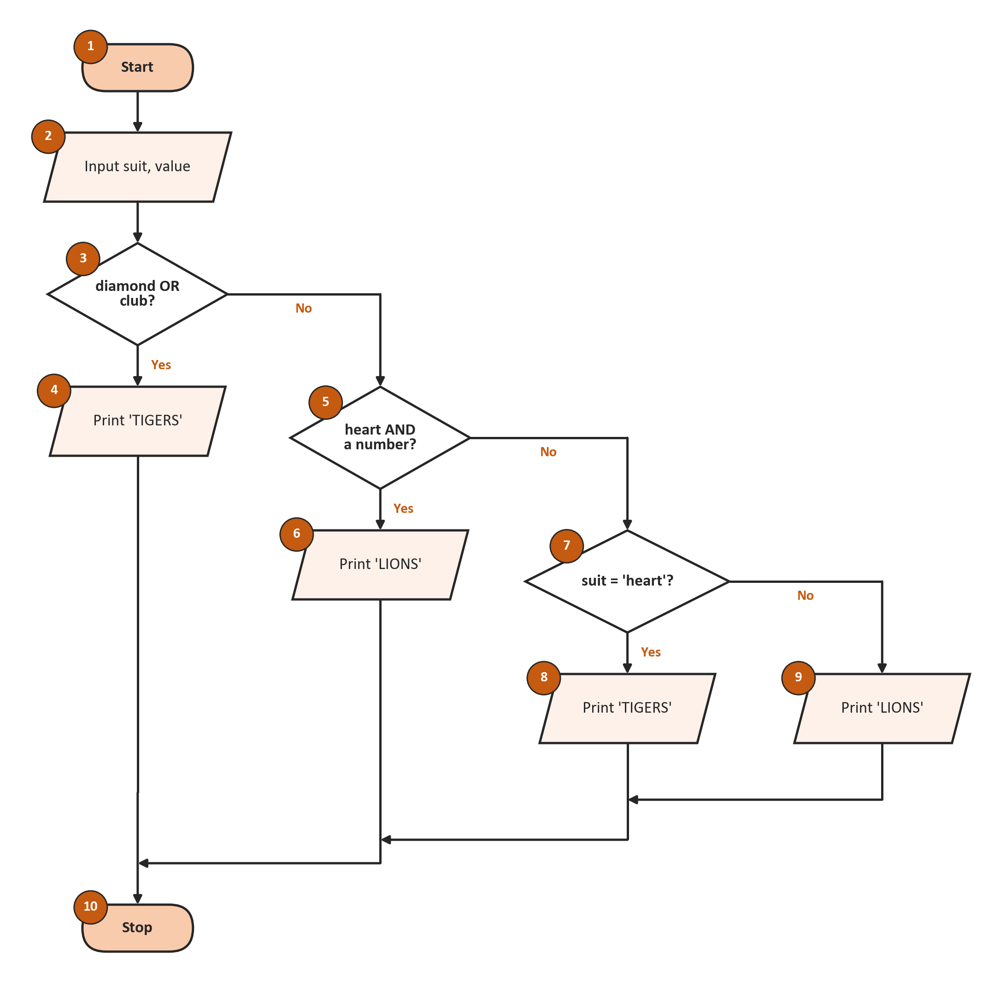

# Explained: The card game, in full

*Chapter 5 · Explained. Question 13 of the printed chapter: two teams, TIGERS and LIONS, and a card drawn from a pack. Here is the whole algorithm as a flowchart, run for all 52 cards.*

*Every number on this page was computed by a program (`tools/ch05_pages2.py`) and checked.*

**The rules.** If the card is a diamond or a club, TIGERS get a point. If it is a heart with a number
(2 to 10), LIONS get a point. If it is a heart without a number (ace, jack, queen, king), TIGERS get a point.
Any other card (a spade) gives LIONS a point.

{ width="720" }

```text
 2  INPUT suit, value
 3  IF suit = 'diamond' OR suit = 'club' THEN
 4      PRINT 'TIGERS'
    ELSE
 5      IF suit = 'heart' AND value.isdigit() THEN
 6          PRINT 'LIONS'
        ELSE
 7          IF suit = 'heart' THEN
 8              PRINT 'TIGERS'
            ELSE
 9              PRINT 'LIONS'
            END IF
        END IF
    END IF
```

## Every card

| Suit | A | 2 | 3 | 4 | 5 | 6 | 7 | 8 | 9 | 10 | J | Q | K |
|---|:-:|:-:|:-:|:-:|:-:|:-:|:-:|:-:|:-:|:-:|:-:|:-:|:-:|
| diamonds | T | T | T | T | T | T | T | T | T | T | T | T | T |
| clubs | T | T | T | T | T | T | T | T | T | T | T | T | T |
| hearts | T | L | L | L | L | L | L | L | L | L | T | T | T |
| spades | L | L | L | L | L | L | L | L | L | L | L | L | L |

T = TIGERS, L = LIONS. Over the whole pack TIGERS win **30** cards and LIONS **22**: 13 diamonds + 13 clubs + 4 hearts without a number = 30 for TIGERS.

- **7 of hearts:** boxes 1 → 2 → 3 → 5 → 6 → 10: **LIONS**.
- **K of spades:** boxes 1 → 2 → 3 → 5 → 7 → 9 → 10: **LIONS**.

*Why AND, why OR?* "a diamond **or** a club" is Yes if either is true; "a heart **and** a number" needs both.
