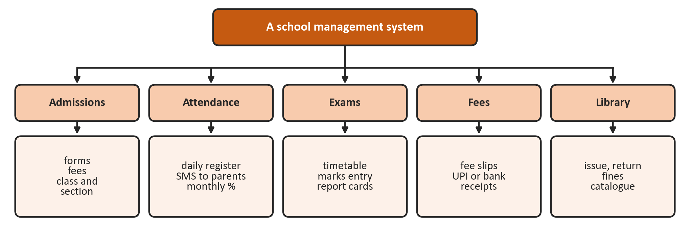
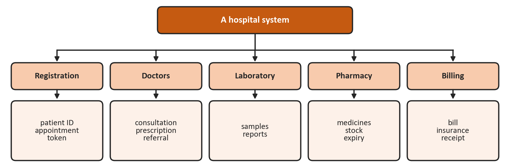
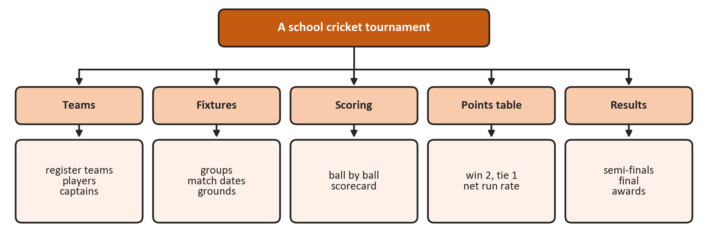
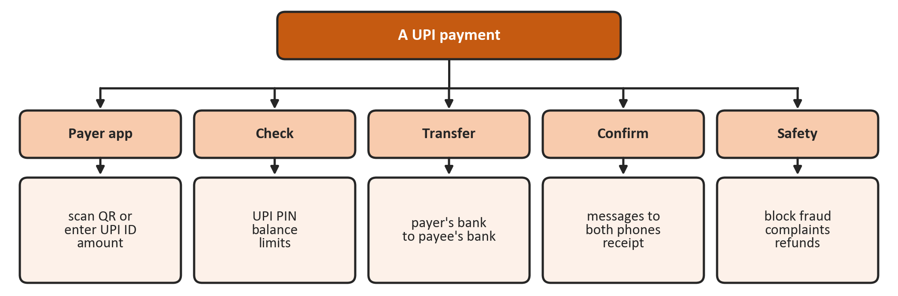

# Explained: More systems, decomposed

*Chapter 5 · Explained. The printed book (section 5.9) decomposes a food-delivery app and a railway reservation system. Here are four more, each with its structure diagram, what each part does, and what the parts must agree on; then the report-card algorithm refined step by step.*

*Every number on this page was computed by a program (`tools/ch05_pages2.py`) and checked.*

## 1. A school management system

{ width="720" }

| Part | What it does |
|---|---|
| Admissions | forms; fees; class and; section |
| Attendance | daily register; SMS to parents; monthly % |
| Exams | timetable; marks entry; report cards |
| Fees | fee slips; UPI or bank; receipts |
| Library | issue, return; fines; catalogue |

- **The parts must agree on:** The roll number of a student: attendance, exams, fees and the library all use the same one.
- The report-card part (Exams) is the program of W6; it can be tested alone with sample marks before it is joined to the marks-entry screens.

## 2. A hospital system

{ width="720" }

| Part | What it does |
|---|---|
| Registration | patient ID; appointment; token |
| Doctors | consultation; prescription; referral |
| Laboratory | samples; reports |
| Pharmacy | medicines; stock; expiry |
| Billing | bill; insurance; receipt |

- **The parts must agree on:** The patient ID: the lab report and the medicines must reach the right patient.
- If the pharmacy part is changed (a new supplier), registration and billing need not change: this is why parts are kept separate.

## 3. A school cricket tournament

{ width="720" }

| Part | What it does |
|---|---|
| Teams | register teams; players; captains |
| Fixtures | groups; match dates; grounds |
| Scoring | ball by ball; scorecard |
| Points table | win 2, tie 1; net run rate |
| Results | semi-finals; final; awards |

- **The parts must agree on:** The match result: scoring hands it to the points table, which decides the semi-finalists.
- Pattern recognition: every match has the same steps (toss, two innings, result), so one scoring part serves all the matches.

## 4. A UPI payment

{ width="720" }

| Part | What it does |
|---|---|
| Payer app | scan QR or; enter UPI ID; amount |
| Check | UPI PIN; balance; limits |
| Transfer | payer's bank; to payee's bank |
| Confirm | messages to; both phones; receipt |
| Safety | block fraud; complaints; refunds |

- **The parts must agree on:** The transaction ID: every part writes it down, so a payment can be traced and a refund can find it.
- Abstraction: the payer sees only "Paid ✓"; the banks, the network and the checks stay hidden.

## 5. Stepwise refinement: the report card, from one line to boxes

**Level 1** (the whole problem, in one line):

1. Make the report card.

**Level 2** (each line broken into steps):

1. Take the marks.
2. Work out the result.
3. Print the result.

**Level 3** (until each step can be one box of a flowchart):

1. Take the marks → *Input m1, m2, m3, m4, m5* (box 2 of W6).
2. Work out the result →
    1. total = m1 + … + m5; per = total ÷ 5; low = the lowest mark (box 3);
    2. Is low ≥ 33? No: the result is Fail (boxes 4, 5);
    3. Yes: is per ≥ 90? ≥ 75? ≥ 60? → the grade (boxes 6 to 12).
3. Print the result → the Print boxes 5, 7, 9, 11, 12.

This is **top-down design**: start from the whole and break it down. Its opposite, **bottom-up design**, starts from
small ready parts (a part that finds the lowest of five numbers, a part that prints) and joins them.

## 6. Try it yourself

**Decompose a school canteen app into five parts.**

??? success "Answer"
    Menu (items, prices, today's specials); orders (cart, pre-order for the break); payment (UPI, canteen card, cash); kitchen (orders in the queue, ready alert); feedback (ratings, complaints). They must agree on the order number.

