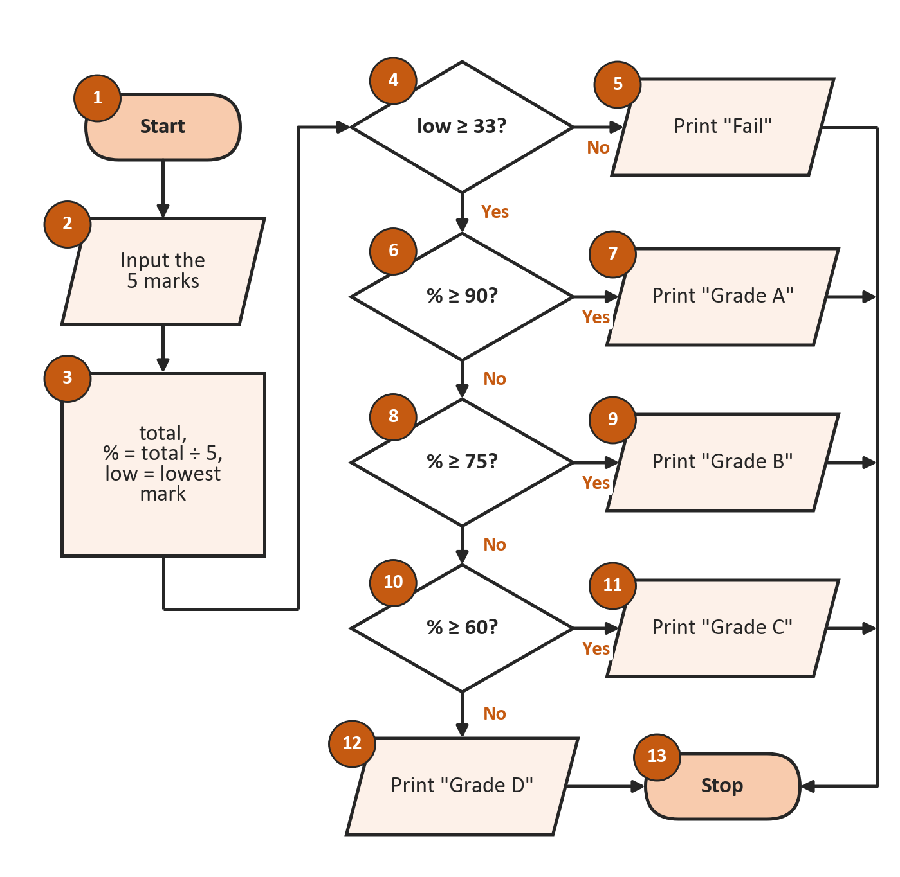

# Explained: Testing and debugging the report-card program

*Chapter 5 · Explained. The printed book (section 5.2) explains testing and debugging in a few lines. Here the report-card program (worked example W6) is tested with the four kinds of test data, three bugs are found, and each is traced to its cause and fixed.*

*Every number on this page was computed by a program (`tools/ch05_pages2.py`) and checked.*

## 1. The program under test

The class teacher types the marks of five subjects (each 0 to 100). The program prints **Fail** if any mark is below 33; otherwise the grade: 90% and above **A**, 75% and above **B**, 60% and above **C**, below 60% **D**.

{ width="537" }

## 2. Test data: choose marks whose answers you already know

| Kind | Marks | Expected | The program gives | Why this test |
|---|---|---|---|---|
| Normal | 80, 75, 70, 72, 78 | Grade B | Grade B ✓ | usual marks must work |
| Normal | 95, 92, 88, 91, 94 | Grade A | Grade A ✓ | each grade at least once |
| Extreme | 100, 100, 100, 100, 100 | Grade A | Grade A ✓ | the largest marks allowed |
| Extreme | 0, 0, 0, 0, 0 | Fail | Fail ✓ | the smallest marks allowed |
| Boundary | 33, 33, 33, 33, 33 | Grade D | Grade D ✓ | exactly the pass mark passes |
| Boundary | 32, 90, 90, 90, 90 | Fail | Fail ✓ | one mark just below 33 fails the student |
| Boundary | 90, 90, 90, 90, 90 | Grade A | Grade A ✓ | exactly 90% is an A |
| Boundary | 75, 75, 75, 75, 74 | Grade C | Grade C ✓ | 74.8% is just below a B |

**Abnormal data** (−5, 105, "sixty") is not a mark at all. The program of W6 does not check for it: given −5, 100, 100, 100, 100 it says **Fail**, and given 105 in every subject it says **Grade A**, as if nothing were wrong. A real report-card program must refuse such marks *before* using them. That check is one more decision at the start: "is every mark from 0 to 100?". Its No path asks for the marks again.

## 3. Three bugs, found by testing and removed by debugging

### Bug 1: "more than 33" instead of "33 or more"

- **Test:** marks 33, 33, 33, 33, 33. Expected: **Grade D**. The program printed: **Fail**. *Testing has found a bug:* the answer is wrong, but testing does not say why.
- **Debugging, the cause:** Box 4 asks "low > 33?". For a lowest mark of exactly 33, 33 > 33 is No, so a student who passed is told Fail.
- **The fix:** Change the question to **low ≥ 33**. The pass mark itself passes.
- **Test again:** with the fix, the same marks give **Grade D** ✓, and every test of section 2 still passes.

### Bug 2: dividing by 4

- **Test:** marks 80, 75, 70, 72, 78. Expected: **Grade B**. The program printed: **Grade A**. *Testing has found a bug:* the answer is wrong, but testing does not say why.
- **Debugging, the cause:** Box 3 computes per = total ÷ 4. Five subjects need ÷ 5: the program found 93.75% instead of 75%.
- **The fix:** Divide by the number of subjects, **5**.
- **Test again:** with the fix, the same marks give **Grade B** ✓, and every test of section 2 still passes.

### Bug 3: the grade questions in the wrong order

- **Test:** marks 95, 92, 88, 91, 94. Expected: **Grade A**. The program printed: **Grade C**. *Testing has found a bug:* the answer is wrong, but testing does not say why.
- **Debugging, the cause:** The ladder asks "% ≥ 60?" first. 92% is ≥ 60, so the first Yes prints the first grade on the ladder and the other questions are never asked.
- **The fix:** Ask the **highest** limit first: 90, then 75, then 60. In a ladder, the first Yes wins.
- **Test again:** with the fix, the same marks give **Grade A** ✓, and every test of section 2 still passes.

*Why "test again" after every fix?* A fix can break something that worked before. Running all the old tests
again after each change is called **regression testing** (beyond the syllabus).

## 4. Four kinds of testing, in the report-card program

| Kind | What is tested | In the report-card program |
|---|---|---|
| **Unit** testing | one part alone | the part that works out the percentage: give it 375, it must give 75 |
| **Integration** testing | parts joined together | the marks-entry part joined to the grade part: do the marks reach the grade part correctly? |
| **System** testing | the whole program | type real marks, check the printed report card from start to end |
| **Acceptance** testing | by the user, before delivery | the class teacher tries last year's report cards and says "yes, this is what I wanted" |

## 5. Testing vs debugging, once more

| | Testing | Debugging |
|---|---|---|
| Question | **Is** something wrong? | **Where** and **why** is it wrong? |
| Tool | test data with known answers | the program text, a dry run (section 5.7), printing values |
| Result | a list of faults | a corrected program, tested again |

## 6. Try it yourself

**A program finds the average of 3 marks as (m1 + m2 + m3) ÷ 2. Which test finds the bug: 60, 60, 60 or 0, 0, 0?**

??? success "Answer"
    60, 60, 60: the program says 90 instead of 60. With 0, 0, 0 both give 0, so that test hides the bug: a test whose answer is the same for the right and the wrong program finds nothing.

**Choose boundary test data for "a person may vote at 18 or more".**

??? success "Answer"
    17 (just below), 18 (exactly the limit) and 19 (just above). Most faults hide at the limit: > instead of ≥ fails only for 18.

