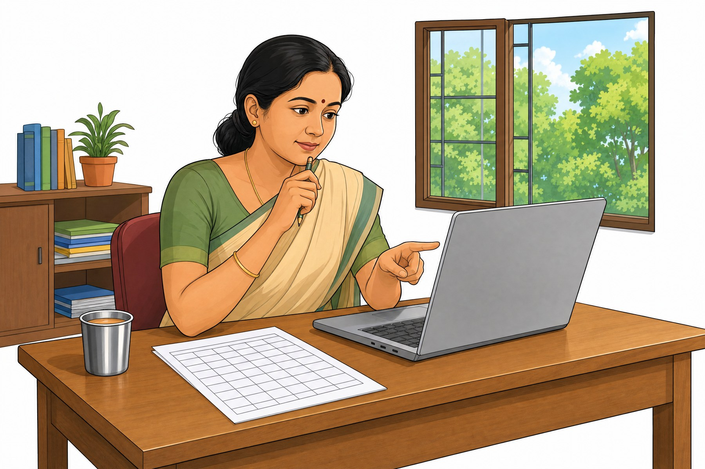
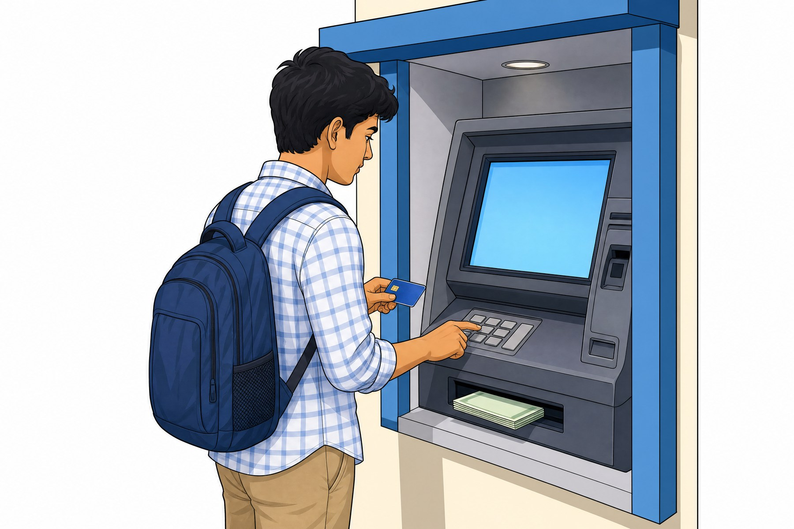

# Chapter 5: Problem Solving

The online pages of Chapter 5 of *Computer Science with Python, CBSE Class XI*. The label under each QR code in the
printed book says what you will find:

- **Explained**: a topic of the book explained more fully, with more examples;
- **Step by step**: one algorithm, every step drawn;
- **Practical**: the CBSE practical programs;
- **See it**: interactive: type the inputs, and watch;
- **Sometimes asked**: beyond the syllabus wording, but set now and then in school papers;
- **Practice**, **Revise**: questions with answers, flashcards and the glossary.

| Page | Label | Section of the book |
|---|---|---|
| [Testing and debugging the report-card program](explained-testing-and-debugging.md) | Explained | 5.2 |
| [The ATM algorithm, run by run](explained-atm-algorithm.md) | Explained | 5.3 |
| [Euclid's GCD, step by step](step-by-step-euclid-gcd.md) | Step by step | 5.3 |
| [More flowchart symbols](sometimes-asked-more-symbols.md) | Sometimes asked | 5.4 |
| [The five-step method, practised](practice-five-step-method.md) | Practice | 5.5 |
| [The dry-run player: W1 to W10](see-it-dry-run-player.md) | See it | 5.5 |
| [The 22 practical programs as flowcharts](practical-flowcharts.md) | Practical | 5.5 |
| [Pseudocode to Python, line for line](explained-pseudocode-to-python.md) | Explained | 5.6 |
| [Trace tables, with more to fill in](practice-trace-tables.md) | Practice | 5.7 |
| [Halving search, step by step](step-by-step-halving-search.md) | Step by step | 5.8 |
| [The four prime tests, worked](explained-prime-tests.md) | Explained | 5.8 |
| [More systems, decomposed](explained-more-decompositions.md) | Explained | 5.9 |
| [The card game, in full](explained-card-game.md) | Explained | Question 13 |
| [Questions with answers, by type](questions/index.md) | Practice | the whole chapter |
| [Flashcards](flashcards.md) and [glossary](glossary.md) | Revise | the whole chapter |

The Python programs of this chapter can be run in Google Colab with Chapter 6, when you start Python.

## Full-colour pictures

Large full-colour versions of the pictures of the printed chapter.

**The report-card program** (section 5.2): the class teacher checks the program's result against a printed report card.

**Cash from an ATM** (section 5.3): the card in one hand, the PIN typed with the other.

**A food-delivery app** (section 5.9): many parts of the app worked together so that the parcel changes hands.

