# Practical: The 22 practical programs as flowcharts

*Chapter 5 · Practical. The CBSE practical list for Class XI asks for these programs. For each: the flowchart (the numbers on the boxes are the step numbers), the pseudocode, the Python program and a walk-through. Every flowchart and every program was run on many inputs and compared with a separate check.*

*Every number on this page was computed by a program (`tools/ch05_pages2.py`) and checked.*

| No. | Program | Pattern |
|:-:|---|---|
| 1 | [Display a welcome message](#1-welcome) | sequence |
| 2 | [The larger and the smaller of two numbers](#2-larger-smaller) | one choice |
| 3 | [The largest and the smallest of three numbers](#3-largest-smallest-three) | choices in a row |
| 4 | [Pattern 1: a triangle of stars](#4-pattern-stars) | loop inside a loop |
| 5 | [Pattern 2: 12345, 1234 … 1](#5-pattern-numbers) | loop inside a loop |
| 6 | [Pattern 3: A, AB, ABC …](#6-pattern-letters) | loop inside a loop |
| 7 | [Series 1 + x + x² + … + xⁿ](#7-series-1) | counted loop |
| 8 | [Series 1 − x + x² − … ± xⁿ](#8-series-2) | counted loop |
| 9 | [Series x + x²/2 + x³/3 + … + xⁿ/n](#9-series-3) | counted loop |
| 10 | [Series x + x²/2! + x³/3! + … + xⁿ/n!](#10-series-4) | counted loop |
| 11 | [Is the number perfect?](#11-perfect) | loop, then one choice |
| 12 | [Is it an Armstrong number?](#12-armstrong) | loop, then one choice |
| 13 | [Is the number a palindrome?](#13-palindrome-number) | loop, then one choice |
| 14 | [Prime or composite](#14-prime) | loop with an early stop |
| 15 | [The first n terms of the Fibonacci series](#15-fibonacci) | counted loop |
| 16 | [GCD and LCM of two numbers (Euclid)](#16-gcd-lcm) | loop until the remainder is 0 |
| 17 | [Vowels, consonants, upper case and lower case in a string](#17-count-characters) | loop over the characters, choices inside |
| 18 | [Is the string a palindrome? Change the case of each letter](#18-palindrome-and-case) | loop over the characters |
| 19 | [The largest and the smallest in a list](#19-list-largest-smallest) | loop over the items |
| 20 | [Swap the items at even and odd places](#20-list-swap) | loop over the items, two at a time |
| 21 | [Search for an item in a list](#21-list-search) | loop with an early stop |
| 22 | [Students with marks above 75](#22-dictionary-marks) | two loops |

*Chapters 11, 12 and 14 print the string, list and dictionary programs (17 to 22) beside their Python again, when you learn them.*

## 1. Display a welcome message { #1-welcome }

*The syllabus:* Input a welcome message and display it.

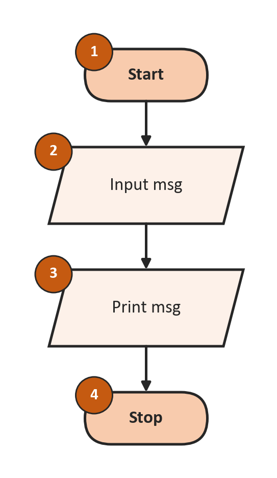{ width="199" }

<div class="grid2" markdown>
<div markdown>

**Pseudocode**

```text
 2  INPUT msg
 3  PRINT msg
```

</div>
<div markdown>

**Python**

```python
msg = input()
print(msg)
```

</div>
</div>

**Walk-through for the input Welcome to Class XI**

| Step | Pseudocode | What happens |
|:-:|---|---|
| 1 | `START` | begin |
| 2 | `INPUT msg` | msg = Welcome to Class XI |
| 3 | `PRINT msg` | prints Welcome to Class XI |
| 4 | `STOP` | end |

**Output:** Welcome to Class XI

*Tested on 2 inputs: the flowchart and the Python gave the expected answer every time.*

## 2. The larger and the smaller of two numbers { #2-larger-smaller }

*The syllabus:* Input two numbers and display the larger / smaller number.

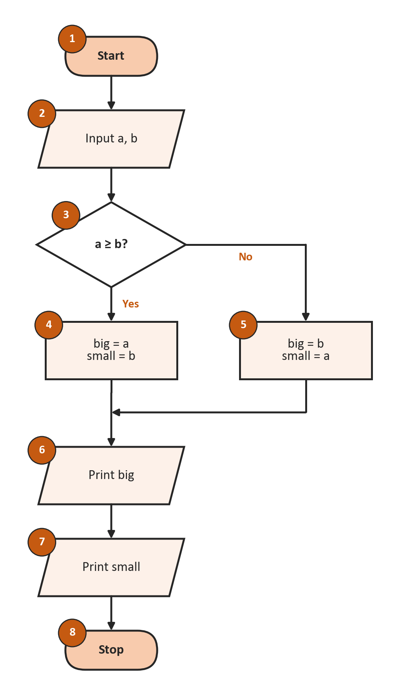{ width="381" }

<div class="grid2" markdown>
<div markdown>

**Pseudocode**

```text
 2  INPUT a, b
 3  IF a ≥ b THEN
 4      COMPUTE big = a, COMPUTE small = b
    ELSE
 5      COMPUTE big = b, COMPUTE small = a
    END IF
 6  PRINT 'Larger: ' + str(big)
 7  PRINT 'Smaller: ' + str(small)
```

</div>
<div markdown>

**Python**

```python
a = int(input())
b = int(input())
if a >= b:
    big = a
    small = b
else:
    big = b
    small = a
print('Larger: ' + str(big))
print('Smaller: ' + str(small))
```

</div>
</div>

**Walk-through for the input 7, 12**

| Step | Pseudocode | What happens |
|:-:|---|---|
| 1 | `START` | begin |
| 2 | `INPUT a, b` | a = 7, b = 12 |
| 3 | `IF a ≥ b THEN` | 7 ≥ 12? No |
| 5 | `COMPUTE big = b, COMPUTE small = a` | big = 12, small = 7 |
| 6 | `PRINT 'Larger: ' + str(big)` | prints Larger: 12 |
| 7 | `PRINT 'Smaller: ' + str(small)` | prints Smaller: 7 |
| 8 | `STOP` | end |

**Output:** Larger: 12 / Smaller: 7

*Note:* Equal numbers: a ≥ b is Yes, so both lines show the same number, which is right.

*Tested on 24 inputs: the flowchart and the Python gave the expected answer every time.*

## 3. The largest and the smallest of three numbers { #3-largest-smallest-three }

*The syllabus:* Input three numbers and display the largest / smallest number.

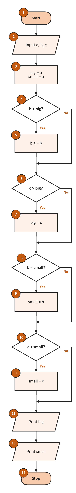{ width="225" }

<div class="grid2" markdown>
<div markdown>

**Pseudocode**

```text
 2  INPUT a, b, c
 3  COMPUTE big = a, COMPUTE small = a
 4  IF b > big THEN
 5      COMPUTE big = b
    END IF
 6  IF c > big THEN
 7      COMPUTE big = c
    END IF
 8  IF b < small THEN
 9      COMPUTE small = b
    END IF
10  IF c < small THEN
11      COMPUTE small = c
    END IF
12  PRINT 'Largest: ' + str(big)
13  PRINT 'Smallest: ' + str(small)
```

</div>
<div markdown>

**Python**

```python
a = int(input())
b = int(input())
c = int(input())
big = a
small = a
if b > big:
    big = b
if c > big:
    big = c
if b < small:
    small = b
if c < small:
    small = c
print('Largest: ' + str(big))
print('Smallest: ' + str(small))
```

</div>
</div>

**Walk-through for the input 5, 5, 2**

| Step | Pseudocode | What happens |
|:-:|---|---|
| 1 | `START` | begin |
| 2 | `INPUT a, b, c` | a = 5, b = 5, c = 2 |
| 3 | `COMPUTE big = a, COMPUTE small = a` | big = 5, small = 5 |
| 4 | `IF b > big THEN` | 5 > 5? No |
| 6 | `IF c > big THEN` | 2 > 5? No |
| 8 | `IF b < small THEN` | 5 < 5? No |
| 10 | `IF c < small THEN` | 2 < 5? Yes |
| 11 | `COMPUTE small = c` | small = 2 |
| 12 | `PRINT 'Largest: ' + str(big)` | prints Largest: 5 |
| 13 | `PRINT 'Smallest: ' + str(small)` | prints Smallest: 2 |
| 14 | `STOP` | end |

**Output:** Largest: 5 / Smallest: 2

*Note:* This is the "champion" method: assume the first is the largest, and let each other number challenge it. It has no trap with equal numbers (5, 5, 2 gives 5), and it grows easily to more numbers.

*Tested on 35 inputs: the flowchart and the Python gave the expected answer every time.*

## 4. Pattern 1: a triangle of stars { #4-pattern-stars }

*The syllabus:* Generate the patterns using nested loops: Pattern 1.

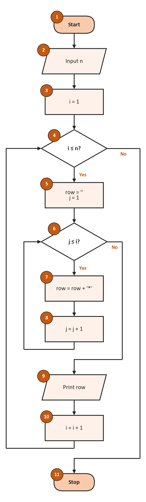{ width="318" }

<div class="grid2" markdown>
<div markdown>

**Pseudocode**

```text
 2  INPUT n
 3  SET i = 1
 4  WHILE i ≤ n
 5      SET row = '', j = 1
 6      WHILE j ≤ i
 7          COMPUTE row = row + '*'
 8          INCREMENT j
        END WHILE
 9      PRINT row
10      INCREMENT i
    END WHILE
```

</div>
<div markdown>

**Python**

```python
n = int(input())
i = 1
while i <= n:
    row = ''
    j = 1
    while j <= i:
        row = row + '*'
        j = j + 1
    print(row)
    i = i + 1
```

</div>
</div>

**Walk-through for the input 3**

| Step | Pseudocode | What happens |
|:-:|---|---|
| 1 | `START` | begin |
| 2 | `INPUT n` | n = 3 |
| 3 | `SET i = 1` | i = 1 |
| 4 | `WHILE i ≤ n` | 1 ≤ 3? Yes |
| 5 | `SET row = '', j = 1` | row = , j = 1 |
| 6 | `WHILE j ≤ i` | 1 ≤ 1? Yes |
| 7 | `COMPUTE row = row + '*'` |  + '*' = * |
| 8 | `INCREMENT j` | 1 + 1 = 2 |
| 6 | `WHILE j ≤ i` | 2 ≤ 1? No |
| 9 | `PRINT row` | prints * |
| 10 | `INCREMENT i` | 1 + 1 = 2 |
| 4 | `WHILE i ≤ n` | 2 ≤ 3? Yes |
| 5 | `SET row = '', j = 1` | row = , j = 1 |
| … | `…` | rounds 3–7 |
| 6 | `WHILE j ≤ i` | 3 ≤ 3? Yes |
| 7 | `COMPUTE row = row + '*'` | ** + '*' = *** |
| 8 | `INCREMENT j` | 3 + 1 = 4 |
| 6 | `WHILE j ≤ i` | 4 ≤ 3? No |
| 9 | `PRINT row` | prints *** |
| 10 | `INCREMENT i` | 3 + 1 = 4 |
| 4 | `WHILE i ≤ n` | 4 ≤ 3? No |
| 11 | `STOP` | end |

**Output:** * / ** / ***

*Note:* Row i has i stars: the inner loop runs i times.

*Tested on 3 inputs: the flowchart and the Python gave the expected answer every time.*

## 5. Pattern 2: 12345, 1234 … 1 { #5-pattern-numbers }

*The syllabus:* Generate the patterns using nested loops: Pattern 2.

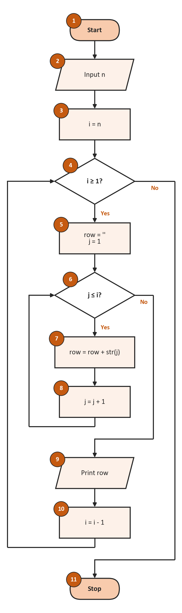{ width="326" }

<div class="grid2" markdown>
<div markdown>

**Pseudocode**

```text
 2  INPUT n
 3  COMPUTE i = n
 4  WHILE i ≥ 1
 5      SET row = '', j = 1
 6      WHILE j ≤ i
 7          COMPUTE row = row + str(j)
 8          INCREMENT j
        END WHILE
 9      PRINT row
10      DECREMENT i
    END WHILE
```

</div>
<div markdown>

**Python**

```python
n = int(input())
i = n
while i >= 1:
    row = ''
    j = 1
    while j <= i:
        row = row + str(j)
        j = j + 1
    print(row)
    i = i - 1
```

</div>
</div>

**Walk-through for the input 3**

| Step | Pseudocode | What happens |
|:-:|---|---|
| 1 | `START` | begin |
| 2 | `INPUT n` | n = 3 |
| 3 | `COMPUTE i = n` | i = 3 |
| 4 | `WHILE i ≥ 1` | 3 ≥ 1? Yes |
| 5 | `SET row = '', j = 1` | row = , j = 1 |
| 6 | `WHILE j ≤ i` | 1 ≤ 3? Yes |
| 7 | `COMPUTE row = row + str(j)` |  + str(1) = 1 |
| 8 | `INCREMENT j` | 1 + 1 = 2 |
| 6 | `WHILE j ≤ i` | 2 ≤ 3? Yes |
| 7 | `COMPUTE row = row + str(j)` | 1 + str(2) = 12 |
| 8 | `INCREMENT j` | 2 + 1 = 3 |
| … | `…` | rounds 3–7 |
| 6 | `WHILE j ≤ i` | 1 ≤ 1? Yes |
| 7 | `COMPUTE row = row + str(j)` |  + str(1) = 1 |
| 8 | `INCREMENT j` | 1 + 1 = 2 |
| 6 | `WHILE j ≤ i` | 2 ≤ 1? No |
| 9 | `PRINT row` | prints 1 |
| 10 | `DECREMENT i` | 1 - 1 = 0 |
| 4 | `WHILE i ≥ 1` | 0 ≥ 1? No |
| 11 | `STOP` | end |

**Output:** 123 / 12 / 1

*Note:* The outer loop counts DOWN from n, so the rows get shorter.

*Tested on 3 inputs: the flowchart and the Python gave the expected answer every time.*

## 6. Pattern 3: A, AB, ABC … { #6-pattern-letters }

*The syllabus:* Generate the patterns using nested loops: Pattern 3.

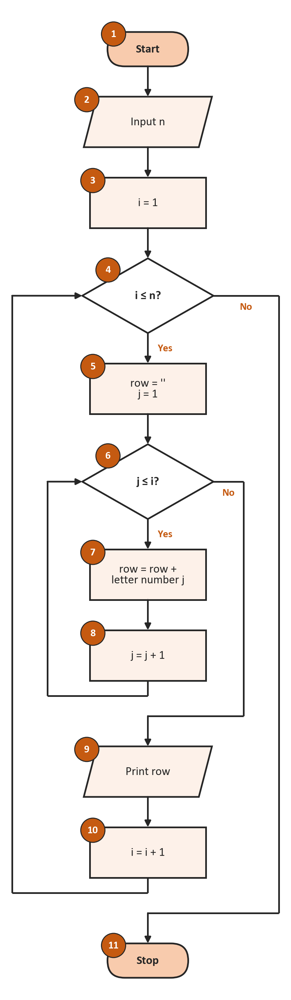{ width="318" }

<div class="grid2" markdown>
<div markdown>

**Pseudocode**

```text
 2  INPUT n
 3  SET i = 1
 4  WHILE i ≤ n
 5      SET row = '', j = 1
 6      WHILE j ≤ i
 7          COMPUTE row = row + chr(64 + j)
 8          INCREMENT j
        END WHILE
 9      PRINT row
10      INCREMENT i
    END WHILE
```

</div>
<div markdown>

**Python**

```python
n = int(input())
i = 1
while i <= n:
    row = ''
    j = 1
    while j <= i:
        row = row + chr(64 + j)
        j = j + 1
    print(row)
    i = i + 1
```

</div>
</div>

**Walk-through for the input 3**

| Step | Pseudocode | What happens |
|:-:|---|---|
| 1 | `START` | begin |
| 2 | `INPUT n` | n = 3 |
| 3 | `SET i = 1` | i = 1 |
| 4 | `WHILE i ≤ n` | 1 ≤ 3? Yes |
| 5 | `SET row = '', j = 1` | row = , j = 1 |
| 6 | `WHILE j ≤ i` | 1 ≤ 1? Yes |
| 7 | `COMPUTE row = row + chr(64 + j)` | row = A |
| 8 | `INCREMENT j` | 1 + 1 = 2 |
| 6 | `WHILE j ≤ i` | 2 ≤ 1? No |
| 9 | `PRINT row` | prints A |
| 10 | `INCREMENT i` | 1 + 1 = 2 |
| 4 | `WHILE i ≤ n` | 2 ≤ 3? Yes |
| 5 | `SET row = '', j = 1` | row = , j = 1 |
| … | `…` | rounds 3–7 |
| 6 | `WHILE j ≤ i` | 3 ≤ 3? Yes |
| 7 | `COMPUTE row = row + chr(64 + j)` | row = ABC |
| 8 | `INCREMENT j` | 3 + 1 = 4 |
| 6 | `WHILE j ≤ i` | 4 ≤ 3? No |
| 9 | `PRINT row` | prints ABC |
| 10 | `INCREMENT i` | 3 + 1 = 4 |
| 4 | `WHILE i ≤ n` | 4 ≤ 3? No |
| 11 | `STOP` | end |

**Output:** A / AB / ABC

*Note:* Letter number j: A is the 1st letter, B the 2nd … In Python, chr(64 + j), because the ASCII code of A is 65 (Chapter 4).

*Tested on 3 inputs: the flowchart and the Python gave the expected answer every time.*

## 7. Series 1 + x + x² + … + xⁿ { #7-series-1 }

*The syllabus:* Sum of the series 1 + x + x² + x³ + … + xⁿ.

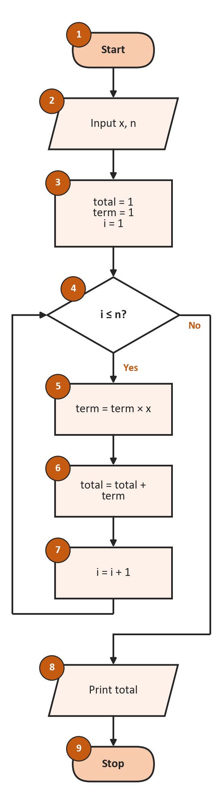{ width="241" }

<div class="grid2" markdown>
<div markdown>

**Pseudocode**

```text
 2  INPUT x, n
 3  SET total = 1, term = 1, i = 1
 4  WHILE i ≤ n
 5      COMPUTE term = term × x
 6      COMPUTE total = total + term
 7      INCREMENT i
    END WHILE
 8  PRINT total
```

</div>
<div markdown>

**Python**

```python
x = int(input())
n = int(input())
total = 1
term = 1
i = 1
while i <= n:
    term = term * x
    total = total + term
    i = i + 1
print(total)
```

</div>
</div>

**Walk-through for the input 2, 3**

| Step | Pseudocode | What happens |
|:-:|---|---|
| 1 | `START` | begin |
| 2 | `INPUT x, n` | x = 2, n = 3 |
| 3 | `SET total = 1, term = 1, i = 1` | total = 1, term = 1, i = 1 |
| 4 | `WHILE i ≤ n` | 1 ≤ 3? Yes |
| 5 | `COMPUTE term = term × x` | 1 × 2 = 2 |
| 6 | `COMPUTE total = total + term` | total = 3 |
| 7 | `INCREMENT i` | 1 + 1 = 2 |
| 4 | `WHILE i ≤ n` | 2 ≤ 3? Yes |
| 5 | `COMPUTE term = term × x` | 2 × 2 = 4 |
| 6 | `COMPUTE total = total + term` | total = 7 |
| 7 | `INCREMENT i` | 2 + 1 = 3 |
| 4 | `WHILE i ≤ n` | 3 ≤ 3? Yes |
| 5 | `COMPUTE term = term × x` | 4 × 2 = 8 |
| 6 | `COMPUTE total = total + term` | total = 15 |
| 7 | `INCREMENT i` | 3 + 1 = 4 |
| 4 | `WHILE i ≤ n` | 4 ≤ 3? No |
| 8 | `PRINT total` | prints 15 |
| 9 | `STOP` | end |

**Output:** 15

*Note:* The same as worked example W9: each term is the one before multiplied by x.

*Tested on 5 inputs: the flowchart and the Python gave the expected answer every time.*

## 8. Series 1 − x + x² − … ± xⁿ { #8-series-2 }

*The syllabus:* Sum of the series 1 − x + x² − x³ + … ± xⁿ.

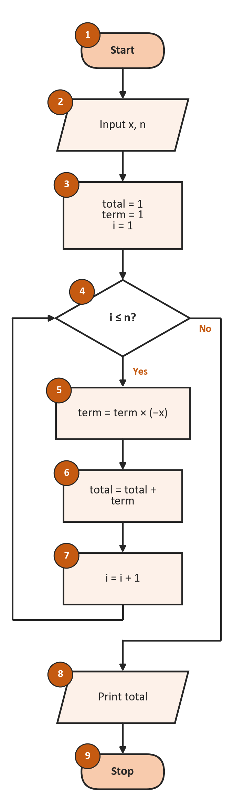{ width="249" }

<div class="grid2" markdown>
<div markdown>

**Pseudocode**

```text
 2  INPUT x, n
 3  SET total = 1, term = 1, i = 1
 4  WHILE i ≤ n
 5      COMPUTE term = term × (-x)
 6      COMPUTE total = total + term
 7      INCREMENT i
    END WHILE
 8  PRINT total
```

</div>
<div markdown>

**Python**

```python
x = int(input())
n = int(input())
total = 1
term = 1
i = 1
while i <= n:
    term = term * (-x)
    total = total + term
    i = i + 1
print(total)
```

</div>
</div>

**Walk-through for the input 2, 3**

| Step | Pseudocode | What happens |
|:-:|---|---|
| 1 | `START` | begin |
| 2 | `INPUT x, n` | x = 2, n = 3 |
| 3 | `SET total = 1, term = 1, i = 1` | total = 1, term = 1, i = 1 |
| 4 | `WHILE i ≤ n` | 1 ≤ 3? Yes |
| 5 | `COMPUTE term = term × (-x)` | 1 × (−2) = -2 |
| 6 | `COMPUTE total = total + term` | total = -1 |
| 7 | `INCREMENT i` | 1 + 1 = 2 |
| 4 | `WHILE i ≤ n` | 2 ≤ 3? Yes |
| 5 | `COMPUTE term = term × (-x)` | -2 × (−2) = 4 |
| 6 | `COMPUTE total = total + term` | total = 3 |
| 7 | `INCREMENT i` | 2 + 1 = 3 |
| 4 | `WHILE i ≤ n` | 3 ≤ 3? Yes |
| 5 | `COMPUTE term = term × (-x)` | 4 × (−2) = -8 |
| 6 | `COMPUTE total = total + term` | total = -5 |
| 7 | `INCREMENT i` | 3 + 1 = 4 |
| 4 | `WHILE i ≤ n` | 4 ≤ 3? No |
| 8 | `PRINT total` | prints -5 |
| 9 | `STOP` | end |

**Output:** -5

*Note:* Multiplying by −x each time makes the signs take turns: +, −, +, − …

*Tested on 4 inputs: the flowchart and the Python gave the expected answer every time.*

## 9. Series x + x²/2 + x³/3 + … + xⁿ/n { #9-series-3 }

*The syllabus:* Sum of the series x + x²/2 + x³/3 + … + xⁿ/n.

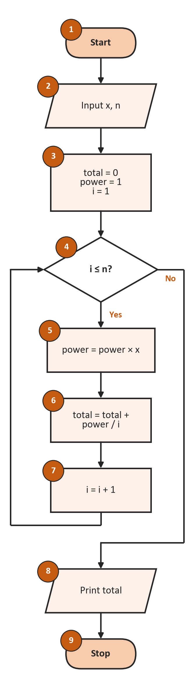{ width="245" }

<div class="grid2" markdown>
<div markdown>

**Pseudocode**

```text
 2  INPUT x, n
 3  SET total = 0, power = 1, i = 1
 4  WHILE i ≤ n
 5      COMPUTE power = power × x
 6      COMPUTE total = total + power / i
 7      INCREMENT i
    END WHILE
 8  PRINT total
```

</div>
<div markdown>

**Python**

```python
x = int(input())
n = int(input())
total = 0
power = 1
i = 1
while i <= n:
    power = power * x
    total = total + power / i
    i = i + 1
print(total)
```

</div>
</div>

**Walk-through for the input 2, 3**

| Step | Pseudocode | What happens |
|:-:|---|---|
| 1 | `START` | begin |
| 2 | `INPUT x, n` | x = 2, n = 3 |
| 3 | `SET total = 0, power = 1, i = 1` | total = 0, power = 1, i = 1 |
| 4 | `WHILE i ≤ n` | 1 ≤ 3? Yes |
| 5 | `COMPUTE power = power × x` | 1 × 2 = 2 |
| 6 | `COMPUTE total = total + power / i` | total = 2.0 |
| 7 | `INCREMENT i` | 1 + 1 = 2 |
| 4 | `WHILE i ≤ n` | 2 ≤ 3? Yes |
| 5 | `COMPUTE power = power × x` | 2 × 2 = 4 |
| 6 | `COMPUTE total = total + power / i` | total = 4.0 |
| 7 | `INCREMENT i` | 2 + 1 = 3 |
| 4 | `WHILE i ≤ n` | 3 ≤ 3? Yes |
| 5 | `COMPUTE power = power × x` | 4 × 2 = 8 |
| 6 | `COMPUTE total = total + power / i` | total = 6.666666666666666 |
| 7 | `INCREMENT i` | 3 + 1 = 4 |
| 4 | `WHILE i ≤ n` | 4 ≤ 3? No |
| 8 | `PRINT total` | prints 6.666666666666666 |
| 9 | `STOP` | end |

**Output:** 6.666666666666666

*Note:* Keep the power xⁱ and the divisor i apart: the power is multiplied by x, the divisor is just i.

*Tested on 3 inputs: the flowchart and the Python gave the expected answer every time.*

## 10. Series x + x²/2! + x³/3! + … + xⁿ/n! { #10-series-4 }

*The syllabus:* Sum of the series x + x²/2! + x³/3! + … + xⁿ/n!.

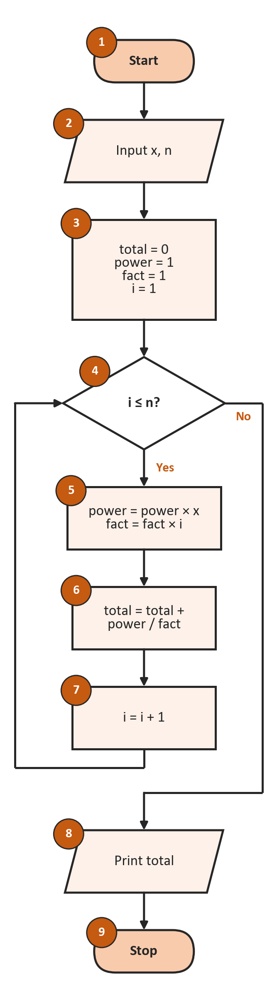{ width="245" }

<div class="grid2" markdown>
<div markdown>

**Pseudocode**

```text
 2  INPUT x, n
 3  SET total = 0, power = 1, fact = 1, i = 1
 4  WHILE i ≤ n
 5      COMPUTE power = power × x, COMPUTE fact = fact × i
 6      COMPUTE total = total + power / fact
 7      INCREMENT i
    END WHILE
 8  PRINT total
```

</div>
<div markdown>

**Python**

```python
x = int(input())
n = int(input())
total = 0
power = 1
fact = 1
i = 1
while i <= n:
    power = power * x
    fact = fact * i
    total = total + power / fact
    i = i + 1
print(total)
```

</div>
</div>

**Walk-through for the input 2, 3**

| Step | Pseudocode | What happens |
|:-:|---|---|
| 1 | `START` | begin |
| 2 | `INPUT x, n` | x = 2, n = 3 |
| 3 | `SET total = 0, power = 1, fact = 1, i = 1` | total = 0, power = 1, fact = 1, i = 1 |
| 4 | `WHILE i ≤ n` | 1 ≤ 3? Yes |
| 5 | `COMPUTE power = power × x, COMPUTE fact = fact × i` | power = 2 |
| 6 | `COMPUTE total = total + power / fact` | total = 2.0 |
| 7 | `INCREMENT i` | 1 + 1 = 2 |
| 4 | `WHILE i ≤ n` | 2 ≤ 3? Yes |
| 5 | `COMPUTE power = power × x, COMPUTE fact = fact × i` | power = 4, fact = 2 |
| 6 | `COMPUTE total = total + power / fact` | total = 4.0 |
| 7 | `INCREMENT i` | 2 + 1 = 3 |
| 4 | `WHILE i ≤ n` | 3 ≤ 3? Yes |
| 5 | `COMPUTE power = power × x, COMPUTE fact = fact × i` | power = 8, fact = 6 |
| 6 | `COMPUTE total = total + power / fact` | total = 5.333333333333333 |
| 7 | `INCREMENT i` | 3 + 1 = 4 |
| 4 | `WHILE i ≤ n` | 4 ≤ 3? No |
| 8 | `PRINT total` | prints 5.333333333333333 |
| 9 | `STOP` | end |

**Output:** 5.333333333333333

*Note:* The factorial i! is built up as the loop goes (as in W10), so nothing is worked out twice.

*Tested on 3 inputs: the flowchart and the Python gave the expected answer every time.*

## 11. Is the number perfect? { #11-perfect }

*The syllabus:* Determine whether a number is a perfect number.

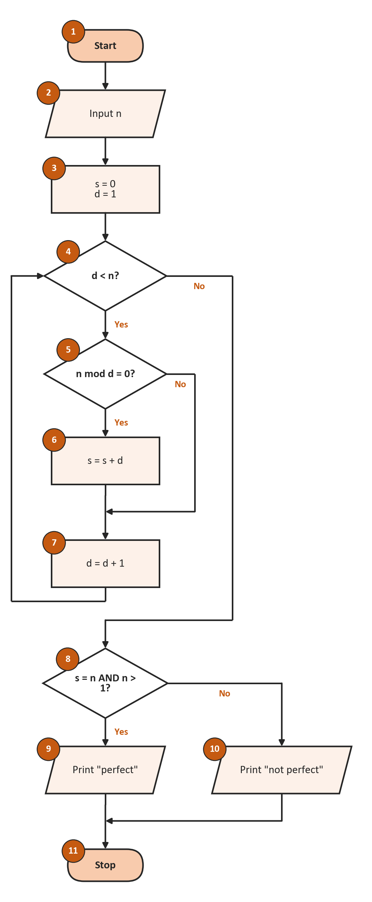{ width="436" }

<div class="grid2" markdown>
<div markdown>

**Pseudocode**

```text
 2  INPUT n
 3  SET s = 0, d = 1
 4  WHILE d < n
 5      IF n mod d = 0 THEN
 6          COMPUTE s = s + d
        END IF
 7      INCREMENT d
    END WHILE
 8  IF s = n AND n > 1 THEN
 9      PRINT str(n) + ' is perfect'
    ELSE
10      PRINT str(n) + ' is not perfect'
    END IF
```

</div>
<div markdown>

**Python**

```python
n = int(input())
s = 0
d = 1
while d < n:
    if n % d == 0:
        s = s + d
    d = d + 1
if s == n and n > 1:
    print(str(n) + ' is perfect')
else:
    print(str(n) + ' is not perfect')
```

</div>
</div>

**Walk-through for the input 6**

| Step | Pseudocode | What happens |
|:-:|---|---|
| 1 | `START` | begin |
| 2 | `INPUT n` | n = 6 |
| 3 | `SET s = 0, d = 1` | s = 0, d = 1 |
| 4 | `WHILE d < n` | 1 < 6? Yes |
| 5 | `IF n mod d = 0 THEN` | 6 mod 1 = 0? Yes |
| 6 | `COMPUTE s = s + d` | 0 + 1 = 1 |
| 7 | `INCREMENT d` | 1 + 1 = 2 |
| 4 | `WHILE d < n` | 2 < 6? Yes |
| 5 | `IF n mod d = 0 THEN` | 6 mod 2 = 0? Yes |
| 6 | `COMPUTE s = s + d` | 1 + 2 = 3 |
| 7 | `INCREMENT d` | 2 + 1 = 3 |
| … | `…` | rounds 3–4 |
| 4 | `WHILE d < n` | 5 < 6? Yes |
| 5 | `IF n mod d = 0 THEN` | 6 mod 5 = 0? No |
| 7 | `INCREMENT d` | 5 + 1 = 6 |
| 4 | `WHILE d < n` | 6 < 6? No |
| 8 | `IF s = n AND n > 1 THEN` | 6 = 6 AND 6 > 1? Yes |
| 9 | `PRINT str(n) + ' is perfect'` | prints 6 is perfect |
| 11 | `STOP` | end |

**Output:** 6 is perfect

*Note:* A perfect number equals the sum of its divisors other than itself: 6 = 1 + 2 + 3, 28 = 1 + 2 + 4 + 7 + 14.

*Tested on 5 inputs: the flowchart and the Python gave the expected answer every time.*

## 12. Is it an Armstrong number? { #12-armstrong }

*The syllabus:* Determine whether a number is an Armstrong number.

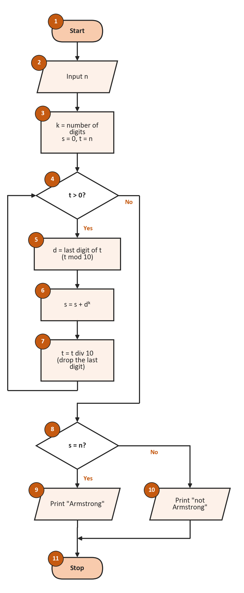{ width="425" }

<div class="grid2" markdown>
<div markdown>

**Pseudocode**

```text
 2  INPUT n
 3  COMPUTE k = len(str(n)), SET s = 0, COMPUTE t = n
 4  WHILE t > 0
 5      COMPUTE d = t mod 10
 6      COMPUTE s = s + d ^ k
 7      COMPUTE t = t  div  10
    END WHILE
 8  IF s = n THEN
 9      PRINT str(n) + ' is an Armstrong number'
    ELSE
10      PRINT str(n) + ' is not an Armstrong number'
    END IF
```

</div>
<div markdown>

**Python**

```python
n = int(input())
k = len(str(n))
s = 0
t = n
while t > 0:
    d = t % 10
    s = s + d ** k
    t = t // 10
if s == n:
    print(str(n) + ' is an Armstrong number')
else:
    print(str(n) + ' is not an Armstrong number')
```

</div>
</div>

**Walk-through for the input 153**

| Step | Pseudocode | What happens |
|:-:|---|---|
| 1 | `START` | begin |
| 2 | `INPUT n` | n = 153 |
| 3 | `COMPUTE k = len(str(n)), SET s = 0, COMPUTE t = n` | k = 3, s = 0, t = 153 |
| 4 | `WHILE t > 0` | 153 > 0? Yes |
| 5 | `COMPUTE d = t mod 10` | d = 3 |
| 6 | `COMPUTE s = s + d ^ k` | 0 + dᵏ = 27 |
| 7 | `COMPUTE t = t` | t = 15 |
| 4 | `WHILE t > 0` | 15 > 0? Yes |
| 5 | `COMPUTE d = t mod 10` | d = 5 |
| 6 | `COMPUTE s = s + d ^ k` | 27 + dᵏ = 152 |
| 7 | `COMPUTE t = t` | t = 1 |
| 4 | `WHILE t > 0` | 1 > 0? Yes |
| 5 | `COMPUTE d = t mod 10` | d = 1 |
| 6 | `COMPUTE s = s + d ^ k` | 152 + dᵏ = 153 |
| 7 | `COMPUTE t = t` | t = 0 |
| 4 | `WHILE t > 0` | 0 > 0? No |
| 8 | `IF s = n THEN` | 153 = 153? Yes |
| 9 | `PRINT str(n) + ' is an Armstrong number'` | prints 153 is an Armstrong number |
| 11 | `STOP` | end |

**Output:** 153 is an Armstrong number

*Note:* An Armstrong number equals the sum of its digits, each raised to the number of digits: 153 = 1³ + 5³ + 3³ = 1 + 125 + 27.

*Tested on 6 inputs: the flowchart and the Python gave the expected answer every time.*

## 13. Is the number a palindrome? { #13-palindrome-number }

*The syllabus:* Determine whether a number is a palindrome.

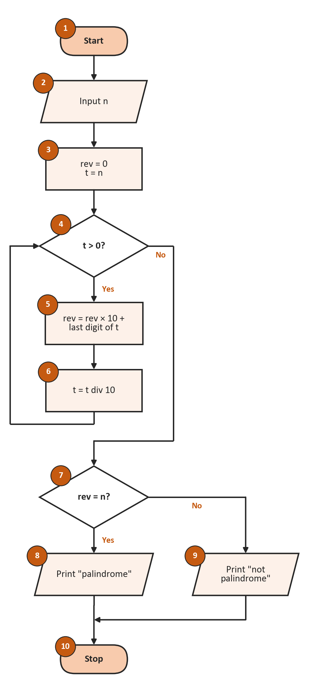{ width="418" }

<div class="grid2" markdown>
<div markdown>

**Pseudocode**

```text
 2  INPUT n
 3  SET rev = 0, COMPUTE t = n
 4  WHILE t > 0
 5      COMPUTE rev = rev × 10 + t mod 10
 6      COMPUTE t = t  div  10
    END WHILE
 7  IF rev = n THEN
 8      PRINT str(n) + ' is a palindrome'
    ELSE
 9      PRINT str(n) + ' is not a palindrome'
    END IF
```

</div>
<div markdown>

**Python**

```python
n = int(input())
rev = 0
t = n
while t > 0:
    rev = rev * 10 + t % 10
    t = t // 10
if rev == n:
    print(str(n) + ' is a palindrome')
else:
    print(str(n) + ' is not a palindrome')
```

</div>
</div>

**Walk-through for the input 121**

| Step | Pseudocode | What happens |
|:-:|---|---|
| 1 | `START` | begin |
| 2 | `INPUT n` | n = 121 |
| 3 | `SET rev = 0, COMPUTE t = n` | rev = 0, t = 121 |
| 4 | `WHILE t > 0` | 121 > 0? Yes |
| 5 | `COMPUTE rev = rev × 10 + t mod 10` | rev = 1 |
| 6 | `COMPUTE t = t` | 121 div 10 = 12 |
| 4 | `WHILE t > 0` | 12 > 0? Yes |
| 5 | `COMPUTE rev = rev × 10 + t mod 10` | rev = 12 |
| 6 | `COMPUTE t = t` | 12 div 10 = 1 |
| 4 | `WHILE t > 0` | 1 > 0? Yes |
| 5 | `COMPUTE rev = rev × 10 + t mod 10` | rev = 121 |
| 6 | `COMPUTE t = t` | 1 div 10 = 0 |
| 4 | `WHILE t > 0` | 0 > 0? No |
| 7 | `IF rev = n THEN` | 121 = 121? Yes |
| 8 | `PRINT str(n) + ' is a palindrome'` | prints 121 is a palindrome |
| 10 | `STOP` | end |

**Output:** 121 is a palindrome

*Note:* The loop builds the number backwards, one digit at a time: 121 → 1, 12, 121.

*Tested on 5 inputs: the flowchart and the Python gave the expected answer every time.*

## 14. Prime or composite { #14-prime }

*The syllabus:* Input a number and check if the number is a prime or composite number.

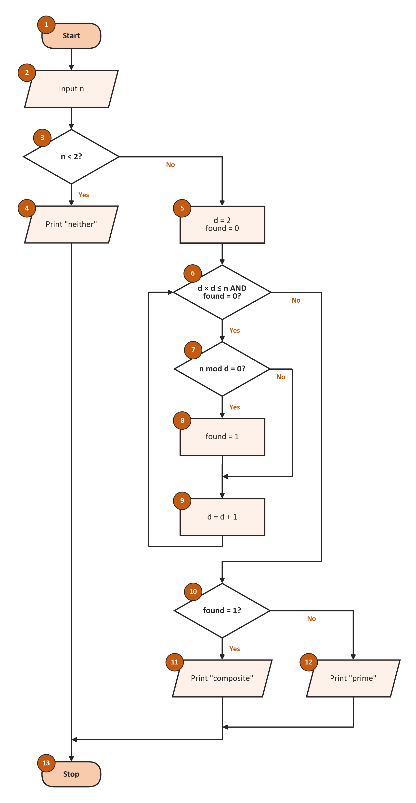{ width="624" }

<div class="grid2" markdown>
<div markdown>

**Pseudocode**

```text
 2  INPUT n
 3  IF n < 2 THEN
 4      PRINT str(n) + ' is neither prime nor composite'
    ELSE
 5      SET d = 2, found = 0
 6      WHILE d × d ≤ n AND found = 0
 7          IF n mod d = 0 THEN
 8              SET found = 1
            END IF
 9          INCREMENT d
        END WHILE
10      IF found = 1 THEN
11          PRINT str(n) + ' is composite'
        ELSE
12          PRINT str(n) + ' is prime'
        END IF
    END IF
```

</div>
<div markdown>

**Python**

```python
n = int(input())
if n < 2:
    print(str(n) + ' is neither prime nor composite')
else:
    d = 2
    found = 0
    while d * d <= n and found == 0:
        if n % d == 0:
            found = 1
        d = d + 1
    if found == 1:
        print(str(n) + ' is composite')
    else:
        print(str(n) + ' is prime')
```

</div>
</div>

**Walk-through for the input 91**

| Step | Pseudocode | What happens |
|:-:|---|---|
| 1 | `START` | begin |
| 2 | `INPUT n` | n = 91 |
| 3 | `IF n < 2 THEN` | 91 < 2? No |
| 5 | `SET d = 2, found = 0` | d = 2, found = 0 |
| 6 | `WHILE d × d ≤ n AND found = 0` | 2 × 2 ≤ 91 AND 0 = 0? Yes |
| 7 | `IF n mod d = 0 THEN` | 91 mod 2 = 0? No |
| 9 | `INCREMENT d` | 2 + 1 = 3 |
| 6 | `WHILE d × d ≤ n AND found = 0` | 3 × 3 ≤ 91 AND 0 = 0? Yes |
| 7 | `IF n mod d = 0 THEN` | 91 mod 3 = 0? No |
| 9 | `INCREMENT d` | 3 + 1 = 4 |
| … | `…` | rounds 3–5 |
| 6 | `WHILE d × d ≤ n AND found = 0` | 7 × 7 ≤ 91 AND 0 = 0? Yes |
| 7 | `IF n mod d = 0 THEN` | 91 mod 7 = 0? Yes |
| 8 | `SET found = 1` | found = 1 |
| 9 | `INCREMENT d` | 7 + 1 = 8 |
| 6 | `WHILE d × d ≤ n AND found = 0` | 8 × 8 ≤ 91 AND 1 = 0? No |
| 10 | `IF found = 1 THEN` | 1 = 1? Yes |
| 11 | `PRINT str(n) + ' is composite'` | prints 91 is composite |
| 13 | `STOP` | end |

**Output:** 91 is composite

*Note:* Method (iii) of section 5.8: divide only while d × d ≤ n, and stop at the first divisor. 0 and 1 are neither prime nor composite.

*Tested on 12 inputs: the flowchart and the Python gave the expected answer every time.*

## 15. The first n terms of the Fibonacci series { #15-fibonacci }

*The syllabus:* Display the terms of a Fibonacci series.

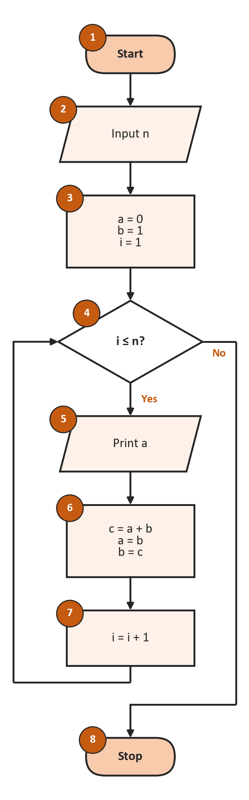{ width="247" }

<div class="grid2" markdown>
<div markdown>

**Pseudocode**

```text
 2  INPUT n
 3  SET a = 0, b = 1, i = 1
 4  WHILE i ≤ n
 5      PRINT a
 6      COMPUTE c = a + b, COMPUTE a = b, COMPUTE b = c
 7      INCREMENT i
    END WHILE
```

</div>
<div markdown>

**Python**

```python
n = int(input())
a = 0
b = 1
i = 1
while i <= n:
    print(a)
    c = a + b
    a = b
    b = c
    i = i + 1
```

</div>
</div>

**Walk-through for the input 6**

| Step | Pseudocode | What happens |
|:-:|---|---|
| 1 | `START` | begin |
| 2 | `INPUT n` | n = 6 |
| 3 | `SET a = 0, b = 1, i = 1` | a = 0, b = 1, i = 1 |
| 4 | `WHILE i ≤ n` | 1 ≤ 6? Yes |
| 5 | `PRINT a` | prints 0 |
| 6 | `COMPUTE c = a + b, COMPUTE a = b, COMPUTE b = c` | a = 1, c = 1 |
| 7 | `INCREMENT i` | 1 + 1 = 2 |
| 4 | `WHILE i ≤ n` | 2 ≤ 6? Yes |
| 5 | `PRINT a` | prints 1 |
| 6 | `COMPUTE c = a + b, COMPUTE a = b, COMPUTE b = c` | b = 2, c = 2 |
| 7 | `INCREMENT i` | 2 + 1 = 3 |
| … | `…` | rounds 3–5 |
| 4 | `WHILE i ≤ n` | 6 ≤ 6? Yes |
| 5 | `PRINT a` | prints 5 |
| 6 | `COMPUTE c = a + b, COMPUTE a = b, COMPUTE b = c` | a = 8, b = 13, c = 13 |
| 7 | `INCREMENT i` | 6 + 1 = 7 |
| 4 | `WHILE i ≤ n` | 7 ≤ 6? No |
| 8 | `STOP` | end |

**Output:** 0 / 1 / 1 / 2 / 3 / 5

*Note:* Each term is the sum of the two before it: 0, 1, 1, 2, 3, 5, 8 … The box "c = a + b, a = b, b = c" moves the pair one step along.

*Tested on 4 inputs: the flowchart and the Python gave the expected answer every time.*

## 16. GCD and LCM of two numbers (Euclid) { #16-gcd-lcm }

*The syllabus:* Compute the greatest common divisor and least common multiple of two integers.

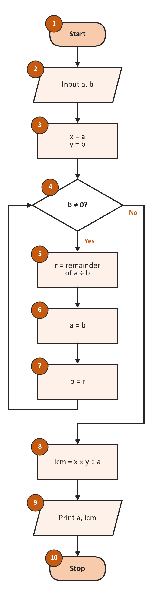{ width="241" }

<div class="grid2" markdown>
<div markdown>

**Pseudocode**

```text
 2  INPUT a, b
 3  COMPUTE x = a, COMPUTE y = b
 4  WHILE b ≠ 0
 5      COMPUTE r = a mod b
 6      COMPUTE a = b
 7      COMPUTE b = r
    END WHILE
 8  COMPUTE lcm = x × y  div  a
 9  PRINT str(a) + ' ' + str(lcm)
```

</div>
<div markdown>

**Python**

```python
a = int(input())
b = int(input())
x = a
y = b
while b != 0:
    r = a % b
    a = b
    b = r
lcm = x * y // a
print(str(a) + ' ' + str(lcm))
```

</div>
</div>

**Walk-through for the input 30, 21**

| Step | Pseudocode | What happens |
|:-:|---|---|
| 1 | `START` | begin |
| 2 | `INPUT a, b` | a = 30, b = 21 |
| 3 | `COMPUTE x = a, COMPUTE y = b` | x = 30, y = 21 |
| 4 | `WHILE b ≠ 0` | 21 ≠ 0? Yes |
| 5 | `COMPUTE r = a mod b` | r = 9 |
| 6 | `COMPUTE a = b` | a = 21 |
| 7 | `COMPUTE b = r` | b = 9 |
| 4 | `WHILE b ≠ 0` | 9 ≠ 0? Yes |
| 5 | `COMPUTE r = a mod b` | r = 3 |
| 6 | `COMPUTE a = b` | a = 9 |
| 7 | `COMPUTE b = r` | b = 3 |
| 4 | `WHILE b ≠ 0` | 3 ≠ 0? Yes |
| 5 | `COMPUTE r = a mod b` | r = 0 |
| 6 | `COMPUTE a = b` | a = 3 |
| 7 | `COMPUTE b = r` | b = 0 |
| 4 | `WHILE b ≠ 0` | 0 ≠ 0? No |
| 8 | `COMPUTE lcm = x × y` | 30 × 21 ÷ 3 = 210 |
| 9 | `PRINT str(a) + ' ' + str(lcm)` | prints 3 210 |
| 10 | `STOP` | end |

**Output:** 3 210

*Note:* Worked example W8 of the book; every round is drawn on the page "Euclid step by step".

*Tested on 7 inputs: the flowchart and the Python gave the expected answer every time.*

## 17. Vowels, consonants, upper case and lower case in a string { #17-count-characters }

*The syllabus:* Count and display the number of vowels, consonants, uppercase, lowercase characters in a string.

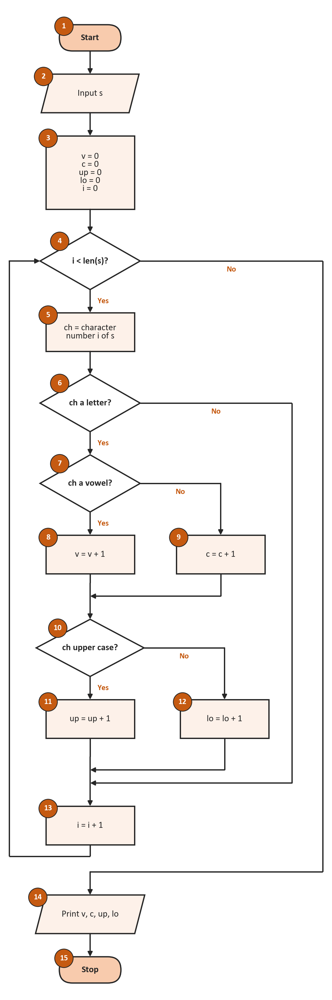{ width="475" }

<div class="grid2" markdown>
<div markdown>

**Pseudocode**

```text
 2  INPUT s
 3  SET v = 0, c = 0, up = 0, lo = 0, i = 0
 4  WHILE i < len(s)
 5      COMPUTE ch = s[i]
 6      IF ch.isalpha() THEN
 7          IF ch in 'aeiouAEIOU' THEN
 8              INCREMENT v
            ELSE
 9              INCREMENT c
            END IF
10          IF ch.isupper() THEN
11              INCREMENT up
            ELSE
12              INCREMENT lo
            END IF
        END IF
13      INCREMENT i
    END WHILE
14  PRINT 'Vowels ' + str(v) + ', consonants ' + str(c) + ', upper ' + str(up) + ', lower ' + str(lo)
```

</div>
<div markdown>

**Python**

```python
s = input()
v = 0
c = 0
up = 0
lo = 0
i = 0
while i < len(s):
    ch = s[i]
    if ch.isalpha():
        if ch in 'aeiouAEIOU':
            v = v + 1
        else:
            c = c + 1
        if ch.isupper():
            up = up + 1
        else:
            lo = lo + 1
    i = i + 1
print('Vowels ' + str(v) + ', consonants ' + str(c) + ', upper ' + str(up) + ', lower ' + str(lo))
```

</div>
</div>

**Walk-through for the input Hi Om**

| Step | Pseudocode | What happens |
|:-:|---|---|
| 1 | `START` | begin |
| 2 | `INPUT s` | s = Hi Om |
| 3 | `SET v = 0, c = 0, up = 0, lo = 0, i = 0` | v = 0, c = 0, up = 0, lo = 0, i = 0 |
| 4 | `WHILE i < len(s)` | 0 < len(Hi Om)? Yes |
| 5 | `COMPUTE ch = s[i]` | ch = H |
| 6 | `IF ch.isalpha() THEN` | H a letter? Yes |
| 7 | `IF ch in 'aeiouAEIOU' THEN` | H a vowel? No |
| 9 | `INCREMENT c` | 0 + 1 = 1 |
| 10 | `IF ch.isupper() THEN` | H upper case? Yes |
| 11 | `INCREMENT up` | 0 + 1 = 1 |
| 13 | `INCREMENT i` | 0 + 1 = 1 |
| 4 | `WHILE i < len(s)` | 1 < len(Hi Om)? Yes |
| 5 | `COMPUTE ch = s[i]` | ch = i |
| 6 | `IF ch.isalpha() THEN` | i a letter? Yes |
| 7 | `IF ch in 'aeiouAEIOU' THEN` | i a vowel? Yes |
| 8 | `INCREMENT v` | 0 + 1 = 1 |
| 10 | `IF ch.isupper() THEN` | i upper case? No |
| 12 | `INCREMENT lo` | 0 + 1 = 1 |
| 13 | `INCREMENT i` | 1 + 1 = 2 |
| … | `…` | rounds 3–4 |
| 4 | `WHILE i < len(s)` | 4 < len(Hi Om)? Yes |
| 5 | `COMPUTE ch = s[i]` | ch = m |
| 6 | `IF ch.isalpha() THEN` | m a letter? Yes |
| 7 | `IF ch in 'aeiouAEIOU' THEN` | m a vowel? No |
| 9 | `INCREMENT c` | 1 + 1 = 2 |
| 10 | `IF ch.isupper() THEN` | m upper case? No |
| 12 | `INCREMENT lo` | 1 + 1 = 2 |
| 13 | `INCREMENT i` | 4 + 1 = 5 |
| 4 | `WHILE i < len(s)` | 5 < len(Hi Om)? No |
| 14 | `PRINT 'Vowels ' + str(v) + ', consonants ' + str(c) + ', upper ' + str(up) + ', lower ' + str(lo)` | prints Vowels 2, consonants 2, upper 2, lower 2 |
| 15 | `STOP` | end |

**Output:** Vowels 2, consonants 2, upper 2, lower 2

*Note:* Spaces and digits are not letters, so they are counted in none of the four.

*Tested on 4 inputs: the flowchart and the Python gave the expected answer every time.*

## 18. Is the string a palindrome? Change the case of each letter { #18-palindrome-and-case }

*The syllabus:* Input a string and determine whether it is a palindrome or not; convert the case of characters in a string.

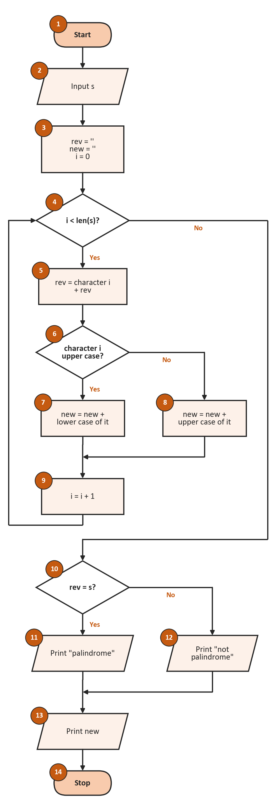{ width="426" }

<div class="grid2" markdown>
<div markdown>

**Pseudocode**

```text
 2  INPUT s
 3  SET rev = '', new = '', i = 0
 4  WHILE i < len(s)
 5      COMPUTE rev = s[i] + rev
 6      IF s[i].isupper() THEN
 7          COMPUTE new = new + s[i].lower()
        ELSE
 8          COMPUTE new = new + s[i].upper()
        END IF
 9      INCREMENT i
    END WHILE
10  IF rev = s THEN
11      PRINT s + ' is a palindrome'
    ELSE
12      PRINT s + ' is not a palindrome'
    END IF
13  PRINT new
```

</div>
<div markdown>

**Python**

```python
s = input()
rev = ''
new = ''
i = 0
while i < len(s):
    rev = s[i] + rev
    if s[i].isupper():
        new = new + s[i].lower()
    else:
        new = new + s[i].upper()
    i = i + 1
if rev == s:
    print(s + ' is a palindrome')
else:
    print(s + ' is not a palindrome')
print(new)
```

</div>
</div>

**Walk-through for the input Madam**

| Step | Pseudocode | What happens |
|:-:|---|---|
| 1 | `START` | begin |
| 2 | `INPUT s` | s = Madam |
| 3 | `SET rev = '', new = '', i = 0` | rev = , new = , i = 0 |
| 4 | `WHILE i < len(s)` | 0 < len(Madam)? Yes |
| 5 | `COMPUTE rev = s[i] + rev` | rev = M |
| 6 | `IF s[i].isupper() THEN` | character 0 upper case? Yes |
| 7 | `COMPUTE new = new + s[i].lower()` | new = m |
| 9 | `INCREMENT i` | 0 + 1 = 1 |
| 4 | `WHILE i < len(s)` | 1 < len(Madam)? Yes |
| 5 | `COMPUTE rev = s[i] + rev` | rev = aM |
| 6 | `IF s[i].isupper() THEN` | character 1 upper case? No |
| 8 | `COMPUTE new = new + s[i].upper()` | new = mA |
| 9 | `INCREMENT i` | 1 + 1 = 2 |
| … | `…` | rounds 3–4 |
| 4 | `WHILE i < len(s)` | 4 < len(Madam)? Yes |
| 5 | `COMPUTE rev = s[i] + rev` | rev = madaM |
| 6 | `IF s[i].isupper() THEN` | character 4 upper case? No |
| 8 | `COMPUTE new = new + s[i].upper()` | new = mADAM |
| 9 | `INCREMENT i` | 4 + 1 = 5 |
| 4 | `WHILE i < len(s)` | 5 < len(Madam)? No |
| 10 | `IF rev = s THEN` | madaM = Madam? No |
| 12 | `PRINT s + ' is not a palindrome'` | prints Madam is not a palindrome |
| 13 | `PRINT new` | prints mADAM |
| 14 | `STOP` | end |

**Output:** Madam is not a palindrome / mADAM

*Note:* "Madam" is not a palindrome for the computer: M and m are different characters. Putting each character in FRONT of rev builds the string backwards.

*Tested on 4 inputs: the flowchart and the Python gave the expected answer every time.*

## 19. The largest and the smallest in a list { #19-list-largest-smallest }

*The syllabus:* Find the largest / smallest number in a list / tuple.

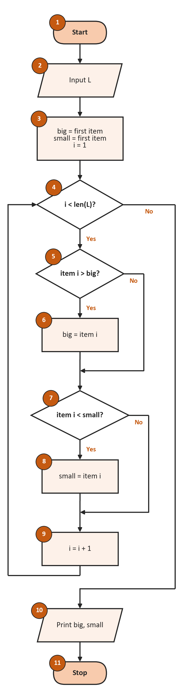{ width="305" }

<div class="grid2" markdown>
<div markdown>

**Pseudocode**

```text
 2  INPUT L
 3  COMPUTE big = L[0], COMPUTE small = L[0], SET i = 1
 4  WHILE i < len(L)
 5      IF L[i] > big THEN
 6          COMPUTE big = L[i]
        END IF
 7      IF L[i] < small THEN
 8          COMPUTE small = L[i]
        END IF
 9      INCREMENT i
    END WHILE
10  PRINT 'Largest ' + str(big) + ', smallest ' + str(small)
```

</div>
<div markdown>

**Python**

```python
L = eval(input())
big = L[0]
small = L[0]
i = 1
while i < len(L):
    if L[i] > big:
        big = L[i]
    if L[i] < small:
        small = L[i]
    i = i + 1
print('Largest ' + str(big) + ', smallest ' + str(small))
```

</div>
</div>

**Walk-through for the input [4, 9, 1, 7]**

| Step | Pseudocode | What happens |
|:-:|---|---|
| 1 | `START` | begin |
| 2 | `INPUT L` | L = [4, 9, 1, 7] |
| 3 | `COMPUTE big = L[0], COMPUTE small = L[0], SET i = 1` | big = 4, small = 4, i = 1 |
| 4 | `WHILE i < len(L)` | 1 < len([4, 9, 1, 7])? Yes |
| 5 | `IF L[i] > big THEN` | item 1 > 4? Yes |
| 6 | `COMPUTE big = L[i]` | item 1 = 9 |
| 7 | `IF L[i] < small THEN` | item 1 < 4? No |
| 9 | `INCREMENT i` | 1 + 1 = 2 |
| 4 | `WHILE i < len(L)` | 2 < len([4, 9, 1, 7])? Yes |
| 5 | `IF L[i] > big THEN` | item 2 > 9? No |
| 7 | `IF L[i] < small THEN` | item 2 < 4? Yes |
| 8 | `COMPUTE small = L[i]` | item 2 = 1 |
| 9 | `INCREMENT i` | 2 + 1 = 3 |
| 4 | `WHILE i < len(L)` | 3 < len([4, 9, 1, 7])? Yes |
| 5 | `IF L[i] > big THEN` | item 3 > 9? No |
| 7 | `IF L[i] < small THEN` | item 3 < 1? No |
| 9 | `INCREMENT i` | 3 + 1 = 4 |
| 4 | `WHILE i < len(L)` | 4 < len([4, 9, 1, 7])? No |
| 10 | `PRINT 'Largest ' + str(big) + ', smallest ' + str(small)` | prints Largest 9, smallest 1 |
| 11 | `STOP` | end |

**Output:** Largest 9, smallest 1

*Note:* The list is typed as [4, 9, 1, 7]. Items are counted from 0, so the first item is L[0].

*Tested on 4 inputs: the flowchart and the Python gave the expected answer every time.*

## 20. Swap the items at even and odd places { #20-list-swap }

*The syllabus:* Input a list of numbers and swap elements at the even location with the elements at the odd location.

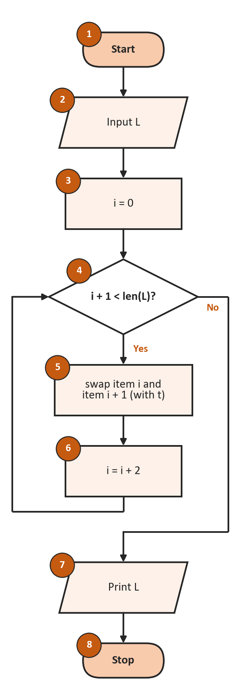{ width="262" }

<div class="grid2" markdown>
<div markdown>

**Pseudocode**

```text
 2  INPUT L
 3  SET i = 0
 4  WHILE i + 1 < len(L)
 5      COMPUTE t = L[i], COMPUTE L[i] = L[i + 1], COMPUTE L[i + 1] = t
 6      COMPUTE i = i + 2
    END WHILE
 7  PRINT L
```

</div>
<div markdown>

**Python**

```python
L = eval(input())
i = 0
while i + 1 < len(L):
    t = L[i]
    L[i] = L[i + 1]
    L[i + 1] = t
    i = i + 2
print(L)
```

</div>
</div>

**Walk-through for the input [1, 2, 3, 4, 5]**

| Step | Pseudocode | What happens |
|:-:|---|---|
| 1 | `START` | begin |
| 2 | `INPUT L` | L = [1, 2, 3, 4, 5] |
| 3 | `SET i = 0` | i = 0 |
| 4 | `WHILE i + 1 < len(L)` | 0 + 1 < len([2, 1, 4, 3, 5])? Yes |
| 5 | `COMPUTE t = L[i], COMPUTE L[i] = L[i + 1], COMPUTE L[i + 1] = t` | t = 1 |
| 6 | `COMPUTE i = i + 2` | 0 + 2 = 2 |
| 4 | `WHILE i + 1 < len(L)` | 2 + 1 < len([2, 1, 4, 3, 5])? Yes |
| 5 | `COMPUTE t = L[i], COMPUTE L[i] = L[i + 1], COMPUTE L[i + 1] = t` | t = 3 |
| 6 | `COMPUTE i = i + 2` | 2 + 2 = 4 |
| 4 | `WHILE i + 1 < len(L)` | 4 + 1 < len([2, 1, 4, 3, 5])? No |
| 7 | `PRINT L` | prints [2, 1, 4, 3, 5] |
| 8 | `STOP` | end |

**Output:** [2, 1, 4, 3, 5]

*Note:* i jumps by 2 (0, 2, 4 …), so each pair is swapped once. With an odd number of items, the last one stays.

*Tested on 4 inputs: the flowchart and the Python gave the expected answer every time.*

## 21. Search for an item in a list { #21-list-search }

*The syllabus:* Input a list / tuple of elements, search for a given element in the list / tuple.

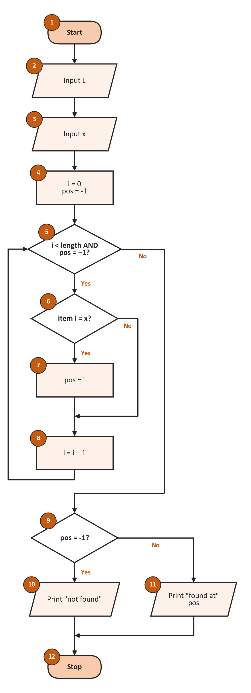{ width="416" }

<div class="grid2" markdown>
<div markdown>

**Pseudocode**

```text
 2  INPUT L
 3  INPUT x
 4  SET i = 0, pos = -1
 5  WHILE i < len(L) AND pos = -1
 6      IF L[i] = x THEN
 7          COMPUTE pos = i
        END IF
 8      INCREMENT i
    END WHILE
 9  IF pos = -1 THEN
10      PRINT str(x) + ' not found'
    ELSE
11      PRINT str(x) + ' found at position ' + str(pos)
    END IF
```

</div>
<div markdown>

**Python**

```python
L = eval(input())
x = int(input())
i = 0
pos = -1
while i < len(L) and pos == -1:
    if L[i] == x:
        pos = i
    i = i + 1
if pos == -1:
    print(str(x) + ' not found')
else:
    print(str(x) + ' found at position ' + str(pos))
```

</div>
</div>

**Walk-through for the input [4, 9, 1, 7], 1**

| Step | Pseudocode | What happens |
|:-:|---|---|
| 1 | `START` | begin |
| 2 | `INPUT L` | L = [4, 9, 1, 7] |
| 3 | `INPUT x` | x = 1 |
| 4 | `SET i = 0, pos = -1` | i = 0, pos = -1 |
| 5 | `WHILE i < len(L) AND pos = -1` | 0 < length AND -1 = −1? Yes |
| 6 | `IF L[i] = x THEN` | item 0 = 1? No |
| 8 | `INCREMENT i` | 0 + 1 = 1 |
| 5 | `WHILE i < len(L) AND pos = -1` | 1 < length AND -1 = −1? Yes |
| 6 | `IF L[i] = x THEN` | item 1 = 1? No |
| 8 | `INCREMENT i` | 1 + 1 = 2 |
| 5 | `WHILE i < len(L) AND pos = -1` | 2 < length AND -1 = −1? Yes |
| 6 | `IF L[i] = x THEN` | item 2 = 1? Yes |
| 7 | `COMPUTE pos = i` | pos = 2 |
| 8 | `INCREMENT i` | 2 + 1 = 3 |
| 5 | `WHILE i < len(L) AND pos = -1` | 3 < length AND 2 = −1? No |
| 9 | `IF pos = -1 THEN` | 2 = -1? No |
| 11 | `PRINT str(x) + ' found at position ' + str(pos)` | prints 1 found at position 2 |
| 12 | `STOP` | end |

**Output:** 1 found at position 2

*Note:* The search stops at the first match (pos is no longer −1). This is the one-by-one search of section 5.8.

*Tested on 4 inputs: the flowchart and the Python gave the expected answer every time.*

## 22. Students with marks above 75 { #22-dictionary-marks }

*The syllabus:* Create a dictionary with the roll number, name and marks of n students in a class and display the names of students who have marks above 75.

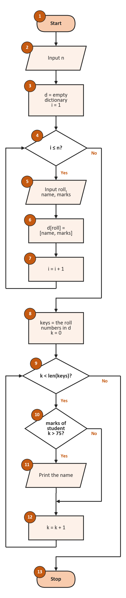{ width="291" }

<div class="grid2" markdown>
<div markdown>

**Pseudocode**

```text
 2  INPUT n
 3  COMPUTE d = {}, SET i = 1
 4  WHILE i ≤ n
 5      INPUT roll, name, marks
 6      COMPUTE d[roll] = [name, marks]
 7      INCREMENT i
    END WHILE
 8  COMPUTE keys = list(d), SET k = 0
 9  WHILE k < len(keys)
10      IF d[keys[k]][1] > 75 THEN
11          PRINT d[keys[k]][0]
        END IF
12      INCREMENT k
    END WHILE
```

</div>
<div markdown>

**Python**

```python
n = int(input())
d = {}
i = 1
while i <= n:
    roll = int(input())
    name = input()
    marks = int(input())
    d[roll] = [name, marks]
    i = i + 1
keys = list(d)
k = 0
while k < len(keys):
    if d[keys[k]][1] > 75:
        print(d[keys[k]][0])
    k = k + 1
```

</div>
</div>

**Walk-through for the input 3, 1, Asha, 82, 2, Ravi, 75, 3, Meena, 91**

| Step | Pseudocode | What happens |
|:-:|---|---|
| 1 | `START` | begin |
| 2 | `INPUT n` | n = 3 |
| 3 | `COMPUTE d = {}, SET i = 1` | d = {}, i = 1 |
| 4 | `WHILE i ≤ n` | 1 ≤ 3? Yes |
| 5 | `INPUT roll, name, marks` | roll = 1, name = Asha, marks = 82 |
| 6 | `COMPUTE d[roll] = [name, marks]` |  |
| 7 | `INCREMENT i` | 1 + 1 = 2 |
| 4 | `WHILE i ≤ n` | 2 ≤ 3? Yes |
| 5 | `INPUT roll, name, marks` | roll = 2, name = Ravi, marks = 75 |
| 6 | `COMPUTE d[roll] = [name, marks]` |  |
| 7 | `INCREMENT i` | 2 + 1 = 3 |
| 4 | `WHILE i ≤ n` | 3 ≤ 3? Yes |
| 5 | `INPUT roll, name, marks` | roll = 3, name = Meena, marks = 91 |
| 6 | `COMPUTE d[roll] = [name, marks]` |  |
| 7 | `INCREMENT i` | 3 + 1 = 4 |
| 4 | `WHILE i ≤ n` | 4 ≤ 3? No |
| 8 | `COMPUTE keys = list(d), SET k = 0` | keys = [1, 2, 3], k = 0 |
| 9 | `WHILE k < len(keys)` | 0 < len([1, 2, 3])? Yes |
| 10 | `IF d[keys[k]][1] > 75 THEN` | 91 of student 0 > 75? Yes |
| 11 | `PRINT d[keys[k]][0]` | prints Asha |
| 12 | `INCREMENT k` | 0 + 1 = 1 |
| 9 | `WHILE k < len(keys)` | 1 < len([1, 2, 3])? Yes |
| 10 | `IF d[keys[k]][1] > 75 THEN` | 91 of student 1 > 75? No |
| 12 | `INCREMENT k` | 1 + 1 = 2 |
| 9 | `WHILE k < len(keys)` | 2 < len([1, 2, 3])? Yes |
| 10 | `IF d[keys[k]][1] > 75 THEN` | 91 of student 2 > 75? Yes |
| 11 | `PRINT d[keys[k]][0]` | prints Meena |
| 12 | `INCREMENT k` | 2 + 1 = 3 |
| 9 | `WHILE k < len(keys)` | 3 < len([1, 2, 3])? No |
| 13 | `STOP` | end |

**Output:** Asha / Meena

*Note:* Ravi has exactly 75, which is not ABOVE 75. The roll number is the key, so no two students share an entry.

*Tested on 3 inputs: the flowchart and the Python gave the expected answer every time.*

