# Practice: The five-step method, practised

*Chapter 5 · Practice. The printed book (section 5.5) gives the five steps Read, Mark, List, Draw, Check, worked on the ATM. Here are eight more questions worked the same way, from easy to hard, and six to try.*

*Every number on this page was computed by a program (`tools/ch05_pages2.py`) and checked.*

Each worked question shows: **Read** (what is given, what is asked), **Mark** (the signal words and their
shapes), **List** (the steps in plain words), **Draw** (the flowchart) and **Check** (two dry runs, a normal value
and a boundary value).

## 1. A bank pays simple interest. Input the principal, the rate (% per year) and the time (years), and print the interest SI = P × R × T ÷ 100.

*Pattern: sequence.*

- **Read.** Given P, R, T. Asked: SI.
- **Mark.** input (input) · print (output) · "SI = …" (a formula: process).
- **List.**
    1. Input P, R, T.
    2. Compute SI = P × R × T ÷ 100.
    3. Print SI.
- **Draw.**

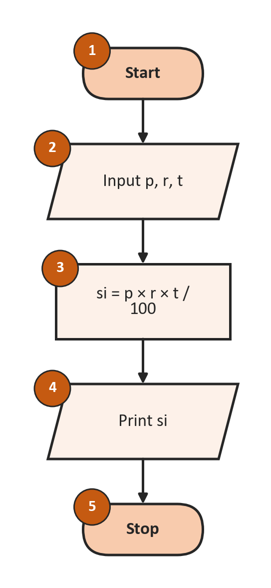{ width="199" }

- **Check.**

    - Input 1000, 5, 2: boxes 1 → 2 → 3 → 4 → 5; prints **100.0**.
    - Input 100, 0, 5: boxes 1 → 2 → 3 → 4 → 5; prints **0.0**.

## 2. Input the age of a person and print whether the person can vote (18 or more).

*Pattern: one choice.*

- **Read.** Given age. Asked: "Can vote" or "Cannot vote yet".
- **Mark.** input · whether (decision) · print (output).
- **List.**
    1. Input age.
    2. Is age ≥ 18? Yes: print "Can vote". No: print "Cannot vote yet".
- **Draw.**

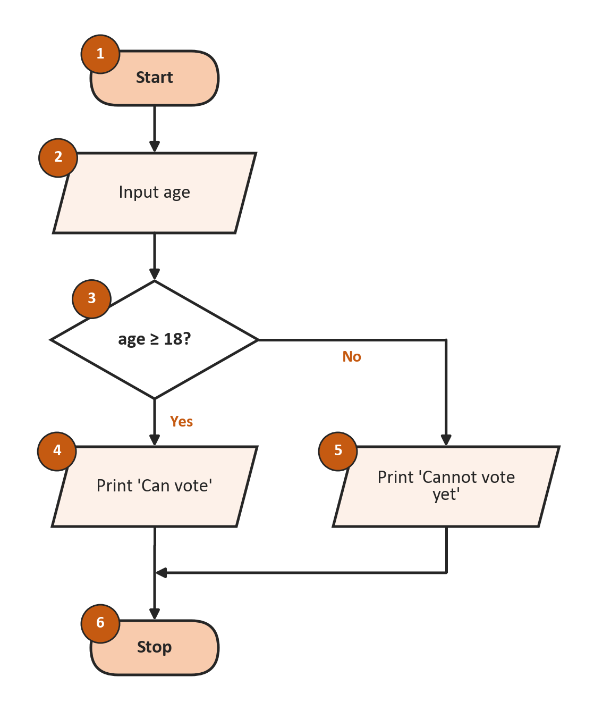{ width="411" }

- **Check.**

    - Input 18: boxes 1 → 2 → 3 → 4 → 6; prints **Can vote**.
    - Input 17: boxes 1 → 2 → 3 → 5 → 6; prints **Cannot vote yet**.

## 3. An electricity board charges ₹5 a unit for the first 100 units and ₹7 a unit after that. Input the units and print the bill.

*Pattern: one choice.*

- **Read.** Given units. Asked: the bill.
- **Mark.** input · "for the first 100 … after that" (a hidden decision) · charges (process) · print.
- **List.**
    1. Input units.
    2. Is units ≤ 100? Yes: bill = units × 5. No: bill = 500 + (units − 100) × 7.
    3. Print bill.
- **Draw.**

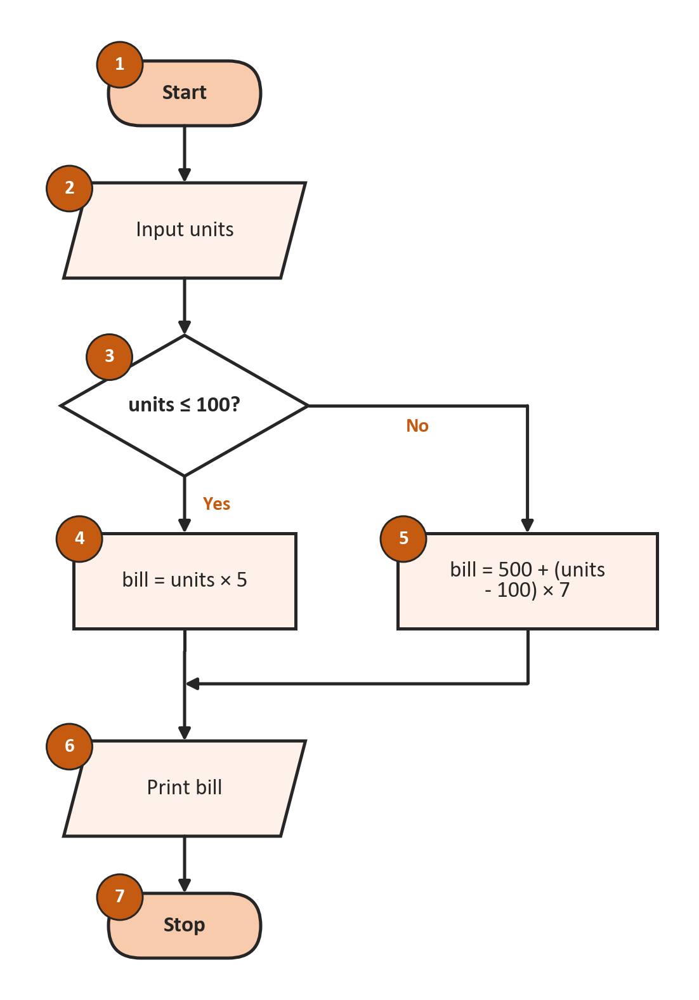{ width="405" }

- **Check.**

    - Input 250: boxes 1 → 2 → 3 → 5 → 6 → 7; prints **1550**.
    - Input 100: boxes 1 → 2 → 3 → 4 → 6 → 7; prints **500**.

## 4. A cinema charges ₹100 for children under 12, ₹120 for people of 60 or more, and ₹200 for others. Input the age and print the price.

*Pattern: a ladder (nested choice).*

- **Read.** Given age. Asked: the price.
- **Mark.** input · "under 12", "60 or more", "others" (a ladder of decisions) · print.
- **List.**
    1. Input age.
    2. Is age < 12? Yes: price 100.
    3. No: is age ≥ 60? Yes: price 120. No: price 200.
    4. Print price.
- **Draw.**

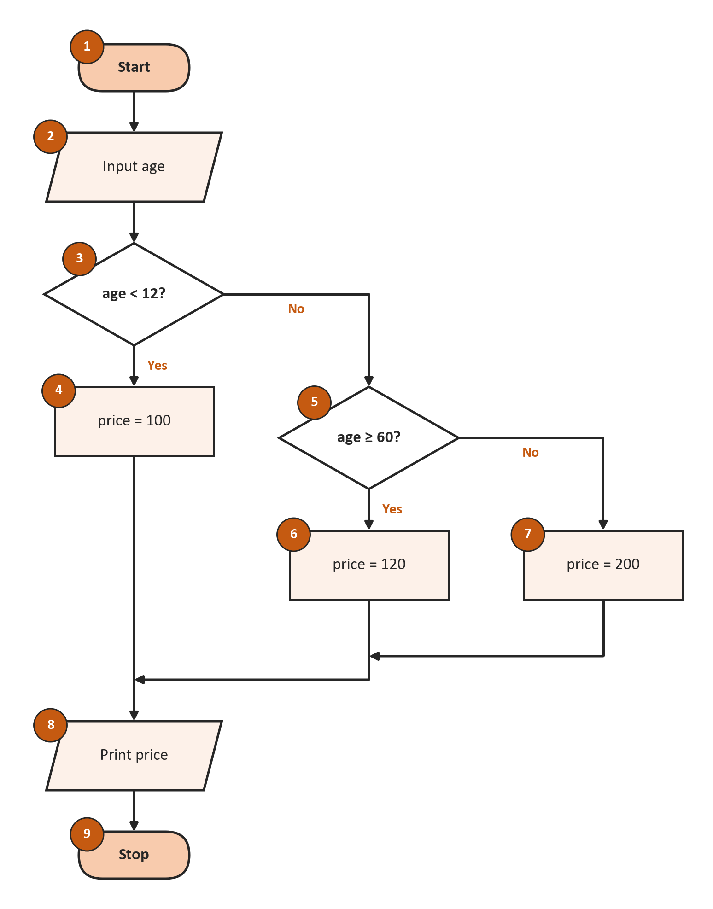{ width="569" }

- **Check.**

    - Input 12: boxes 1 → 2 → 3 → 5 → 7 → 8 → 9; prints **200**.
    - Input 60: boxes 1 → 2 → 3 → 5 → 6 → 8 → 9; prints **120**.

## 5. Input a year and print whether it is a leap year. (A year divisible by 400 is leap; otherwise one divisible by 100 is not; otherwise one divisible by 4 is.)

*Pattern: a ladder.*

- **Read.** Given year. Asked: "Leap" or "Not leap".
- **Mark.** input · "divisible", "otherwise" (decisions, in order) · print.
- **List.**
    1. Input y.
    2. Divisible by 400? Yes: Leap.
    3. No: divisible by 100? Yes: Not leap.
    4. No: divisible by 4? Yes: Leap. No: Not leap.
- **Draw.**

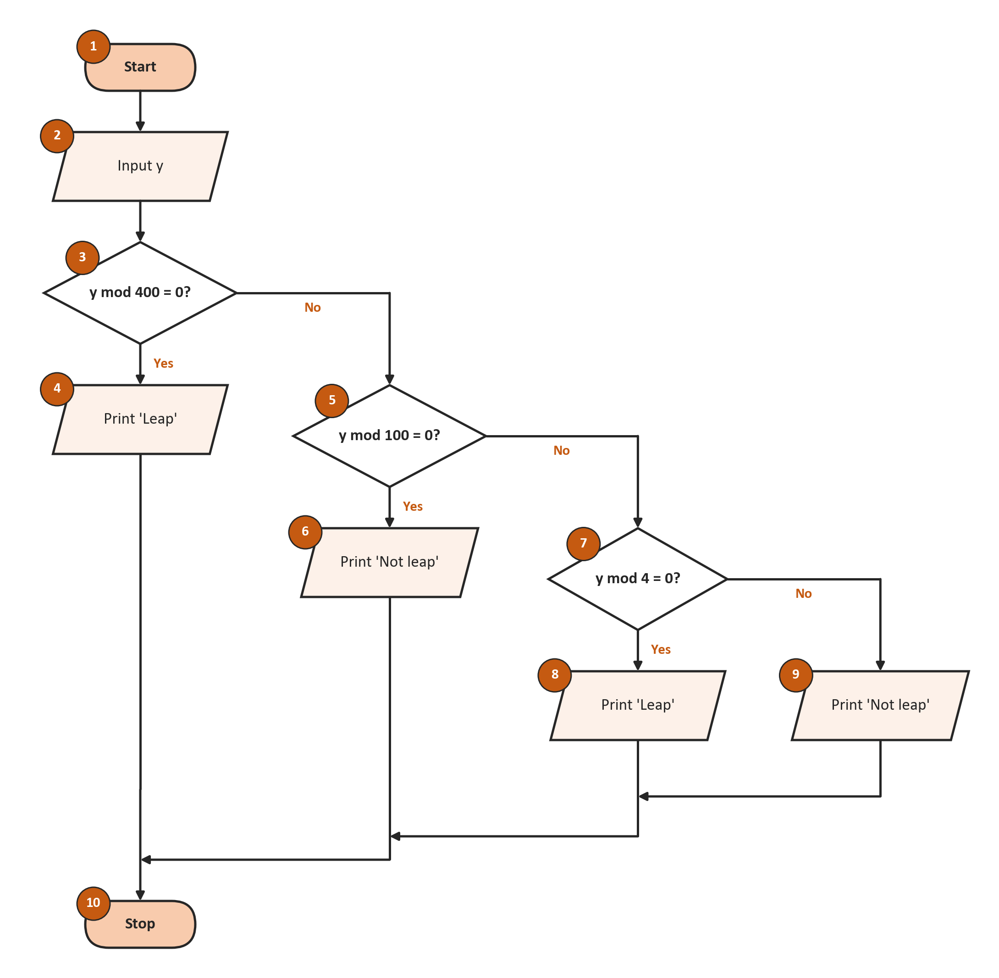{ width="720" }

- **Check.**

    - Input 1900: boxes 1 → 2 → 3 → 5 → 6 → 10; prints **Not leap**.
    - Input 2024: boxes 1 → 2 → 3 → 5 → 7 → 8 → 10; prints **Leap**.

## 6. Input n and print its multiplication table up to 10 (n × 1 = …, n × 2 = …).

*Pattern: counted loop.*

- **Read.** Given n. Asked: 10 lines.
- **Mark.** input · "up to 10" (a counted loop) · print.
- **List.**
    1. Input n; set i = 1.
    2. While i ≤ 10: print "n × i = n·i"; increase i by 1.
- **Draw.**

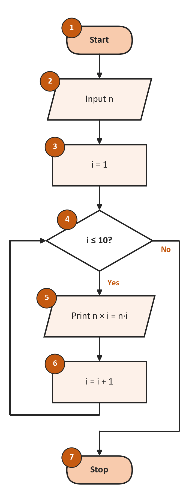{ width="255" }

- **Check.**

    - Input 7: boxes 1 → 2 → 3 → 4 → 5 → 6 → 4 → 5 → 6 → 4 → 5 → 6 → …; prints **7 x 1 = 7 … 7 x 10 = 70 (10 lines)**.

## 7. Input a whole number and print the sum of its digits (for 4096: 4 + 0 + 9 + 6 = 19).

*Pattern: loop until a condition.*

- **Read.** Given n. Asked: the sum of the digits.
- **Mark.** input · "each digit" (a loop until nothing is left) · sum (process) · print.
- **List.**
    1. Input n; set s = 0.
    2. While n > 0: add the last digit (n mod 10) to s; drop the last digit (n div 10).
    3. Print s.
- **Draw.**

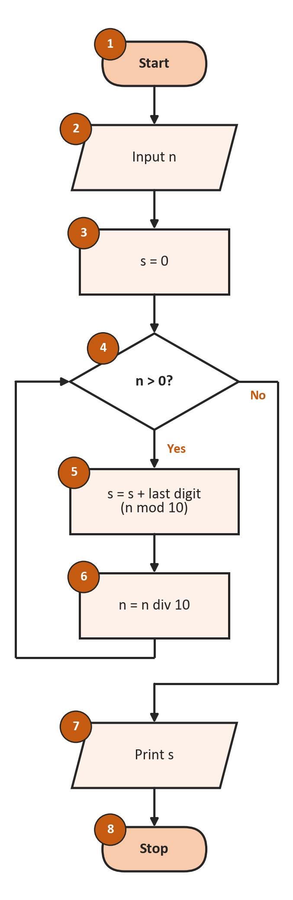{ width="249" }

- **Check.**

    - Input 4096: boxes 1 → 2 → 3 → 4 → 5 → 6 → 4 → 5 → 6 → 4 → 5 → 6 → …; prints **19**.
    - Input 0: boxes 1 → 2 → 3 → 4 → 7 → 8; prints **0**.

## 8. Marks are typed one at a time; −1 ends the list. Count how many students passed (33 or more).

*Pattern: a loop with a choice inside.*

- **Read.** Given marks, then −1. Asked: how many passed.
- **Mark.** "one at a time", "ends" (a loop until −1) · "passed" (a decision inside the loop) · count (process) · print.
- **List.**
    1. Set c = 0; input m.
    2. While m ≠ −1: if m ≥ 33, add 1 to c; input the next m.
    3. Print c.
- **Draw.**

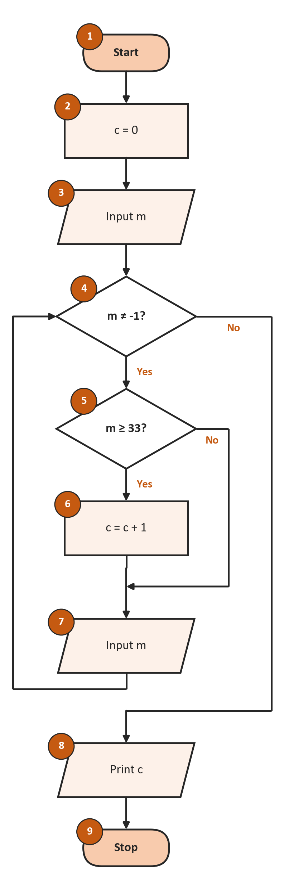{ width="291" }

- **Check.**

    - Input 45, 20, 33, -1: boxes 1 → 2 → 3 → 4 → 5 → 6 → 7 → 4 → 5 → 7 → 4 → 5 → …; prints **2**.
    - Input -1: boxes 1 → 2 → 3 → 4 → 8 → 9; prints **0**.

## Try these

Work the five steps on paper; then open the answer: the list and the flowchart, tested.

**1. Input a temperature in Celsius and print it in Fahrenheit (F = C × 9 ÷ 5 + 32).**

??? success "Answer"
    ```text
     2  INPUT c
     3  COMPUTE f = c × 9 / 5 + 32
     4  PRINT f
    ```

    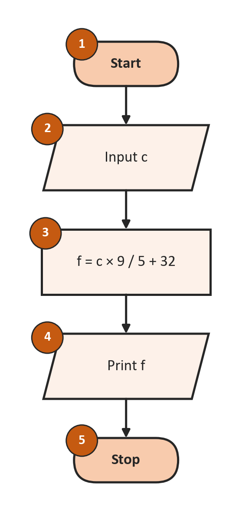{ width="193" }

    Tested: 100 → 212.0; 0 → 32.0; 37 → 98.6.

**2. Input a number and print "Positive", "Negative" or "Zero".**

??? success "Answer"
    ```text
     2  INPUT n
     3  IF n > 0 THEN
     4      PRINT 'Positive'
        ELSE
     5      IF n < 0 THEN
     6          PRINT 'Negative'
            ELSE
     7          PRINT 'Zero'
            END IF
        END IF
    ```

    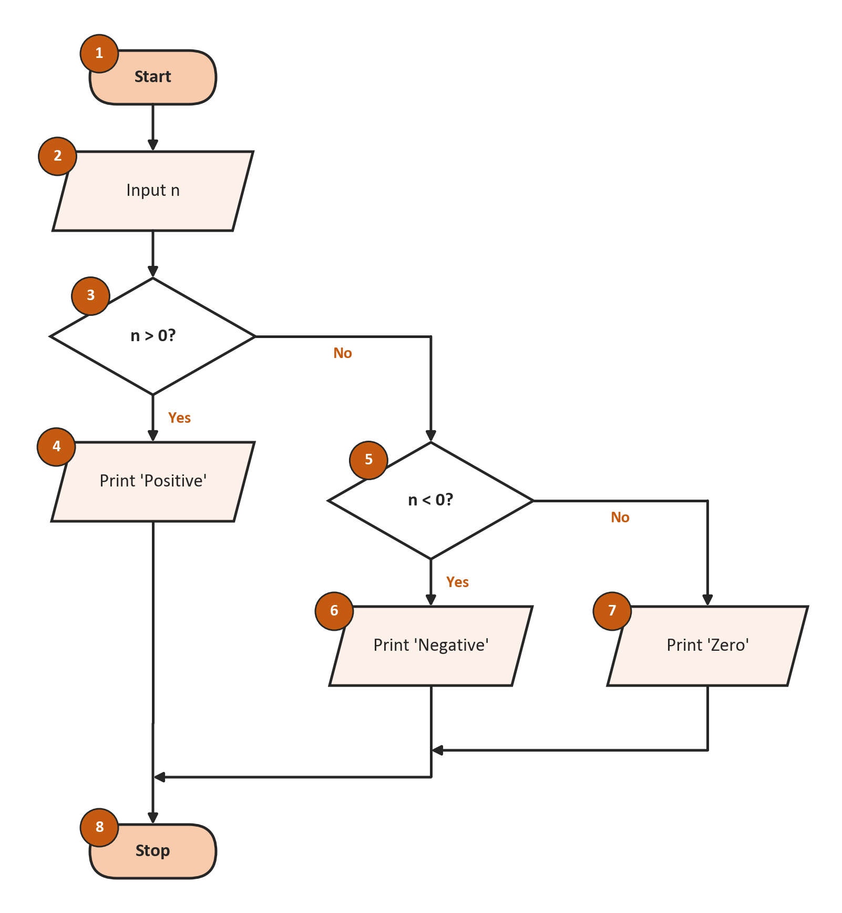{ width="563" }

    Tested: 5 → Positive; -3 → Negative; 0 → Zero.

**3. A shop gives 10% off on a bill above ₹5,000 and 5% off otherwise. Input the bill and print the amount to pay.**

??? success "Answer"
    ```text
     2  INPUT bill
     3  IF bill > 5000 THEN
     4      COMPUTE pay = bill - bill × 10 / 100
        ELSE
     5      COMPUTE pay = bill - bill × 5 / 100
        END IF
     6  PRINT pay
    ```

    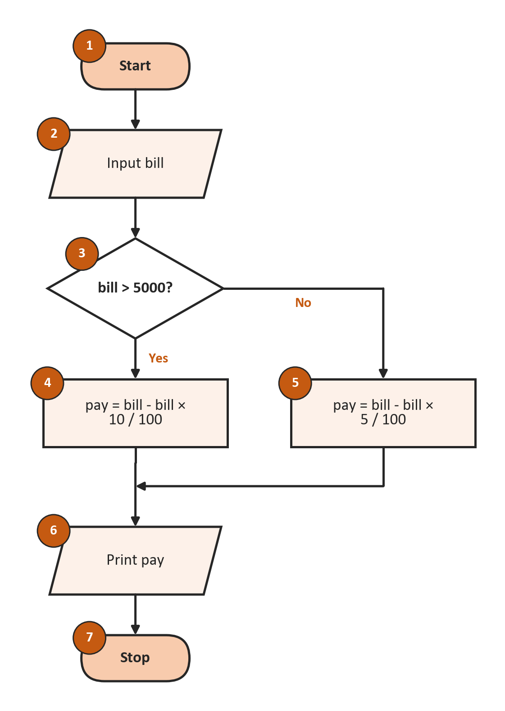{ width="394" }

    Tested: 6000 → 5400.0; 5000 → 4750.0; 100 → 95.0.

**4. Input n and print the sum 1 + 2 + … + n using a loop.**

??? success "Answer"
    ```text
     2  INPUT n
     3  SET s = 0, i = 1
     4  WHILE i ≤ n
     5      COMPUTE s = s + i
     6      INCREMENT i
        END WHILE
     7  PRINT s
    ```

    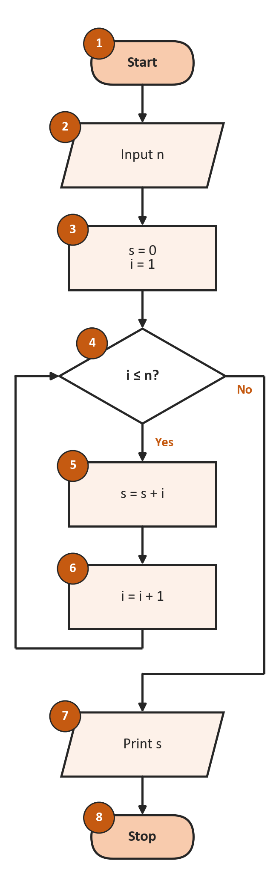{ width="230" }

    Tested: 10 → 55; 1 → 1; 0 → 0.

**5. Input a whole number and print how many digits it has (0 has 1 digit).**

??? success "Answer"
    ```text
     2  INPUT n
     3  SET d = 1
     4  WHILE n ≥ 10
     5      COMPUTE n = n  div  10
     6      INCREMENT d
        END WHILE
     7  PRINT d
    ```

    { width="230" }

    Tested: 0 → 1; 7 → 1; 4096 → 4; 100 → 3.

**6. Numbers are typed until 0. Print the largest of them (the first number is not 0).**

??? success "Answer"
    ```text
     2  INPUT x
     3  COMPUTE big = x
     4  WHILE x ≠ 0
     5      IF x > big THEN
     6          COMPUTE big = x
            END IF
     7      INPUT x
        END WHILE
     8  PRINT big
    ```

    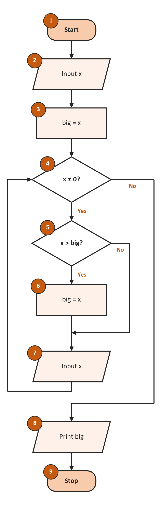{ width="279" }

    Tested: 4, 9, 2, 0 → 9; 5, 0 → 5; -3, -1, -8, 0 → -1.

