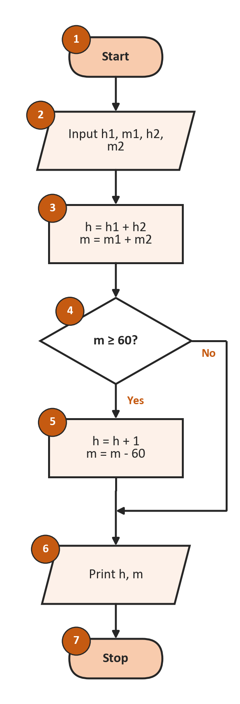

# Practice: Trace tables, with more to fill in

*Chapter 5 · Practice. The printed book (section 5.7) shows one classic trace table. Here are full trace tables for W6 to W10, the bug in the time adder found by a dry run, and ten trace tables to fill in yourself, with the answers behind a click.*

*Every number on this page was computed by a program (`tools/ch05_pages2.py`) and checked.*

## 1. How to make a trace table

1. Draw one column for **each variable**, one for the **question** and one for the **output**.
2. Follow the flowchart from Start. Each time a box **changes** a value, **asks** a question or **prints**, write a row.
3. Write a value **only when it changes** (here it is in bold); the others stay as they were.
4. At Stop, the output column holds the answer. Check it by hand if you can.

## 2. W6: Report card: result and grade, for 80, 75, 70, 72, 78

| Step | Box | m1 | m2 | m3 | m4 | m5 | total | per | low | Output |
|:-:|---|:-:|:-:|:-:|:-:|:-:|:-:|:-:|:-:|---|
| 2 | Input the 5 marks | **80** | **75** | **70** | **72** | **78** |  |  |  |  |
| 3 | total, % = total ÷ 5, low = lowest mark | 80 | 75 | 70 | 72 | 78 | **375** | **75.0** | **70** |  |
| 4 | low ≥ 33? → Yes | 80 | 75 | 70 | 72 | 78 | 375 | 75.0 | 70 |  |
| 6 | % ≥ 90? → No | 80 | 75 | 70 | 72 | 78 | 375 | 75.0 | 70 |  |
| 8 | % ≥ 75? → Yes | 80 | 75 | 70 | 72 | 78 | 375 | 75.0 | 70 |  |
| 9 | Print "Grade B" | 80 | 75 | 70 | 72 | 78 | 375 | 75.0 | 70 | Grade B |

**Output:** Grade B.

## 3. W7: Average of numbers until 0 is typed, for 6, 9, 0

| Step | Box | x | sum | count | avg | Output |
|:-:|---|:-:|:-:|:-:|:-:|---|
| 2 | sum = 0, count = 0 |  | **0** | **0** |  |  |
| 3 | Input x | **6** | 0 | 0 |  |  |
| 4 | x = 0? → No | 6 | 0 | 0 |  |  |
| 5 | sum = sum + x | 6 | **6** | 0 |  |  |
| 6 | count = count + 1 | 6 | 6 | **1** |  |  |
| 3 | Input x | **9** | 6 | 1 |  |  |
| 4 | x = 0? → No | 9 | 6 | 1 |  |  |
| 5 | sum = sum + x | 9 | **15** | 1 |  |  |
| 6 | count = count + 1 | 9 | 15 | **2** |  |  |
| 3 | Input x | **0** | 15 | 2 |  |  |
| 4 | x = 0? → Yes | 0 | 15 | 2 |  |  |
| 7 | avg = sum ÷ count | 0 | 15 | 2 | **7.5** |  |
| 8 | Print avg | 0 | 15 | 2 | 7.5 | 7.5 |

**Output:** 7.5.

## 4. W8: GCD and LCM by Euclid's method, for 30, 21

| Step | Box | a | b | x | y | r | lcm | Output |
|:-:|---|:-:|:-:|:-:|:-:|:-:|:-:|---|
| 2 | Input a, b | **30** | **21** |  |  |  |  |  |
| 3 | x = a, y = b (keep a copy) | 30 | 21 | **30** | **21** |  |  |  |
| 4 | b = 0? → No | 30 | 21 | 30 | 21 |  |  |  |
| 5 | r = remainder of a ÷ b | 30 | 21 | 30 | 21 | **9** |  |  |
| 6 | a = b | **21** | 21 | 30 | 21 | 9 |  |  |
| 7 | b = r | 21 | **9** | 30 | 21 | 9 |  |  |
| 4 | b = 0? → No | 21 | 9 | 30 | 21 | 9 |  |  |
| 5 | r = remainder of a ÷ b | 21 | 9 | 30 | 21 | **3** |  |  |
| 6 | a = b | **9** | 9 | 30 | 21 | 3 |  |  |
| 7 | b = r | 9 | **3** | 30 | 21 | 3 |  |  |
| 4 | b = 0? → No | 9 | 3 | 30 | 21 | 3 |  |  |
| 5 | r = remainder of a ÷ b | 9 | 3 | 30 | 21 | **0** |  |  |
| 6 | a = b | **3** | 3 | 30 | 21 | 0 |  |  |
| 7 | b = r | 3 | **0** | 30 | 21 | 0 |  |  |
| 4 | b = 0? → Yes | 3 | 0 | 30 | 21 | 0 |  |  |
| 8 | LCM = x × y ÷ a | 3 | 0 | 30 | 21 | 0 | **210** |  |
| 9 | Print a (GCD) and LCM | 3 | 0 | 30 | 21 | 0 | 210 | 3 210 |

**Output:** 3 210.

## 5. W9: The series 1 + x + x² + … + xⁿ, for 2, 3

| Step | Box | x | n | sum | term | i | Output |
|:-:|---|:-:|:-:|:-:|:-:|:-:|---|
| 2 | Input x, n | **2** | **3** |  |  |  |  |
| 3 | sum = 1, term = 1 i = 1 | 2 | 3 | **1** | **1** | **1** |  |
| 4 | i ≤ n? → Yes | 2 | 3 | 1 | 1 | 1 |  |
| 5 | term = term × x | 2 | 3 | 1 | **2** | 1 |  |
| 6 | sum = sum + term | 2 | 3 | **3** | 2 | 1 |  |
| 7 | i = i + 1 | 2 | 3 | 3 | 2 | **2** |  |
| 4 | i ≤ n? → Yes | 2 | 3 | 3 | 2 | 2 |  |
| 5 | term = term × x | 2 | 3 | 3 | **4** | 2 |  |
| 6 | sum = sum + term | 2 | 3 | **7** | 4 | 2 |  |
| 7 | i = i + 1 | 2 | 3 | 7 | 4 | **3** |  |
| 4 | i ≤ n? → Yes | 2 | 3 | 7 | 4 | 3 |  |
| 5 | term = term × x | 2 | 3 | 7 | **8** | 3 |  |
| 6 | sum = sum + term | 2 | 3 | **15** | 8 | 3 |  |
| 7 | i = i + 1 | 2 | 3 | 15 | 8 | **4** |  |
| 4 | i ≤ n? → No | 2 | 3 | 15 | 8 | 4 |  |
| 8 | Print sum | 2 | 3 | 15 | 8 | 4 | 15 |

**Output:** 15.

## 6. W10: The factorial of n, for 4

| Step | Box | n | fact | i | Output |
|:-:|---|:-:|:-:|:-:|---|
| 2 | Input n | **4** |  |  |  |
| 3 | fact = 1, i = 1 | 4 | **1** | **1** |  |
| 4 | i ≤ n? → Yes | 4 | 1 | 1 |  |
| 5 | fact = fact × i | 4 | 1 | 1 |  |
| 6 | i = i + 1 | 4 | 1 | **2** |  |
| 4 | i ≤ n? → Yes | 4 | 1 | 2 |  |
| 5 | fact = fact × i | 4 | **2** | 2 |  |
| 6 | i = i + 1 | 4 | 2 | **3** |  |
| 4 | i ≤ n? → Yes | 4 | 2 | 3 |  |
| 5 | fact = fact × i | 4 | **6** | 3 |  |
| 6 | i = i + 1 | 4 | 6 | **4** |  |
| 4 | i ≤ n? → Yes | 4 | 6 | 4 |  |
| 5 | fact = fact × i | 4 | **24** | 4 |  |
| 6 | i = i + 1 | 4 | 24 | **5** |  |
| 4 | i ≤ n? → No | 4 | 24 | 5 |  |
| 7 | Print fact | 4 | 24 | 5 | 24 |

**Output:** 24.

## 7. The bug in the time adder, found by a dry run

Journey J1 takes 4 h 50 min and J2 takes 2 h 20 min. The first algorithm adds hours to hours and minutes to minutes:

| Step | Box | h1 | m1 | h2 | m2 | h | m | Output |
|:-:|---|:-:|:-:|:-:|:-:|:-:|:-:|---|
| 2 | Input h1, m1, h2, m2 | **4** | **50** | **2** | **20** |  |  |  |
| 3 | h = h1 + h2 m = m1 + m2 | 4 | 50 | 2 | 20 | **6** | **70** |  |
| 4 | Print h, m | 4 | 50 | 2 | 20 | 6 | 70 | 6 h 70 min |

It prints **6 h 70 min**: 70 minutes is more than an hour. The fix adds one question: if the minutes are 60 or more, add 1 to the hours and take 60 from the minutes.

{ width="237" }

| Step | Box | h1 | m1 | h2 | m2 | h | m | Output |
|:-:|---|:-:|:-:|:-:|:-:|:-:|:-:|---|
| 2 | Input h1, m1, h2, m2 | **4** | **50** | **2** | **20** |  |  |  |
| 3 | h = h1 + h2 m = m1 + m2 | 4 | 50 | 2 | 20 | **6** | **70** |  |
| 4 | m ≥ 60? → Yes | 4 | 50 | 2 | 20 | 6 | 70 |  |
| 5 | h = h + 1 m = m - 60 | 4 | 50 | 2 | 20 | **7** | **10** |  |
| 6 | Print h, m | 4 | 50 | 2 | 20 | 7 | 10 | 7 h 10 min |

Now it prints **7 h 10 min** ✓.

## 8. Ten to fill in

Make the trace table on paper first; then open the answer.

**T1. W7, for 4, 8, 6, 0.** Columns: x, sum, count, avg, output.

??? success "Answer"
    | Step | Box | x | sum | count | avg | Output |
    |:-:|---|:-:|:-:|:-:|:-:|---|
    | 2 | sum = 0, count = 0 |  | **0** | **0** |  |  |
    | 3 | Input x | **4** | 0 | 0 |  |  |
    | 4 | x = 0? → No | 4 | 0 | 0 |  |  |
    | 5 | sum = sum + x | 4 | **4** | 0 |  |  |
    | 6 | count = count + 1 | 4 | 4 | **1** |  |  |
    | 3 | Input x | **8** | 4 | 1 |  |  |
    | 4 | x = 0? → No | 8 | 4 | 1 |  |  |
    | 5 | sum = sum + x | 8 | **12** | 1 |  |  |
    | 6 | count = count + 1 | 8 | 12 | **2** |  |  |
    | 3 | Input x | **6** | 12 | 2 |  |  |
    | 4 | x = 0? → No | 6 | 12 | 2 |  |  |
    | 5 | sum = sum + x | 6 | **18** | 2 |  |  |
    | 6 | count = count + 1 | 6 | 18 | **3** |  |  |
    | 3 | Input x | **0** | 18 | 3 |  |  |
    | 4 | x = 0? → Yes | 0 | 18 | 3 |  |  |
    | 7 | avg = sum ÷ count | 0 | 18 | 3 | **6.0** |  |
    | 8 | Print avg | 0 | 18 | 3 | 6.0 | 6.0 |

    **Output:** 6.0.

**T2. W9, for 3, 4.** Columns: sum, term, i, output.

??? success "Answer"
    | Step | Box | sum | term | i | Output |
    |:-:|---|:-:|:-:|:-:|---|
    | 2 | Input x, n |  |  |  |  |
    | 3 | sum = 1, term = 1 i = 1 | **1** | **1** | **1** |  |
    | 4 | i ≤ n? → Yes | 1 | 1 | 1 |  |
    | 5 | term = term × x | 1 | **3** | 1 |  |
    | 6 | sum = sum + term | **4** | 3 | 1 |  |
    | 7 | i = i + 1 | 4 | 3 | **2** |  |
    | 4 | i ≤ n? → Yes | 4 | 3 | 2 |  |
    | 5 | term = term × x | 4 | **9** | 2 |  |
    | 6 | sum = sum + term | **13** | 9 | 2 |  |
    | 7 | i = i + 1 | 13 | 9 | **3** |  |
    | 4 | i ≤ n? → Yes | 13 | 9 | 3 |  |
    | 5 | term = term × x | 13 | **27** | 3 |  |
    | 6 | sum = sum + term | **40** | 27 | 3 |  |
    | 7 | i = i + 1 | 40 | 27 | **4** |  |
    | 4 | i ≤ n? → Yes | 40 | 27 | 4 |  |
    | 5 | term = term × x | 40 | **81** | 4 |  |
    | 6 | sum = sum + term | **121** | 81 | 4 |  |
    | 7 | i = i + 1 | 121 | 81 | **5** |  |
    | 4 | i ≤ n? → No | 121 | 81 | 5 |  |
    | 8 | Print sum | 121 | 81 | 5 | 121 |

    **Output:** 121.

**T3. W10, for 5.** Columns: fact, i, output.

??? success "Answer"
    | Step | Box | fact | i | Output |
    |:-:|---|:-:|:-:|---|
    | 2 | Input n |  |  |  |
    | 3 | fact = 1, i = 1 | **1** | **1** |  |
    | 4 | i ≤ n? → Yes | 1 | 1 |  |
    | 5 | fact = fact × i | 1 | 1 |  |
    | 6 | i = i + 1 | 1 | **2** |  |
    | 4 | i ≤ n? → Yes | 1 | 2 |  |
    | 5 | fact = fact × i | **2** | 2 |  |
    | 6 | i = i + 1 | 2 | **3** |  |
    | 4 | i ≤ n? → Yes | 2 | 3 |  |
    | 5 | fact = fact × i | **6** | 3 |  |
    | 6 | i = i + 1 | 6 | **4** |  |
    | 4 | i ≤ n? → Yes | 6 | 4 |  |
    | 5 | fact = fact × i | **24** | 4 |  |
    | 6 | i = i + 1 | 24 | **5** |  |
    | 4 | i ≤ n? → Yes | 24 | 5 |  |
    | 5 | fact = fact × i | **120** | 5 |  |
    | 6 | i = i + 1 | 120 | **6** |  |
    | 4 | i ≤ n? → No | 120 | 6 |  |
    | 7 | Print fact | 120 | 6 | 120 |

    **Output:** 120.

**T4. W8, for 48, 18.** Columns: a, b, r, output.

??? success "Answer"
    | Step | Box | a | b | r | Output |
    |:-:|---|:-:|:-:|:-:|---|
    | 2 | Input a, b | **48** | **18** |  |  |
    | 3 | x = a, y = b (keep a copy) | 48 | 18 |  |  |
    | 4 | b = 0? → No | 48 | 18 |  |  |
    | 5 | r = remainder of a ÷ b | 48 | 18 | **12** |  |
    | 6 | a = b | **18** | 18 | 12 |  |
    | 7 | b = r | 18 | **12** | 12 |  |
    | 4 | b = 0? → No | 18 | 12 | 12 |  |
    | 5 | r = remainder of a ÷ b | 18 | 12 | **6** |  |
    | 6 | a = b | **12** | 12 | 6 |  |
    | 7 | b = r | 12 | **6** | 6 |  |
    | 4 | b = 0? → No | 12 | 6 | 6 |  |
    | 5 | r = remainder of a ÷ b | 12 | 6 | **0** |  |
    | 6 | a = b | **6** | 6 | 0 |  |
    | 7 | b = r | 6 | **0** | 0 |  |
    | 4 | b = 0? → Yes | 6 | 0 | 0 |  |
    | 8 | LCM = x × y ÷ a | 6 | 0 | 0 |  |
    | 9 | Print a (GCD) and LCM | 6 | 0 | 0 | 6 144 |

    **Output:** 6 144.

**T5. Fibonacci (practical 15), for 6.** Columns: a, b, c, i, output.

??? success "Answer"
    | Step | Box | a | b | c | i | Output |
    |:-:|---|:-:|:-:|:-:|:-:|---|
    | 2 | Input n |  |  |  |  |  |
    | 3 | a = 0 b = 1 i = 1 | **0** | **1** |  | **1** |  |
    | 4 | i ≤ n? → Yes | 0 | 1 |  | 1 |  |
    | 5 | Print a | 0 | 1 |  | 1 | 0 |
    | 6 | c = a + b a = b b = c | **1** | 1 | **1** | 1 |  |
    | 7 | i = i + 1 | 1 | 1 | 1 | **2** |  |
    | 4 | i ≤ n? → Yes | 1 | 1 | 1 | 2 |  |
    | 5 | Print a | 1 | 1 | 1 | 2 | 1 |
    | 6 | c = a + b a = b b = c | 1 | **2** | **2** | 2 |  |
    | 7 | i = i + 1 | 1 | 2 | 2 | **3** |  |
    | 4 | i ≤ n? → Yes | 1 | 2 | 2 | 3 |  |
    | 5 | Print a | 1 | 2 | 2 | 3 | 1 |
    | 6 | c = a + b a = b b = c | **2** | **3** | **3** | 3 |  |
    | 7 | i = i + 1 | 2 | 3 | 3 | **4** |  |
    | 4 | i ≤ n? → Yes | 2 | 3 | 3 | 4 |  |
    | 5 | Print a | 2 | 3 | 3 | 4 | 2 |
    | 6 | c = a + b a = b b = c | **3** | **5** | **5** | 4 |  |
    | 7 | i = i + 1 | 3 | 5 | 5 | **5** |  |
    | 4 | i ≤ n? → Yes | 3 | 5 | 5 | 5 |  |
    | 5 | Print a | 3 | 5 | 5 | 5 | 3 |
    | 6 | c = a + b a = b b = c | **5** | **8** | **8** | 5 |  |
    | 7 | i = i + 1 | 5 | 8 | 8 | **6** |  |
    | 4 | i ≤ n? → Yes | 5 | 8 | 8 | 6 |  |
    | 5 | Print a | 5 | 8 | 8 | 6 | 5 |
    | 6 | c = a + b a = b b = c | **8** | **13** | **13** | 6 |  |
    | 7 | i = i + 1 | 8 | 13 | 13 | **7** |  |
    | 4 | i ≤ n? → No | 8 | 13 | 13 | 7 |  |

    **Output:** 0, 1, 1, 2, 3, 5.

**T6. Palindrome number (practical 13), for 1231.** Columns: rev, t, output.

??? success "Answer"
    | Step | Box | rev | t | Output |
    |:-:|---|:-:|:-:|---|
    | 2 | Input n |  |  |  |
    | 3 | rev = 0 t = n | **0** | **1231** |  |
    | 4 | t > 0? → Yes | 0 | 1231 |  |
    | 5 | rev = rev × 10 + last digit of t | **1** | 1231 |  |
    | 6 | t = t div 10 | 1 | **123** |  |
    | 4 | t > 0? → Yes | 1 | 123 |  |
    | 5 | rev = rev × 10 + last digit of t | **13** | 123 |  |
    | 6 | t = t div 10 | 13 | **12** |  |
    | 4 | t > 0? → Yes | 13 | 12 |  |
    | 5 | rev = rev × 10 + last digit of t | **132** | 12 |  |
    | 6 | t = t div 10 | 132 | **1** |  |
    | 4 | t > 0? → Yes | 132 | 1 |  |
    | 5 | rev = rev × 10 + last digit of t | **1321** | 1 |  |
    | 6 | t = t div 10 | 1321 | **0** |  |
    | 4 | t > 0? → No | 1321 | 0 |  |
    | 7 | rev = n? → No | 1321 | 0 |  |
    | 9 | Print "not palindrome" | 1321 | 0 | 1231 is not a palindrome |

    **Output:** 1231 is not a palindrome.

**T7. Armstrong number (practical 12), for 370.** Columns: k, s, t, d, output.

??? success "Answer"
    | Step | Box | k | s | t | d | Output |
    |:-:|---|:-:|:-:|:-:|:-:|---|
    | 2 | Input n |  |  |  |  |  |
    | 3 | k = number of digits s = 0, t = n | **3** | **0** | **370** |  |  |
    | 4 | t > 0? → Yes | 3 | 0 | 370 |  |  |
    | 5 | d = last digit of t (t mod 10) | 3 | 0 | 370 | **0** |  |
    | 6 | s = s + dᵏ | 3 | 0 | 370 | 0 |  |
    | 7 | t = t div 10 (drop the last digit) | 3 | 0 | **37** | 0 |  |
    | 4 | t > 0? → Yes | 3 | 0 | 37 | 0 |  |
    | 5 | d = last digit of t (t mod 10) | 3 | 0 | 37 | **7** |  |
    | 6 | s = s + dᵏ | 3 | **343** | 37 | 7 |  |
    | 7 | t = t div 10 (drop the last digit) | 3 | 343 | **3** | 7 |  |
    | 4 | t > 0? → Yes | 3 | 343 | 3 | 7 |  |
    | 5 | d = last digit of t (t mod 10) | 3 | 343 | 3 | **3** |  |
    | 6 | s = s + dᵏ | 3 | **370** | 3 | 3 |  |
    | 7 | t = t div 10 (drop the last digit) | 3 | 370 | **0** | 3 |  |
    | 4 | t > 0? → No | 3 | 370 | 0 | 3 |  |
    | 8 | s = n? → Yes | 3 | 370 | 0 | 3 |  |
    | 9 | Print "Armstrong" | 3 | 370 | 0 | 3 | 370 is an Armstrong number |

    **Output:** 370 is an Armstrong number.

**T8. Series 1 − x + x² … (practical 8), for 2, 4.** Columns: total, term, i, output.

??? success "Answer"
    | Step | Box | total | term | i | Output |
    |:-:|---|:-:|:-:|:-:|---|
    | 2 | Input x, n |  |  |  |  |
    | 3 | total = 1 term = 1 i = 1 | **1** | **1** | **1** |  |
    | 4 | i ≤ n? → Yes | 1 | 1 | 1 |  |
    | 5 | term = term × (−x) | 1 | **-2** | 1 |  |
    | 6 | total = total + term | **-1** | -2 | 1 |  |
    | 7 | i = i + 1 | -1 | -2 | **2** |  |
    | 4 | i ≤ n? → Yes | -1 | -2 | 2 |  |
    | 5 | term = term × (−x) | -1 | **4** | 2 |  |
    | 6 | total = total + term | **3** | 4 | 2 |  |
    | 7 | i = i + 1 | 3 | 4 | **3** |  |
    | 4 | i ≤ n? → Yes | 3 | 4 | 3 |  |
    | 5 | term = term × (−x) | 3 | **-8** | 3 |  |
    | 6 | total = total + term | **-5** | -8 | 3 |  |
    | 7 | i = i + 1 | -5 | -8 | **4** |  |
    | 4 | i ≤ n? → Yes | -5 | -8 | 4 |  |
    | 5 | term = term × (−x) | -5 | **16** | 4 |  |
    | 6 | total = total + term | **11** | 16 | 4 |  |
    | 7 | i = i + 1 | 11 | 16 | **5** |  |
    | 4 | i ≤ n? → No | 11 | 16 | 5 |  |
    | 8 | Print total | 11 | 16 | 5 | 11 |

    **Output:** 11.

**T9. Pattern 2 (practical 5), for 3.** Columns: i, j, row, output.

??? success "Answer"
    | Step | Box | i | j | row | Output |
    |:-:|---|:-:|:-:|:-:|---|
    | 2 | Input n |  |  |  |  |
    | 3 | i = n | **3** |  |  |  |
    | 4 | i ≥ 1? → Yes | 3 |  |  |  |
    | 5 | row = '' j = 1 | 3 | **1** | **** |  |
    | 6 | j ≤ i? → Yes | 3 | 1 |  |  |
    | 7 | row = row + str(j) | 3 | 1 | **1** |  |
    | 8 | j = j + 1 | 3 | **2** | 1 |  |
    | 6 | j ≤ i? → Yes | 3 | 2 | 1 |  |
    | 7 | row = row + str(j) | 3 | 2 | **12** |  |
    | 8 | j = j + 1 | 3 | **3** | 12 |  |
    | 6 | j ≤ i? → Yes | 3 | 3 | 12 |  |
    | 7 | row = row + str(j) | 3 | 3 | **123** |  |
    | 8 | j = j + 1 | 3 | **4** | 123 |  |
    | 6 | j ≤ i? → No | 3 | 4 | 123 |  |
    | 9 | Print row | 3 | 4 | 123 | 123 |
    | 10 | i = i - 1 | **2** | 4 | 123 |  |
    | 4 | i ≥ 1? → Yes | 2 | 4 | 123 |  |
    | 5 | row = '' j = 1 | 2 | **1** | **** |  |
    | 6 | j ≤ i? → Yes | 2 | 1 |  |  |
    | 7 | row = row + str(j) | 2 | 1 | **1** |  |
    | 8 | j = j + 1 | 2 | **2** | 1 |  |
    | 6 | j ≤ i? → Yes | 2 | 2 | 1 |  |
    | 7 | row = row + str(j) | 2 | 2 | **12** |  |
    | 8 | j = j + 1 | 2 | **3** | 12 |  |
    | 6 | j ≤ i? → No | 2 | 3 | 12 |  |
    | 9 | Print row | 2 | 3 | 12 | 12 |
    | 10 | i = i - 1 | **1** | 3 | 12 |  |
    | 4 | i ≥ 1? → Yes | 1 | 3 | 12 |  |
    | 5 | row = '' j = 1 | 1 | **1** | **** |  |
    | 6 | j ≤ i? → Yes | 1 | 1 |  |  |
    | 7 | row = row + str(j) | 1 | 1 | **1** |  |
    | 8 | j = j + 1 | 1 | **2** | 1 |  |
    | 6 | j ≤ i? → No | 1 | 2 | 1 |  |
    | 9 | Print row | 1 | 2 | 1 | 1 |
    | 10 | i = i - 1 | **0** | 2 | 1 |  |
    | 4 | i ≥ 1? → No | 0 | 2 | 1 |  |

    **Output:** 123, 12, 1.

**T10. Sum of digits (five-step practice), for 4096.** Columns: n, s, output.

??? success "Answer"
    | Step | Box | n | s | Output |
    |:-:|---|:-:|:-:|---|
    | 2 | Input n | **4096** |  |  |
    | 3 | s = 0 | 4096 | **0** |  |
    | 4 | n > 0? → Yes | 4096 | 0 |  |
    | 5 | s = s + n mod 10 | 4096 | **6** |  |
    | 6 | n = n  div  10 | **409** | 6 |  |
    | 4 | n > 0? → Yes | 409 | 6 |  |
    | 5 | s = s + n mod 10 | 409 | **15** |  |
    | 6 | n = n  div  10 | **40** | 15 |  |
    | 4 | n > 0? → Yes | 40 | 15 |  |
    | 5 | s = s + n mod 10 | 40 | 15 |  |
    | 6 | n = n  div  10 | **4** | 15 |  |
    | 4 | n > 0? → Yes | 4 | 15 |  |
    | 5 | s = s + n mod 10 | 4 | **19** |  |
    | 6 | n = n  div  10 | **0** | 19 |  |
    | 4 | n > 0? → No | 0 | 19 |  |
    | 7 | Print s | 0 | 19 | 19 |

    **Output:** 19.

