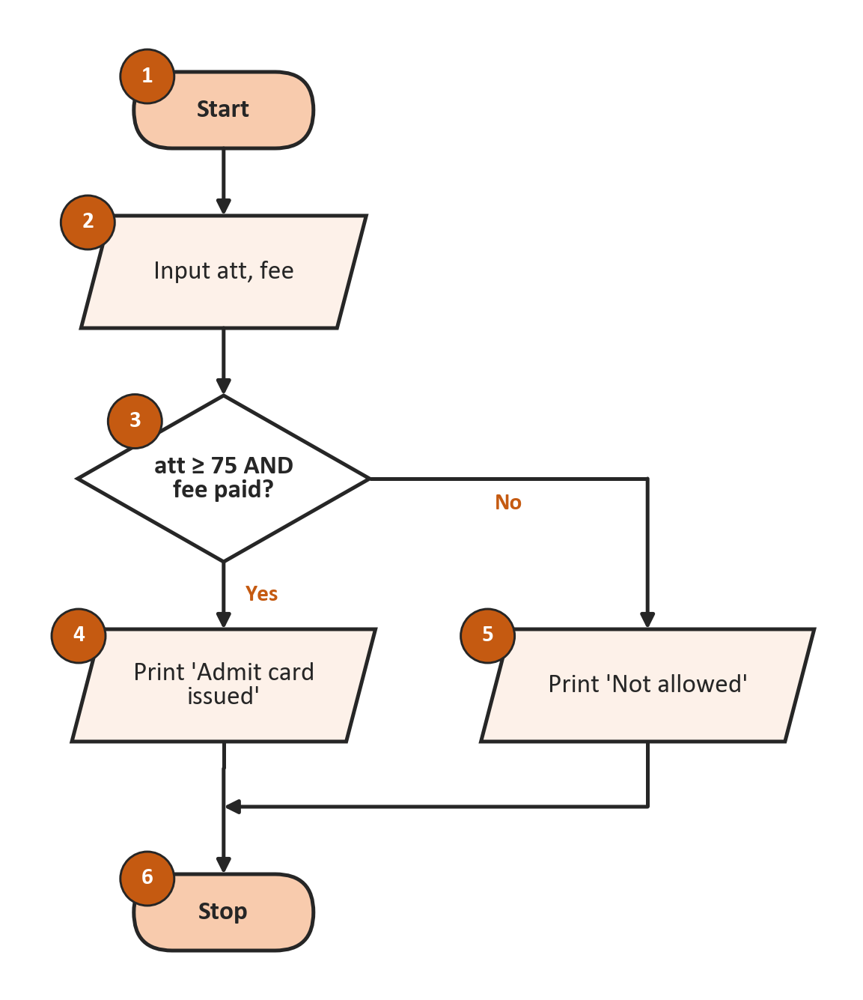
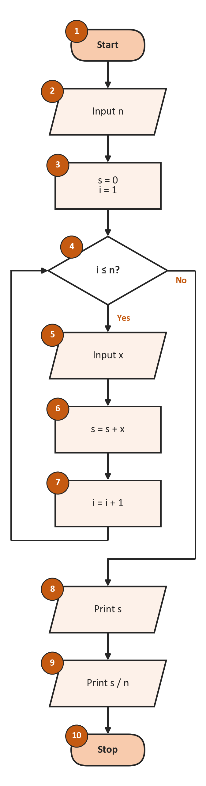
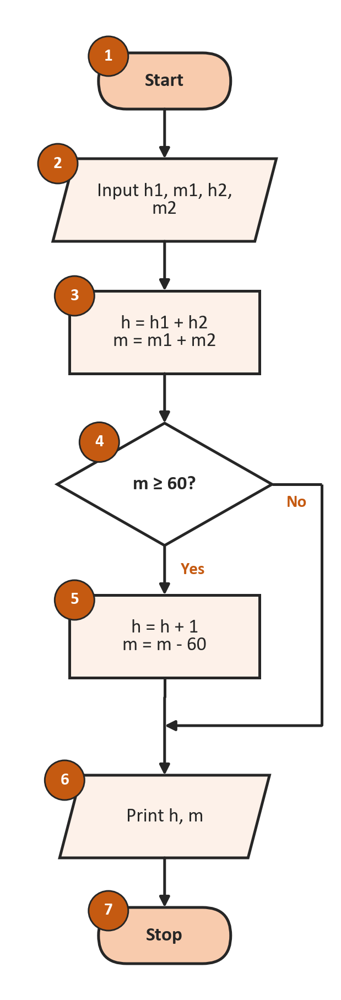

# Chapter 5: Problem Solving: Long-answer questions (12)

*Chapter 5 · Questions (online). Four or five marks each. Try each one first. The difficulty (E easy, M medium, H hard) and the section of the book are given in brackets. Every number on this page was computed and checked by a program (`tools/ch05_typed_questions.py`).*

## Long answers

**Q1.** [4] A student gets an admit card if attendance is at least 75% AND the fee is paid (1 = paid). Draw the flowchart and dry-run it for 75, 1 and 90, 0. *(M · 5.5)*

**Answer.** Inputs att, fee; one decision "att ≥ 75 AND fee paid?"; Yes: "Admit card issued"; No: "Not allowed". Dry runs: 75, 1 → admit card (75 ≥ 75); 90, 0 → not allowed (fee not paid).

{ width="405" }

**Q2.** [5] (i) Write the steps of problem solving for the report-card program. (ii) Give the test data you would use, of each kind, with the expected result. *(M · 5.2)*

**Answer.** (i) Analyse (inputs: 5 marks 0–100; outputs: result and grade); algorithm (W6); code; test; debug; maintain. (ii) Normal 80, 75, 70, 72, 78 → B; extreme 100 ×5 → A and 0 ×5 → Fail; boundary 33 ×5 → D and 32 in one subject → Fail; abnormal −5 or 105 → must be refused.

**Q3.** [5] Explain the five characteristics of an algorithm with the ATM, and give for each a step that breaks it. *(E · 5.3)*

**Answer.** Precision ("a multiple of ₹100"; broken by "give some money"); uniqueness (same inputs, same result; "pay if it feels like it"); finiteness (stops after 3 wrong PINs; "keep asking"); input (card, PIN, amount); output (cash or a message; a step that shows nothing).

**Q4.** [4] Find the GCD and LCM of 1071 and 462 by Euclid's method, showing each division, and explain why the method works. *(H · 5.3)*

**Answer.** 1071 ÷ 462 r 147; 462 ÷ 147 r 21; 147 ÷ 21 r 0: GCD 21; LCM = 1071 × 462 ÷ 21 = 23,562. It works because a number that divides both numbers also divides their difference, so each new pair has the same common divisors and a smaller size.

**Q5.** [4] Draw the six flowchart symbols, name each, and give one common mistake for each. *(E · 5.4)*

**Answer.** Terminal (more than one Start); input/output parallelogram (a rectangle for input); process rectangle (a question in it); decision diamond (only one way out); flow line (an arrow to nowhere); connector (letters that do not match).

**Q6.** [5] Draw a flowchart to input n numbers and print their sum and average. Dry-run it for n = 3 and 4, 5, 6. *(M · 5.5)*

**Answer.** Input n; s = 0, i = 1; while i ≤ n: input x; s = s + x; i = i + 1; then print s and s ÷ n. Dry run: s = 4, 9, 15; prints 15 and 5.0.

{ width="236" }

**Q7.** [4] Write the five-step method and apply it to: "Input the price and quantity; if the bill is over ₹1,000 give 10% off; print the amount." *(M · 5.5)*

**Answer.** Read: given price, quantity; asked the amount. Mark: input, "if" decision, "give" output. List: input price, qty; bill = price × qty; is bill > 1000? Yes: amount = bill − bill × 10 ÷ 100; No: amount = bill; print amount. Draw. Check with 100 × 10 = 1,000 (no discount: boundary) and 200 × 10 = 2,000 (1,800).

**Q8.** [4] Write pseudocode for W9 (1 + x + … + xⁿ) and make its trace table for x = 3, n = 3. *(M · 5.6)*

**Answer.** SET sum = 1, term = 1, i = 1; WHILE i ≤ n: term = term × x; sum = sum + term; INCREMENT i; END WHILE; PRINT sum. Trace: term 3, 9, 27; sum 4, 13, 40; i 2, 3, 4; prints 40.

**Q9.** [5] Compare the four prime tests of section 5.8 for 997 and for 91. Which would you use, and why? *(H · 5.8)*

**Answer.** For 997 (prime): 995, 497, 30 and 25 divisions. For 91: all four stop at 7. Use √n: few divisions and no extra memory; the list method is faster still for small n but needs memory and fails from 10,201.

**Q10.** [4] Explain time and space complexity with two examples from the chapter. *(M · 5.8)*

**Answer.** Time: halving (7 looks for 100) against one by one (100); Euclid (3 divisions) against listing divisors (51 for 30 and 21). Space: the prime list of method (iv); remembering tables against counting on fingers.

**Q11.** [5] Decompose a school annual-day event into parts, draw its structure diagram and say what the parts must agree on. *(M · 5.9)*

**Answer.** Programme (items, rehearsals); stage and sound; invitations and seating; costumes and props; refreshments. They must agree on the date, the timetable and the number of guests.

**Q12.** [4] A train journey has two parts. Draw a flowchart that adds the two times correctly (hours and minutes), and dry-run it for 3 h 45 min + 2 h 15 min. *(M · 5.7)*

**Answer.** Add hours and minutes; if minutes ≥ 60, add 1 to hours and take 60 from minutes. Dry run: h = 5, m = 60; 60 ≥ 60 Yes: h = 6, m = 0: prints 6 h 0 min.

{ width="217" }

