# Chapter 5: Problem Solving: Draw the flowchart (29)

*Chapter 5 · Questions (online). Our own questions, from easy to hard. Each answer is one correct flowchart (others are possible), tested on the inputs shown. Try each one first. The difficulty (E easy, M medium, H hard) and the section of the book are given in brackets. Every number on this page was computed and checked by a program (`tools/ch05_typed_questions.py`).*

## Draw the flowchart

**Q1.** Draw a flowchart and write the pseudocode: Input the radius of a circle; print its area (π = 3.14). *(E · 5.5)*

**Answer.** 

```text
 2  INPUT r
 3  COMPUTE area = 3.14 × r × r
 4  PRINT area
```

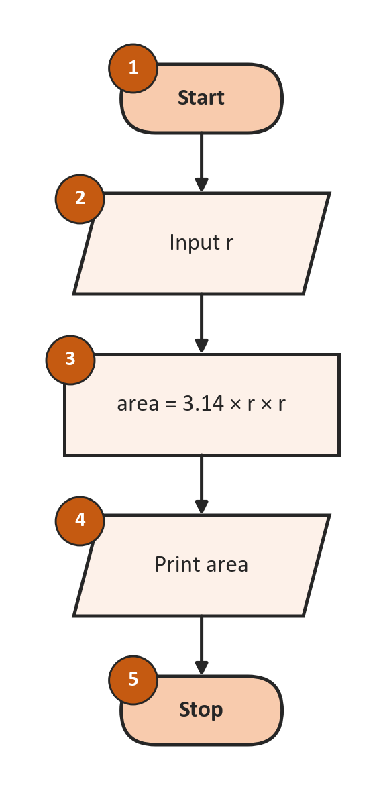{ width="191" }

*Dry runs:* 7 → 153.86; 1 → 3.14.

**Q2.** Draw a flowchart and write the pseudocode: Input the cost price and selling price; print "Profit", "Loss" or "No profit, no loss". *(M · 5.5)*

**Answer.** 

```text
 2  INPUT cp, sp
 3  IF sp > cp THEN
 4      PRINT 'Profit'
    ELSE
 5      IF sp < cp THEN
 6          PRINT 'Loss'
        ELSE
 7          PRINT 'No profit, no loss'
        END IF
    END IF
```

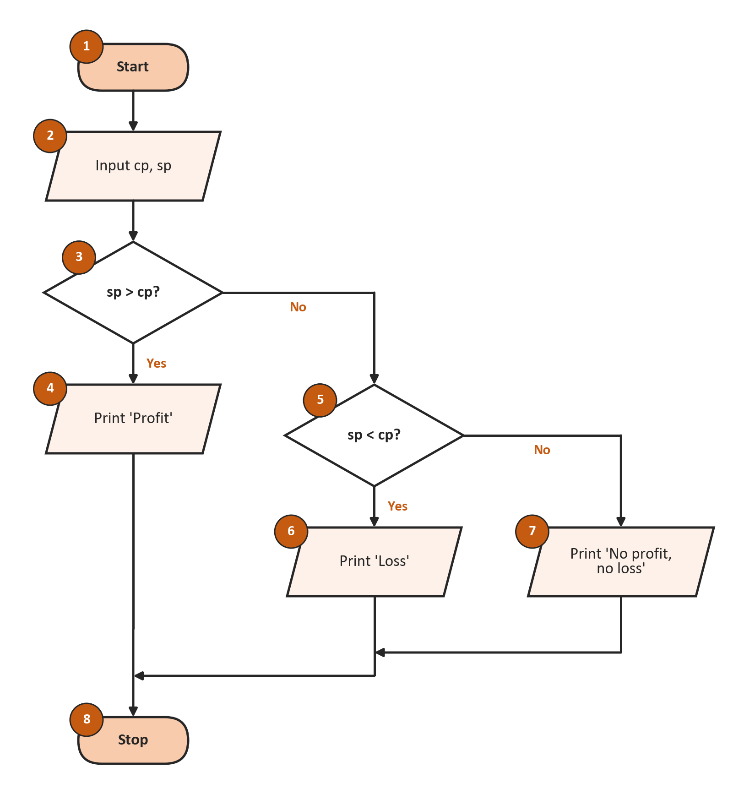{ width="546" }

*Dry runs:* 100, 120 → Profit; 100, 80 → Loss; 50, 50 → No profit, no loss.

**Q3.** Draw a flowchart and write the pseudocode: Input a number; print whether it is divisible by both 3 and 5. *(M · 5.5)*

**Answer.** 

```text
 2  INPUT n
 3  IF n mod 3 = 0 AND n mod 5 = 0 THEN
 4      PRINT 'Divisible by both'
    ELSE
 5      PRINT 'Not divisible by both'
    END IF
```

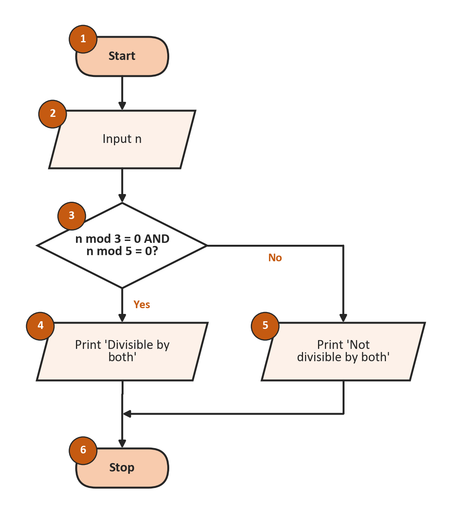{ width="394" }

*Dry runs:* 30 → Divisible by both; 9 → Not divisible by both; 10 → Not divisible by both.

**Q4.** Draw a flowchart and write the pseudocode: Input three sides; print whether they can make a triangle (each side less than the sum of the other two). *(H · 5.5)*

**Answer.** 

```text
 2  INPUT a, b, c
 3  IF a < b + c AND b < a + c AND c < a + b THEN
 4      PRINT 'Triangle'
    ELSE
 5      PRINT 'Not a triangle'
    END IF
```

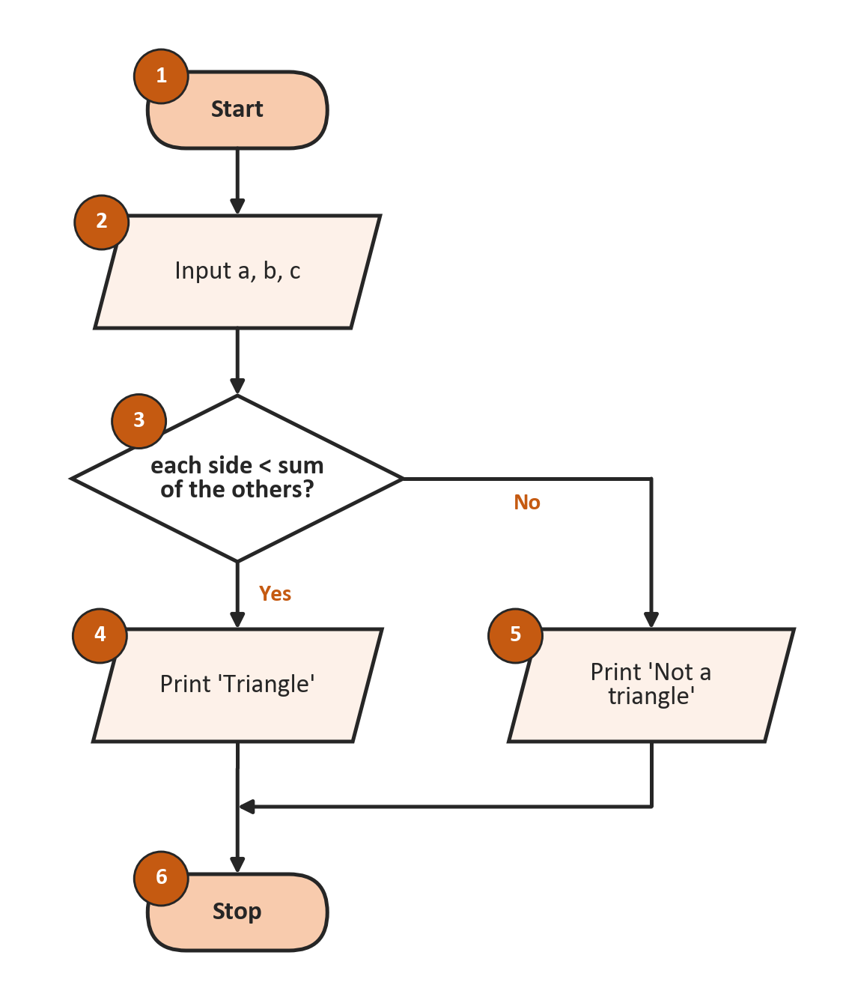{ width="378" }

*Dry runs:* 3, 4, 5 → Triangle; 1, 2, 3 → Not a triangle; 2, 2, 3 → Triangle.

**Q5.** Draw a flowchart and write the pseudocode: Input a percentage; print the division: 60 and above "First", 45 and above "Second", 33 and above "Third", else "Fail". *(M · 5.5)*

**Answer.** 

```text
 2  INPUT p
 3  IF p ≥ 60 THEN
 4      PRINT 'First'
    ELSE
 5      IF p ≥ 45 THEN
 6          PRINT 'Second'
        ELSE
 7          IF p ≥ 33 THEN
 8              PRINT 'Third'
            ELSE
 9              PRINT 'Fail'
            END IF
        END IF
    END IF
```

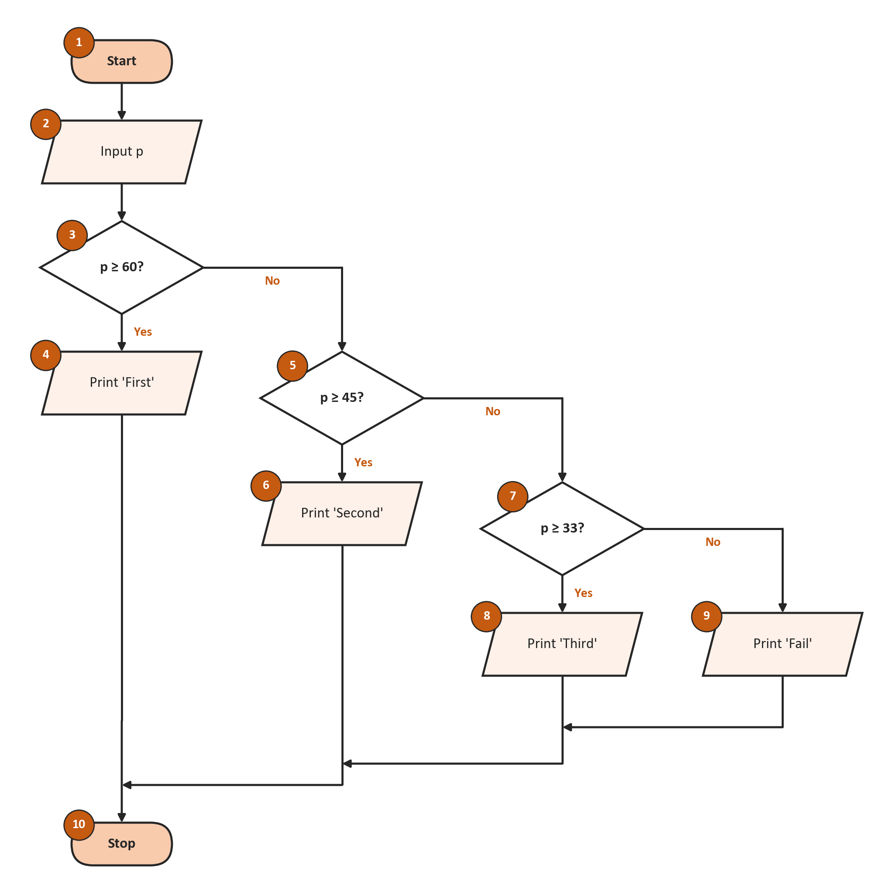{ width="714" }

*Dry runs:* 60 → First; 59 → Second; 33 → Third; 32 → Fail.

**Q6.** Draw a flowchart and write the pseudocode: Input a year of birth and the present year; print the age and whether the person is a senior citizen (60 or more). *(M · 5.5)*

**Answer.** 

```text
 2  INPUT born, now
 3  COMPUTE age = now - born
 4  PRINT age
 5  IF age ≥ 60 THEN
 6      PRINT 'Senior citizen'
    ELSE
 7      PRINT 'Not a senior citizen'
    END IF
```

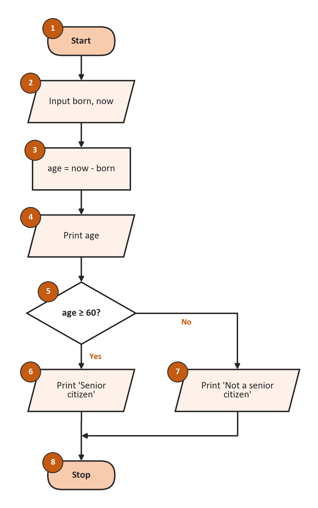{ width="382" }

*Dry runs:* 1960, 2026 → 66 / Senior citizen; 2009, 2026 → 17 / Not a senior citizen.

**Q7.** Draw a flowchart and write the pseudocode: Print the numbers from 1 to n. *(E · 5.5)*

**Answer.** 

```text
 2  INPUT n
 3  SET i = 1
 4  WHILE i ≤ n
 5      PRINT i
 6      INCREMENT i
    END WHILE
```

{ width="226" }

*Dry runs:* 5 → 1 / 2 / 3 / 4 / 5; 1 → 1.

**Q8.** Draw a flowchart and write the pseudocode: Print the odd numbers from 1 to n. *(E · 5.5)*

**Answer.** 

```text
 2  INPUT n
 3  SET i = 1
 4  WHILE i ≤ n
 5      PRINT i
 6      COMPUTE i = i + 2
    END WHILE
```

{ width="226" }

*Dry runs:* 9 → 1 / 3 / 5 / 7 / 9; 10 → 1 / 3 / 5 / 7 / 9.

**Q9.** Draw a flowchart and write the pseudocode: Print the numbers from n down to 1. *(E · 5.5)*

**Answer.** 

```text
 2  INPUT n
 3  WHILE n ≥ 1
 4      PRINT n
 5      DECREMENT n
    END WHILE
```

{ width="226" }

*Dry runs:* 4 → 4 / 3 / 2 / 1; 1 → 1.

**Q10.** Draw a flowchart and write the pseudocode: Input n; print the sum of the even numbers from 2 to n. *(M · 5.5)*

**Answer.** 

```text
 2  INPUT n
 3  SET s = 0, i = 2
 4  WHILE i ≤ n
 5      COMPUTE s = s + i
 6      COMPUTE i = i + 2
    END WHILE
 7  PRINT s
```

{ width="220" }

*Dry runs:* 10 → 30; 7 → 12; 1 → 0.

**Q11.** Draw a flowchart and write the pseudocode: Input n; print the squares 1, 4, 9 … up to n². *(E · 5.5)*

**Answer.** 

```text
 2  INPUT n
 3  SET i = 1
 4  WHILE i ≤ n
 5      PRINT i × i
 6      INCREMENT i
    END WHILE
```

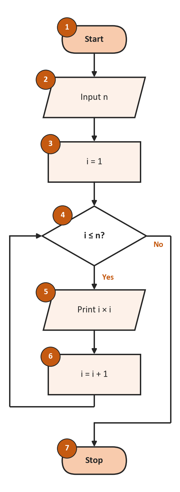{ width="226" }

*Dry runs:* 4 → 1 / 4 / 9 / 16.

**Q12.** Draw a flowchart and write the pseudocode: Input x and n; print xⁿ by repeated multiplication. *(M · 5.5)*

**Answer.** 

```text
 2  INPUT x, n
 3  SET p = 1, i = 1
 4  WHILE i ≤ n
 5      COMPUTE p = p × x
 6      INCREMENT i
    END WHILE
 7  PRINT p
```

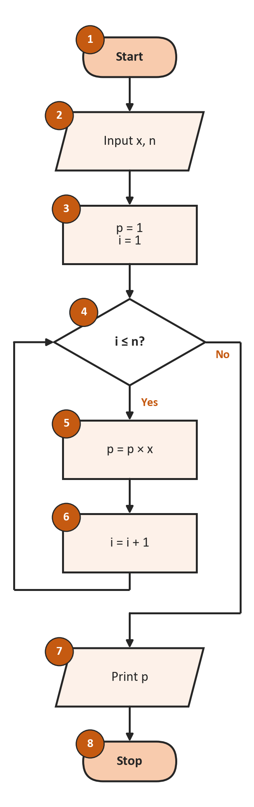{ width="220" }

*Dry runs:* 2, 10 → 1024; 5, 0 → 1; 3, 4 → 81.

**Q13.** Draw a flowchart and write the pseudocode: Input n; print the product 1 × 3 × 5 × … of the odd numbers up to n. *(M · 5.5)*

**Answer.** 

```text
 2  INPUT n
 3  SET p = 1, i = 1
 4  WHILE i ≤ n
 5      COMPUTE p = p × i
 6      COMPUTE i = i + 2
    END WHILE
 7  PRINT p
```

{ width="220" }

*Dry runs:* 7 → 105; 1 → 1.

**Q14.** Draw a flowchart and write the pseudocode: Input a number; print its digits in reverse order, one per line. *(M · 5.5)*

**Answer.** 

```text
 2  INPUT n
 3  WHILE n > 0
 4      PRINT n mod 10
 5      COMPUTE n = n  div  10
    END WHILE
```

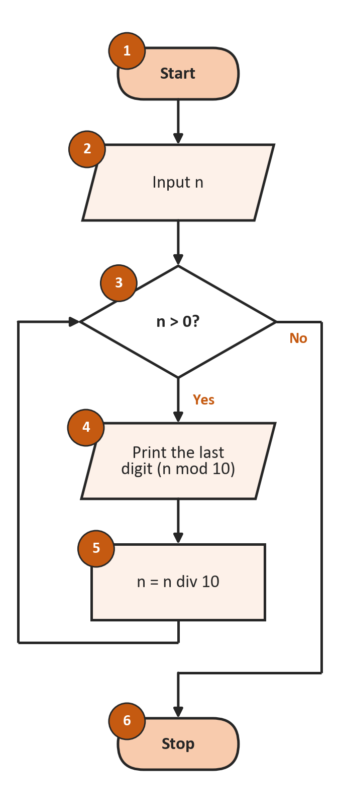{ width="226" }

*Dry runs:* 4096 → 6 / 9 / 0 / 4; 7 → 7.

**Q15.** Draw a flowchart and write the pseudocode: Input a number; print the reverse number (for 1234: 4321). *(H · 5.5)*

**Answer.** 

```text
 2  INPUT n
 3  SET rev = 0
 4  WHILE n > 0
 5      COMPUTE rev = rev × 10 + n mod 10
 6      COMPUTE n = n  div  10
    END WHILE
 7  PRINT rev
```

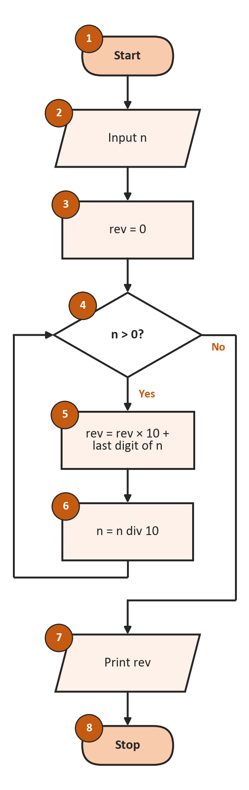{ width="220" }

*Dry runs:* 1234 → 4321; 500 → 5.

**Q16.** Draw a flowchart and write the pseudocode: Input a number; print how many of its digits are even. *(H · 5.5)*

**Answer.** 

```text
 2  INPUT n
 3  SET c = 0
 4  WHILE n > 0
 5      IF n mod 2 = 0 THEN
 6          INCREMENT c
        END IF
 7      COMPUTE n = n  div  10
    END WHILE
 8  PRINT c
```

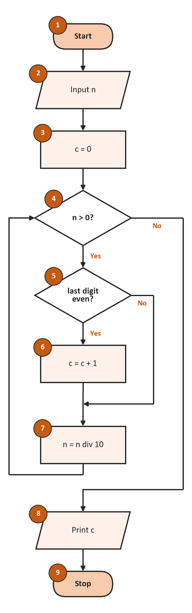{ width="261" }

*Dry runs:* 24680 → 5; 1357 → 0; 1234 → 2.

**Q17.** Draw a flowchart and write the pseudocode: Numbers are typed until 0; print their sum. *(M · 5.5)*

**Answer.** 

```text
 2  SET s = 0
 3  INPUT x
 4  WHILE x ≠ 0
 5      COMPUTE s = s + x
 6      INPUT x
    END WHILE
 7  PRINT s
```

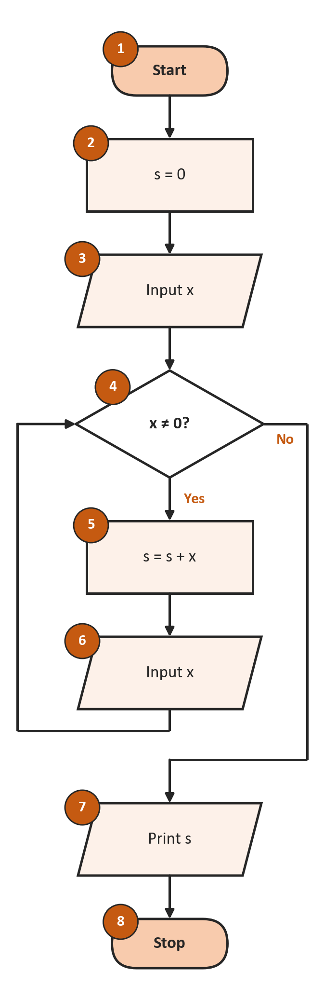{ width="226" }

*Dry runs:* 4, 5, 6, 0 → 15; 0 → 0.

**Q18.** Draw a flowchart and write the pseudocode: Numbers are typed until 0; print how many were negative. *(M · 5.5)*

**Answer.** 

```text
 2  SET c = 0
 3  INPUT x
 4  WHILE x ≠ 0
 5      IF x < 0 THEN
 6          INCREMENT c
        END IF
 7      INPUT x
    END WHILE
 8  PRINT c
```

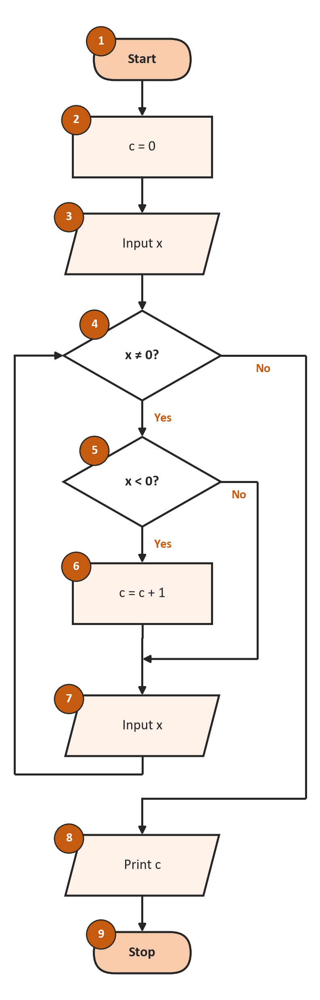{ width="266" }

*Dry runs:* 4, -5, -6, 0 → 2; 0 → 0.

**Q19.** Draw a flowchart and write the pseudocode: Numbers are typed until 0; print the smallest (the first is not 0). *(M · 5.5)*

**Answer.** 

```text
 2  INPUT x
 3  COMPUTE small = x
 4  WHILE x ≠ 0
 5      IF x < small THEN
 6          COMPUTE small = x
        END IF
 7      INPUT x
    END WHILE
 8  PRINT small
```

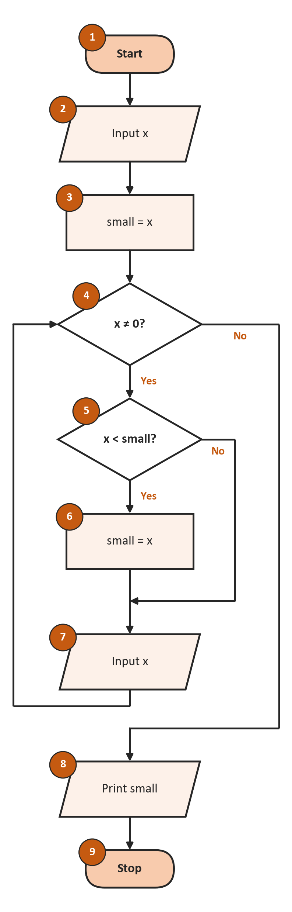{ width="266" }

*Dry runs:* 4, 9, 2, 0 → 2; 5, 0 → 5.

**Q20.** Draw a flowchart and write the pseudocode: Input a PIN; allow up to 3 tries for the PIN 1234; print "Welcome" or "Locked". *(H · 5.5)*

**Answer.** 

```text
 2  SET tries = 0, ok = 0
 3  WHILE tries < 3 AND ok = 0
 4      INPUT pin
 5      IF pin = 1234 THEN
 6          SET ok = 1
        ELSE
 7          INCREMENT tries
        END IF
    END WHILE
 8  IF ok = 1 THEN
 9      PRINT 'Welcome'
    ELSE
10      PRINT 'Locked'
    END IF
```

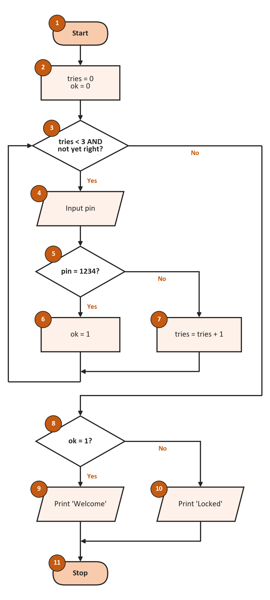{ width="397" }

*Dry runs:* 1111, 1234 → Welcome; 1, 2, 3 → Locked; 1234 → Welcome.

**Q21.** Draw a flowchart and write the pseudocode: Input marks until a valid mark (0 to 100) is typed; then print it. *(H · 5.5)*

**Answer.** 

```text
 2  INPUT m
 3  WHILE m < 0 OR m > 100
 4      PRINT 'Invalid, type again'
 5      INPUT m
    END WHILE
 6  PRINT m
```

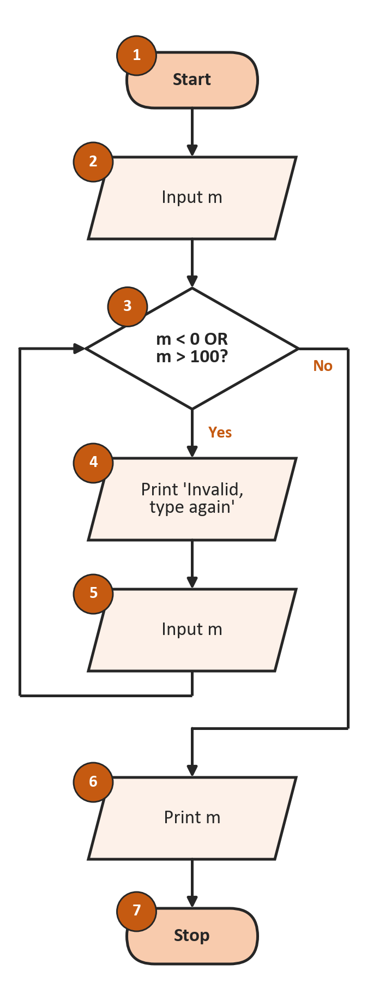{ width="226" }

*Dry runs:* 105, -3, 67 → Invalid, type again / Invalid, type again / 67; 50 → 50.

**Q22.** Draw a flowchart and write the pseudocode: Input n; print the multiplication tables of 1 to n, each up to 3 (1 × 1 … n × 3). *(H · 5.5)*

**Answer.** 

```text
 2  INPUT n
 3  SET i = 1
 4  WHILE i ≤ n
 5      SET j = 1
 6      WHILE j ≤ 3
 7          PRINT str(i) + ' x ' + str(j) + ' = ' + str(i × j)
 8          INCREMENT j
        END WHILE
 9      INCREMENT i
    END WHILE
```

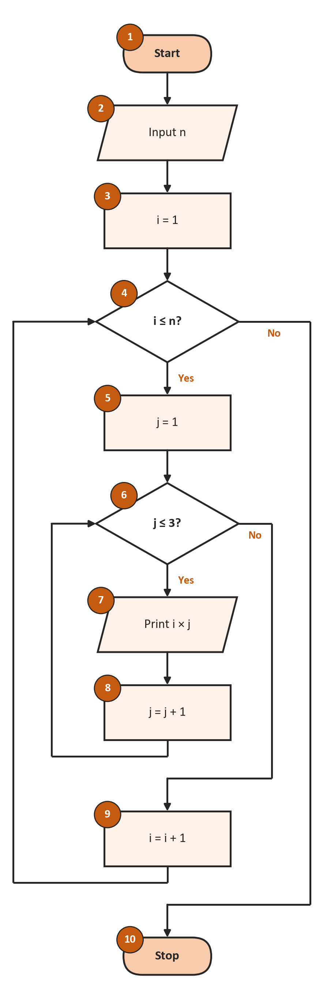{ width="296" }

*Dry runs:* 2 → 1 x 1 = 1 / 1 x 2 = 2 / 1 x 3 = 3 / 2 x 1 = 2 / 2 x 2 = 4 / 2 x 3 = 6.

**Q23.** Draw a flowchart and write the pseudocode: Print the pattern 1, 22, 333 … for n rows. *(H · 5.5)*

**Answer.** 

```text
 2  INPUT n
 3  SET i = 1
 4  WHILE i ≤ n
 5      SET row = '', j = 1
 6      WHILE j ≤ i
 7          COMPUTE row = row + str(i)
 8          INCREMENT j
        END WHILE
 9      PRINT row
10      INCREMENT i
    END WHILE
```

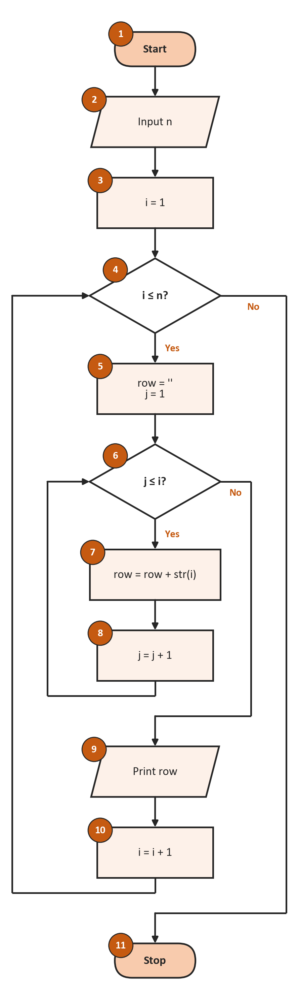{ width="298" }

*Dry runs:* 4 → 1 / 22 / 333 / 4444.

**Q24.** Draw a flowchart and write the pseudocode: Input n; print the sum of the digits of every number from 1 to n (for 12: 1 + … + 9 + 1 + 2 + 1 + 3 = 51). *(H · 5.5)*

**Answer.** 

```text
 2  INPUT n
 3  SET s = 0, i = 1
 4  WHILE i ≤ n
 5      COMPUTE t = i
 6      WHILE t > 0
 7          COMPUTE s = s + t mod 10, COMPUTE t = t  div  10
        END WHILE
 8      INCREMENT i
    END WHILE
 9  PRINT s
```

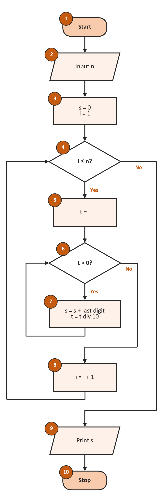{ width="298" }

*Dry runs:* 12 → 51; 9 → 45.

**Q25.** Draw a flowchart and write the pseudocode: Input a number; print "Single digit", "Two digits" or "More than two digits" (for a positive number). *(E · 5.5)*

**Answer.** 

```text
 2  INPUT n
 3  IF n < 10 THEN
 4      PRINT 'Single digit'
    ELSE
 5      IF n < 100 THEN
 6          PRINT 'Two digits'
        ELSE
 7          PRINT 'More than two digits'
        END IF
    END IF
```

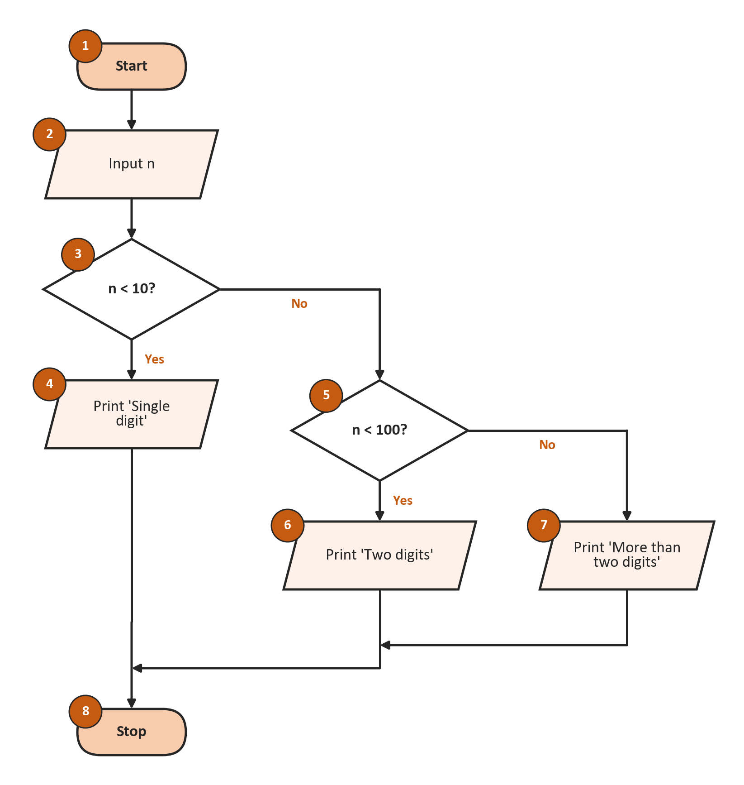{ width="552" }

*Dry runs:* 7 → Single digit; 42 → Two digits; 100 → More than two digits.

**Q26.** Draw a flowchart and write the pseudocode: Input the units of water used; ₹2 a unit for the first 50, ₹4 for the next 50, ₹8 after that. Print the bill. *(H · 5.5)*

**Answer.** 

```text
 2  INPUT u
 3  IF u ≤ 50 THEN
 4      COMPUTE bill = u × 2
    ELSE
 5      IF u ≤ 100 THEN
 6          COMPUTE bill = 100 + (u - 50) × 4
        ELSE
 7          COMPUTE bill = 300 + (u - 100) × 8
        END IF
    END IF
 8  PRINT bill
```

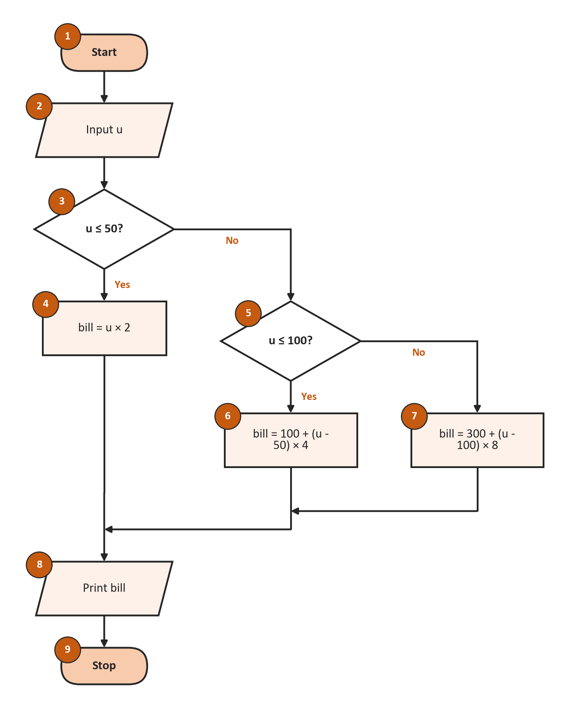{ width="531" }

*Dry runs:* 40 → 80; 50 → 100; 80 → 220; 120 → 460.

**Q27.** Draw a flowchart and write the pseudocode: Input two numbers; swap them using a third variable and print them. *(E · 5.5)*

**Answer.** 

```text
 2  INPUT a, b
 3  COMPUTE t = a, COMPUTE a = b, COMPUTE b = t
 4  PRINT str(a) + ' ' + str(b)
```

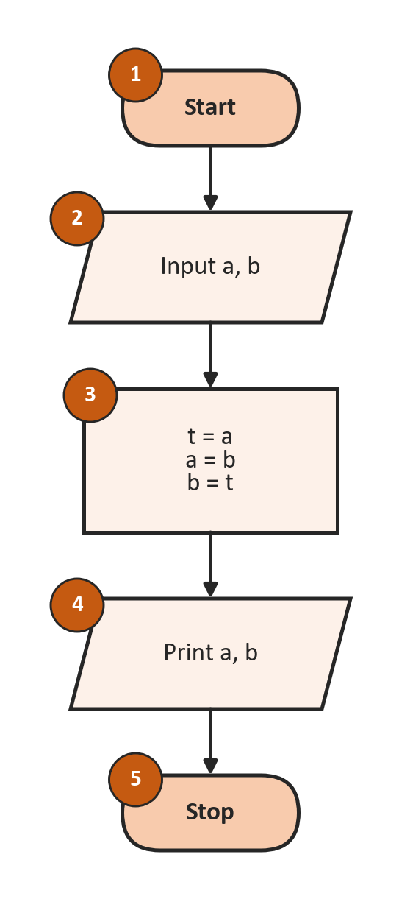{ width="182" }

*Dry runs:* 3, 8 → 8 3.

**Q28.** Draw a flowchart and write the pseudocode: Input the length of a side; print the perimeter and area of a square. *(E · 5.5)*

**Answer.** 

```text
 2  INPUT s
 3  COMPUTE p = 4 × s, COMPUTE area = s × s
 4  PRINT str(p) + ' ' + str(area)
```

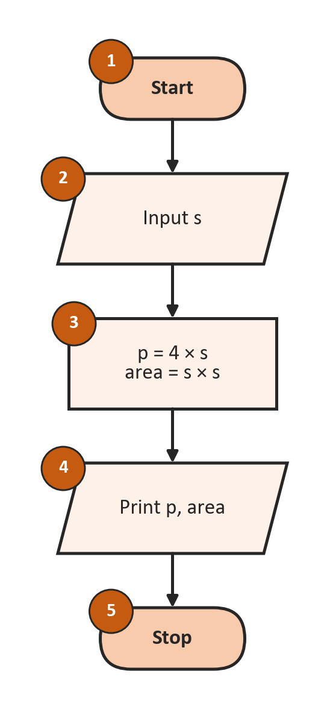{ width="182" }

*Dry runs:* 5 → 20 25.

**Q29.** Draw a flowchart and write the pseudocode: Input n; print "Prime" or "Not prime" by dividing up to √n (n ≥ 2). *(H · 5.8)*

**Answer.** 

```text
 2  INPUT n
 3  SET d = 2, f = 0
 4  WHILE d × d ≤ n AND f = 0
 5      IF n mod d = 0 THEN
 6          SET f = 1
        END IF
 7      INCREMENT d
    END WHILE
 8  IF f = 0 THEN
 9      PRINT 'Prime'
    ELSE
10      PRINT 'Not prime'
    END IF
```

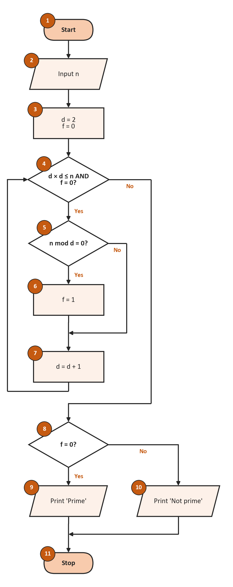{ width="384" }

*Dry runs:* 97 → Prime; 91 → Not prime; 2 → Prime; 4 → Not prime.

