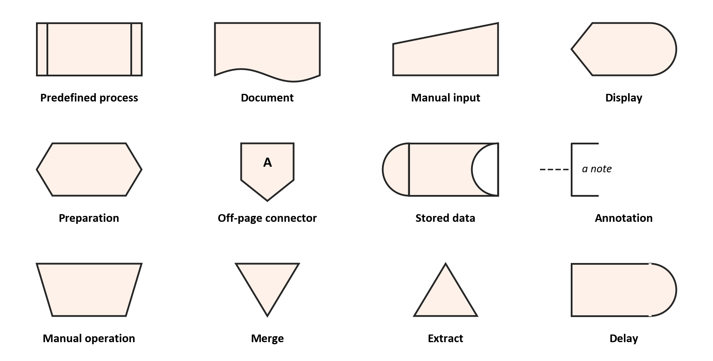

# Sometimes asked: More flowchart symbols

*Chapter 5 · Sometimes asked. The printed book (section 5.4) teaches the six symbols the syllabus needs. The international standard ISO 5807 has more. A few of them turn up in some school papers and books; none is needed to answer a CBSE question.*

*Every number on this page was computed by a program (`tools/ch05_pages2.py`) and checked.*

{ width="720" }

| Symbol | Used for | Example |
|---|---|---|
| Predefined process | a step whose details are written somewhere else (a sub-program) | "Find the grade (see chart 2)" |
| Document | a printed report or slip | "Print the receipt" |
| Manual input | data typed by hand at that moment | "Enter the PIN" |
| Display | a result shown on a screen | "Show the balance" |
| Preparation | setting up a counted loop | "i = 1 to 10" (some books draw FOR loops with it) |
| Off-page connector | the chart goes on to another page | (A) on page 1 → (A) on page 2 |
| Stored data | data kept in a file or a database | "Bank accounts" |
| Annotation | a note that explains a box; not a step | "PIN: 4 digits" |
| Manual operation | a step done by a person, not the computer | "Count the cash by hand" |
| Merge | several lists or flows joined into one | joining two class lists |
| Extract | taking some items out of a set | "Pick the students above 75" |
| Delay | waiting | "Wait 30 seconds for the card" |

**In the exam:** draw only the six symbols of the syllabus (terminal, input/output, process, decision, flow line,
connector). Input and output are both the parallelogram there, even when the input is typed by hand and the output
is shown on a screen.

## Connectors: when a flowchart does not fit

A long flowchart can be cut into pieces joined by **connectors**: a small circle with the same letter at the end of
one piece and the start of the next. An **on-page** connector (circle) joins pieces on the same page; an
**off-page** connector (the five-sided shape above) joins pieces on different pages. Each letter is used for one
join only.

## Why the shapes are what they are

- The **parallelogram** leans, like data sliding in or out.
- The **diamond** has corners for the ways out: one way in, Yes and No out.
- The **terminal** is rounded, so it can never be mistaken for a step.
- The **document** has a torn, wavy bottom, like a sheet torn off a printer.
