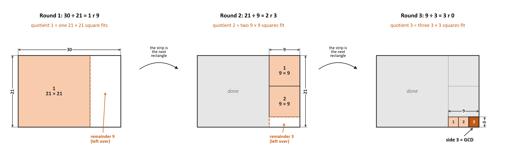
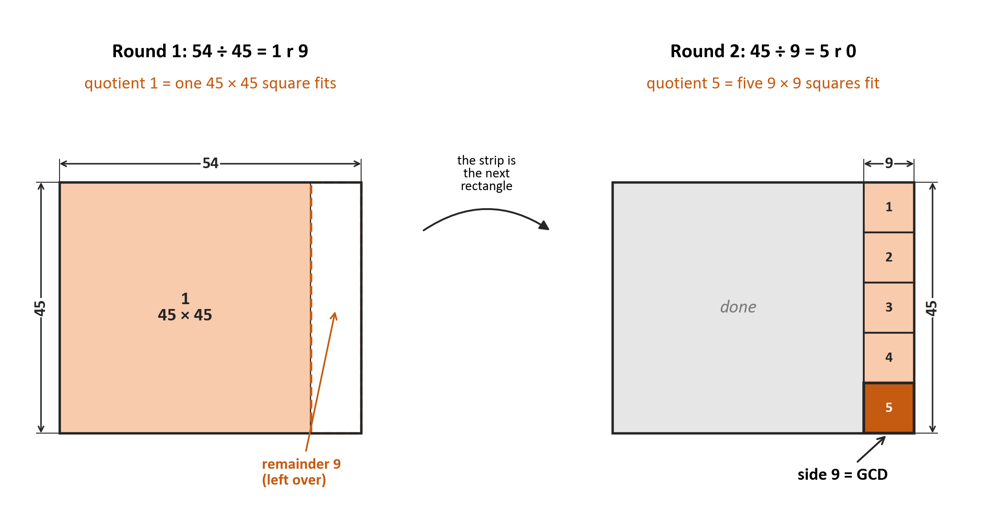
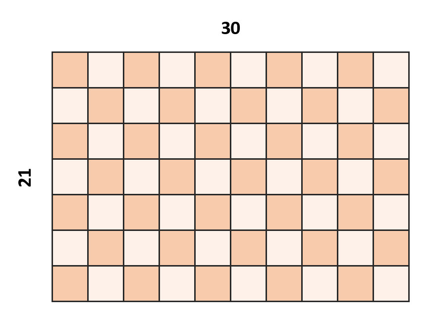
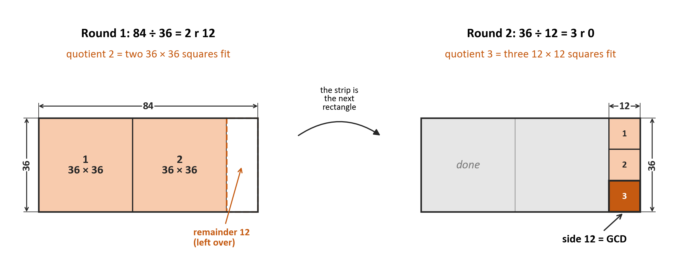
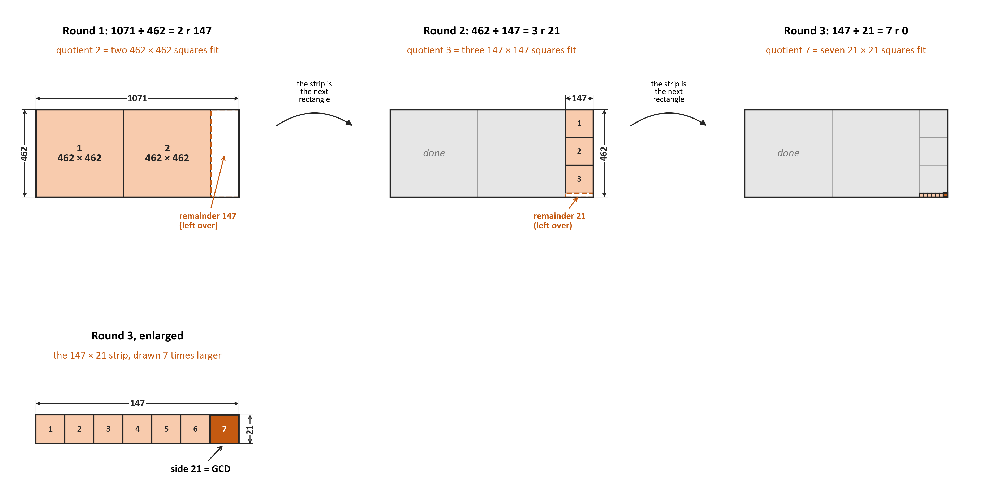
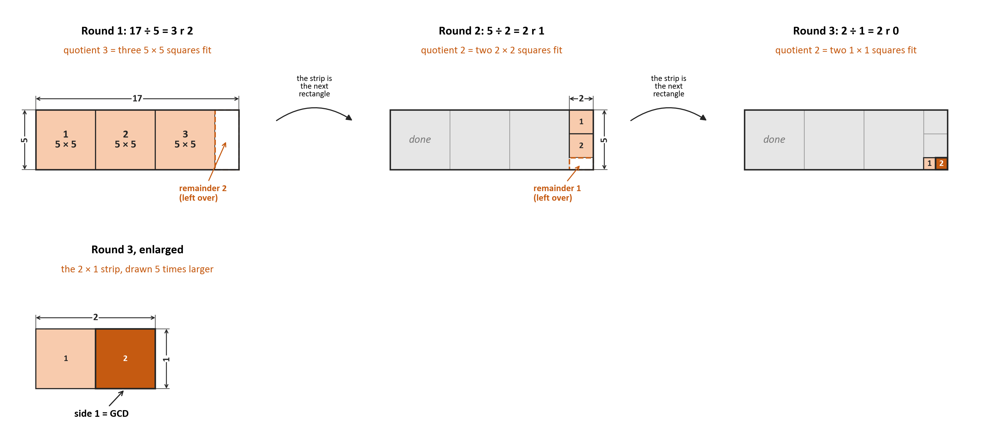
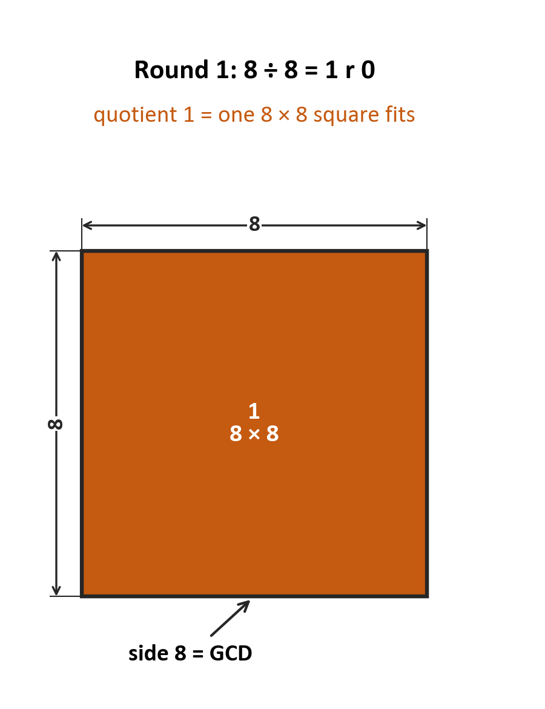
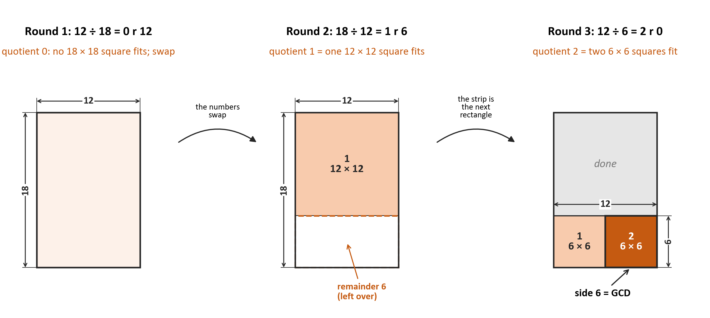
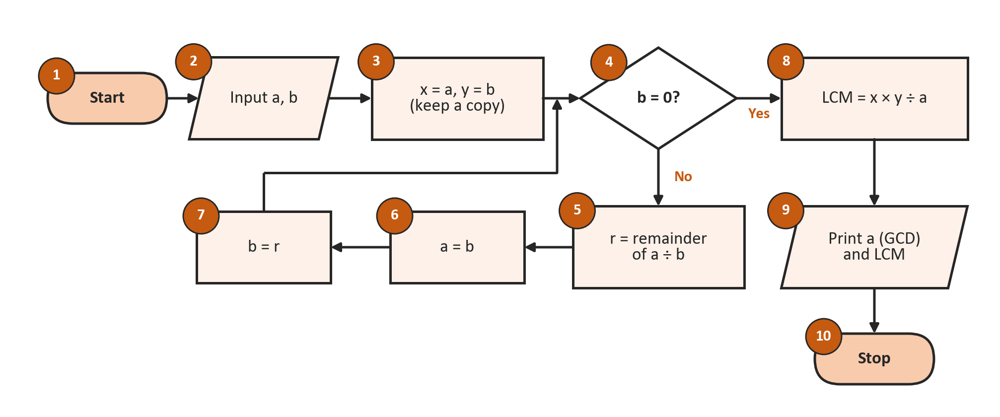

# Step by step: Euclid's GCD

*Chapter 5 · Step by step. The printed book (section 5.3 and worked example W8) shows Euclid's method for 30 and 21 in one tile picture. This page shows every round, for seven pairs of numbers, with a picture of each round, and explains why the method always gives the right answer.*

*Every number on this page was computed by a program (`tools/ch05_pages.py`) and checked.*

## 1. The idea in one line

> **Divide the larger number by the smaller. Then divide the last divisor by the last remainder, again and again,
> until the remainder is 0. The last divisor (the last remainder that was not 0) is the GCD.**

The **GCD** (greatest common divisor, also called the HCF, highest common factor) of two numbers is the largest number
that divides both of them exactly. Euclid of Alexandria wrote this method down about 2,300 years ago, and every phone
still uses it (for example, inside the arithmetic that keeps online payments secret).

## 2. The tile picture: what one division means

Think of a floor **30 units long and 21 units wide** that must be covered with **square tiles, all of the same size, as
large as possible, with no tile cut**. The side of the largest such tile is the GCD of 30 and 21.

Euclid's method finds it by cutting squares. All three pictures are drawn to the **same scale**, so a 9 × 9 square
really is smaller than the 21 × 21 square:

{ width="720" }

| Round | Divide | Quotient | Remainder | Next pair |
|:-:|:-:|:-:|:-:|:-:|
| 1 | 30 ÷ 21 | 1 | **9** | (21, 9) |
| 2 | 21 ÷ 9 | 2 | **3** | (9, 3) |
| 3 | 9 ÷ 3 | 3 | **0** | (3, 0) : stop, the remainder is 0 |

- **Round 1.** 30 ÷ 21 = 1, remainder 9: the largest square that fits is 21 × 21, and **one** of it fits.
  A strip **9 wide** is left over (white, dashed).
- **Round 2.** Now only that strip, 21 by 9, is left. 21 ÷ 9 = 2, remainder 3: **two** squares of 9 × 9 fit, and a
  strip **3 tall** is left over.
- **Round 3.** The strip is 9 by 3. 9 ÷ 3 = 3, remainder 0: **three** squares of 3 × 3 fill it exactly.
- Nothing is left, so we stop. The last square has side **3**, so **GCD (30, 21) = 3**.

*Reading the pictures:* the numbers on the arrows are the lengths of the sides. The squares of each round are numbered
1, 2, 3 … because the **quotient is a count**: how many squares fit. The white dashed strip is the **remainder**, and
the curved arrow shows that it becomes the next rectangle. Grey, marked "done", is what earlier rounds already cut.

### A pair that finishes in two rounds: 54 and 45

The remainder can become 0 sooner. For 54 and 45, five 9 × 9 squares fill the first strip exactly:

{ width="720" }

| Round | Divide | Quotient | Remainder | Next pair |
|:-:|:-:|:-:|:-:|:-:|
| 1 | 54 ÷ 45 | 1 | **9** | (45, 9) |
| 2 | 45 ÷ 9 | 5 | **0** | (9, 0) : stop, the remainder is 0 |

**GCD (54, 45) = 9**; LCM = 54 × 45 ÷ 9 = **270**.

## 3. Why does it work?

Two facts are enough.

1. **A number that divides both 30 and 21 also divides their difference, 30 − 21 = 9.** If 30 and 21 are both made of
   3's, then taking 21 away from 30 leaves a number made of 3's too.
2. **A number that divides both 21 and 9 also divides 30**, because 30 = 21 + 9.

So the pair (30, 21) and the pair (21, 9) have **exactly the same common divisors**, and so has the next pair (9, 3):
the program found all three to be 1, 3. Their largest is the same, so
GCD (30, 21) = GCD (21, 9) = GCD (9, 3) = 3.

Each round replaces the pair by a smaller pair with the same GCD. The numbers keep getting smaller, so the method must
stop, and when the remainder is 0, the last divisor divides the one before it exactly: it is the GCD.

*A division is only quick subtraction:* 21 ÷ 9 = 2 r 3 is "take 9 away from 21 twice". 1071 ÷ 462 = 2 r 147 is "take
462 away twice". That is why fact 1 (about the difference) is enough.

In the tile picture: a 3 × 3 tile covers the whole floor exactly, **10 across and 7 up**, so 3 divides both 30 and 21.
No larger square can: a 4 × 4 or 5 × 5 tile does not fit 21 exactly, and neither does anything else above 3.

{ width="417" }

## 4. More pairs, round by round

### 84 and 36

The pair in the printed Check yourself: two rounds.

{ width="720" }

| Round | Divide | Quotient | Remainder | Next pair |
|:-:|:-:|:-:|:-:|:-:|
| 1 | 84 ÷ 36 | 2 | **12** | (36, 12) |
| 2 | 36 ÷ 12 | 3 | **0** | (12, 0) : stop, the remainder is 0 |

**GCD (84, 36) = 12**; LCM = 84 × 36 ÷ 12 = **252**.

### 1071 and 462

Three rounds with large numbers. The 21 × 21 squares of the last round are tiny at this scale, so a fourth picture shows the last strip enlarged.

{ width="720" }

| Round | Divide | Quotient | Remainder | Next pair |
|:-:|:-:|:-:|:-:|:-:|
| 1 | 1071 ÷ 462 | 2 | **147** | (462, 147) |
| 2 | 462 ÷ 147 | 3 | **21** | (147, 21) |
| 3 | 147 ÷ 21 | 7 | **0** | (21, 0) : stop, the remainder is 0 |

**GCD (1071, 462) = 21**; LCM = 1071 × 462 ÷ 21 = **23,562**.

### 17 and 5

The GCD can be 1: then the two numbers have no common factor except 1 (they are *co-prime*).

{ width="720" }

| Round | Divide | Quotient | Remainder | Next pair |
|:-:|:-:|:-:|:-:|:-:|
| 1 | 17 ÷ 5 | 3 | **2** | (5, 2) |
| 2 | 5 ÷ 2 | 2 | **1** | (2, 1) |
| 3 | 2 ÷ 1 | 2 | **0** | (1, 0) : stop, the remainder is 0 |

**GCD (17, 5) = 1**; LCM = 17 × 5 ÷ 1 = **85**.

### 8 and 8

Equal numbers: one round, and the GCD is the number itself.

{ width="432" }

| Round | Divide | Quotient | Remainder | Next pair |
|:-:|:-:|:-:|:-:|:-:|
| 1 | 8 ÷ 8 | 1 | **0** | (8, 0) : stop, the remainder is 0 |

**GCD (8, 8) = 8**; LCM = 8 × 8 ÷ 8 = **8**.

### 12 and 18

The smaller number first. Round 1 gives quotient 0 and simply swaps the numbers, so you need not put the larger number first: the method does it for you.

{ width="720" }

| Round | Divide | Quotient | Remainder | Next pair |
|:-:|:-:|:-:|:-:|:-:|
| 1 | 12 ÷ 18 | 0 | **12** | (18, 12) |
| 2 | 18 ÷ 12 | 1 | **6** | (12, 6) |
| 3 | 12 ÷ 6 | 2 | **0** | (6, 0) : stop, the remainder is 0 |

**GCD (12, 18) = 6**; LCM = 12 × 18 ÷ 6 = **36**.

## 5. The flowchart (worked example W8) and every step of it

The printed flowchart, with its numbered boxes. Box 3 keeps a copy of a and b (as x and y), because the loop changes a
and b, and the LCM needs the original numbers.

{ width="720" }

The book prints the walk-through for a = 30, b = 21. Here it is for **a = 1071, b = 462**, every step, nothing left out:

| Step (box) | Pseudocode | What happens |
|:-:|---|---|
| 1 | `START` | begin |
| 2 | `INPUT a, b` | a = 1071, b = 462 |
| 3 | `SET x = a, y = b` | x = 1071, y = 462 |
| 4 | `WHILE b ≠ 0` | 462 = 0? No |
| 5 | `COMPUTE r = remainder of a ÷ b` | r = 147 |
| 6 | `SET a = b` | a = 462 |
| 7 | `SET b = r` | b = 147 |
| 4 | `WHILE b ≠ 0` | 147 = 0? No |
| 5 | `COMPUTE r = remainder of a ÷ b` | r = 21 |
| 6 | `SET a = b` | a = 147 |
| 7 | `SET b = r` | b = 21 |
| 4 | `WHILE b ≠ 0` | 21 = 0? No |
| 5 | `COMPUTE r = remainder of a ÷ b` | r = 0 |
| 6 | `SET a = b` | a = 21 |
| 7 | `SET b = r` | b = 0 |
| 4 | `WHILE b ≠ 0` | 0 = 0? Yes |
| 8 | `COMPUTE LCM = x × y ÷ a` | 1071 × 462 ÷ 21 = 23562 |
| 9 | `PRINT a, LCM` | prints 21 23562 |
| 10 | `STOP` | end |

The loop (boxes 4 to 7) ran three times, once for each round of the table in section 4.

## 6. Why not just list the divisors?

Listing every divisor of both numbers and picking the largest common one also works, but it needs one trial division
for every number from 1 up to each number. Euclid needs one division per round.

| Numbers | Trial divisions to list all divisors | Divisions by Euclid |
|:-:|:-:|:-:|
| 30 and 21 | 51 | 3 |
| 54 and 45 | 99 | 2 |
| 84 and 36 | 120 | 2 |
| 1,071 and 462 | 1,533 | 3 |
| 987 and 610 | 1,597 | 14 |
| 1,00,000 and 75,000 | 1,75,000 | 2 |

*Beyond the syllabus:* 987 and 610 are two neighbouring numbers of the Fibonacci series (… 377, 610, 987 …), and such
pairs are the slowest of all for Euclid. Even so, it needs only 14 divisions.

## 7. The LCM from the GCD

**LCM = a × b ÷ GCD.** For 30 and 21: 30 × 21 = 630, and 630 ÷ 3 = **210**.

*Check:* 210 ÷ 30 = 7 and 210 ÷ 21 = 10, both exact, so 210 is a common multiple; and the program tried every number
below 210: none is a multiple of both.

*Why it works:* 30 = 3 × 10 and 21 = 3 × 7. The product 30 × 21 = 3 × 10 × 3 × 7 counts the common part, 3, **twice**;
dividing by the GCD once leaves 3 × 10 × 7 = 210, which has each part just once.

## 8. Common mistakes

| Mistake | Why it is wrong | Right |
|---|---|---|
| Stopping when the remainder is 0 and giving **0** (or the last quotient) as the GCD | 0 is what tells you to stop; it is not the answer | the **last divisor** (the last non-zero remainder) |
| Dividing the remainder by the divisor (9 ÷ 21) | the roles must move one place to the left each round | divide the **last divisor** by the **last remainder** (21 ÷ 9) |
| Giving the GCD when the LCM is asked | the GCD is the largest common **divisor**, the LCM the smallest common **multiple** | LCM = a × b ÷ GCD |
| Forgetting to keep a and b for the LCM in the flowchart | the loop changes a and b | keep copies first (box 3 of W8) |

## 9. Try it yourself

**Find the GCD and LCM of 48 and 18.**

??? success "Answer"
    48 ÷ 18 = 2 r 12; 18 ÷ 12 = 1 r 6; 12 ÷ 6 = 2 r 0. **GCD = 6**, LCM = 48 × 18 ÷ 6 = **144**.

**Find the GCD and LCM of 391 and 299.**

??? success "Answer"
    391 ÷ 299 = 1 r 92; 299 ÷ 92 = 3 r 23; 92 ÷ 23 = 4 r 0. **GCD = 23**, LCM = 391 × 299 ÷ 23 = **5,083**.

**Find the GCD and LCM of 35 and 64.**

??? success "Answer"
    35 ÷ 64 = 0 r 35; 64 ÷ 35 = 1 r 29; 35 ÷ 29 = 1 r 6; 29 ÷ 6 = 4 r 5; 6 ÷ 5 = 1 r 1; 5 ÷ 1 = 5 r 0. **GCD = 1**, LCM = 35 × 64 ÷ 1 = **2,240**.

