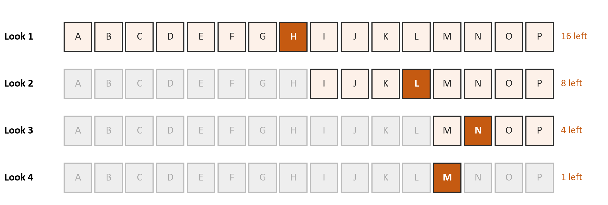
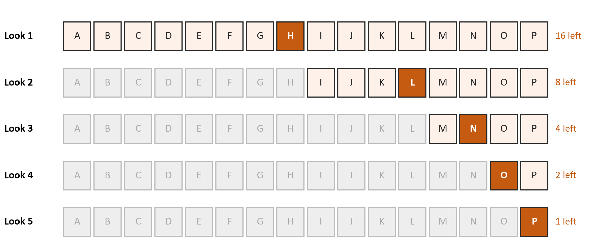

# Step by step: Halving search, step by step

*Chapter 5 · Step by step. The printed book (section 5.8) finds M among 16 names in 4 looks by halving. This page draws every look, shows why 100 contacts need at most 7 looks, and plays the guessing game.*

*Every number on this page was computed by a program (`tools/ch05_pages2.py`) and checked.*

## 1. The rule

> **Open the middle of what is left. If it is the one you want, stop. If what you want comes after it, keep the
> half after it; if before, keep the half before it. Repeat.**

It works only when the list is **in order**, like the contacts in a phone or the words in a dictionary.

## 2. Finding M among A to P

The orange box is the middle, the one opened at that look; the grey boxes have been thrown away.

{ width="720" }

| Look | Names left | Middle | Compare | Keep |
|:-:|:-:|:-:|---|---|
| 1 | A to P (16) | H | M comes after H | I to P |
| 2 | I to P (8) | L | M comes after L | M to P |
| 3 | M to P (4) | N | M comes before N | M to M |
| 4 | M to M (1) | M | M = M: found | — |

One by one (A, B, C … M), the same search takes **13** looks.

## 3. Every letter: one by one vs halving

| Name | A | B | C | D | E | F | G | H | I | J | K | L | M | N | O | P |
|---|:-:|:-:|:-:|:-:|:-:|:-:|:-:|:-:|:-:|:-:|:-:|:-:|:-:|:-:|:-:|:-:|
| One by one | 1 | 2 | 3 | 4 | 5 | 6 | 7 | 8 | 9 | 10 | 11 | 12 | 13 | 14 | 15 | 16 |
| Halving | 4 | 3 | 4 | 2 | 4 | 3 | 4 | 1 | 4 | 3 | 4 | 2 | 4 | 3 | 4 | 5 |

Halving never needs more than **5** looks for 16 names; one by one needs up to 16. On average: 8.5 looks one by one, 3.375 by halving. *Why 5 and not 4?* After 4 looks one name is left, and for some names (P, for example) the 5th look is needed to open it.

{ width="720" }

## 4. Why 100 contacts need 7 looks, 1,000 need 10, 1,00,000 need 17

Each look can deal with one name and splits the rest in two halves. So **k looks are enough for 2ᵏ − 1 names**: 1 look for 1 name, 2 looks for 3, 3 looks for 7, and the number almost doubles with every look.

| Looks k | Names that k looks can always handle (2ᵏ − 1) |
|:-:|:-:|
| 1 | 1 |
| 2 | 3 |
| 3 | 7 |
| 4 | 15 |
| 5 | 31 |
| 6 | 63 |
| 7 | 127 |
| 8 | 255 |
| 9 | 511 |
| 10 | 1,023 |
| 11 | 2,047 |
| 12 | 4,095 |
| 13 | 8,191 |
| 14 | 16,383 |
| 15 | 32,767 |
| 16 | 65,535 |
| 17 | 1,31,071 |

So 100 contacts need **7** (6 looks handle only 63), 1,000 need **10** (2¹⁰ − 1 = 1,023), and 1,00,000 need **17** (2¹⁷ − 1 = 1,31,071). The program also searched for thousands of names in lists of these sizes: none needed more.

## 5. The guessing game: a number from 1 to 100

A friend thinks of a number from 1 to 100 and answers only "higher", "lower" or "right". Guess the middle every time:

| Secret | Guesses | Number of guesses |
|:-:|---|:-:|
| 37 | 50, 25, 37 | 3 |
| 50 | 50 | 1 |
| 1 | 50, 25, 12, 6, 3, 1 | 6 |
| 100 | 50, 75, 88, 94, 97, 99, 100 | 7 |
| 73 | 50, 75, 62, 68, 71, 73 | 6 |

The program played all 100 secrets: never more than **7** guesses.

## 6. Halving needs a list in order

In the list K, B, P, D, A (not in order), look for A: the middle is P; A comes before P, so keep K, B … and A is
thrown away with the other half. **Halving on a list that is not in order can miss a name that is there.** One by
one works on any list.

## 7. Try it yourself

**Guess 81 in 1 to 100 by halving. Write every guess.**

??? success "Answer"
    50, 75, 88, 81: 4 guesses.

**At most how many looks find a word in a dictionary of 50,000 words?**

??? success "Answer"
    16: 15 looks can always handle only 32,767 words, which is fewer than 50,000; 16 looks handle 65,535.

