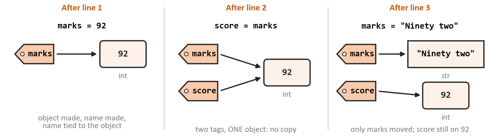
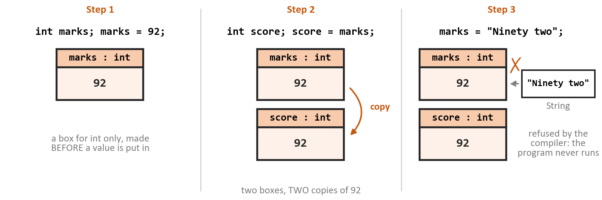

# Compare: Python and Java, step by step

*Chapter 6 · Compare. The printed section 6.7 explains static and dynamic typing in words. This page shows the same four lines in Python and in Java, one step at a time, with the real answers of Python and of the Java compiler. You do not need to learn Java: read its lines for the idea.*

## The program in Python

```python
marks = 92
score = marks
marks = "Ninety two"
print(score, marks)
```

Output:

```text
92 Ninety two
```

After each line, every name and the object it is tied to:

{ width="720" }

- **Line 1** makes the object 92 (an `int`), makes the name `marks` and ties it to the object.
- **Line 2** makes **no new object**: `score` is tied to the same 92. One object, two tags.
- **Line 3** makes a new object, the string, and moves only the tag `marks` to it. `score` stays on 92.

You can watch this happen with `id()` (the identity of an object) and `type()`:

```python
marks = 92
score = marks
print(id(score) == id(marks))
marks = "Ninety two"
print(id(score) == id(marks))
print(type(score), type(marks))
```

Output:

```text
True
False
<class 'int'> <class 'str'>
```

The first `True`: after line 2, both names share one object. The `False`: after line 3, `marks` has moved. And `type()` reports the type of the **object**; the names have none.

## The same steps in Java

In Java, a variable is a **box with a type**. Each step below was compiled with the Java compiler (JDK 21); the messages are the compiler's own, shortened to their first line.

| Step | Java | What happens | Python, for comparison |
|---|---|---|---|
| 1 | `int marks;` | a **declaration**: a box for whole numbers is made, before any value exists | no such step: a name exists only when it is tied to an object |
| 2 | `marks = 92;` | 92 is put into the box | `marks = 92` makes the object and the name and ties them |
| 3 | `score = marks;` before `int score;` | refused: `error: cannot find symbol` | no declaration needed |
| 4 | `int score;` then `score = marks;` | a second box; a **copy** of 92 is put into it | a second **tag** on the **same** object; nothing is copied |
| 5 | `marks = "Ninety two";` | refused before the program runs: `error: incompatible types: String cannot be converted to int` | allowed: `marks` simply moves to a string |
| 6 | `score = "Ninety two";` | refused in the same way | allowed |

{ width="720" }

**Two boxes, two copies.** In Java, after `score = marks;` the boxes are separate. This complete Java program changes `marks` afterwards and prints both:

```java
int marks;
marks = 92;
int score;
score = marks;
marks = 95;
System.out.println(score + " " + marks);
```

Output (compiled and run):

```text
92 95
```

`score` kept its own copy, 92. In Python the end result for numbers looks the same (`score` stays 92), but for a different reason: nothing was copied; only the tag `marks` moved.

**A name with no value.** Java can declare a box and leave it empty; using it is refused by the compiler: `error: variable marks might not have been initialized`. In Python a name cannot exist without an object, so a name never given a value is a `NameError` when its line runs: `print(marks + bonus)` gives `NameError: name 'bonus' is not defined`.

## In one table

| Basis of difference | Java (static typing) | Python (dynamic typing) |
|---|---|---|
| What a variable is | a box with a type | a name (tag) tied to an object |
| Declaration | needed before use: `int marks;` | none |
| `score = marks` | copies the value into a second box | ties a second tag to the same object |
| Wrong type later | refused by the compiler, before the program runs | allowed: the tag moves |
| Name used before a value | compiler error | `NameError` when the line runs |
| Who checks types, and when | the compiler, before running | Python, while running |

C and C++ work like Java here. The printed chapter puts this in one sentence: *in Java the type belongs to the box; in Python it belongs to the object.*

[Back to Chapter 6](index.md)
