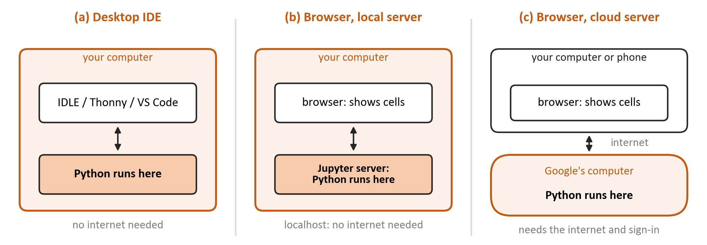

# Explained: Where does my code run?

*Chapter 6 · Explained. Table 6.3 in the printed chapter sorts the tools into three kinds. Here is what each kind means, drawn, and what it needs. (This page follows the author's comparison of programming environments in his *Python Programming* (2026), rewritten for Class XI.)*

{ width="691" }

| Kind | Where your code runs | Example tools | Install? | Internet? | Typical use |
|---|---|---|:-:|:-:|---|
| **Desktop IDE** | your own computer | IDLE, Thonny, VS Code, PyCharm | yes | no | learning; the practical exam; projects |
| **Browser-based, local server** | a server program on **your own** computer; the browser only shows the cells | Jupyter Notebook, JupyterLab | yes (Jupyter) | no | notebooks without the internet; data work |
| **Browser-based, cloud server** | a computer of the provider, far away | Google Colab, Replit, Deepnote | no | **yes** | practice anywhere; sharing with a teacher |

## Two words explained

- **Server**: a program that waits for requests and answers them. A Jupyter server waits for "run this cell", runs it
  in Python and sends back the output. It can be on your own computer ("local server", reached at `localhost`) or on
  another computer far away.
- **Cloud**: computers in the provider's data centres, reached through the internet. When you use Colab, your typing
  travels to Google's computer, Python runs there, and only the output comes back to your screen.

## Why it matters

| Question | Desktop IDE | Local server | Cloud |
|---|---|---|---|
| Works when the internet is down? | yes | yes | no |
| Your files are kept | on your computer | on your computer | in your Google Drive (or the provider's store) |
| Works on a phone or a cheap laptop? | needs Python installed | needs Python installed | yes: only a browser |
| Used in the practical exam? | **yes (IDLE)** | no | no |

**Privacy note (Chapter 16).** Whatever you type in a cloud tool is stored by its provider. Do not paste passwords,
phone numbers or other private data into a notebook you share.
