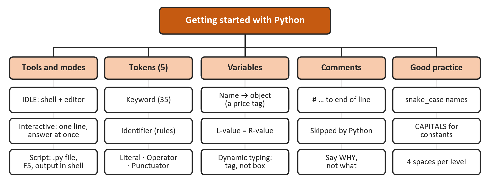
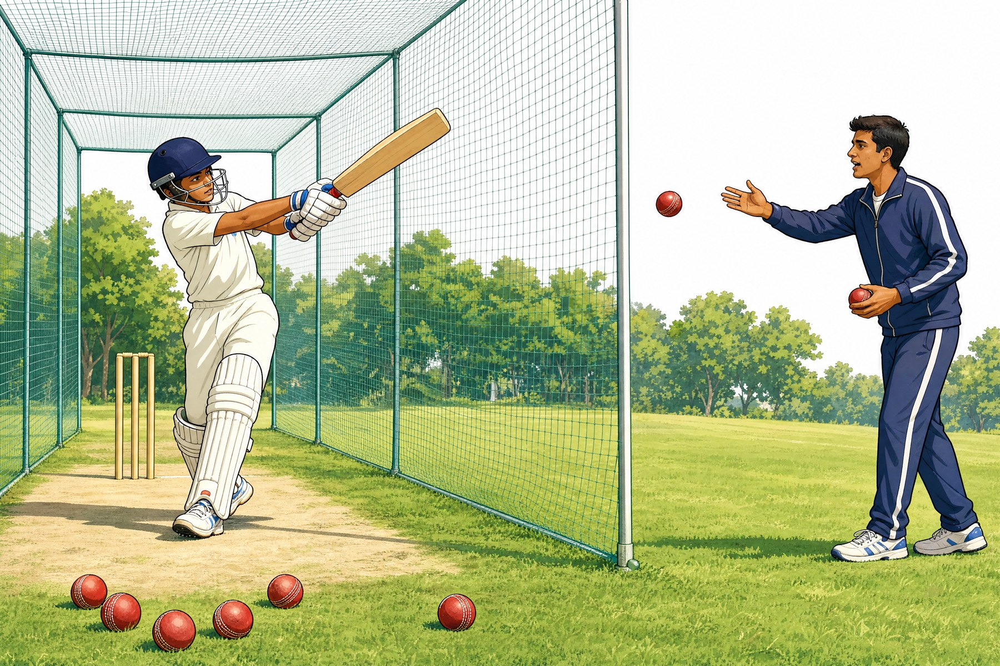
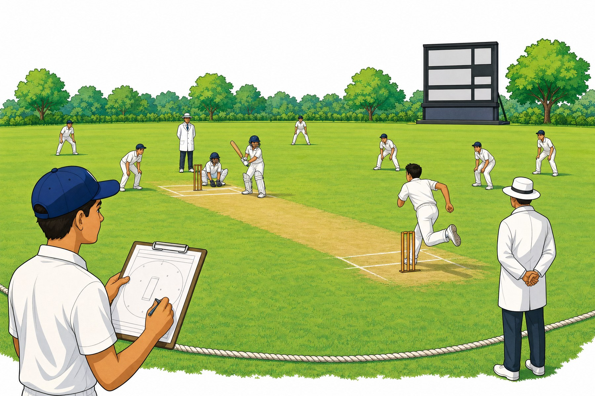
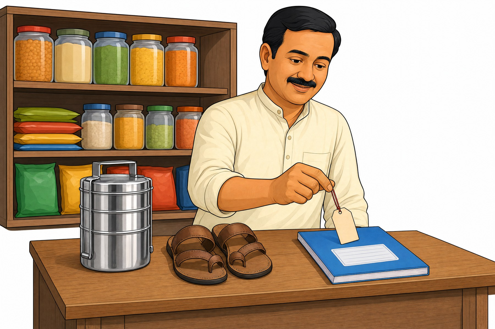
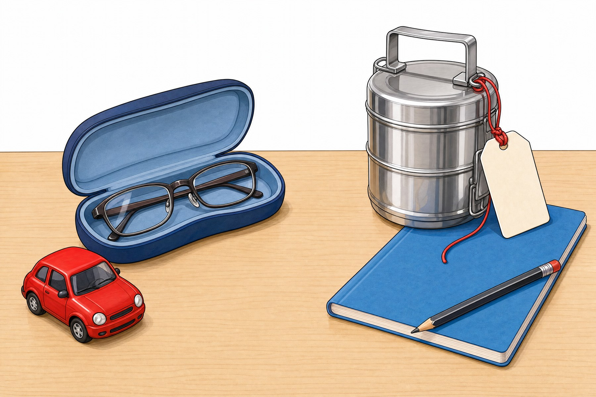

# Chapter 6: Getting Started with Python

The online pages of Chapter 6 of *Computer Science with Python, CBSE Class XI*. The label under each QR code in the printed book says what you will find:

- **Helps you understand**: more explanation of a topic of the book;
- **Explained**, **Step by step**: a topic in full, with every step;
- **Good practice**: not in the syllabus, but what every good programmer does (and examiners reward);
- **See it**: interactive: type, choose, press and watch;
- **Sometimes asked**: beyond the syllabus wording, but set now and then in school papers;
- **Practice**, **Revise**: questions with answers, notebooks, the cheat sheet, flashcards and the glossary.

| Page | Label | Section of the book |
|---|---|---|
| [Python's story and versions](helps-story-and-versions.md) | Helps you understand | 6.1 |
| [Python's limits](helps-python-limits.md) | Helps you understand | 6.1 |
| [Set up Python (install, IDLE, Colab, VS Code, Jupyter, problems: the Get started section)](set-up-python.md) | Step by step | 6.2 |
| [AI assistants: learn first](good-practice-ai-assistants.md) | Good practice | 6.2 |
| [Interactive or script?](see-it-interactive-or-script.md) | See it | 6.3 |
| [Reading an error message](explained-reading-an-error-message.md) | Explained | 6.3 |
| [Statements over several lines](helps-statements-over-several-lines.md) | Helps you understand | 6.3 |
| [Token explorer](see-it-token-explorer.md) | See it | 6.4 |
| [All 35 keywords](helps-all-35-keywords.md) | Helps you understand | 6.5 |
| [Identifier checker, and variable vs identifier](see-it-identifier-checker.md) | See it | 6.5 |
| [PEP 8 for Class XI, and what a PEP is](good-practice-pep8-and-peps.md) | Good practice | 6.5 |
| [Literals up close](sometimes-asked-literals-up-close.md) | Sometimes asked | 6.6 |
| [Names and objects, step by step](see-it-names-and-objects.md) | See it | 6.7 |
| [Python and Java, step by step](compare-python-and-java.md) | Compare | 6.7 |
| [Strong and weak typing: Python and JavaScript](compare-strong-and-weak-typing.md) | Compare | 6.7 |
| [Tricky assignments and None](practice-tricky-assignments-and-none.md) | Practice | 6.7 |
| [Notes for people](good-practice-notes-for-people.md) | Good practice | 6.8 |
| [Four Colab notebooks](practice-colab-notebooks.md) | Practice | the whole chapter |
| [Chapter 6 cheat sheet (printable A4)](revise-cheat-sheet.md) | Revise | the whole chapter |
| [320 questions with answers, by type](questions/index.md) | Practice | the whole chapter |
| [Flashcards](flashcards.md) and [glossary](glossary.md) | Revise | the whole chapter |

Every output, error message and answer on these pages was made by running Python, and the interactive pages were tested against Python itself.

## Concept map

{ width="720" }

## Full-colour pictures

Large full-colour versions of the pictures of the printed chapter, and two more.

**Interactive mode is like the nets** (section 6.3): one ball, one shot, and you know at once.

**Script mode is like a match** (section 6.3): played from start to end, from a plan, and kept on record.

**A variable is a price tag** (section 6.7): the tag is not the thing, and it can be tied to another thing.

**Box or tag?** (section 6.7): a spectacles case takes one kind of thing only (C++, Java); a price tag can be tied to anything (Python).

**Swapping two drinks** (section 6.7): you cannot pour lassi into the nimbu paani; you need an empty third glass first.

