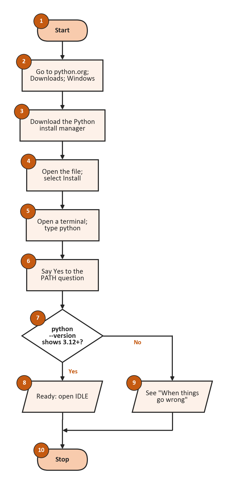
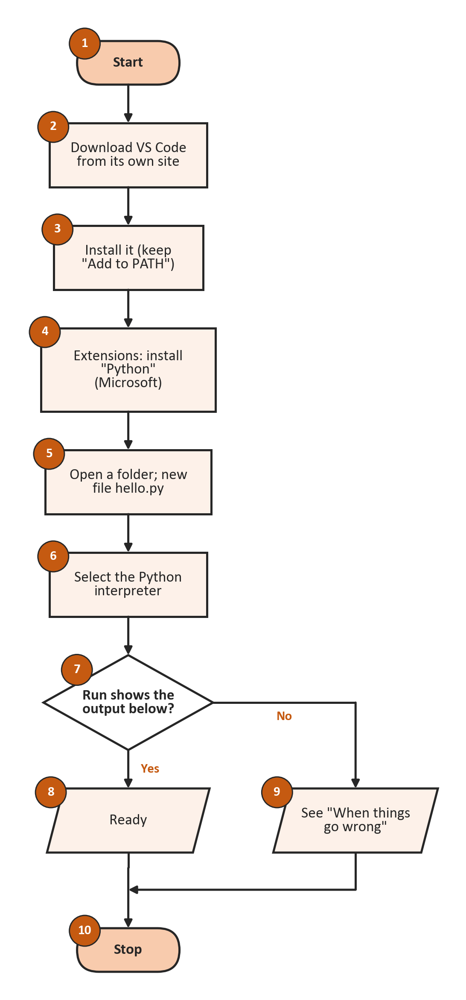
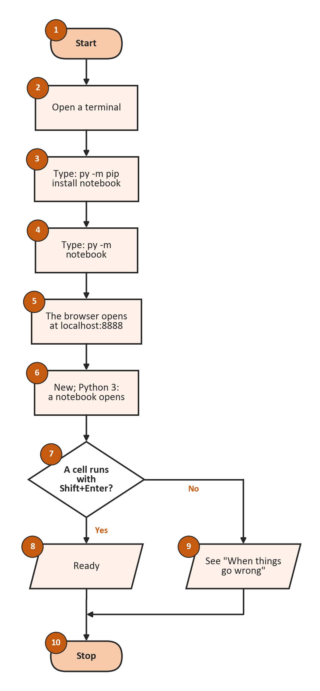

# Step by step: Install Python, VS Code and Jupyter on Windows

*Chapter 6 · Step by step. The printed chapter shows five tools in one table. Here are the three installs, each as numbered steps and as a flowchart with the same numbers. Google Colab needs no install: only a Google sign-in.*

!!! warning "Cyber link (Chapter 18)"
    Download only from the makers' own sites: **python.org**, **code.visualstudio.com**. "Free Python" or "Python
    setup" files on other sites can carry malware.

## 1. Python itself

Since Python 3.14 the makers recommend the **Python install manager**, a small program that installs Python and keeps
it up to date. (The older full installer, a `.exe` with an "Add python.exe to PATH" box on its first screen, is still
offered for Python 3.15 and earlier, and stops with 3.16.) The same install manager is also in the Microsoft Store.

1. Start.
2. Go to python.org; Downloads; Windows.
3. Download the Python install manager.
4. Open the file; select Install.
5. Open a terminal; type python.
6. Say Yes to the PATH question.
7. python --version shows 3.12+? Yes: go to 8. No: go to 9.
8. Ready: open IDLE; go to 10.
9. See "When things go wrong".
10. Stop.

{ width="348" }

**What "PATH" means.** PATH is the list of folders where Windows looks for a command. If Python's folder is on the list,
typing `python` in any terminal finds it; if not, Windows says it does not know the command. Saying **Yes** to the PATH
question saves trouble later.

**Starting IDLE.** Search for **IDLE** in the Start menu. If it is not there, type this in a terminal; it opens IDLE too:

```text
py -m idlelib
```

## 2. VS Code, for bigger projects

1. Start.
2. Download VS Code from its own site.
3. Install it (keep "Add to PATH").
4. Extensions: install "Python" (Microsoft).
5. Open a folder; new file hello.py.
6. Select the Python interpreter.
7. Run shows the output below? Yes: go to 8. No: go to 9.
8. Ready; go to 10.
9. See "When things go wrong".
10. Stop.

{ width="349" }

**Selecting the interpreter** tells VS Code which Python to use: press **Ctrl+Shift+P**, type `Python: Select
Interpreter`, and choose the Python you installed in part 1. VS Code itself does not run Python; it hands your file
to that Python, and the output appears in the **terminal** panel at the bottom.

## 3. Jupyter Notebook, for notebooks without the internet

1. Start.
2. Open a terminal.
3. Type: py -m pip install notebook.
4. Type: py -m notebook.
5. The browser opens at localhost:8888.
6. New; Python 3: a notebook opens.
7. A cell runs with Shift+Enter? Yes: go to 8. No: go to 9.
8. Ready; go to 10.
9. See "When things go wrong".
10. Stop.

{ width="344" }

**What these commands mean.**

- `pip` is Python's own installer for extra packages; `py -m pip install notebook` asks it to fetch Jupyter Notebook.
- `py -m notebook` starts a small **Jupyter server** on your own computer and opens your browser at
  `http://localhost:8888`. "localhost" means *this computer*: nothing leaves it.
- Keep the terminal window open while you work; closing it stops the server.

## 4. Google Colab: no install

Open **colab.research.google.com** in a browser and sign in with a Google account. Your code runs on Google's
computers, and your notebooks are saved in your Google Drive (folder *Colab Notebooks*). The page "Five places to write
Python" shows how to use it.

## Anaconda: you may hear of it

**Anaconda** is a large "distribution": Python plus hundreds of extra packages, Jupyter and the Spyder editor, in one
download. Scientists like it. **For Class XI we do not recommend it**: it is a very large download, school labs and the
practical exam use the Python from python.org, and it installs a **second** Python beside the first, so a beginner may
not know which one is running.
